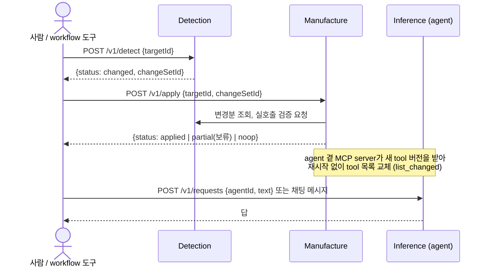
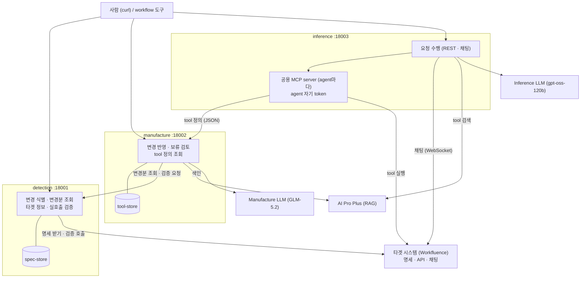

# aiagent4workfluence

> **타겟 시스템의 기능 변화를 동적으로, 거의 실시간으로 받아들이는 AI agent**
>
> 타겟의 API가 바뀌면 사람이 코드를 고치거나 다시 배포하지 않아도, agent가 쓰는 tool이 몇 분 안에 바뀐 API에 맞춰진다.

타겟 시스템의 API 명세를 지켜보고(Detection), 바뀐 만큼 tool을 다시 만들고(Manufacture), 그 tool로 사람의 요청을 수행하는(Inference) agent 3종이다. 첫 타겟은 사내 위키 Workfluence다.

## 왜 만들었나

**타겟 시스템이 빠르게 바뀐다.** 기능이 자주 더해지고 바뀌는 시스템에 AI agent를 붙이면, 보통은 API가 바뀔 때마다 사람이 agent의 tool 코드를 고치고, 시험하고, 다시 배포해야 한다. 그 사이 agent는 낡은 tool로 일하거나 멈춘다.

이 프로젝트는 그 일을 agent가 스스로 하게 만든다.

- 타겟이 명세를 바꾸면 Detection이 무엇이 바뀌었는지 동작 단위로 찾는다.
- Manufacture가 바뀐 동작의 tool만 다시 만들고, 타겟 시험 환경에서 실제로 불러 검증한 뒤 내놓는다.
- Inference의 agent는 다시 시작하지 않고 새 tool 목록을 받아 바로 쓴다.

tool은 코드가 아니라 **JSON 정의**다. 그래서 tool이 더해지거나 바뀌어도 코드·이미지 빌드·재배포가 없다.

### 실제 사례: 타겟 기능 추가가 agent에 들어오기까지

2026-10-16, Workfluence가 스페이스·페이지·댓글 목록에 "만든 사람" 조건과 칸을 새로 배포했다(명세 16개 동작 변경). 그 뒤 일어난 일이다.

| 단계 | 걸린 시간 | 결과 |
|---|---|---|
| Detection 변경 식별 `POST /v1/detect` | 수 초 | 바뀐 동작 16개, 사람 검토 필요 표시 |
| Manufacture 변경 반영 `POST /v1/apply` | 6초 | tool 13개를 새로 만들고 시험 환경 실호출 검증 13/13 통과, 보류(검토 대기) |
| 사람 승인 → 정리 반영 | 3초 | tool 버전 `tv-000006` 서빙, RAG 색인 13건 갱신 |
| agent가 새 tool 받기 | 1분 안 (`MCP_REFRESH_SECONDS=60`) | 재시작 없이 36개 tool 교체 |
| 채팅에서 "네가 만든 스페이스 목록 알려줘" | — | agent가 새 조건 `createdBy=aiagent`로 불러 정답 |

코드 수정은 없었다. Manufacture LLM 호출도 0번이었다(사람이 미리 써 둔 tool 글(seed)이 새 명세에 맞으면 LLM을 부르지 않는다).

## 특징

### 1. Detection · Manufacture · Inference 3단계 분할

세 단계는 각자 한 가지 일만 하고, 서로의 저장소를 직접 읽지 않는다.

| 단계 | 하는 일 | 갖는 것 | 갖지 않는 것 |
|---|---|---|---|
| **Detection** | 타겟 명세를 받아 버전을 남기고, 이전 버전과 비교해 동작 단위 변경분을 만든다. 타겟과 맞닿는 유일한 창구다(token 권한 확인, tool 실호출 검증, 시험 자료 정리) | 명세 보관소(`spec-store`), 검증용 계정 | tool 만들기 |
| **Manufacture** | 변경분을 읽어 바뀐 동작의 tool(JSON)만 새로 만들고, Detection에 실호출 검증을 맡긴 뒤 새 tool 버전으로 내놓는다. RAG에 tool 색인을 쓴다 | tool 보관소(`tool-store`), tool 작성 LLM | 타겟 token (타겟과 단절) |
| **Inference** | 사람의 요청(REST·채팅)을 받아, RAG로 필요한 tool만 찾아 모델에 싣고, agent 자기 계정으로 실행해 답한다 | agent별 계정 token, 요청 수행 LLM | tool 만들기, 명세 |

- 단계마다 하나의 실행 API가 있고, 한 단계는 다른 단계를 연쇄 실행하지 않는다. 다른 단계 호출은 조회와 검증 요청뿐이다.
- 책임이 나뉘어 있어 한 단계를 고쳐도 다른 단계는 그대로다. 예를 들어 tool 검색어를 다듬는 개선은 Inference만, tool 색인 글을 보강하는 개선은 Manufacture만 바꿨다.

### 2. token 절약: 단계마다 다른 LLM

| 단계 | LLM | 언제 부르나 | 이유 |
|---|---|---|---|
| Manufacture | 큰 모델 (사내 OpenAI 호환, `zai-org/GLM-5.2`) | **API가 바뀐 동작에 대해 한 번** | tool 이름·설명·입력 칸을 잘 설계해야 하는 일. 드물게, 바뀐 것만 부른다. 사람이 써 둔 seed가 맞으면 아예 부르지 않는다 |
| Inference | 작은 모델 (`openai/gpt-oss-120b`) | **요청마다** | 잘 만들어진 tool을 골라 부르는 일. 자주 불리므로 싸고 빠른 모델 |

- 비싼 일(tool 설계)은 변경이 있을 때 한 번만 하고, 결과(JSON)를 계속 재사용한다.
- Inference는 tool 36개를 모두 싣지 않는다. RAG 검색으로 상위 K개(`INFERENCE_SEARCH_TOP_K=12`)만 싣는다. 검색 전에는 모델이 대화를 보고 검색어를 한 줄로 다듬는다(약 400 토큰).
- tool 입력 칸을 최소로 만든다(보이는 칸 4개 이하, 고정값·서버 기본값은 숨김). 작은 모델이 고민할 것을 줄이고 입력 토큰도 줄인다.

### 3. 각 단계가 서비스이고, workflow 도구에 끼우기 좋은 API를 연다

세 단계는 각각 독립 Docker container로 도는 HTTP 서비스다. 언제 실행할지는 바깥(지금은 사람이 curl, 나중에는 n8n·Windmill·Prefect 같은 workflow 도구)이 정한다.

| 규칙 | 내용 |
|---|---|
| 한 단계 = 한 호출 | `POST /v1/detect`, `POST /v1/apply`, `POST /v1/requests`. 숨은 연쇄 실행이 없다 |
| 다음 단계 입력을 응답에 | 변경 식별 응답의 `changeSetId`를 반영 요청에 그대로 넘긴다 |
| 분기는 `status`로 | `changed`·`unchanged`, `applied`·`partial`·`noop`·`failed` |
| 멱등 | 같은 변경분을 다시 반영하면 아무것도 바꾸지 않고 같은 결과. 자동 재시도에 안전하다 |
| 오류 모양 하나 | `{"error":{"code","message"}}` |
| 명세 공개 | 서비스마다 `/openapi.json` |
| 사람 검토 단계 | 위험한 변경(동작 삭제·구조 변경)은 보류로 두고 `POST /v1/reviews/{id}/decision`으로 승인 |



### 4. 타겟에 묶이지 않는 범용 플랫폼

- **코어와 타겟을 나눈다.** 코어(`packages/core`, `packages/tools`, `agents/*`)에는 Workfluence 고유 값이 없다. 타겟 고유의 것은 타겟 패키지(`packages/targets/workfluence`: 선정 규칙, seed, 검증 시나리오, 오류 해석)와 타겟 설정(`config/targets/<targetId>.env`)에 둔다.
- **interface로 바꿔 끼운다(SOLID, DIP·OCP).** 명세 형식(OpenAPI 3 변환기), RAG 저장소(AI Pro Plus), LLM 공급자, 채널(REST·채팅), 채팅 API 어댑터는 모두 interface 뒤에 있다. 새 타겟·채널은 기존 코드를 고치지 않고 더한다.
- **tool 형식과 실행기가 하나다.** tool 정의(JSON)와 공용 실행기(`a4w_tools`)를 Detection(검증)과 Inference(실행)가 같이 쓴다. 검증한 그대로 실행된다.
- **agent는 여럿, 계정은 각자.** agent마다 자기 계정 token으로 공용 MCP server(`a4w_mcp`)를 띄운다. token은 agent 밖으로 나가지 않는다.
- **하드코딩하지 않는다.** URL·token·모델명·경로·한도·임계값은 모두 설정이다.

## 구성



```
agents/
  detection/      Detection 서비스
  manufacture/    Manufacture 서비스 (prompts/: tool 작성 LLM 프롬프트, 판 관리)
  inference/      Inference 서비스 (engine: 수행 로직, channels: REST·채팅)
packages/
  core/           공통 (설정, OpenAPI 처리, registry)
  tools/          tool 정의 형식과 공용 실행기 (a4w_tools)
  clients/        LLM·RAG 클라이언트
  mcp/            agent 곁 공용 MCP server (a4w_mcp)
  targets/workfluence/   타겟 어댑터: 선정 규칙, seed, 검증 시나리오, 평가 질의
config/           설정 (*.example만 저장소에 있다)
docs/             과제정의서, 시스템 아키텍처, phase별 요구사항·설계·시험 결과서
scripts/          이미지 빌드·시험 스크립트
```

## 실행

모든 빌드·시험·실행은 container 안에서 한다(host에 Python을 설치하지 않는다). 이미지 빌드는 compose와 독립이다.

```bash
# 설정: .env.example, config/**/*.example을 복사해 값을 채운다 (비밀은 config/secrets/, Git 제외)

# 시험 (이미지 안 코드로)
scripts/build.sh detection test   && scripts/test.sh detection
scripts/build.sh manufacture test && scripts/test.sh manufacture
scripts/build.sh mcp test         && scripts/test.sh mcp
scripts/build.sh inference test   && scripts/test.sh inference
A4W_LIVE_TESTS=1 scripts/test.sh inference      # 시험 스택 실호출 포함

# 실행
for s in detection manufacture inference; do scripts/build.sh $s runtime; done
docker compose up -d
```

변화 받아들이기: scheduler·workflow 도구가 `scripts/a4w-sync.sh`를 주기적으로 부른다(변경 식별 → 반영 → 결과 기다리기 → 승인된 보류 정리 반영, 멱등). cron·systemd timer·n8n·Prefect 연동과 결과별 처리는 [`docs/운영연동가이드.md`](docs/운영연동가이드.md)에 있다.

```bash
A4W_TARGET=workfluence A4W_DETECTION_URL=http://localhost:18001 A4W_MANUFACTURE_URL=http://localhost:18002 \
  scripts/a4w-sync.sh        # 종료 코드 0 끝남, 2 사람 검토 대기, 1 실패
```

손으로 돌릴 때 (반영은 비동기라 결과를 조회한다):

```bash
R=$(curl -s -X POST localhost:18001/v1/detect -H 'Content-Type: application/json' -d '{"targetId":"workfluence"}')
CS=$(echo "$R" | jq -r 'select(.status=="changed") | .changeSetId')
A=$(curl -s -X POST localhost:18002/v1/apply -H 'Content-Type: application/json' \
      -d "{\"targetId\":\"workfluence\",\"changeSetId\":\"$CS\"}" | jq -r .applyId)
curl -s localhost:18002/v1/applies/$A | jq '{status, toolVersion, summary, pendingReview}'   # running이면 다시
# 보류가 있으면 검토 후 승인 → 정리 반영
curl -s "localhost:18002/v1/reviews?targetId=workfluence&status=pending"
curl -s -X POST localhost:18002/v1/reviews/<reviewId>/decision -H 'Content-Type: application/json' -d '{"decision":"approve"}'
curl -s -X POST localhost:18002/v1/apply -H 'Content-Type: application/json' -d '{"targetId":"workfluence"}'
```

요청 수행:

```bash
curl -s -X POST localhost:18003/v1/requests -H 'Content-Type: application/json' \
  -d '{"agentId":"aiagent","text":"내가 볼 수 있는 스페이스 목록 알려줘","requester":"me"}'
curl -s localhost:18003/v1/requests/<requestId>
```

채팅: `CHAT_ENABLED=true`면 agent가 Workfluence 채팅에 자기 계정으로 붙어 있다. 1:1 방은 모든 메시지에, 여럿 방은 이름("AI Agent")을 부른 메시지에 답한다. 쓰기는 허용 목록(`CHAT_WRITE_ALLOWED_USERS`)의 요청만 실행한다.

## 문서

| 문서 | 내용 |
|---|---|
| [`docs/과제정의서.md`](docs/과제정의서.md) | 전체 과제 정의 (정본) |
| [`docs/시스템아키텍처.md`](docs/시스템아키텍처.md) | 구성, API 공통 규칙, 실행 환경 |
| [`docs/운영연동가이드.md`](docs/운영연동가이드.md) | scheduler·workflow 도구로 Detection·Manufacture 돌리기 (cron, systemd, n8n, Prefect, webhook) |
| [`docs/phase1_detection/`](docs/phase1_detection/) | Detection 요구사항·설계·시험 결과서 |
| [`docs/phase2_manufacture/`](docs/phase2_manufacture/) | Manufacture (tool 생성·검증·색인) |
| [`docs/phase3_tool_serving/`](docs/phase3_tool_serving/) | tool 정의 조회 API와 공용 MCP server |
| [`docs/phase4_inference/`](docs/phase4_inference/) | Inference 수행 로직과 REST 채널 |
| [`docs/phase5_chat/`](docs/phase5_chat/) | Workfluence 채팅 채널 |

개발 원칙(SOLID, 하드코딩 금지, TDD, phase 분할, 문서 산출물)은 [`CLAUDE.md`](CLAUDE.md)에 있다.
