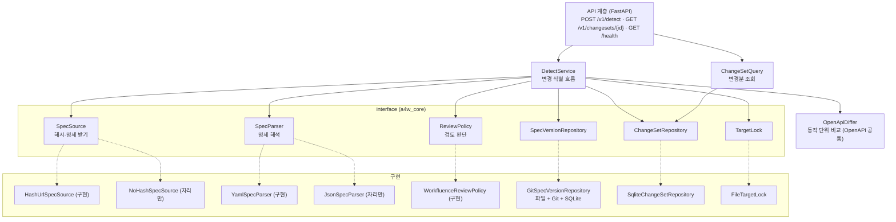
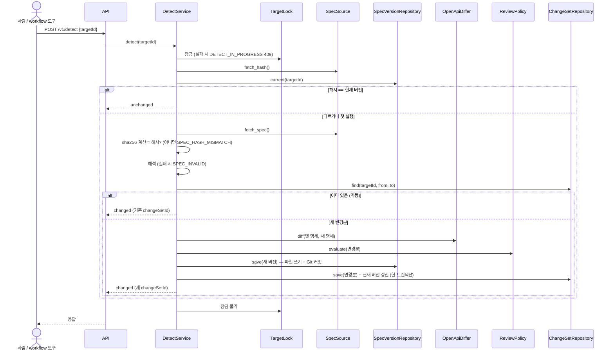

# Phase 1 설계 — Detection agent

- 작성일: 2026-10-12
- 상태: 초안
- 입력: [`1_요구사항정의.md`](1_요구사항정의.md), [`시스템아키텍처.md`](../시스템아키텍처.md)

## 1. 설계 개요

Detection은 "명세를 받는 곳(타겟)", "명세를 해석·비교하는 규칙(OpenAPI)", "보관하는 곳(저장소)", "검토 판단(타겟 정책)"을 서로 모르게 나누고, 이들을 조립하는 서비스 하나가 변경 식별 흐름을 진행한다.



- **DIP**: `DetectService`는 interface에만 의존한다. 구현은 조립 지점(composition root, `wiring.py`)에서 타겟 설정을 보고 끼운다.
- **OCP**: 새 타겟이나 새 명세 형식은 구현을 하나 더하고 registry에 등록하면 된다. `DetectService`와 `OpenApiDiffer`를 고치지 않는다.
- **SRP**: 받기, 해석, 비교, 판단, 보관, 잠금을 각각 한 클래스가 맡는다.
- **OpenAPI 비교는 타겟 공통이다.** OpenAPI 3.x 규칙만 쓰므로 core에 둔다. Manufacture도 같은 참조 풀기(`$ref` 해석)를 쓸 수 있다.

## 2. 모듈 구조

```
packages/
  core/                          # 패키지 a4w_core (타겟 무관)
    pyproject.toml
    src/a4w_core/
      config.py                  # 공통·타겟 설정 읽기 (.env)
      errors.py                  # 오류 코드와 예외
      models.py                  # SpecVersion, ChangeSet, OperationChange 등
      interfaces.py              # SpecSource, SpecParser, ReviewPolicy, 저장소, 잠금
      registry.py                # 타겟 어댑터 이름 → 구현 등록
      openapi/
        operations.py            # 동작 나열, 유효 security 계산
        resolver.py              # $ref 풀기 (순환 처리)
        canonical.py             # 비교용 정규 JSON, 문서용 키 제거
      spec_sources.py            # HashUrlSpecSource(구현), NoHashSpecSource(자리만)
      spec_parsers.py            # YamlSpecParser(구현), JsonSpecParser(자리만)
    tests/
  targets/
    workfluence/                 # 패키지 a4w_target_workfluence
      pyproject.toml
      src/a4w_target_workfluence/
        __init__.py              # registry 등록
        review_policy.py         # WorkfluenceReviewPolicy (v1 더하기만 정책)
      tests/
agents/
  detection/                     # 패키지 a4w_detection
    Dockerfile
    pyproject.toml
    src/a4w_detection/
      app.py                     # FastAPI 앱 생성
      api/routes.py              # 라우트
      api/schemas.py             # 요청·응답 모델 (계약)
      api/errors.py              # 오류 → HTTP 응답 변환
      auth.py                    # none / bearer
      service.py                 # DetectService, ChangeSetQuery
      diff.py                    # OpenApiDiffer
      textdiff.py                # 줄 단위 diff
      storage/git_versions.py    # GitSpecVersionRepository
      storage/sqlite_changesets.py
      storage/schema.sql         # SQLite 테이블
      storage/file_lock.py       # FileTargetLock
      wiring.py                  # 조립 지점
    tests/
      unit/  contract/  integration/  live/
      fixtures/
scripts/
  build.sh                       # 이미지 빌드 (compose와 독립)
config/
  targets/
    workfluence.env.example      # 타겟 설정 예시 (실제 .env는 Git 제외)
docker-compose.yml
.env.example
```

- 패키지 이름 앞머리 `a4w_`는 저장소 이름(agent4workfluence)에서 땄다. 타겟 이름이 아니다.
- 의존 방향: `a4w_detection` → `a4w_core` ← `a4w_target_workfluence`. core는 다른 패키지를 모른다.

## 3. 설정

### 3.1 파일 구성

| 파일 | 내용 | Git |
|---|---|---|
| `.env` | 서비스 공통·서비스별 설정 | 제외 (`.env.example`만 올림) |
| `config/targets/<targetId>.env` | 타겟 하나의 설정 | 제외 (`<targetId>.env.example`만 올림) |

- 타겟 파일 이름의 `<targetId>`가 곧 `targetId`다. container에는 `config/targets`를 읽기 전용으로 붙인다.
- 등록된 타겟은 `TARGETS`에 나열한 것만이다. 나열했는데 파일이 없거나 필수 값이 빠지면 container가 시작하지 않는다(빨리 실패).
- **기본값을 코드에 두지 않는다.** 모든 값은 `.env.example`에 예시와 함께 적고, 코드는 필수 값이 없으면 시작을 거부한다.

### 3.2 `.env` (Detection 관련)

| 변수 | 뜻 | 예 |
|---|---|---|
| `DETECTION_IMAGE`, `DETECTION_TAG` | 이미지 이름·태그 (compose와 build 스크립트가 같이 씀) | `a4w/detection`, `0.1.0` |
| `DETECTION_PORT` | API 포트 | `18001` |
| `DETECTION_AUTH_MODE` | `none` 또는 `bearer` | `none` |
| `DETECTION_API_TOKEN` | `bearer`일 때 받는 토큰 | (비밀) |
| `DETECTION_SPEC_STORE_PATH` | container 안 `spec-store` 경로 | `/data/spec-store` |
| `DETECTION_TARGETS_DIR` | container 안 타겟 설정 디렉터리 | `/config/targets` |
| `TARGETS` | 등록 타겟 목록(쉼표 구분) | `workfluence` |
| `LOG_LEVEL` | 로그 수준 | `INFO` |
| `HTTP_PROXY`, `HTTPS_PROXY`, `NO_PROXY` | 실행 시 proxy | `NO_PROXY`에 `wf.internal` 포함 |

### 3.3 `config/targets/workfluence.env`

| 변수 | 뜻 | 예 |
|---|---|---|
| `TARGET_ADAPTER` | 어댑터 이름(registry 키) | `workfluence` |
| `SPEC_SOURCE` | 명세 받는 방식 | `hash_url` (구현), `no_hash` (자리만) |
| `SPEC_FORMAT` | 명세 형식 | `yaml` (구현), `json` (자리만) |
| `SPEC_URL` | 명세 URL | `https://wf.internal:8444/api/v1/openapi.yaml` |
| `SPEC_HASH_URL` | 해시 URL | `https://wf.internal:8444/api/v1/openapi.sha256` |
| `SPEC_MAX_BYTES` | 받을 명세 최대 크기 | `20000000` |
| `HTTP_TIMEOUT_SECONDS` | 타겟 호출 시간 제한 | `30` |
| `TLS_VERIFY` | 인증서 검증 여부 | `true` |
| `TLS_CA_FILE` | 사설 CA 파일 경로(있으면 사용) | `/config/targets/workfluence-ca.pem` |
| `REVIEW_POLICY` | 검토 판단 정책 이름 | `workfluence_v1_additive` |

- 타겟 token은 Detection에 필요 없다(명세는 인증 없이 받는다). Phase 2부터 같은 파일에 더하되, Detection container에는 넘기지 않는다(시스템아키텍처 6절).
- 시험 스택은 자체 서명 인증서다. 기본은 `TLS_VERIFY=true` + `TLS_CA_FILE`로 그 인증서를 신뢰하는 방식이다. 인증서 파일을 구하지 못하면 시험 환경에 한해 `TLS_VERIFY=false`를 쓴다.

## 4. 변경 식별 흐름



- 잠금은 받기부터 저장까지 전체를 덮는다.
- "해시 == 현재 버전"이 아니어도, 받은 명세의 sha256이 현재 버전과 같으면 `unchanged`다(해시 URL만 먼저 바뀐 경우 등).
- **저장 순서와 복구**: Git 커밋 다음에 SQLite 트랜잭션(버전 기록, 변경분, 현재 버전 갱신)을 한 번에 한다. 둘 사이에서 죽으면 SQLite의 현재 버전은 옛 버전 그대로다. 다음 호출에서 같은 흐름을 다시 타고, Git에는 바뀐 내용이 없으므로 기존 커밋을 그대로 쓴다. 그래서 다시 호출하는 것만으로 복구된다.
- **되돌아간 명세**(A → B → A): `toVersion` A가 이미 버전 기록에 있어도 새 변경분(B → A)을 만든다. Git에는 A 내용을 다시 커밋해서 이력을 남긴다.

## 5. 명세 비교 (OpenApiDiffer)

### 5.1 동작 조각 만들기

1. 명세를 해석해 `paths` 아래 동작을 `(METHOD, path)`로 모은다. 메서드는 OpenAPI 3.x의 8개(`get` `put` `post` `delete` `options` `head` `patch` `trace`)다.
2. 경로 수준 `parameters`가 있으면 동작의 `parameters`에 합친다(같은 `name`+`in`은 동작 쪽이 이긴다).
3. 유효 `security`를 정한다. 동작에 `security`가 있으면 그것, 없으면 최상위 `security`다.
4. 동작 안의 `$ref`(`#/components/...`)를 풀어 넣는다. 순환 참조는 두 번째 만남에서 멈추고 `{"$ref": "...", "x-a4w-cycle": true}`로 남긴다. 외부 파일 참조는 지원하지 않고 `SPEC_INVALID`로 처리한다(Workfluence는 내부 참조만 쓴다).
5. 결과 조각: `{operationId, method, path, summary, description, tags, parameters, requestBody, responses, security}`. 값이 없는 키는 넣지 않는다.

### 5.2 분류

| 분류 | 조건 |
|---|---|
| `added` | 새 명세에만 있는 `(METHOD, path)` |
| `removed` | 옛 명세에만 있는 `(METHOD, path)` |
| `modified` | 양쪽에 있고, 정규 JSON(키 정렬, 공백 없음)이 다른 경우 |

- `modified`에는 `changedFields`(조각의 최상위 키 중 달라진 것)와 `docOnly`를 붙인다.
- `docOnly`: 조각에서 문서용 키(`summary`, `description`, `example`, `examples`, `title`)를 모든 깊이에서 지운 뒤 비교해 같으면 `true`다. 설명 문구만 바뀐 경우다.
- `$ref`를 풀어 넣고 비교하므로, 공용 스키마가 바뀌면 그 스키마를 쓰는 동작이 모두 `modified`가 된다(FR-109).
- `operationId`만 바뀐 경우도 `modified`(`changedFields: ["operationId"]`)다. 동작 식별은 `(METHOD, path)`로 한다.

### 5.3 문서 수준 변경

동작이 아닌 부분의 변경은 `documentChanges`로 따로 담는다. 대상은 `openapi`, `info`, `servers`, `tags`, `security`(최상위), `components.securitySchemes`다. 각 항목은 `{section, change}`이고, `change`는 `added`·`removed`·`modified` 중 하나다. `components.schemas`의 변경은 동작 조각에 이미 반영되므로 따로 담지 않는다.

### 5.4 순서와 결정성

- 동작 변경 목록은 `(path, METHOD)` 오름차순이다. `documentChanges`는 위 섹션 순서다.
- 같은 두 명세면 결과가 늘 같다(NFR-105). 시각(`createdAt`)은 변경분을 처음 만들 때 한 번만 정한다.

### 5.5 줄 단위 diff

- 받은 YAML 원문을 줄 단위로 비교해 unified diff(앞뒤 3줄)를 만든다. 사람이 확인하는 용도다.
- Workfluence 명세는 키 정렬이라 원문 그대로 비교한다. 정렬되지 않는 타겟을 위한 정규화는 interface(`SpecNormalizer`)만 두고 구현하지 않는다.

## 6. 검토 판단 (ReviewPolicy)

`WorkfluenceReviewPolicy`(`workfluence_v1_additive`)의 규칙이다. Workfluence v1은 더하기만 하므로, 그렇지 않은 변경을 사람에게 알린다.

| 변경 | `needsReview` | 이유 코드 |
|---|---|---|
| 동작 `removed` | true | `OPERATION_REMOVED` |
| 동작 `modified` (`docOnly: false`) | true | `OPERATION_CHANGED` |
| 동작 `modified` (`docOnly: true`) | false | — (설명만 바뀜) |
| 동작 `added` | false | — |
| `security`, `components.securitySchemes` 변경 | true | `SECURITY_CHANGED` |
| `openapi` 버전 변경 | true | `SPEC_VERSION_CHANGED` |
| `info`, `servers`, `tags` 변경 | false | — |

- 응답에는 `needsReview`와 `reviewReasons`(이유 코드 목록, 중복 없이 정렬)를 담는다.
- **요구사항 보완**: FR-111은 "삭제나 변경이 하나라도 있으면 검토"였다. 설명 문구만 바뀐 변경까지 검토로 보내면 잡음이 많아서, 설명만 바뀐 경우(`docOnly`)는 검토에서 뺐다. 요구사항 정의서 FR-111을 이에 맞춰 고친다.
- 새로 추가된 동작이 admin이나 위험 동작인지는 Detection이 판단하지 않는다. tool을 만들지 말지의 문제라서 Manufacture가 판단한다.

## 7. 식별자

| 식별자 | 규칙 | 예 |
|---|---|---|
| 명세 버전 `version` | 명세 원문 바이트의 sha256 (소문자 16진 64자) | `8c83f9c6…a2b1e6` |
| `changeSetId` | `cs-` + sha256(`"{targetId}\n{fromVersion 또는 'empty'}\n{toVersion}"`)의 앞 24자 | `cs-1f0c…` |

- `changeSetId`는 같은 `(targetId, fromVersion, toVersion)`이면 늘 같다(FR-112). 그래서 다시 호출해도 결과가 같다.
- 첫 실행의 `fromVersion`은 응답에서 `null`이다.

## 8. 저장소 (`spec-store`)

### 8.1 디렉터리

```
/data/spec-store/                  # DETECTION_SPEC_STORE_PATH
  detection.db                     # SQLite (모든 타겟 공용, 행에 target_id)
  locks/
    <targetId>.lock                # 타겟 잠금 파일
  targets/
    <targetId>/
      specs/                       # Git 저장소 (타겟마다 하나)
        .git/
        openapi.yaml               # 최신 명세. 커밋 하나 = 버전 하나
```

- 명세 파일 이름은 `SPEC_FORMAT`을 따른다(`openapi.yaml`). 옛 버전 원문은 `git show <commit>:openapi.yaml`로 꺼낸다.
- 커밋 메시지는 `spec <version>`(sha256)이고, 작성자는 설정 없이 고정 식별자(`a4w-detection`)다. 이 값은 저장소 안 표시용이라 설정 대상에서 뺐다.
- Git은 container 안의 `git` 명령으로 다룬다. `GitSpecVersionRepository`가 감싸서 다른 코드는 Git을 모른다.

### 8.2 SQLite 테이블

```sql
CREATE TABLE spec_versions (
  target_id      TEXT NOT NULL,
  version        TEXT NOT NULL,          -- sha256
  git_commit     TEXT NOT NULL,
  size_bytes     INTEGER NOT NULL,
  operation_count INTEGER NOT NULL,
  first_seen_at  TEXT NOT NULL,          -- ISO 8601 UTC
  PRIMARY KEY (target_id, version)
);

CREATE TABLE target_state (
  target_id       TEXT PRIMARY KEY,
  current_version TEXT NOT NULL,
  current_commit  TEXT NOT NULL,
  updated_at      TEXT NOT NULL
);

CREATE TABLE changesets (
  change_set_id  TEXT PRIMARY KEY,
  target_id      TEXT NOT NULL,
  from_version   TEXT,                   -- 첫 실행이면 NULL
  to_version     TEXT NOT NULL,
  needs_review   INTEGER NOT NULL,
  review_reasons TEXT NOT NULL,          -- JSON 배열
  summary        TEXT NOT NULL,          -- JSON
  document_changes TEXT NOT NULL,        -- JSON 배열
  text_diff      TEXT NOT NULL,
  created_at     TEXT NOT NULL,
  UNIQUE (target_id, from_version, to_version)
);

CREATE TABLE changeset_operations (
  change_set_id  TEXT NOT NULL REFERENCES changesets(change_set_id),
  seq            INTEGER NOT NULL,       -- 5.4절 순서
  method         TEXT NOT NULL,
  path           TEXT NOT NULL,
  operation_id   TEXT,
  change         TEXT NOT NULL,          -- added | removed | modified
  changed_fields TEXT,                   -- JSON 배열 (modified)
  doc_only       INTEGER,                -- modified일 때 0/1
  before_fragment TEXT,                  -- JSON (removed, modified)
  after_fragment  TEXT,                  -- JSON (added, modified)
  PRIMARY KEY (change_set_id, seq)
);
```

- SQLite의 `UNIQUE`는 `NULL`을 서로 다르게 보므로, `from_version`이 `NULL`인 첫 변경분의 중복은 저장소 코드가 먼저 찾아서 막는다.
- 스키마 버전은 `PRAGMA user_version`으로 관리한다. 바꿀 때는 이전 버전에서 올리는 순서를 코드로 둔다.

### 8.3 잠금

- `FileTargetLock`은 `locks/<targetId>.lock`에 운영체제의 배타 잠금(`flock`, 기다리지 않음)을 건다. 이미 잠겨 있으면 바로 `DETECT_IN_PROGRESS`(409)다.
- 프로세스가 죽으면 운영체제가 잠금을 풀어 주므로, 남은 잠금 때문에 막히는 일이 없다.
- 서버는 프로세스 하나(uvicorn worker 1개)로 돈다. 여러 프로세스로 늘려도 파일 잠금이라 그대로 동작한다.

## 9. API 계약

### 9.1 `POST /v1/detect`

요청

```json
{"targetId": "workfluence"}
```

응답 200

```json
{
  "status": "changed",
  "targetId": "workfluence",
  "changeSetId": "cs-1f0c9a…",
  "fromVersion": "3b1d…",
  "toVersion": "8c83…",
  "summary": {"added": 9, "removed": 0, "modified": 0, "docOnly": 0, "documentChanges": 1},
  "needsReview": false,
  "reviewReasons": []
}
```

- `unchanged`이면 `{"status":"unchanged","targetId":…,"currentVersion":…}`만 돌려준다.
- 같은 변경을 다시 식별하면(멱등) 같은 `changeSetId`로 `changed`를 돌려준다.

### 9.2 `GET /v1/changesets/{changeSetId}?targetId=workfluence[&includeTextDiff=true]`

응답 200 (Detection–Manufacture 계약)

```json
{
  "changeSetId": "cs-1f0c9a…",
  "targetId": "workfluence",
  "fromVersion": "3b1d…",
  "toVersion": "8c83…",
  "createdAt": "2026-10-12T06:00:00Z",
  "needsReview": false,
  "reviewReasons": [],
  "summary": {"added": 9, "removed": 0, "modified": 0, "docOnly": 0, "documentChanges": 1},
  "operations": [
    {
      "method": "POST",
      "path": "/chat/rooms",
      "operationId": "chat.createRoom",
      "change": "added",
      "after": {"operationId": "chat.createRoom", "method": "POST", "path": "/chat/rooms",
                "summary": "…", "description": "…", "tags": ["chat"],
                "requestBody": {"…": "…"}, "responses": {"…": "…"},
                "security": [{"bearerAuth": ["write"]}]}
    }
  ],
  "documentChanges": [{"section": "info", "change": "modified"}],
  "textDiff": "--- …\n+++ …\n…"
}
```

- `before`는 `removed`·`modified`, `after`는 `added`·`modified`에만 있다. `modified`는 `changedFields`와 `docOnly`를 더 담는다.
- `textDiff`는 `includeTextDiff=true`일 때만 담는다(크기 때문).
- `targetId`가 변경분의 타겟과 다르면 404다.
- 계약은 `api/schemas.py`의 응답 모델과 계약 시험(`tests/contract/`)이 고정한다. 바꿀 때는 계약 시험을 먼저 바꾼다.

### 9.3 `GET /health`

`{"status":"ok","specStore":"ok"}`. 보관소에 쓰지 못하면 `specStore: "error"`와 503. 인증을 요구하지 않는다.

### 9.4 오류 코드

| HTTP | `code` | 때 |
|---|---|---|
| 400 | `VALIDATION_ERROR` | 요청 모양이 틀림(FastAPI 기본 422를 이 모양으로 바꾼다) |
| 401 | `UNAUTHORIZED` | `bearer` 모드에서 토큰이 없거나 틀림 |
| 404 | `TARGET_NOT_FOUND` | 등록되지 않은 `targetId` |
| 404 | `CHANGESET_NOT_FOUND` | 없는 변경분이거나 타겟이 다름 |
| 409 | `DETECT_IN_PROGRESS` | 같은 타겟의 변경 식별이 진행 중 |
| 501 | `UNSUPPORTED_SPEC_SOURCE` | 자리만 둔 방식(`no_hash`, `json` 등)이 설정됨 |
| 502 | `SPEC_FETCH_FAILED` | 타겟 접속 실패, 시간 초과, 2xx가 아닌 응답, 크기 초과 |
| 502 | `SPEC_HASH_MISMATCH` | 받은 명세의 sha256과 해시 URL 값이 다름 |
| 502 | `SPEC_INVALID` | YAML·OpenAPI로 해석되지 않음, 외부 참조 |
| 500 | `STORAGE_ERROR` | Git·SQLite·파일 오류 |
| 500 | `INTERNAL_ERROR` | 그 밖 |

- 502 계열은 타겟 쪽 문제라서 workflow 도구가 나중에 다시 시도할 만하다. 400·404·501은 다시 해도 같다.
- `message`에 비밀이나 명세 본문을 넣지 않는다.

### 9.5 인증

- `DETECTION_AUTH_MODE=none`: 검사하지 않는다(시험 환경).
- `DETECTION_AUTH_MODE=bearer`: `Authorization: Bearer <DETECTION_API_TOKEN>`을 상수 시간 비교로 확인한다. `/health`와 `/openapi.json`은 검사하지 않는다.

## 10. 외부 호출 (`HashUrlSpecSource`)

- HTTP client는 `httpx`를 쓴다. proxy는 환경변수(`HTTP_PROXY`·`HTTPS_PROXY`·`NO_PROXY`)를 따른다. 내부 주소는 IP 대역보다 **호스트 이름**으로 `NO_PROXY`에 넣는다(`wf.internal`).
- 해시 응답은 앞뒤 공백을 지운 뒤 64자 16진인지 확인한다. 아니면 `SPEC_FETCH_FAILED`다.
- 명세는 `SPEC_MAX_BYTES`를 넘으면 받기를 멈추고 `SPEC_FETCH_FAILED`다.
- 재시도는 하지 않는다. 한 번 실패하면 바로 오류로 돌려주고, 다시 시도는 바깥(workflow 도구)이 정한다(한 호출 = 한 단계).

## 11. 이미지와 실행

### 11.1 Dockerfile (`agents/detection/Dockerfile`)

| 단계 | 내용 |
|---|---|
| `base` | `python:3.12-slim` + `git`. 빌드 인자로 받은 proxy를 이 단계에서만 쓴다 |
| `deps` | `a4w_core`, `a4w_target_workfluence`, `a4w_detection`의 실행 의존성 설치 |
| `test` | 개발 의존성(`pytest` 등)과 테스트 코드 포함. 실행 명령은 `pytest` |
| `runtime` | 실행에 필요한 것만. root가 아닌 사용자로 `uvicorn` 1 worker 실행. 포트는 `DETECTION_PORT` |

- 빌드 context는 저장소 루트다(공통 패키지를 넣기 위해).
- proxy 값은 `ARG`로만 받고 `ENV`로 남기지 않는다.

### 11.2 빌드 스크립트 (`scripts/build.sh`)

- 사용법: `scripts/build.sh detection [runtime|test]`.
- `.env`에서 `DETECTION_IMAGE`·`DETECTION_TAG`를 읽는다. 테스트 이미지는 태그 뒤에 `-test`를 붙인다.
- host의 `HTTP_PROXY`·`HTTPS_PROXY`·`NO_PROXY`를 `--build-arg`로 넘긴다.
- compose는 부르지 않는다.

### 11.3 `docker-compose.yml` (Phase 1은 `detection`만)

```yaml
services:
  detection:
    image: ${DETECTION_IMAGE}:${DETECTION_TAG}
    env_file: .env
    ports:
      - "${DETECTION_PORT}:${DETECTION_PORT}"
    volumes:
      - spec-store:/data/spec-store
      - ./config/targets:/config/targets:ro
    healthcheck:
      test: ["CMD", "python", "-c", "import os,urllib.request; urllib.request.urlopen(f\"http://127.0.0.1:{os.environ['DETECTION_PORT']}/health\")"]
volumes:
  spec-store:
```

- `build:`가 없다. 이미지는 11.2의 스크립트로 먼저 만든다.

### 11.4 사람이 돌리는 순서

```bash
scripts/build.sh detection runtime
docker compose up -d detection
curl -s -X POST http://localhost:${DETECTION_PORT}/v1/detect \
  -H 'Content-Type: application/json' -d '{"targetId":"workfluence"}'
```

## 12. 시험 설계 (TDD)

모든 시험은 `test` 이미지 안에서 돈다: `scripts/build.sh detection test` 후 `docker run --rm <image>:<tag>-test`.

| 묶음 | 대상 | 방식 |
|---|---|---|
| `unit` | `$ref` 풀기(순환 포함), 경로 parameters 합치기, 유효 security, 분류(added·removed·modified·docOnly), 문서 수준 변경, 정렬·결정성, 검토 정책, `changeSetId` 규칙, 해시 형식 검사 | 작은 명세 조각과 손으로 만든 명세 쌍 |
| `unit` | `DetectService` 흐름(unchanged, 첫 실행, 변경, 멱등, 해시 불일치, 해석 실패, 잠금 충돌, 저장 중 실패 후 재호출 복구) | interface를 가짜 구현으로 바꿔서 |
| `integration` | `GitSpecVersionRepository`, `SqliteChangeSetRepository`, `FileTargetLock` | 임시 디렉터리에 실제 Git·SQLite |
| `integration` | API 전체 | FastAPI TestClient + 가짜 SpecSource + 실제 저장소 |
| `contract` | 변경분 조회 응답 모양 | 응답 모델의 JSON Schema를 저장해 두고 비교 |
| `fixtures` | 실제 명세 쌍: 저장소 사본(동작 66개) → 시험 스택 스냅숏(동작 75개, 2026-10-12) | 추가 9개(`chat`)가 `added`로 나오는지 등 (AC-3) |
| `live` | 시험 스택 실호출(AC-1, AC-2) | 환경변수로 켤 때만 돈다. 기본은 건너뛴다 |

- red → green 순서로 묶음마다 실패하는 시험을 먼저 올린다. test 결과서에 실행 명령과 통과·실패 수를 남긴다.
- 실제 명세 고정 자료는 Workfluence 명세 사본이다. 자료가 어디서 언제 왔는지 `fixtures/README.md`에 적는다.

## 13. 요구사항 대응

| 요구사항 | 설계 위치 |
|---|---|
| FR-101~104 | 4절, 10절, 9.4절 |
| FR-105~107 | 4절, 7절, 8절 |
| FR-108~110 | 5절 |
| FR-111 | 6절 (설명만 바뀐 경우 제외로 보완) |
| FR-112~115 | 7절, 8.3절, 9.1절 |
| FR-121~125 | 9.2절, 12절 contract |
| FR-131~135 | 9.3~9.5절, 11절 |
| FR-141~143 | 1절, 2절, 3.3절 |
| NFR-101~109 | 3절, 10절, 11절, 12절 |

## 14. 확인 결과와 남은 확인

`workf`가 Workfluence 코드(`v1-openapi.controller.ts`, `packages/shared/src/v1-spec.ts`)를 보고 답했다(2026-10-12).

| # | 내용 | 결과 | 설계 반영 |
|---|---|---|---|
| D1 | 환경이 달라도 명세가 같은지 | 같은 코드면 바이트까지 같다. 기동 때 코드 상수로 한 번 만들고, 환경변수·DB 설정을 읽지 않는다. 단, 설명 문구의 숫자(채팅 글자 상한 4000, 보내기 한도 60, 프레임 64KiB, 연결 상한 5, 토큰 만료 90일)는 **코드에 적힌 기본값**이라 실제 서버 설정과 다를 수 있다 | 해시 비교 방식이 맞다. 설명 문구의 숫자는 실제 동작의 근거가 아니라는 점을 Phase 2(tool 설명 생성)에 넘긴다 |
| D2 | `operationId`, `(METHOD, path)`의 안정성 | v1 안에서 안정적이다(호환 정책 근거). 다만 정책은 문서에만 있고 기계가 막지는 않는다 | 동작 식별은 `(METHOD, path)`, tool 이름 기준은 `operationId`. 둘 중 하나가 바뀌면 `removed`+`added` 또는 `modified`로 드러나고 검토 대상이 된다 |
| D3 | 배열 순서 | 같은 코드면 같다. 키만 정렬하고 배열은 코드 순서 그대로다 | 정규 JSON 비교에서 배열 순서를 그대로 둔다. 순서만 바뀐 것도 `modified`로 본다(코드가 바뀐 것이므로) |
| D4 | 명세가 바뀌는 시점 | 배포 때만. 실행 중 설정 변경으로는 바뀌지 않는다 | 외부 일정은 배포 주기에 맞추면 된다 |
| D5 | 명세 호출의 빈도 제한 | 앱·nginx 모두 없다 | 따로 조절하지 않는다 |
| D6 | WebSocket 설명의 위치 | 구조화된 필드가 아니라 `info.description` 안의 세 문단("채팅 실시간 연결:", "서버가 보내는 프레임(`type`):", "채팅 연결의 규칙:")이다. 같은 내용이 Workfluence `API사용가이드.md` 3.13절에 있다 | `info` 변경은 `documentChanges`로 분류하고 검토 대상이 아니다(6절). 채팅 어댑터(Phase 5)가 이 변경을 볼 수 있게 `documentChanges`의 `info` 항목은 줄 단위 diff로 확인한다 |
| D7 | 시험 스택 자체 서명 인증서(CA 파일)를 받을 수 있는지 | 미정 | 받지 못하면 시험 환경에 한해 `TLS_VERIFY=false` |
