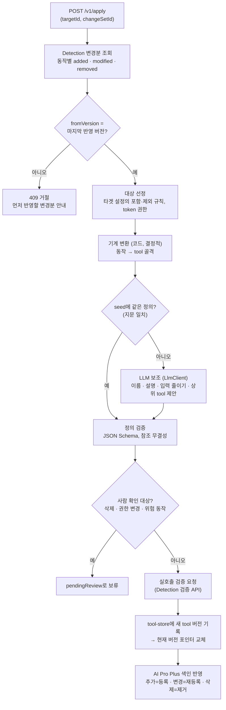
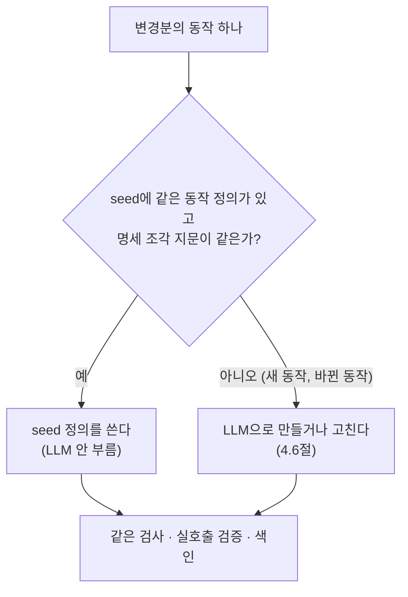
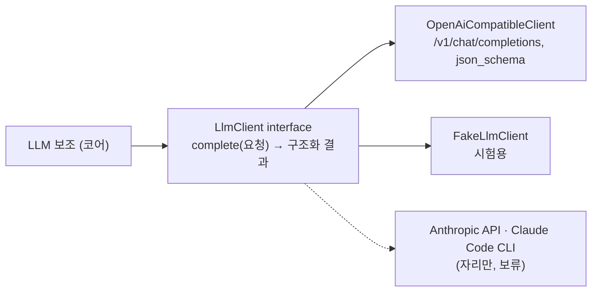

# Phase 2 요구사항 정의 — Manufacture (`manufacture`, 변경 반영)

- 작성일: 2026-10-13
- 상태: 확정 (사용자 검토 완료, 2026-10-13)
- 상위 문서: [`과제정의서.md`](../과제정의서.md) 2.2·4.3절과 미정 항목 4~11, [`시스템아키텍처.md`](../시스템아키텍처.md) 1·4·5.3절
- 선행: Phase 1 Detection의 변경분 조회 API(`GET /v1/changesets/{changeSetId}`, Phase 1 설계 9.2절)

## 1. 목표

Detection이 만든 변경분을 읽고, 작은 모델이 쓰기 좋은 tool을 만들거나 고치거나 정리한다. 만든 tool은 시험 환경에서 실제로 호출해 검증하고, `tool-store`에 버전으로 기록한 뒤, AI Pro Plus에 색인해 자연어로 검색할 수 있게 한다. 실행은 API 호출로만 일어난다.

**tool의 산출물은 코드가 아니라 선언형 정의(JSON)다.** Manufacture는 Python 등 실행 코드를 만들지 않는다. tool 하나가 정의 파일 하나이고, 하나뿐인 공통 실행기가 어떤 정의든 읽어서 타겟 API를 부른다. 그래서 tool을 더하거나 바꿔도 코드 생성, 이미지 빌드, 재배포가 없다(과제정의서 미정 항목 4의 기본안, 위험 "LLM으로 만든 코드를 그대로 실행"에 대한 대응).

**최초 tool은 사람 쪽(이 프로젝트의 개발 세션, Claude)이 직접 작성하고, 이후 변경분만 LLM이 반영한다.** 최초 tool 묶음은 저장소에 seed로 두고, 첫 반영 때 seed를 그대로 쓴다. 그 뒤 명세가 바뀌면 바뀐 동작만 Manufacture가 LLM(GLM-5.2)으로 만들거나 고친다. 품질의 기준을 seed가 잡고, LLM은 그 기준을 이어 가는 역할만 맡는다.

Manufacture용 LLM은 사내 OpenAI 호환 엔드포인트(SCP Simple AI Inference)로 부른다. 기본 모델은 `zai-org/GLM-5.2`이고 모델 이름은 설정이다. 모델 선정 과정과 시험 결과는 [`부록_LLM모델선정.md`](부록_LLM모델선정.md)에 있다. LLM 접속은 interface 뒤에 두어, 나중에 Anthropic API나 Claude Code CLI 같은 다른 방식을 코어를 고치지 않고 더할 수 있게 한다(이번에는 구현하지 않음).

이번 phase의 타겟은 Workfluence 하나다. 다른 타겟의 경우는 interface만 둔다(과제정의서 1.3절).

**Manufacture는 타겟과 단절한다.** Manufacture는 타겟(Workfluence) API를 직접 부르지 않고 타겟 token도 갖지 않는다. 타겟과 맞닿는 일(명세 받기, token scope 확인, 시험 환경 실호출 검증과 시험 자료 정리)은 모두 Detection이 맡는다. 타겟 연계에 문제가 생기면 Detection에서 푼다. 그래서 이번 phase는 Detection을 보강한다(4.15절). (사용자 결정, 2026-10-13)

## 2. 범위

| 포함 | 제외 |
|---|---|
| `manufacture` container와 이미지 빌드 스크립트 | `manufacture-mcp`(MCP server, Phase 3) |
| tool 정의 형식(JSON Schema)과 `tool-store` 쓰기 형식. 이 형식이 Phase 3과의 계약이다 | tool을 MCP로 서빙하는 일, `tools/call` 처리 |
| 공통 tool 실행기(라이브러리). 실호출 검증에 쓰고, Phase 3이 그대로 가져다 쓴다 | `inference`, 채팅 어댑터 |
| 기계 변환(명세 → tool 골격)과 LLM 보조(이름·설명·입력 줄이기·묶음) | AI Pro Plus 개발(외부 시스템, 클라이언트로만 씀) |
| LLM 클라이언트 interface와 OpenAI 호환 구현 | Anthropic API·Claude Code CLI 구현(interface 자리만), Inference의 LLM 연동(Phase 4) |
| AI Pro Plus 색인 클라이언트 | 일정 실행(외부 scheduler 몫) |
| 사람 확인 대상의 보류(`pendingReview`)와 승인 수단 | LLM이 실행 코드를 만들어 tool로 쓰는 방식 |
| `docker-compose.yml`에 `manufacture` 추가 | |
| Detection 보강: 타겟 정보(token scope) 조회 API, 실호출 검증 API, 시험 환경 준비·정리 (4.15절) | Manufacture의 타겟 직접 호출 |

## 3. 처리 흐름

## 4. 기능 요구사항

### 4.1 변경 반영 — `POST /v1/apply`

| ID | 요구 |
|---|---|
| FR-201 | 요청 본문 `{"targetId", "changeSetId"}`를 받는다. 등록되지 않은 `targetId`면 404로 거절한다. `changeSetId` 없이 `{"targetId"}`만 보내면 정리 반영(승인된 보류 항목, 지난번 실패 동작 재시도, 색인 어긋남 맞추기)만 하고, 할 것이 없으면 `noop`이다. |
| FR-202 | `changeSetId`로 Detection 변경분 조회 API를 불러 내용을 읽는다. `spec-store`를 직접 읽지 않는다. 변경분이 없으면 404로 거절한다. |
| FR-203 | 변경분의 `fromVersion`이 마지막으로 반영한 명세 버전과 다르면 409로 거절하고, 응답에 마지막 반영 버전을 담는다(시스템아키텍처 A6). 첫 반영은 `fromVersion`이 없는(빈 명세 대비) 변경분만 받는다. |
| FR-204 | 같은 타겟에 반영이 이미 진행 중이면 409로 거절한다(타겟 단위 잠금). |
| FR-205 | 이미 반영한 `changeSetId`로 다시 부르면 아무것도 바꾸지 않고 앞선 반영 결과를 돌려준다(멱등). |
| FR-206 | 반영은 tool 버전 단위로 원자적이다. 중간에 실패하면 현재 버전 포인터를 바꾸지 않는다. 반쯤 만든 tool이 서빙되지 않는다. |
| FR-207 | 반영은 비동기다. 접수하면 202와 `applyId`를 돌려주고, 결과는 반영 조회 API로 본다. 결과는 `targetId`, `changeSetId`, 새 `toolVersion`, `summary`(추가·변경·삭제·보류·실패·제외 tool 수), 검증 결과 요약, 색인 결과 요약을 담는다. |
| FR-208 | 반영 기록(언제, 어떤 변경분을, 어떤 tool 버전으로, 결과)을 남긴다. |

### 4.2 대상 선정

| ID | 요구 |
|---|---|
| FR-211 | 어떤 동작을 tool로 만들지는 타겟 설정이 정한다. 포함·제외 규칙은 동작 식별(`operationId`, 경로 패턴, tag, 필요 scope)로 표현한다. Workfluence 규칙은 과제정의서 4.3절이다(admin 15개 제외 등). |
| FR-212 | 위험 동작(과제정의서 4.3절 "위험 동작" 묶음)은 기본값이 꺼짐이다. 설정으로 켠다(미정 항목 11). |
| FR-213 | 타겟 token에 없는 scope가 필요한 동작은 tool로 만들지 않는다(과제정의서 3절 최소 권한). token scope는 Detection의 타겟 정보 API로 받는다(FR-331). |
| FR-214 | 제외한 동작은 이유와 함께 반영 기록에 남긴다. |
| FR-215 | Workfluence의 `chat` 동작 전체(`/chat/*`)는 tool로 만들지 않고 MCP로도 서빙하지 않는다. 타겟 규칙의 제외(`NOT_NEEDED`)로 처리한다. 채팅 API는 Detection·Manufacture 대상이 아니다. 채팅은 Workfluence에 종속된 모듈(Workfluence 타겟 어댑터 쪽, Phase 5)이 코드로 부르고 코어에 넣지 않는다. 채팅 API가 바뀌면 사람이 어댑터 코드를 고치고 다시 배포한다(사용자 확정 2026-10-15). |
| FR-216 | (2026-10-15 정정) 채팅 API 변경은 알리지 않는다. 변경분에 채팅 동작이 나와도 tool은 바뀌지 않고 따로 알리는 것도 없다. 코어의 일반 기능 `codeOwned`(응답의 `codeOwnedChanges`)는 남아 있으나 Workfluence 규칙은 쓰지 않는다. |

### 4.3 tool 정의 형식 (Phase 3과의 계약)

| ID | 요구 |
|---|---|
| FR-221 | tool 정의는 JSON이다. 형식은 JSON Schema로 고정하고, `tool-store`에 쓰기 전에 모든 정의를 이 스키마로 검사한다. |
| FR-222 | 단순 tool은 동작 하나에 대응한다. 이름, 설명, 입력 스키마(MCP `inputSchema`로 그대로 쓸 수 있는 JSON Schema), HTTP 매핑(메서드, 경로 템플릿, 각 입력 값이 놓일 위치 path·query·header·body), 고정값·기본값, 응답 가공 규칙, 출처(`operationId`, 명세 버전), 위험 등급(read·write·danger), 필요 scope를 담는다. |
| FR-223 | 상위 tool은 여러 동작을 묶는다. 순서대로 실행할 step 목록으로 표현하고, 앞 step 응답의 값을 뒤 step 입력에 넣는 참조 규칙을 선언형으로 담는다. 조건 분기와 반복은 실행기가 제공하는 정해진 기능(예: 목록 페이지 넘기기)만 쓴다. |
| FR-224 | 선언형으로 표현할 수 없는 경우를 위해, 사람이 손으로 작성해 코드에 등록한 handler를 이름으로 참조하는 자리를 둔다. Manufacture와 LLM은 handler 코드를 만들지 않는다. Workfluence에 필요한 경우가 없으면 interface만 두고 구현하지 않는다. |
| FR-225 | 상위 tool의 step은 같은 tool 버전 안에 있는 단순 tool 정의만 참조한다. 참조가 끊기면(동작 삭제 등) 상위 tool도 갱신 대상이 된다. |
| FR-226 | tool 이름은 타겟 안에서 유일하다. 같은 동작의 tool 이름은 동작이 `modified`여도 유지한다(Inference 쪽 안정성). 이름을 바꿔야 하면 삭제 + 추가로 다루고 사람 확인을 거친다. |

### 4.4 기계 변환

| ID | 요구 |
|---|---|
| FR-231 | 변경분의 명세 조각(Phase 1 FR-123, 참조 스키마까지 풀린 조각)만으로 tool 골격을 만든다. 다른 곳을 조회하지 않는다. |
| FR-232 | 골격의 HTTP 매핑과 입력 스키마는 코드가 만든다. 같은 명세 조각이면 늘 같은 골격이 나온다(결정성). |
| FR-233 | 명세의 요청 형식이 여러 개면(예: Workfluence 첨부 올리기의 JSON·multipart) 타겟 설정이 정한 우선 형식을 고른다. 기본은 JSON이다. 응답 형식이 여러 개면(예: 첨부 받기의 `octet-stream`·`format=json`) JSON을 고른다. |

### 4.5 최초 tool (seed)

| ID | 요구 |
|---|---|
| FR-235 | 최초 tool 묶음(seed)은 개발 세션(Claude)이 명세를 읽고 직접 작성한다. seed는 단순 tool, 상위 tool, 실호출 검증 시나리오, 색인 평가용 예시 질의 세트를 담는다. 작성은 Phase 2 구현 단계에서 tool 정의 형식을 확정한 뒤에 한다. |
| FR-236 | seed는 저장소에 Git으로 관리하는 타겟별 파일이다(코어에 넣지 않음). 각 정의는 출처 동작과, 작성 기준이 된 명세 조각의 지문(정규화한 조각의 sha256)을 담는다. |
| FR-237 | 반영할 때 동작마다 seed에 같은 동작 정의가 있고 지문이 같으면 seed 정의를 쓰고 LLM을 부르지 않는다. 지문이 다르거나 seed에 없는 동작이면 LLM 보조로 넘긴다. 그래서 seed를 쓴 뒤에 명세가 바뀌었어도 바뀐 동작만 LLM이 맡는다. |
| FR-238 | seed 정의도 LLM 출력과 같은 검사(형식, HTTP 매핑이 기계 변환 결과와 같은지, 참조 무결성), 실호출 검증, 색인을 거친다. 사람이 썼다고 검사를 건너뛰지 않는다. |
| FR-239 | seed는 LLM의 본보기로도 쓴다. LLM에 주는 입력에 seed의 정의 몇 개를 예시로 넣어 이름 짓기와 설명 문체를 맞춘다. 예시를 고르는 규칙은 설계에서 정한다. |

### 4.6 LLM 보조 (변경 반영)

| ID | 요구 |
|---|---|
| FR-240 | LLM은 첫 반영 뒤의 변경분에만 쓴다. 바뀐 동작은 이전 tool 정의를 함께 넣어, 이름을 지키고 바뀐 부분만 고치게 한다(FR-226). |
| FR-241 | LLM은 tool의 이름, 설명, 입력 칸 설명, 숨길 입력 칸과 기본값, 상위 tool 묶음 제안, 색인용 요약을 만든다. |
| FR-242 | LLM 출력은 정해진 JSON Schema를 따르는 구조화된 값으로만 받는다. 스키마에 맞지 않으면 설정된 횟수만큼 다시 요청하고, 그래도 맞지 않으면 그 반영을 실패로 끝낸다. |
| FR-243 | LLM은 HTTP 매핑을 만들거나 바꾸지 못한다. 입력 칸은 골격에 있는 것을 숨기거나 기본값을 주는 것만 할 수 있다. 상위 tool step은 존재하는 동작만 참조할 수 있다. 이것을 코드로 검사한다. |
| FR-244 | LLM 결과는 입력(명세 조각, 프롬프트 버전, 모델)의 지문으로 저장해 재사용한다. 설명만 바뀐 경우가 아니면 같은 동작에 LLM을 다시 부르지 않는다. 비용을 줄이고 결과를 안정시키기 위해서다. |
| FR-245 | 한 번의 반영에서 LLM 호출 수와 호출당 제한 시간에 상한을 둔다. 상한은 설정이다. |
| FR-246 | 프롬프트는 코드에 박지 않고 버전이 붙은 파일로 둔다. |

### 4.7 LLM 클라이언트

| ID | 요구 |
|---|---|
| FR-251 | 코어는 `LlmClient` interface에만 의존한다. 요청은 system prompt, 사용자 입력, 출력 JSON Schema, 모델, 제한 시간이다. 결과는 스키마를 통과한 JSON 값, 실제 쓴 모델, 사용량(토큰)이다. 실패는 정해진 오류 종류(인증, 제한 시간, 한도 초과, 출력 형식 오류, 기타)로 돌려준다. |
| FR-252 | 구현은 설정(`LLM_PROVIDER`)으로 고른다. 이번에 구현하는 것은 `openai_compatible` 하나다. 다른 provider는 같은 interface로 더한다(OCP). Anthropic API와 Claude Code CLI는 보류한다(사용자 결정, 2026-10-13). |
| FR-253 | `openai_compatible`: `{LLM_BASE_URL}/v1/chat/completions`를 `Authorization: Bearer <key>`로 부른다. 출력 형식 강제 방식은 설정이다(`json_object` 또는 `json_schema`). 기본은 `json_object`로 받고 스키마를 system prompt에 넣은 뒤, 받은 값을 우리 쪽에서 JSON Schema로 검사한다. 이 엔드포인트의 `json_schema`(strict) 모드는 일부 입력에서 출력이 끝나지 않고 한도까지 이어졌다(부록 A). |
| FR-254 | `finish_reason`이 `stop`이 아니면(예: `length`) 출력 형식 오류로 본다. 추론 모델은 사고 토큰이 출력 한도를 먹으므로(부록 A) 출력 한도는 설정으로 넉넉히 둔다. 사고 내용(`reasoning_content`)은 결과로 쓰지 않고 로그에도 남기지 않는다. |
| FR-255 | 엔드포인트 주소, 모델 이름, 추론 강도(`reasoning_effort`), 출력 한도, 제한 시간, 재시도 횟수는 설정이다. 429·5xx와 출력 형식 오류(JSON이 아니거나, 스키마 불일치, `finish_reason: length`)는 설정된 횟수만큼 다시 요청한다. 형식 오류로 다시 요청할 때는 앞선 오류 내용을 함께 준다. |
| FR-256 | provider 구현은 공통 계약 시험을 통과해야 한다. 계약 시험은 같은 요청에 대해 같은 모양의 결과와 같은 오류 분류가 나오는지 확인한다. 출력 내용이 글자 단위로 같다는 뜻은 아니다. 내용은 스키마 검사(FR-242), 코드 검사(FR-243), 결과 재사용(FR-244)으로 안정시킨다. |

### 4.8 실호출 검증

| ID | 요구 |
|---|---|
| FR-261 | 새로 만들었거나 바뀐 tool은 Detection 검증 API(FR-332)에 tool 정의와 검증 시나리오를 넘겨 시험 환경에서 실제로 호출해 검증한다. Manufacture는 타겟을 직접 부르지 않는다. 검증을 통과한 tool만 새 tool 버전에 넣는다. |
| FR-262 | 읽기 tool은 시험 데이터를 대상으로 호출해 응답이 성공이고 응답 가공 규칙이 적용되는지 본다. |
| FR-263 | 쓰기 tool은 시험 전용 위치(Workfluence는 시험 전용 스페이스)에서만 실행하고, 검증 뒤 만든 것을 정리한다(미정 항목 6). 위치 준비와 정리는 Detection이 한다(FR-333). 정리 실패는 기록하고 알린다. |
| FR-264 | 검증에 쓸 입력 값은 tool 정의와 함께 관리하는 검증 시나리오로 둔다. 시나리오를 만들 수 없는 tool은 "검증 안 됨"으로 표시하고, 설정에 따라 보류하거나 제외한다. |
| FR-265 | 검증 호출도 타겟 호출 규약(호출 한도, 재시도)을 지킨다. 규약은 Detection이 적용한다. |

### 4.9 사람 확인

| ID | 요구 |
|---|---|
| FR-271 | tool 삭제, 필요 scope 변경, 위험 동작 tool 추가는 바로 반영하지 않고 `pendingReview`로 보류한다. Detection 변경분의 `needsReview`도 보류 대상이다. |
| FR-272 | 보류한 항목을 보고 승인·거절하는 수단을 둔다. 수단(API·CLI·파일)은 설계에서 정한다(미정 항목 5). 승인한 항목은 다음 반영 때 들어간다. |
| FR-273 | 보류는 나머지 tool의 반영을 막지 않는다. |

### 4.10 `tool-store`

| ID | 요구 |
|---|---|
| FR-281 | tool 버전은 한 번 쓰면 바꾸지 않는 파일 묶음이다. 묶음 안에는 그 버전의 모든 tool 정의와 목록(manifest)이 있다. |
| FR-282 | 새 묶음을 모두 쓴 뒤 "현재 버전" 포인터만 원자적으로 바꾼다(시스템아키텍처 4.2절). 정의를 내주는 쪽(Phase 3 tool 정의 조회 API)도 묶음과 포인터만 읽는다. (2026-10-14 고침: `manufacture-mcp` 없음) |
| FR-283 | 이전 tool 버전으로 되돌릴 수 있다. 되돌리면 포인터를 옮기고 색인도 그 버전에 맞춘다. 되돌리는 수단은 설계에서 정한다. |
| FR-284 | 반영 기록, 보류, 작업 상태, 잠금, LLM 결과 재사용 자료는 `tool-store` 안의 SQLite에 둔다. |

### 4.11 AI Pro Plus 색인

| ID | 요구 |
|---|---|
| FR-291 | 색인 단위는 tool 하나다. 추가는 등록, 변경은 같은 point ID로 재등록, 삭제는 제거한다. |
| FR-292 | point ID는 `targetId`와 tool 이름에서 만든 결정적 UUID다. 같은 tool을 다시 등록하면 덮어쓴다(멱등). |
| FR-293 | `content`(임베딩 대상)는 tool 이름과 색인용 요약으로 짧게 둔다. tool 정의 요약·버전·scope는 `extended_content`에, `targetId/toolName@revision`(tool 정의 내용의 해시)은 `source`에 둔다. tool 버전 대신 revision을 쓰는 것은 tool 하나가 바뀔 때 전체를 다시 등록하지 않기 위해서다(설계 14.3절). |
| FR-294 | 타겟 구분은 타겟별 컬렉션으로 한다(미정 항목 8 기본안). 컬렉션과 도메인이 없으면 만든다. 우리 이름 규약 밖의 컬렉션은 건드리지 않는다. |
| FR-295 | 색인과 현재 tool 버전이 어긋나지 않게 한다. 색인 반영이 실패하면 어긋난 상태를 기록하고, 다음 반영이나 재시도 때 맞춘다. 맞추는 순서(포인터 교체와 색인 반영의 선후)는 설계에서 정한다. |
| FR-296 | 색인 품질을 예시 질의 세트로 평가한다. 질의마다 기대 tool을 두고, 상위 N개 안에 드는 비율을 잰다. N과 기준 수치는 설계에서 정한다(미정 항목 9, 과제정의서 5절 성공 기준 3). |
| FR-297 | RAG 저장소는 interface 뒤에 둔다. AI Pro Plus 구현만 만든다. |

### 4.12 공통 tool 실행기 (라이브러리)

| ID | 요구 |
|---|---|
| FR-301 | 어떤 tool 정의든 입력 값을 받아 정의대로 HTTP 요청을 만들고 결과를 돌려준다. tool마다 코드가 따로 있지 않다. |
| FR-302 | 입력 값은 실행 전에 tool의 입력 스키마로 검사한다. |
| FR-303 | 인증, 호출 한도, 재시도, 충돌 처리, 오류 해석은 타겟 어댑터와 타겟 설정이 정한 대로 실행기가 처리한다. Workfluence는 429 `Retry-After` 대기, 5xx는 읽기만 재시도, 400·401·403·404는 재시도 안 함이다(과제정의서 4.2절). |
| FR-304 | 오류는 한 가지 모양으로 돌려주고, 타겟의 오류 코드와 `requestId`를 그대로 담는다. |
| FR-305 | 응답 가공 규칙(필요한 필드만 남기기, 크기 상한)을 적용해 작은 모델이 읽기 쉬운 결과를 돌려준다. |
| FR-306 | 상위 tool은 step을 순서대로 실행하고, 한 step이 실패하면 거기서 멈추고 어느 step에서 실패했는지 돌려준다. |
| FR-307 | 실행기는 Detection(실호출 검증)과 공용 MCP server `a4w_mcp`(tool 실행, Phase 3)가 같이 쓴다. 웹 프레임워크나 MCP에 의존하지 않는 라이브러리로 만든다. |

### 4.13 공통

| ID | 요구 |
|---|---|
| FR-311 | `GET /health`는 살아 있는지와 `tool-store` 접근 가능 여부를 돌려준다. 바깥 시스템(Detection, AI Pro Plus, LLM)의 상태는 넣지 않거나 따로 표시한다. |
| FR-312 | 오류는 `{"error":{"code","message"}}` 한 가지 모양이다(Phase 1과 같음). |
| FR-313 | 자기 API의 OpenAPI 명세(`/openapi.json`)를 연다. |
| FR-314 | 인증은 설정으로 고른다. 시험 환경은 인증 없음, 운영은 정적 Bearer 토큰이다. |
| FR-315 | 일정 실행, 시작 시 자동 실행을 하지 않는다. Detection을 부르는 것은 조회뿐이다. |

### 4.14 타겟·외부 확장 interface (구현은 비워 둠)

| ID | 요구 |
|---|---|
| FR-321 | 명세 형식별 기계 변환은 interface 뒤에 둔다. OpenAPI 3.x만 구현한다. |
| FR-322 | 타겟별로 다른 것(대상 선정 규칙, token scope 확인, 호출 규약, 시험 데이터 위치와 정리, 위험 동작 정의)은 타겟 어댑터와 타겟 설정으로 둔다. Workfluence만 구현한다. |
| FR-323 | LLM provider, RAG 저장소, 사람 확인 수단은 interface로 둔다. 각각 이번에 쓰는 구현만 만든다(LLM은 2종). |

### 4.15 Detection 보강 (타겟 창구)

| ID | 요구 |
|---|---|
| FR-331 | Detection은 타겟 정보 조회 API를 연다. 타겟 token의 scope와 검증 환경 사용 가능 여부를 돌려준다. token 값은 돌려주지 않는다. |
| FR-332 | Detection은 실호출 검증 API를 연다. tool 정의, 상위 tool이 참조하는 정의, 검증 시나리오를 받아 공통 실행기로 시험 환경에서 실행하고 tool별 결과(통과·실패·검증 안 됨, 오류 코드, `requestId`)를 돌려준다. 오래 걸리므로 비동기(접수 → 상태 조회)로 한다. |
| FR-333 | 검증 환경 준비와 정리(Workfluence는 시험 스페이스 생성과 통째 삭제)는 Detection의 타겟 어댑터가 한다. 정리 실패는 결과에 담는다. |
| FR-334 | Detection은 받은 정의를 그대로 믿지 않는다. 정의 형식 검사, 쓰기 위치 제한(시험 환경 안의 자료만), 금지 scope(Workfluence는 admin) tool 거절을 코드로 한다. |
| FR-335 | 타겟 token은 Detection이 갖는다. `manufacture`는 갖지 않는다. (2026-10-14 고침: `manufacture-mcp`는 없앴다.) Inference agent는 자기 계정 token으로 직접 부른다(사용자 확정, 2026-10-13, Phase 3·4에서 상세) |
| FR-336 | 같은 타겟의 검증은 한 번에 하나다(진행 중이면 409). 변경 식별과는 따로 잠근다. |
| FR-337 | Phase 1의 기존 API(`/v1/detect`, `/v1/changesets/{id}`)와 계약은 바꾸지 않는다. |

## 5. 비기능 요구사항

| ID | 요구 |
|---|---|
| NFR-201 | **설정**: Detection 주소, AI Pro Plus 주소와 인증 방식, LLM provider·모델·제한 시간·호출 상한, 시험 데이터 위치, 포함·제외 규칙, 검증·보류 정책은 설정으로 받는다. 코드에 하드코딩하지 않는다. |
| NFR-202 | **비밀**: 타겟 token, AI Pro Plus api key, LLM api key는 `config/secrets/`의 `.env`로만 받는다. 로그·응답·`tool-store`·LLM 프롬프트에 넣지 않는다. 타겟 token은 Detection container에만, LLM key는 `manufacture` container에만 붙인다. |
| NFR-203 | **proxy**: LLM 엔드포인트(`*.samsungsdscloud.com`)는 host proxy를 거쳐야 닿는다(부록 A). container에 proxy 환경변수를 넘기고 이 주소는 `NO_PROXY`에 넣지 않는다. 타겟 시험 스택, Detection, AI Pro Plus 같은 내부 주소는 `NO_PROXY`에 넣는다. |
| NFR-204 | **이미지**: (2026-10-14 고침: `manufacture-mcp`가 없어 같은 이미지 요구는 없앴다. 공용 MCP server는 Phase 3 설계 10.1절) LLM 연동은 HTTP 클라이언트만 쓰고 별도 런타임을 넣지 않는다. |
| NFR-205 | **결정성**: LLM을 뺀 부분(대상 선정, 기계 변환, 검사, 색인 ID)은 같은 입력에 늘 같은 결과를 낸다. |
| NFR-206 | **로그**: 비밀을 남기지 않는다. 명세 본문과 LLM 프롬프트·응답 전문을 로그에 통째로 남기지 않는다. LLM 호출은 모델, 소요 시간, 사용량, 성공 여부만 남긴다. |
| NFR-207 | **실행 환경**: 빌드·테스트·실행 모두 container 안에서 한다. 이미지 빌드는 compose와 독립이다. |
| NFR-208 | **설계 원칙**: SOLID를 지킨다. 특히 LLM 클라이언트, RAG 저장소, 타겟 어댑터, 저장소, 사람 확인 수단은 interface로 분리한다. |
| NFR-209 | **개발 방식**: TDD(red → green). LLM·AI Pro Plus·타겟은 가짜 구현으로 단위 시험하고, 실호출 시험은 `A4W_LIVE_TESTS=1`일 때만 돈다. |

## 6. 인수 기준

| # | 기준 | 확인 방법 |
|---|---|---|
| AC-1 | 빈 `tool-store`에서 첫 변경분(빈 명세 대비 전체)을 반영하면 seed의 tool이 LLM 호출 없이 그대로 들어가고, 과제정의서 4.3절 대상 범위의 tool이 모두 있으며 제외 대상(admin 등)은 이유와 함께 빠진다 | 시험 스택 실호출 |
| AC-1a | seed 작성 뒤 명세의 동작 하나가 바뀐 변경분을 반영하면 그 동작만 LLM으로 다시 만들어지고, 이름은 유지된다. 나머지는 seed 그대로다 | 단위 시험(가짜 LLM) |
| AC-2 | 모든 tool 정의가 tool 정의 JSON Schema를 통과하고, LLM이 HTTP 매핑을 바꾸거나 없는 동작을 참조한 출력은 거절된다 | 단위 시험(가짜 LLM의 잘못된 출력 포함) |
| AC-3 | 동작이 추가된 변경분을 반영하면 추가분만 tool로 더해지고, 기존 tool 이름은 그대로다 | 손으로 만든 명세 쌍으로 고정 자료 시험 |
| AC-3b | **추가된 API가 제대로 반영된다.** seed에 없는 동작(실제 명세의 동작과, 모델이 미리 알 수 없는 가상 동작)을 추가한 변경분을 실제 LLM으로 반영하면 새 tool마다 다음을 만족한다. (1) 정의 검사 통과: 명세의 입력 칸을 빠짐없이 담고 지어낸 칸이 없으며, 필수·경로 칸을 기본값 없이 숨기지 않는다. (2) 이름이 형식에 맞고 기존 tool과 겹치지 않는다. (3) 설명에 명세의 제약(페이지 넘김, 범위 옵션 등)이 담긴다. (4) 예시 질의가 사람의 자연스러운 요청이다(id 값을 쓰지 않음). (5) 시험 환경 실호출 검증을 통과한다. (6) 색인 뒤 예시 질의로 검색하면 그 tool이 상위 N개 안에 든다 | LLM 실호출 시험(`A4W_LIVE_TESTS=1`) + 시험 스택 실호출 |
| AC-3a | 66 → 75 변경분을 반영하면 추가된 `chat` 동작 9개는 tool로 만들어지지 않고 아무것도 바뀌지 않는다(알림도 없다, 결과 noop) | 고정 자료 시험 + 실호출 |
| AC-4 | 삭제·scope 변경·위험 동작 추가는 `pendingReview`로 보류되고, 나머지는 반영된다 | 단위 시험 |
| AC-5 | `fromVersion` 불일치, 동시 실행, 없는 변경분, 등록되지 않은 타겟이 정해진 오류 코드로 거절된다. 같은 `changeSetId`로 다시 부르면 바뀌는 것이 없다 | 단위·통합 시험 |
| AC-6 | 반영 도중 실패하면 현재 tool 버전 포인터가 바뀌지 않는다. 이전 tool 버전으로 되돌릴 수 있다 | 통합 시험 |
| AC-7 | `openai_compatible` 구현이 LLM 계약 시험(정상, 스키마 불일치, `finish_reason: length`, 401, 429, 제한 시간)을 통과한다. 코어는 가짜 구현만으로 시험된다 | 계약 시험(녹화한 HTTP 응답) |
| AC-8 | container 안에서 설정한 엔드포인트·모델로 실제 LLM 호출이 되고, 스키마를 통과한 결과가 나온다 | 실호출 |
| AC-9 | 실호출 검증을 통과한 tool만 새 버전에 들어가고, 쓰기 검증으로 만든 시험 데이터가 정리된다 | 시험 스택 실호출 |
| AC-10 | AI Pro Plus에 tool이 색인되고, 예시 질의 세트(예: "페이지에 댓글 달기" → 댓글 쓰기 tool)가 기준 이상 맞는다 | 시험 환경 실호출 |
| AC-11 | 공통 실행기가 웹 프레임워크·MCP 없이 import되어 쓰인다(Phase 3 재사용 가능) | 단위 시험, 검토 |
| AC-12 | `docker-compose.yml`의 `manufacture`를 올리고 curl로 Detection → Manufacture 흐름을 재현할 수 있다 | 수동 실행 기록 |
| AC-13 | 코드에 URL·경로·포트·token·모델명·프롬프트가 하드코딩되어 있지 않다 | 검토 |
| AC-14 | `manufacture` container에 타겟 token과 타겟 주소가 없고, 타겟으로 나가는 호출이 없다. 검증은 Detection 검증 API로만 일어난다 | 검토, compose 설정, 통합 시험 |
| AC-15 | Detection 검증 API가 형식이 틀린 정의, 시험 환경 밖을 쓰는 시나리오, admin scope tool을 거절하고, 검증 뒤 시험 스페이스를 지운다. Phase 1 시험은 그대로 통과한다 | 단위 시험 + 시험 스택 실호출 |

## 7. 시험 자료

- 변경분: Phase 1 시험 자료의 옛 명세(동작 66개)와 새 명세(동작 75개)로 Detection이 만든 변경분 응답을 고정 자료로 저장한다. 빈 명세 대비 전체 변경분도 저장한다. 66 → 75의 추가분은 모두 `chat`(tool 대상 아님)이므로, tool이 더해지는 경우는 손으로 만든 명세 쌍으로 따로 시험한다.
- LLM: 가짜 구현이 돌려줄 정상·비정상 출력 묶음. `openai_compatible`용으로는 실제 엔드포인트 응답을 녹화해 둔다(비밀은 빼고).
- 타겟: 실호출 시험은 시험 스택 `https://wf.internal:8444`와 시험 전용 스페이스를 쓴다.
- 추가 API 시험 자료: seed에서 일부러 뺀 실제 동작과, 명세에 없는 가상 동작(예: 페이지 지켜보기, 역링크 목록)의 명세 조각. 가상 동작은 시험 스택에 없으므로 실호출 검증(AC-3b의 5)은 실제 동작으로만 한다.
- seed: 개발 세션이 작성한 Workfluence tool 묶음(FR-235). 검증 시나리오와 색인 평가용 예시 질의 세트(질의, 기대 tool, 과제정의서 4.3절 묶음마다)를 함께 둔다.

## 8. 착수 전에 필요한 정보

| # | 항목 | 상태 |
|---|---|---|
| 1 | (시험은 해결) AI Pro Plus 시험·운영 base URL, `NON_LOGIN_SERVICE` 값 (미정 항목 7) | 시험: host `28000`, container에서 `host.docker.internal:28000`, `NON_LOGIN_SERVICE=true`(헤더 없이 nobody, `X-Virtual-User`만). 운영 주소·키 발급은 모름(설계 17.1절) |
| 2 | (해결) Manufacture LLM 접속 경로 (미정 항목 10) | 사내 OpenAI 호환 엔드포인트, 기본 모델 `zai-org/GLM-5.2`(부록_LLM모델선정). 주소·key는 `config/secrets/manufacture-llm.env`. 사용자 확정, 2026-10-13 |
| 3 | (해결) Manufacture 모델 선정 | `zai-org/GLM-5.2`. 근거는 부록_LLM모델선정. 실제 색인 품질은 FR-296으로 다시 잰다. 사용자 확정, 2026-10-13 |
| 4 | (해결) Workfluence 시험 전용 스페이스와 검증용 계정 token, 검증으로 만든 데이터의 정리 규칙 (미정 항목 6) | 반영마다 시험 스페이스를 만들고 통째로 지운다. token은 기존 `agent-test`. 설계 17.2절 |
| 5 | (해결) `chat` 동작 9개 | tool 대상이 아니다. 코드로 구현하고, 바뀌면 코드를 고친다(FR-215·216). 사용자 확정, 2026-10-13 |

## 9. 설계에서 정할 것

- seed 파일 위치와 구성, 명세 조각 지문 규칙, LLM 예시로 쓸 seed 고르는 규칙
- tool 정의 JSON Schema의 정확한 필드, 상위 tool step과 값 참조 문법, 응답 가공 규칙 표현
- `tool-store` 디렉터리 구조, manifest, 포인터 교체 방법, SQLite 테이블
- 포인터 교체와 색인 반영의 순서, 어긋남 복구 방법
- `LlmClient` 요청·결과·오류 모양, 설정 변수, 오류 분류 규칙
- 프롬프트 파일 구성과 LLM 결과 재사용 지문 규칙
- 실호출 검증 시나리오 형식과 정리 규칙
- 사람 확인 수단, 되돌리기 수단
- 색인 텍스트 구성, 예시 질의 세트, 평가 기준(상위 N, 통과 비율)
- 공통 패키지와 `manufacture` 앱의 모듈 구조, Dockerfile과 빌드 스크립트
- 오류 코드 목록

---

## 부록 A. LLM 엔드포인트 확인 기록 (2026-10-13)

엔드포인트(SCP Simple AI Inference, OpenAI 호환)를 host에서 curl로 확인했다. container에서는 아직 확인하지 않았다. 주소와 key는 `config/secrets/manufacture-llm.env`에 있고 이 문서에는 적지 않는다.

- 접속: host proxy를 거치면 `GET /v1/models`가 200이다.
- 모델 목록(`type: llm`): `openai/gpt-oss-120b`, `zai-org/GLM-5.2`, `Qwen/Qwen3.8-27B`, `Qwen/Qwen3.6-27B`, `google/gemma-4-31B-it`. 이 밖에 embedding(`Qwen/Qwen3-VL-Embedding-8B`), reranker, guard 모델이 있다. Claude 계열은 없다.
- 구조화 출력: 세 모델(`gpt-oss-120b`, `GLM-5.2`, `Qwen3.8-27B`)에 `response_format: json_schema`(`strict: true`)로 tool 이름·설명을 요청했다. 모두 200, `finish_reason: stop`이었고, `content`가 스키마를 따르는 JSON이었다.
- 추론 토큰: 세 모델 모두 사고 내용이 따로 왔다. `GLM-5.2`는 출력 토큰 450개 중 421개가 사고 토큰이었다. 출력 한도를 작게 잡으면 본문이 잘릴 수 있다(FR-254).
- **`json_schema`(strict) 모드의 출력 반복**: gpt-oss-120b로 `search.find`, `pages.tree`의 tool 설계를 시키면 추론 강도와 temperature를 바꿔도 매번 출력 한도(12000~16000 토큰)까지 이어지다 잘렸다(`finish_reason: length`, 16회 중 15회). 같은 요청을 `json_object` 모드 + 스키마를 프롬프트에 넣는 방식으로 바꾸면 8회 모두 정상으로 끝났다. GLM-5.2도 `json_schema` 모드에서 1건 같은 현상이 있었다.

### A.1 tool 제작 능력 평가

모델 비교 평가와 선정 결과는 [`부록_LLM모델선정.md`](부록_LLM모델선정.md)로 옮겼다.

- 확인하지 못한 것(접속): 긴 입력에서의 소요 시간, 호출 한도와 429 응답 모양, 제한 시간 동작.

## 부록 B. Claude Code CLI 확인 기록 (보류, 2026-10-13)

사용자 결정으로 보류했다. 다시 꺼낼 때를 위해 확인한 사실만 남긴다(host의 Claude Code `2.1.296`).

- `claude -p --tools "" --strict-mcp-config --setting-sources "" --output-format stream-json --verbose --system-prompt … --json-schema …`로 부르면 마지막 `result` 이벤트의 `structured_output`에 스키마를 따르는 값이 온다.
- 성공 판정은 `is_error`로 해야 한다. 인증 실패에도 `subtype: "success"`, `is_error: true`가 나왔다.
- `--bare`는 OAuth 로그인을 읽지 않는다.
- container 안 인증(`claude setup-token`)은 시험하지 않았다.
