# Phase 2 설계 — Manufacture (`manufacture`, 변경 반영)

- 작성일: 2026-10-13
- 상태: 확정 (사용자 검토 완료, 2026-10-13). 구현 완료, 구현 중 바뀐 것은 22절
- 입력: [`1_요구사항정의.md`](1_요구사항정의.md), [`부록_LLM모델선정.md`](부록_LLM모델선정.md), [`시스템아키텍처.md`](../시스템아키텍처.md), Phase 1 [`2_설계.md`](../phase1_detection/2_설계.md) 9.2절(변경분 계약)
- 외부 확인: AI Pro Plus는 세션 `aipro`(2026-10-13, 코드 확인 + host에서 `GET /openapi.json`·`/api/collections`·`/api/domains` 200 확인). Workfluence 명세 사실은 명세(Detection)에서, 명세 밖 운영 사실만 세션 `workf`에서(17절)
- 결정 반영: manufacture는 타겟과 단절하고, 타겟 창구는 Detection으로 보강한다(사용자 결정, 2026-10-13, 1절·11절)

## 1. 설계 개요

Manufacture는 "변경분을 읽는 곳(Detection)", "tool을 만드는 규칙(기계 변환·seed·LLM 보조)", "검증을 맡기는 곳(Detection)", "보관하는 곳(`tool-store`)", "색인하는 곳(RAG)"을 서로 모르게 나눈다. 반영 서비스 하나가 이들을 조립해 변경 반영 흐름을 진행한다.

**Manufacture는 타겟과 단절한다**(사용자 결정, 2026-10-13). 타겟 API를 부르지 않고 타겟 token도 갖지 않는다. 타겟과 맞닿는 일(명세 받기, token scope, 실호출 검증, 시험 자료 준비·정리)은 Detection 한 곳이 맡고, 연계 문제도 Detection에서 푼다. 그래서 이번 phase에서 Detection을 보강한다(11절).

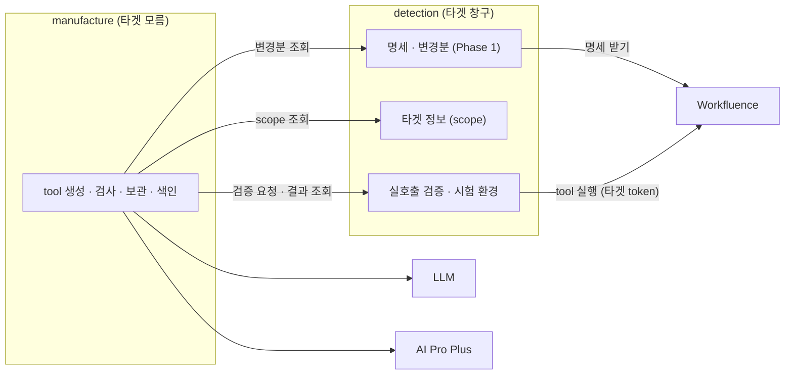

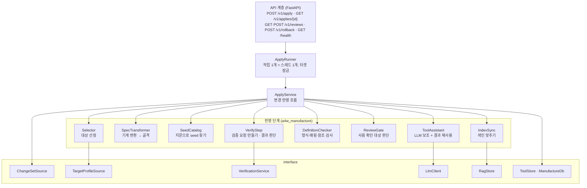

- `ChangeSetSource`·`TargetProfileSource`·`VerificationService`의 구현은 모두 Detection HTTP 클라이언트다. Manufacture 안에 타겟 주소·token·타겟 어댑터 코드(오류 해석, 시험 환경)가 없다.
- **DIP**: `ApplyService`와 각 단계는 interface에만 의존한다. 구현은 조립 지점(`wiring.py`)에서 설정을 보고 registry로 끼운다(Phase 1과 같은 방식).
- **OCP**: 새 타겟은 타겟 어댑터 패키지를 더하면 된다. 카탈로그(대상 선정·seed·시나리오)는 Manufacture가, scope 확인·오류 해석·검증 환경은 Detection이 읽는다. 새 LLM provider, RAG 저장소, 명세 형식도 구현을 등록만 한다.
- **tool은 데이터다.** tool 정의는 JSON 파일이고, 실행은 공통 실행기(`a4w_tools`) 하나가 한다. Manufacture는 실행 코드를 만들지 않는다.
- **LLM은 글만 쓴다.** HTTP 매핑과 입력 칸 목록은 코드가 만들고, LLM은 이름·설명·숨김·기본값·색인 문구만 낸다. LLM 출력은 코드 검사를 통과해야 쓴다.

## 2. 모듈 구조

```
packages/
  core/                          # a4w_core (기존) — registry를 열린 종류로 바꾸고 파일 잠금을 옮겨 온다
    src/a4w_core/
      registry.py                # 종류(kind)를 고정 목록에서 등록 시 생기는 방식으로 (2.1)
      locking.py                 # FileTargetLock (Detection에서 옮김, 오류 종류는 인자로)
  tools/                         # a4w_tools (신규) — tool 정의 형식 + 공통 실행기. manufacture(형식·검사)·detection(실행)·manufacture-mcp(Phase 3)가 같이 씀
    src/a4w_tools/
      schemas/tool.v1.schema.json      # tool 정의 JSON Schema (Phase 3 계약)
      schemas/toolset.v1.schema.json   # manifest JSON Schema (Phase 3 계약)
      model.py                   # ToolDefinition, HttpBinding, Step 등 값 객체
      validate.py                # 정의·manifest 스키마 검사, 참조 무결성
      reader.py                  # ToolsetReader: 현재 포인터 → 묶음 읽기 (읽기 전용)
      executor.py                # ToolExecutor: 단순 tool 실행
      composite.py               # 상위 tool step 실행
      request.py                 # 정의 + 입력 → HTTP 요청
      response.py                # 응답 가공 (필드 고르기, 크기 상한)
      call_policy.py             # CallPolicy interface, ConfigCallPolicy (한도·재시도)
      target_http.py             # TargetHttpClient (base URL, token, TLS, proxy)
      errors.py                  # ToolError 코드
      interfaces.py              # ErrorInterpreter, Handler(자리만)
  clients/                       # a4w_clients (신규) — 외부 시스템 클라이언트. Phase 4 Inference도 씀
    src/a4w_clients/
      llm/base.py                # LlmClient, LlmRequest, LlmResult, LlmError
      llm/openai_compatible.py   # OpenAiCompatibleClient (구현)
      llm/placeholders.py        # anthropic, claude_cli (자리만, 501)
      rag/base.py                # RagStore, RagDocument, RagHit
      rag/aipro_plus.py          # AiProPlusStore (구현)
  targets/workfluence/           # a4w_target_workfluence (기존) — Workfluence 어댑터와 카탈로그
    src/a4w_target_workfluence/
      __init__.py                # registry 등록 (기존 + 아래)
      scopes.py                  # WorkfluenceScopeProvider        ← detection이 씀
      errors.py                  # WorkfluenceErrorInterpreter     ← detection·manufacture-mcp가 씀
      sandbox.py                 # WorkfluenceVerifySandbox        ← detection이 씀
      catalog/                   # Git으로 관리하는 타겟 데이터    ← manufacture가 씀 (패키지 데이터)
        rules.yaml               # 대상 선정 규칙, 묶음, 고정값 규칙
        seed/tools/*.json        # 단순 tool seed (동작 하나 = 파일 하나)
        seed/composites/*.json   # 상위 tool seed
        scenarios/*.yaml         # 실호출 검증 시나리오 (tool 이름별)
        queries.yaml             # 색인 평가용 예시 질의 세트
agents/
  detection/                     # a4w_detection (기존) — 보강 (11절)
    src/a4w_detection/
      profile.py                 # TargetProfileService (token scope, 검증 환경 사용 가능)
      verify/service.py          # VerificationService: 접수·실행·결과
      verify/runner.py           # 비동기 실행 (스레드, 검증 잠금)
      verify/guard.py            # 받은 정의 검사: 형식, 쓰기 위치, 금지 scope
      verify/scenarios.py        # 시나리오 값 채우기
      verify/auto.py             # 시나리오 없는 읽기 tool의 자동 시나리오
      api/routes.py              # + GET /v1/targets/{id}/profile, POST·GET /v1/verifications
      storage/schema.sql         # + verifications 표
  manufacture/                   # a4w_manufacture (신규)
    Dockerfile
    pyproject.toml
    prompts/                     # 프롬프트 파일 (버전이 붙은 이름, 9.4)
    src/a4w_manufacture/
      app.py · auth.py · wiring.py
      api/routes.py · api/schemas.py · api/errors.py · api/serialize.py
      ports.py                   # ChangeSetSource, TargetProfileSource, VerificationService, ToolStore, ManufactureDb, Clock, SpecTransformer
      runner.py                  # ApplyRunner (비동기 작업, 잠금)
      service.py                 # ApplyService
      detection_client.py        # HttpChangeSetSource, HttpTargetProfileSource, HttpVerificationService
      selection.py               # Selector, 카탈로그 규칙 해석
      transform/openapi3.py      # OpenApi3Transformer (구현)
      fingerprint.py             # 명세 조각 지문
      seed.py                    # SeedCatalog
      assist/assistant.py        # ToolAssistant
      assist/prompts.py          # 프롬프트 파일 읽기·채우기
      assist/examples.py         # 본보기 seed 고르기
      checks.py                  # DefinitionChecker
      review.py                  # ReviewGate
      verify_step.py             # VerifyStep: 검증 대상 고르기, 요청 만들기, 결과 판단
      index/sync.py              # IndexSync
      index/text.py              # 색인 문서 만들기
      storage/bundles.py         # FileToolStore (묶음 쓰기, 포인터 교체)
      storage/sqlite_db.py       # SqliteManufactureDb
      storage/schema.sql
    tests/  unit/ contract/ integration/ live/ fixtures/
```

- 의존 방향: `a4w_manufacture` → `a4w_tools`, `a4w_clients`, `a4w_core` ← `a4w_target_workfluence`. `a4w_detection` → `a4w_tools`, `a4w_core` ← `a4w_target_workfluence`. `a4w_tools`는 `a4w_core`만 안다. 웹 프레임워크·MCP에 의존하지 않는다(FR-307).
- `a4w_tools`를 따로 둔 이유: tool 정의 형식은 manufacture(만들기·검사)가, 실행기는 detection(검증)과 Phase 3 `manufacture-mcp`(실행)가 쓴다. 생성 코드(LLM) 없이 형식과 실행기만 가져다 쓰게 한다.
- manufacture는 `a4w_tools`의 형식·검사만 쓰고 실행기(`executor`, `target_http`)는 쓰지 않는다. 시험으로 이를 고정한다(AC-14).
- `a4w_clients`를 따로 둔 이유: RAG 검색과 OpenAI 호환 호출은 Phase 4 Inference도 쓴다.

### 2.1 core 변경

| 변경 | 내용 | 이유 |
|---|---|---|
| registry 종류 | 고정 목록 `KINDS`를 없애고, `register`가 처음 보는 종류를 만든다. `create`에서 모르는 종류·이름이면 `ConfigError` | 서비스마다 다른 종류(LLM, RAG, 검증 환경 등)를 core 수정 없이 더하기 위해(OCP) |
| 파일 잠금 | `FileTargetLock`을 `a4w_core.locking`으로 옮기고, 잠겨 있을 때 낼 예외 종류를 생성자 인자로 받는다 | Detection(`DETECT_IN_PROGRESS`)과 Manufacture(`APPLY_IN_PROGRESS`)가 같이 쓴다 |

Detection 코드는 import 경로만 바뀐다. Detection 시험을 다시 돌려 확인한다.

## 3. 설정

### 3.1 파일 구성

| 파일 | 내용 | Git |
|---|---|---|
| `.env` | 서비스 공통·서비스별 설정 (`MANUFACTURE_*`, `LLM_*` 중 비밀 아닌 것, `RAG_*`) | 제외 (`.env.example`) |
| `config/targets/<targetId>.env` | 타겟 설정. Phase 2에서 tool 관련 변수를 더한다 (3.3) | 제외 (`*.example`) |
| `config/secrets/<targetId>.env` | 타겟 API 주소·token (`TARGET_API_BASE_URL`, `TARGET_API_TOKEN`). **Detection container에만 붙인다** | 제외 (`*.example`) |
| `config/secrets/manufacture-llm.env` | `LLM_BASE_URL`, `LLM_API_KEY` | 제외 (`*.example`) |
| `config/secrets/rag.env` | `RAG_API_KEY` (운영 bearer 모드에서만) | 제외 (`*.example`) |
| 타겟 카탈로그 (`a4w_target_workfluence/catalog/`) | 대상 선정 규칙, seed, 시나리오, 예시 질의 | **Git 관리** (비밀 없음, 사람이 검토하는 타겟 지식) |

- **규칙과 스위치를 나눈다.** "어느 동작이 어느 묶음인지, 왜 빼는지"는 타겟 지식이라 카탈로그(Git)에 두고 검토를 거친다. "어느 묶음을 켤지"는 운영 선택이라 타겟 `.env`에 둔다(FR-211·212).
- Phase 1처럼 코드에 기본값을 두지 않는다. 필수 값이 없으면 container가 시작하지 않는다.

### 3.2 `.env` (Manufacture 관련)

| 변수 | 뜻 | 예 |
|---|---|---|
| `MANUFACTURE_IMAGE`, `MANUFACTURE_TAG` | 이미지 이름·태그 | `a4w/manufacture`, `0.1.0` |
| `MANUFACTURE_PORT` | API 포트 | `18002` |
| `MANUFACTURE_AUTH_MODE` | `none` 또는 `bearer` | `none` |
| `MANUFACTURE_API_TOKEN` | `bearer`일 때 받는 토큰 | (비밀) |
| `MANUFACTURE_TOOL_STORE_PATH` | container 안 `tool-store` 경로 | `/data/tool-store` |
| `MANUFACTURE_TARGETS_DIR` | 타겟 설정 디렉터리 | `/config/targets` |
| `MANUFACTURE_PROMPTS_DIR` | 프롬프트 디렉터리 | `/app/prompts` |
| `DETECTION_BASE_URL` | Detection 주소 | `http://detection:18001` |
| `DETECTION_CLIENT_TOKEN` | Detection이 `bearer`일 때 보낼 토큰 | (비밀, 비우면 헤더 없음) |
| `DETECTION_TIMEOUT_SECONDS` | Detection 호출 하나의 시간 제한 | `30` |
| `DETECTION_VERIFY_POLL_SECONDS` | 검증 결과 조회 간격 | `5` |
| `DETECTION_VERIFY_TIMEOUT_SECONDS` | 검증 하나를 기다리는 최대 시간. 넘으면 반영 전체 실패 | `1800` |
| `LLM_PROVIDER` | `openai_compatible` (구현), `anthropic`·`claude_cli` (자리만) | `openai_compatible` |
| `LLM_MODEL` | 모델 이름 | `zai-org/GLM-5.2` |
| `LLM_RESPONSE_FORMAT` | `json_object` 또는 `json_schema` | `json_object` |
| `LLM_REASONING_EFFORT` | 추론 강도. 비우면 보내지 않는다 | (빈 값) |
| `LLM_TEMPERATURE` | | `0.2` |
| `LLM_MAX_OUTPUT_TOKENS` | 출력 한도 (사고 토큰 포함) | `32000` |
| `LLM_TIMEOUT_SECONDS` | 호출당 제한 시간 | `300` |
| `LLM_MAX_RETRIES` | 429·5xx·형식 오류 재시도 횟수 | `2` |
| `LLM_MAX_CALLS_PER_APPLY` | 반영 한 번의 호출 상한 (재시도 포함) | `60` |
| `LLM_EXAMPLE_COUNT` | 프롬프트에 넣을 seed 본보기 수 | `3` |
| `TOOL_MAX_VISIBLE_INPUTS` | tool 하나의 보이는 입력 칸 상한 (6.3.1) | `4` |
| `RAG_PROVIDER` | `aipro_plus` | `aipro_plus` |
| `RAG_BASE_URL` | AI Pro Plus 주소 | `http://host.docker.internal:28000` |
| `RAG_AUTH_MODE` | `none`(nobody 모드) 또는 `bearer` | `none` |
| `RAG_VIRTUAL_USER` | `none`일 때 `X-Virtual-User` 헤더 값 (호출자 구분) | `aiagent4workfluence` |
| `RAG_TIMEOUT_SECONDS` | | `30` |
| `RAG_COLLECTION_PREFIX` | 우리 컬렉션 이름 앞머리. 이 앞머리 밖의 컬렉션은 건드리지 않는다 | `a4w_tools_` |
| `RAG_DOMAIN_PREFIX` | 우리 도메인 이름 앞머리 | `a4w-tools-` |
| `RAG_CONTENT_MAX_CHARS` | 임베딩 텍스트 상한 | `600` |
| `RAG_LIST_LIMIT` | 색인 목록 조회 상한 (어긋남 비교용) | `1000` |
| `INDEX_EVAL_TOP_N` | 색인 평가의 상위 N | `5` |
| `INDEX_EVAL_MIN_HIT_RATE` | 색인 평가 통과 기준 | `0.9` |
| `HTTP_PROXY`·`HTTPS_PROXY`·`NO_PROXY` | 실행 시 proxy. manufacture의 `NO_PROXY`에는 `detection,host.docker.internal` (타겟 주소는 없다) | |

- LLM 주소와 key는 `.env`가 아니라 `config/secrets/manufacture-llm.env`다(NFR-202). LLM 주소(`*.samsungsdscloud.com`)는 `NO_PROXY`에 넣지 않는다(NFR-203).
- manufacture에는 타겟 주소·token·TLS 설정이 없다(AC-14).

### 3.2.1 `.env` (Detection에 더하는 것)

| 변수 | 뜻 | 예 |
|---|---|---|
| `DETECTION_SECRETS_DIR` | 타겟 비밀 디렉터리 (`<targetId>.env`를 읽음) | `/config/secrets/targets` |
| `DETECTION_VERIFY_MAX_TOOLS` | 검증 요청 하나에 받는 tool 수 상한 | `100` |
| `DETECTION_VERIFY_RESULT_DAYS` | 검증 기록을 남기는 날 수 | `30` |

### 3.3 `config/targets/workfluence.env` (Phase 2에서 더하는 것)

한 파일이지만 읽는 서비스가 나뉜다. manufacture는 tool 만들기 쪽만, Detection은 타겟 호출 쪽만 읽는다.

| 변수 | 읽는 쪽 | 뜻 | 예 |
|---|---|---|---|
| `TOOL_CATALOG` | manufacture | 카탈로그 이름 (registry 키, 타겟 어댑터가 등록) | `workfluence_v1` |
| `TOOL_GROUPS_ENABLED` | manufacture | 켤 묶음 (카탈로그의 묶음 이름) | `read,history,communication,authoring` |
| `TOOL_REQUEST_CONTENT_TYPES` | manufacture | 요청 형식 우선순위 (FR-233) | `application/json,multipart/form-data` |
| `RESPONSE_MAX_CHARS` | manufacture | tool 정의의 결과 크기 상한 기본값 | `8000` |
| `VERIFY_NO_SCENARIO` | manufacture | 시나리오가 없는 tool 처리: `pending` 또는 `exclude` | `pending` |
| `TARGET_SCOPE_PROVIDER` | detection | token scope 확인 방식: `workfluence_jwt`(token의 `scope` 클레임) 또는 `config` | `workfluence_jwt` |
| `TARGET_TOKEN_SCOPES` | detection | `config` 방식일 때의 scope 목록 | (빈 값) |
| `CALL_READ_PER_MINUTE` | detection | 읽기 호출 한도 | `120` |
| `CALL_WRITE_PER_MINUTE` | detection | 쓰기 호출 한도 | `30` |
| `CALL_MAX_ATTEMPTS` | detection | 한 호출의 최대 시도 수 (429·읽기 5xx) | `3` |
| `CALL_MAX_RETRY_WAIT_SECONDS` | detection | `Retry-After`를 이만큼까지만 기다린다 | `60` |
| `CALL_TIMEOUT_SECONDS` | detection | 타겟 API 호출 시간 제한 | `30` |
| `CALL_ERROR_INTERPRETER` | detection | 오류 해석기 이름 | `workfluence` |
| `VERIFY_SANDBOX` | detection | 검증 환경 이름 | `workfluence_space` |
| `VERIFY_SPACE_PREFIX` | detection | 검증마다 만드는 시험 스페이스 이름 앞머리. 뒤에 UTC 시각을 붙인다 (17절 W1) | `aiagent-manufacture-` |
| `VERIFY_DENY_SCOPES` | detection | 이 scope가 필요한 tool은 검증하지 않고 거절 (FR-334) | `admin` |
| `VERIFY_PEER_SECRETS` | detection | (선택) 검증 상대 계정의 비밀 파일 이름(타겟 비밀 디렉터리 안). 있으면 알림 검증에 쓴다 (11.6.1) | `workfluence.peer.env` |
| `VERIFY_PEER_USERNAME` | detection | 검증 상대 계정의 username | `aiagent-peer` |
| `VERIFY_AGENT_USERNAME` | detection | 검증 계정(agent)의 username. 상대가 멘션할 이름 | `aiagent` |
| `AGENT_CONTEXT` | 실행하는 쪽 (Phase 3) | agent의 고정 맥락 값 `키=값,...` (6.3.1). 검증 때는 시험 환경이 같은 키를 채운다 | `homeSpace=<정할 값>` |

- 기존 `TLS_VERIFY`·`TLS_CA_FILE`(Phase 1)은 Detection의 tool 실행에도 그대로 쓴다.

## 4. 처리 흐름

### 4.1 반영 요청과 작업

반영은 오래 걸릴 수 있다. 첫 반영만 해도 tool 30여 개의 실호출 검증(쓰기 한도 30/분)과 색인 등록 30여 건이 있고, 변경 반영은 LLM 호출 하나에 15~25초가 걸린다(부록 4.2). workflow 도구의 HTTP 노드 시간 제한에 걸리지 않게 **비동기**로 한다(시스템아키텍처 A2).

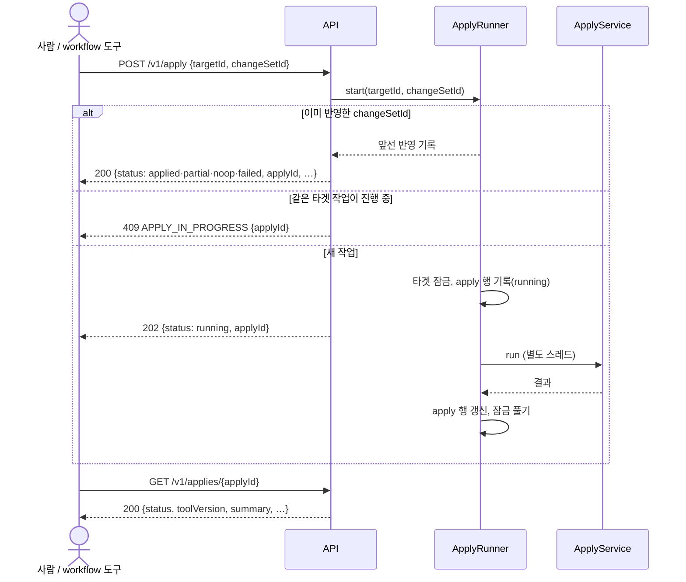

- 요청 단계에서 하는 검사(타겟 등록, 변경분 존재, 순서 `fromVersion`)는 동기로 하고, 실패하면 바로 4xx다. 그래서 202를 받으면 순서 오류는 없다.
- 잠금은 Phase 1의 파일 잠금을 쓴다. 작업 스레드가 끝날 때 푼다. 프로세스가 죽으면 운영체제가 푼다.
- 시작할 때 `running`으로 남은 apply 행은 `failed`(`INTERRUPTED`)로 바꾸고 임시 묶음을 지운다. 반영을 다시 실행하지는 않는다(FR-315). 같은 `changeSetId`로 다시 부르면 처음부터 다시 돈다(실패한 반영은 멱등 대상이 아니다).
- 서버는 uvicorn worker 1개다. 작업 스레드는 타겟마다 최대 1개다.

### 4.2 요청 종류

`POST /v1/apply`는 하나지만 본문으로 두 가지를 한다.

| 본문 | 하는 일 |
|---|---|
| `{"targetId", "changeSetId"}` | 변경분 반영. 같이 처리할 것(승인된 보류 항목, 지난번 실패 동작, 색인 어긋남)도 함께 처리한다 |
| `{"targetId"}` | 정리 반영. 새 변경분 없이 승인된 보류 항목, 지난번 실패 동작 재시도, 색인 어긋남 맞추기만 한다. 할 것이 없으면 `noop` |

- 이렇게 한 이유: 사람이 보류 항목을 승인한 뒤, 또는 LLM·검증 실패를 고친 뒤 새 변경분이 올 때까지 기다리지 않고 반영할 수 있어야 한다. 실행 API를 하나로 두는 원칙(시스템아키텍처 1절)도 지킨다.
- 이미 반영한 `changeSetId`로 다시 부르면 앞선 결과를 그대로 돌려준다(FR-205). 승인 항목을 넣고 싶으면 `changeSetId` 없이 부른다.

### 4.3 반영 흐름 (작업 안)

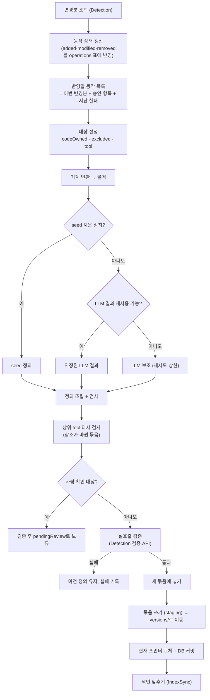

- 동작 하나의 실패(LLM 형식 오류가 계속됨, 검사 실패, 검증 실패)는 그 동작만 빠지고 나머지를 막지 않는다. 그 동작은 `failed`로 남고 다음 반영 때 다시 시도한다(4.2).
- 반영 전체를 실패로 끝내는 경우: Detection 조회·검증 API 실패, 검증 전체 실패(시험 환경 준비 실패 등), 저장소 오류, LLM 인증 오류(다른 동작도 같은 결과). 이때 포인터와 동작 상태를 바꾸지 않는다(FR-206).
- **새 묶음이 이전과 같으면**(모든 동작이 `excluded`·`codeOwned`·보류) 새 tool 버전을 만들지 않는다. 마지막 반영 명세 버전만 올린다.

### 4.4 동작 상태 (`operations` 표)

Manufacture는 `spec-store`를 읽지 않는다. 첫 변경분(빈 명세 대비 전체)부터 변경분을 차례로 쌓아 동작마다 최신 명세 조각을 자기 DB에 둔다. 그래서 승인·재시도 때 Detection을 다시 부르지 않아도 된다.

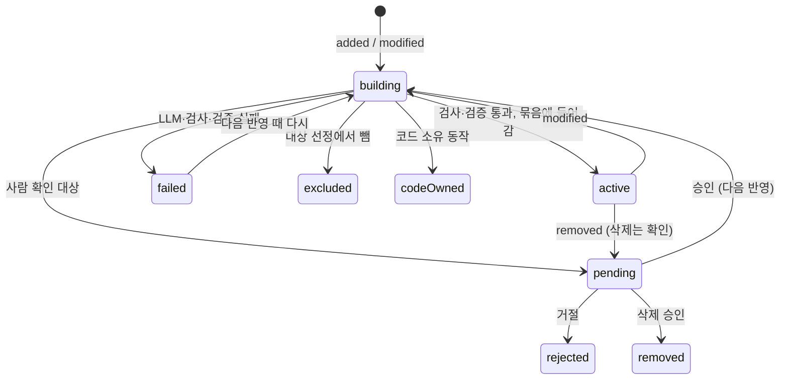

## 5. 대상 선정 (`Selector`)

### 5.1 카탈로그 규칙 (`catalog/rules.yaml`)

```yaml
version: 1
groups:                       # 묶음 이름 → 위험 등급의 바닥값
  read:          {risk: read}
  history:       {risk: read}
  communication: {risk: auto}   # auto = 메서드로 정한다 (GET→read, 그 밖→write)
  authoring:     {risk: write}
  danger:        {risk: danger}
scopeImplies: {write: [read]}  # write scope는 read를 포함한다
rules:                        # 위에서부터 처음 맞는 규칙 하나만 쓴다
  - match: {pathPrefix: /chat/}
    codeOwned: true
  - match: {scope: admin}
    exclude: ADMIN
  - match: {operationId: ["spec.*"]}
    exclude: SPEC_META
  - match: {operationId: [spaces.create, spaces.update, spaces.delete, spaces.members, spaces.addMember,
                          spaces.removeMember, spaces.setMemberRole, spaces.setStatus,
                          categories.create, categories.rename, categories.delete,
                          templates.create, templates.update, templates.delete]}
    exclude: STRUCTURE_CHANGE
  - match: {operationId: [pages.export, trash.spaces, trash.restoreSpace]}
    exclude: NOT_NEEDED
  - match: {operationId: [pages.delete, pages.move, pages.restoreVersion, attachments.upload,
                          attachments.delete, trash.pages, trash.restorePage]}
    group: danger
  - match: {operationId: [pages.versions, pages.version, pages.diff]}
    group: history
  - match: {operationId: ["comments.*", "notifications.*"]}
    group: communication
  - match: {operationId: [pages.create, pages.update, labels.attach, labels.detach]}
    group: authoring
  - match: {method: GET}
    group: read
fallback:                     # 위 규칙에 하나도 맞지 않는 새 동작
  byMethod: {GET: read, DELETE: danger}
  default: authoring
transform:                    # 기계 변환 고정값 규칙 (FR-233)
  - match: {operationId: [attachments.download]}
    fixed: {query: {format: json}}
```

- `match`의 조건: `operationId`(glob), `method`, `pathPrefix`, `tag`, `scope`(필요 scope 중 하나). 한 `match` 안의 조건은 모두 맞아야 한다(AND).
- 선정 결과는 `codeOwned`, `excluded(이유)`, `tool(묶음)` 중 하나다. `tool`이라도 묶음이 `TOOL_GROUPS_ENABLED`에 없으면 `excluded(GROUP_DISABLED)`, token scope가 모자라면 `excluded(SCOPE_MISSING)`이다(FR-212·213).
- **규칙에 없는 새 동작**은 `fallback`을 탄다. 읽기는 켜진 `read`, 삭제는 `danger`(꺼짐, 켜도 확인), 그 밖의 쓰기는 `authoring`이다. 그래서 새 읽기·쓰기 동작은 사람 개입 없이 tool이 된다(과제정의서 성공 기준 2). 쓰기는 사람이 알 수 있게 반영 기록에 `fallback: true`를 남긴다.
- 선정은 코드가 결정적으로 한다(NFR-205). LLM은 선정에 관여하지 않는다.

### 5.2 Workfluence 선정 결과 (명세 `8c83f9c6…`, 동작 75개)

| 결과 | 수 | 동작 |
|---|---|---|
| tool, `read` | 12 | spaces.list, spaces.get, pages.tree, pages.get, search.find, labels.list, labels.pages, labels.forPage, categories.list, templates.list, attachments.list, attachments.download |
| tool, `history` | 3 | pages.versions, pages.version, pages.diff |
| tool, `communication` | 8 | comments.list·create·update·delete, notifications.list·unreadCount·read·readAll |
| tool, `authoring` | 4 | pages.create, pages.update, labels.attach, labels.detach |
| tool, `danger` (기본 꺼짐) | 7 | pages.delete, pages.move, pages.restoreVersion, attachments.upload, attachments.delete, trash.pages, trash.restorePage |
| excluded `ADMIN` | 12 | audit.list, settings.get·update, users.* 9개 |
| excluded `STRUCTURE_CHANGE` | 14 | 스페이스 생성·수정·삭제·멤버·상태, 분류·템플릿 생성·수정·삭제 |
| excluded `NOT_NEEDED` | 3 | pages.export, trash.spaces, trash.restoreSpace |
| excluded `SPEC_META` | 3 | spec.openapi, spec.openapiHash, spec.openapiYaml |
| codeOwned | 9 | chat.* |

- 합계 75 = tool 27 + 위험 동작 7 + 제외 32 + 코드 소유 9. 기본 설정(위험 동작 꺼짐)에서 단순 tool은 27개, 위험 동작을 켜면 34개다. 여기에 seed 상위 tool 3개(6.4)가 더해진다.
- **과제정의서 4.3절과의 차이**: 4.3절은 "66개 중 51개가 대상(admin 15개 제외)"이라고 적었지만, 같은 절의 표와 2.4절(구조 변경·내보내기 제외)을 합치면 대상은 이보다 적다. 이 설계는 표와 2.4절을 따른다. `trash.pages`(휴지통 목록)는 표에 없지만 휴지통 복원에 페이지 id가 필요해 위험 동작 묶음에 넣었다. `labels.forPage`(페이지의 라벨)는 표의 "라벨 목록"으로 보고 읽기에 넣었다. 확정되면 과제정의서 4.3절의 숫자를 고친다.
- admin 동작은 명세의 `security`(`bearerAuth: [admin, …]`)로 세면 12개다(audit.list, settings.get·update, users.* 9개). 과제정의서는 15개라고 적었다. 차이는 과제정의서가 구조 변경 동작 일부를 admin으로 센 것으로 보인다. 결과(제외)는 같다. scope 분포는 read 26, write 34, admin 12, 없음 3(spec.*)이다.
- 이 절의 숫자는 모두 명세(Detection이 보관·서빙하는 것, Phase 1 고정 자료 `openapi-75ops.yaml`)에서 셌다. 실행 중에는 Manufacture가 Detection 변경분 조회 API로만 명세를 읽는다.

### 5.3 코드 소유 동작 (FR-215·216)

- `codeOwned` 동작이 변경분에 나오면 tool을 만들지 않고 응답·반영 기록의 `codeOwnedChanges`에 `{operationId, method, path, change}`로 담는다.
- 코어는 "codeOwned는 tool에서 뺀다"만 안다. 어떤 동작인지는 카탈로그 규칙이 정한다.

### 5.4 token scope (`TargetProfileSource`)

- manufacture는 token을 모르므로 Detection 타겟 정보 API(`GET /v1/targets/{targetId}/profile`, 11.5)로 scope 목록만 받는다. 결과에 카탈로그 `scopeImplies`를 펼쳐 비교한다.
- token에서 scope를 읽는 일은 Detection의 타겟 어댑터가 한다(11.5).
- 동작의 필요 scope는 Detection 변경분 조각의 `security`에서만 읽는다. 다른 출처(문서, 사람의 답)로 보충하지 않는다(명세가 정본).
- scope를 받지 못하면(호출 실패) 반영 전체를 실패로 끝낸다. 모르는 채로 tool을 만들지 않는다(최소 권한).

## 6. tool 정의 형식 (Phase 3과의 계약)

### 6.1 단순 tool (`kind: operation`)

```json
{
  "schema": "a4w.tool/v1",
  "kind": "operation",
  "name": "add_comment",
  "title": "페이지에 댓글 달기",
  "description": "페이지에 댓글을 단다. 본문은 마크다운이다. 원시 HTML·그림 문법은 거절된다(400). 답글은 parentId에 상위 댓글 id를 넣는다.",
  "inputSchema": {
    "type": "object",
    "properties": {
      "pageId":   {"type": "string", "description": "댓글을 달 페이지 id"},
      "body":     {"type": "string", "description": "댓글 본문 (마크다운)"},
      "parentId": {"type": ["string", "null"], "description": "답글이면 상위 댓글 id"}
    },
    "required": ["pageId", "body"],
    "additionalProperties": false
  },
  "http": {
    "method": "POST",
    "path": "/pages/{pageId}/comments",
    "contentType": "application/json",
    "bindings": [
      {"input": "pageId",   "in": "path",  "name": "pageId"},
      {"input": "body",     "in": "body",  "pointer": "/body"},
      {"input": "parentId", "in": "body",  "pointer": "/parentId"}
    ],
    "fixed": [
      {"in": "body", "pointer": "/format", "value": "markdown"}
    ],
    "success": [200, 201]
  },
  "response": {"fields": ["id", "createdAt"], "maxChars": 2000},
  "risk": "write",
  "scopes": ["write"],
  "group": "communication",
  "index": {
    "summary": "위키 페이지에 댓글이나 답글을 남긴다",
    "examples": ["이 페이지에 검토 의견 댓글 달아줘", "회의록 페이지에 답글 남겨줘", "댓글로 확인했다고 적어줘"]
  },
  "source": {
    "operationId": "comments.create", "method": "POST", "path": "/pages/{pageId}/comments",
    "specVersion": "8c83f9c6…", "fragmentSha256": "…", "structureSha256": "…"
  },
  "origin": "seed",
  "revision": "r-1f2e3d4c5b6a"
}
```

| 필드 | 뜻 | 누가 정하나 |
|---|---|---|
| `name` | 타겟 안에서 유일, `^[a-z][a-z0-9_]{2,63}$`. 바뀐 동작에도 유지 | seed / LLM (기존 이름은 코드가 고정) |
| `title`, `description` | 한국어. 명세의 제약(필수 기준 버전, 형식, 한도, 409 등)을 담는다 | seed / LLM |
| `inputSchema` | MCP `inputSchema`로 그대로 쓰는 JSON Schema(2020-12). 숨긴 칸은 없다 | 골격(코드) + 설명만 seed/LLM |
| `http.bindings` | 입력 칸 → 요청 위치. `in`은 `path`·`query`·`header`·`body` | 골격(코드)만 |
| `http.fixed` | 모델에게 보이지 않는 고정값. 숨긴 칸의 기본값과 카탈로그 `transform` 고정값 | 골격 + 숨김(seed/LLM, 코드 검사) |
| `http.success` | 성공으로 볼 상태 코드 | 골격(명세의 2xx) |
| `response.fields` | 남길 필드 경로 목록. 비우면 전체. 경로 문법 `a.b`, 배열은 `items[].id` | seed / LLM (응답 스키마에 있는 경로만) |
| `response.maxChars` | 결과 직렬화 크기 상한. 넘으면 자르고 `truncated: true` | seed / LLM, 없으면 `RESPONSE_MAX_CHARS` |
| `risk` | `read`·`write`·`danger`. 묶음 바닥값과 메서드 중 높은 것 | 코드 |
| `scopes` | 필요 scope (명세 security) | 코드 |
| `index` | 색인 요약(한 문장)과 예시 질의 3개 이상 | seed / LLM |
| `source` | 출처 동작과 지문 (7.2) | 코드 |
| `origin` | `seed`·`llm`·`llm-doc`(설명만 다시 씀) | 코드 |
| `revision` | 정의 정규 JSON(이 필드 제외)의 sha256 앞 12자, `r-` 앞머리 | 코드 |

- **요청 본문**: 본문이 객체 스키마면 최상위 속성을 입력 칸으로 펼친다(`pointer: /이름`). 객체가 아니면(배열 등) 입력 칸 하나 `body`로 둔다. 이름이 경로·질의 칸과 겹치면 본문 칸에 `body_`를 붙인다.
- **header**: `Authorization`과 타겟 어댑터가 넣는 header는 입력 칸이 되지 않는다.
- 숨긴 칸은 `inputSchema`에서 빠지고 `http.fixed`로 간다. 그래서 MCP로 나가는 정의에 숨긴 칸이 없다.

### 6.2 상위 tool (`kind: composite`)

```json
{
  "schema": "a4w.tool/v1",
  "kind": "composite",
  "name": "comment_on_page_by_title",
  "title": "제목으로 페이지를 찾아 댓글 달기",
  "description": "…",
  "inputSchema": {"type": "object", "properties": {
      "title": {"type": "string"}, "spaceKey": {"type": "string"}, "body": {"type": "string"}},
    "required": ["title", "body"], "additionalProperties": false},
  "steps": [
    {"id": "find", "tool": "search_pages",
     "args": {"q": {"$input": "title"}, "spaceKey": {"$input": "spaceKey"}},
     "expect": {"pointer": "/items", "count": "one"}},
    {"id": "comment", "tool": "add_comment",
     "args": {"pageId": {"$step": "find", "pointer": "/items/0/id"}, "body": {"$input": "body"}}}
  ],
  "output": {"$step": "comment"},
  "risk": "write", "scopes": ["write"], "group": "communication",
  "index": {"summary": "…", "examples": ["…"]},
  "origin": "seed", "revision": "r-…"
}
```

- 값 참조는 세 가지뿐이다: `{"$input": 이름}`, `{"$step": id, "pointer": JSON Pointer}`, `{"$const": 값}`. 입력이 비어 있으면(선택 칸) 그 인자를 보내지 않는다.
- step은 순서대로 돈다. 분기·반복 문법은 없다. 실행기가 제공하는 정해진 기능은 `expect` 하나다.
  - `expect.count`: `one`(정확히 하나, 0개면 `NOT_FOUND`, 여럿이면 `AMBIGUOUS`와 후보 목록), `some`(하나 이상).
  - Workfluence 목록은 쪽 나누기가 없어(명세 머리말 "목록: 쪽 나누기가 없다") 페이지 넘기기 기능은 만들지 않는다. 필요한 타겟이 생기면 `expect`처럼 정해진 기능으로 더한다.
- step의 `tool`은 같은 tool 버전 안의 `kind: operation` tool만 참조한다(FR-225). 상위 tool이 상위 tool을 부르지 않는다.
- `risk`는 step tool 등급 중 가장 높은 것, `scopes`는 step scope의 합집합이다. 코드가 정한다(부록 4.4). 위험 동작을 품은 상위 tool은 위험 동작 tool과 같이 다룬다.
- 상위 tool을 실행하는 실행기는 step마다 단순 tool 실행을 그대로 쓴다. 호출 규약은 step마다 적용된다.

### 6.3 handler (`kind: handler`, 자리만)

`{"kind": "handler", "handler": "<registry 이름>", "inputSchema": …}`. 실행기는 registry에서 사람이 작성한 handler를 찾아 부른다. Workfluence에 필요한 경우가 없어 interface(`Handler.run(args, context)`)만 두고, 정의 검사에서 등록되지 않은 handler는 거절한다(FR-224).

### 6.3.1 입력 칸 최소화 (사용자 요구, 2026-10-13)

MCP로 나가는 tool의 입력 칸은 Inference의 작은 모델이 감당할 만큼 적어야 한다. 두 가지 규칙을 둔다.

**(1) 기본값을 최대한 둔다.**

| 칸 | 처리 |
|---|---|
| 필수 칸 | 보인다. 기본값을 줄 수 있으면 숨기고 고정값으로 보낸다(`http.fixed`) |
| 선택 칸, 모델이 자주 정할 값 | 보인다. 기본값이 있으면 `default`를 적는다 |
| 선택 칸, 그 밖 | 숨긴다. 기본값을 주면 고정값으로 보내고, 주지 않으면 **보내지 않는다**(서버 기본값). 보내지 않는 칸은 `http.omitted`에 이름을 남긴다(빠뜨린 것과 구별하기 위해) |

- 보이는 칸 수 상한 `TOOL_MAX_VISIBLE_INPUTS`(기본 예 4)을 넘으면 검사 코드 `TOO_MANY_INPUTS`로 거절하고 LLM에 다시 요청한다. seed도 같은 검사를 받는다.
- 프롬프트에 "숨길 수 있는 칸은 숨기고, 보이는 칸은 꼭 필요한 것만"을 넣는다.

**(2) agent가 늘 쓰는 맥락(theme·identity)은 고정한다.**

agent가 늘 같은 작업 공간(Workfluence는 agent의 기본 스페이스)이나 같은 신원으로 일한다면, 그 값을 모델에게 묻지 않는다. 카탈로그 규칙에 **맥락 키**와 그 키가 채울 칸을 적는다.

```yaml
# rules.yaml
context:
  homeSpace:                       # agent가 늘 쓰는 스페이스
    bind:
      - {in: query, name: space}   # 검색·페이지 트리의 space 칸
      - {in: body, pointer: /space}  # 페이지 만들기의 space 칸
```

- 기계 변환이 이 칸을 입력에서 빼고 `http.fixed`에 **값 대신 맥락 키**로 넣는다: `{"in": "query", "name": "space", "context": "homeSpace"}`.
- 실제 값은 **실행하는 쪽이 넣는다.** tool 정의에는 값이 없다. 그래서 값을 바꿔도 tool을 다시 만들지 않는다.
  - Phase 3 공용 MCP server `a4w_mcp`: agent 설정 `config/agents/<agentId>/<targetId>.env`의 `AGENT_CONTEXT`(예: `homeSpace=<스페이스 id>`). 처음에는 타겟 설정에 두었으나 agent마다 다르므로 옮겼다(Phase 3 설계 3.1절)
  - Phase 2 실호출 검증: Detection의 시험 환경이 같은 키를 채운다(Workfluence는 `homeSpace` = 이번 시험 스페이스 id). 그래서 검증 쓰기도 시험 스페이스 안에 머문다.
- 실행기(`a4w_tools`)는 `execute(tool, args, context=…)`로 맥락을 받는다. 정의가 요구하는 맥락 키가 없으면 HTTP를 부르지 않고 `CONTEXT_MISSING`.
- identity는 Workfluence에서 token 주인으로 정해지므로(작성자·알림 대상 등은 입력 칸이 아님) 지금은 맥락 키가 필요 없다. 다른 타겟에서 "내 사용자 id" 같은 칸이 있으면 같은 방식(`agentUser` 등)으로 더한다.
- 어떤 칸을 맥락으로 묶을지와 값은 사람이 정한다(카탈로그 규칙은 Git 검토, 값은 타겟 설정). Workfluence의 `homeSpace` 값은 Phase 3 전에 정한다.

**(3) 남은 칸도 모델이 "무엇을 넣을지" 고민하지 않게 한다** (사용자 요구, 2026-10-13).

| 장치 | 내용 | 누가 |
|---|---|---|
| 기계 기본 숨김 | 명세에 기본값이 있는 선택 칸(예: `format`, `limit`)은 기계 변환 단계에서 숨김(보내지 않음, 서버 기본값)으로 시작한다. 글 쪽(seed·LLM)이 일부러 드러낼 때만 보인다 | 코드 (결정적) |
| 값의 출처 | 보이는 칸의 설명에 값을 어디서 얻는지 적는다(예: "search_pages 결과의 pageId"). 출처가 없는 칸 설명은 검사에서 거절하지 않지만 프롬프트로 강하게 요구한다 | seed·LLM |
| 사람이 아는 값 | id를 넣어야 하는 일은, 사람이 아는 값(제목·이름)으로 찾아 주는 상위 tool을 함께 둔다(예: `comment_on_page_by_title`). 색인 요약에 상위 tool을 먼저 드러낸다 | seed |
| 짧은 선택지 | enum이 긴 칸은 숨기고 고정값을 쓴다. 보여야 하면 설명에 언제 무엇을 고르는지 적는다 | seed·LLM |

- 결과: 대부분의 tool은 보이는 칸이 1~3개이고, 모두 "요청 글에서 바로 뽑거나, 앞 tool 결과에서 그대로 옮기는" 값이다.

### 6.4 Workfluence seed 계획

seed는 구현 단계에서 형식을 확정한 뒤 작성한다(FR-235). 이름 계획은 다음과 같다(구현 때 바뀔 수 있다).

| 묶음 | 동작 → tool 이름 |
|---|---|
| read | spaces.list `list_spaces`, spaces.get `get_space`, pages.tree `list_pages`, pages.get `read_page`, search.find `search_pages`, labels.list `list_labels`, labels.pages `list_pages_by_label`, labels.forPage `list_page_labels`, categories.list `list_categories`, templates.list `list_templates`, attachments.list `list_attachments`, attachments.download `download_attachment` |
| history | pages.versions `list_page_versions`, pages.version `read_page_version`, pages.diff `compare_page_versions` |
| communication | comments.list `list_comments`, comments.create `add_comment`, comments.update `edit_comment`, comments.delete `delete_comment`, notifications.list `list_notifications`, notifications.unreadCount `count_unread_notifications`, notifications.read `mark_notification_read`, notifications.readAll `mark_all_notifications_read` |
| authoring | pages.create `create_page`, pages.update `update_page`, labels.attach `add_page_label`, labels.detach `remove_page_label` |
| danger | pages.delete `delete_page`, pages.move `move_page`, pages.restoreVersion `restore_page_version`, attachments.upload `upload_attachment`, attachments.delete `delete_attachment`, trash.pages `list_trashed_pages`, trash.restorePage `restore_trashed_page` |
| 상위 tool | `read_page_by_title`(검색 → 읽기), `comment_on_page_by_title`(검색 → 댓글), `label_page_by_title`(검색 → 라벨) |

- 상위 tool의 step 응답 경로(예: 검색 결과의 `/items/0/id`)는 seed 작성 때 명세의 응답 스키마와 실호출로 확정한다.
- `update_page`의 설명에는 "본문 전체 교체, 읽은 `currentVersionNo`를 `baseVersionNo`로, 다르면 409"를 담는다(명세 머리말).

### 6.5 manifest (`toolset.v1`)

```json
{
  "schema": "a4w.toolset/v1",
  "targetId": "workfluence",
  "toolVersion": "tv-000003-9a8b7c6d",
  "parent": "tv-000002-1a2b3c4d",
  "specVersion": "8c83f9c6…",
  "changeSetId": "cs-…",
  "createdAt": "2026-10-13T06:00:00Z",
  "tools": [
    {"name": "add_comment", "kind": "operation", "file": "tools/add_comment.json",
     "revision": "r-1f2e3d4c5b6a", "risk": "write", "scopes": ["write"],
     "operationId": "comments.create", "verified": "passed"}
  ]
}
```

- `verified`: `passed`(이번 또는 이전 버전에서 통과, 정의가 그 뒤 바뀌지 않음), `unverified`(시나리오 없음, 설정이 허용한 경우만).
- Phase 3은 manifest와 tool 파일, `a4w_tools`의 두 스키마에만 의존한다. SQLite를 읽지 않는다(시스템아키텍처 4.1절).

## 7. 기계 변환과 seed

### 7.1 기계 변환 (`SpecTransformer`)

- interface: `skeleton(fragment, rules) -> Skeleton`. `Skeleton`은 입력 칸 목록(이름, JSON Schema, 필수 여부, 명세 설명, 위치), HTTP 매핑, 고정값, 응답 스키마 요약(필드 경로 목록), 필요 scope, 메서드다.
- 구현은 OpenAPI 3.x(`openapi3`) 하나다(FR-321). Detection이 넘긴 조각은 `$ref`가 이미 풀려 있다(Phase 1 5.1절). 다른 곳을 조회하지 않는다(FR-231).
- 요청 형식이 여러 개면 `TOOL_REQUEST_CONTENT_TYPES` 순서로 처음 있는 것을 고른다. 응답 형식이 여러 개면 `application/json`을 고른다. 응답을 JSON으로 바꾸는 질의 값처럼 명세만으로 알 수 없는 것은 카탈로그 `transform` 규칙으로 고정한다(첨부 받기의 `format=json`, 부록 4.3).
- 순환 참조 표시(`x-a4w-cycle`)가 있는 스키마는 그 자리를 `{"type": "object"}`로 둔다.
- 같은 조각과 규칙이면 늘 같은 골격이다. 입력 칸 순서는 path → query → header → body, 같은 위치 안은 명세 순서다.

### 7.2 지문 (`fingerprint.py`)

| 지문 | 계산 | 쓰임 |
|---|---|---|
| `fragmentSha256` | 조각의 정규 JSON(`a4w_core.openapi.canonical_json`) sha256 | seed가 그대로 맞는지 |
| `structureSha256` | 문서용 키를 지운 조각(`strip_doc_keys`)의 정규 JSON sha256 | 설명만 바뀌었는지 |
| `inputSha256` (칸마다) | 골격 입력 칸 하나(이름·위치·스키마, 문서용 키 제외)의 sha256 | 바뀌지 않은 칸의 설명을 코드가 옮길지 |

### 7.3 seed 찾기 (`SeedCatalog`)

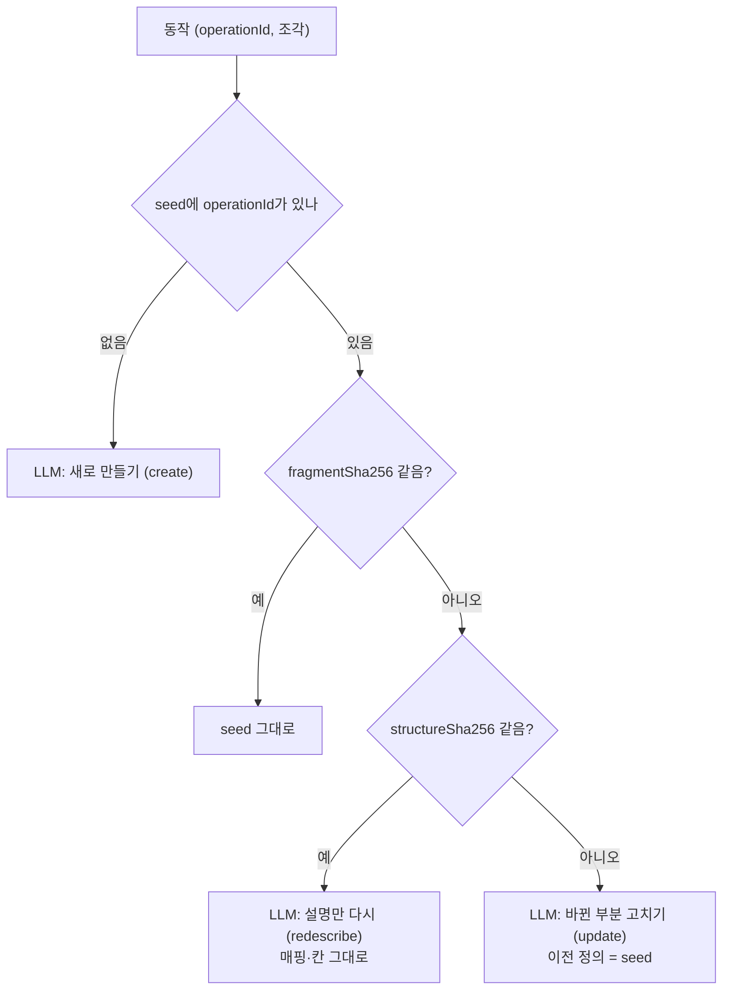

- "이전 정의"는 seed가 아니라 **현재 묶음의 정의**가 우선이다. 이미 LLM이 한 번 고친 동작이 또 바뀌면 그 정의를 이전 정의로 쓴다. seed 비교는 현재 묶음에 그 동작이 없을 때(첫 반영, 승인·재시도)만 한다.
- seed 정의도 같은 검사(8절)와 실호출 검증(11절), 색인을 거친다(FR-238). 특히 seed의 `http`가 기계 변환 결과와 다르면 seed를 쓰지 않고 실패로 기록한다(seed 작성 실수를 잡는다).
- seed 파일은 사람이 쓰므로 `revision`·`source`의 지문은 seed 작성 도구(`python -m a4w_manufacture.seedtool stamp`)가 채운다. 이 도구는 명세 파일을 읽어 조각을 만들고 지문을 넣는다. 반영 흐름에서는 쓰지 않는다.

## 8. 정의 검사 (`DefinitionChecker`)

모든 정의(seed·LLM·상위 tool)가 같은 검사를 거친다. 하나라도 걸리면 그 정의는 쓰지 않는다. 오류는 코드와 칸 이름으로 남기고, LLM 재요청 때 그대로 붙인다.

| 코드 | 검사 |
|---|---|
| `SCHEMA_INVALID` | `tool.v1.schema.json` 불통과 |
| `MAPPING_CHANGED` | `http`가 골격과 다름 (숨긴 칸의 `fixed`만 허용) |
| `INPUT_MISSING` | 골격의 입력 칸이 `inputSchema`에도 `fixed`에도 없음 |
| `INPUT_INVENTED` | 골격에 없는 입력 칸이 있음 |
| `HIDDEN_REQUIRED` | 필수 칸·경로 칸을 기본값 없이 숨김 |
| `TOO_MANY_INPUTS` | 보이는 칸이 `TOOL_MAX_VISIBLE_INPUTS`를 넘음 (6.3.1) |
| `DEFAULT_INVALID` | 기본값이 칸 스키마에 맞지 않음 |
| `NAME_FORMAT` | 이름 형식 위반 |
| `NAME_TAKEN` | 다른 동작의 tool 이름과 겹침 |
| `NAME_CHANGED` | 바뀐 동작인데 이름이 이전과 다름 (코드가 이전 이름으로 고정하므로 seed 실수에서만 나옴) |
| `RESPONSE_FIELD_UNKNOWN` | `response.fields`가 응답 스키마에 없는 경로 |
| `EXAMPLE_HAS_ID` | 예시 질의에 UUID·긴 16진·숫자 id 같은 값이 있음 (부록 4.3) |
| `TEXT_LIMIT` | 설명·요약·예시 길이 상한 위반, 예시 질의 3개 미만 |
| `STEP_UNKNOWN_TOOL` | 상위 tool step이 묶음에 없는 tool 또는 상위 tool을 참조 |
| `STEP_BINDING_INVALID` | step 인자 이름이 대상 tool의 입력 칸이 아니거나, 필수 칸이 빠짐, `$input`이 상위 tool 입력에 없음, `$step`이 뒤 step을 가리킴 |
| `HANDLER_UNKNOWN` | 등록되지 않은 handler |

- 상위 tool은 step이 참조하는 tool이 이번 반영에서 바뀌거나 빠지면 다시 검사한다. 걸리면 그 상위 tool은 `pending`(`COMPOSITE_BROKEN`)이다. 자동으로 고치지 않는다(사람이 seed를 고친다).
- 텍스트 길이 상한은 카탈로그 규칙이 아니라 Manufacture 설정이다(타겟 무관): 설명 600자, 요약 120자, 예시 질의 60자. (`.env`의 `TOOL_TEXT_LIMITS`, 3.2에 더함)

## 9. LLM 보조

### 9.1 세 가지 작업

| 작업 | 언제 | LLM이 내는 것 | 코드가 하는 것 |
|---|---|---|---|
| `create` | seed에도 현재 묶음에도 없는 동작 | 이름, 제목, 설명, 칸 설명, 숨길 칸과 기본값, `response.fields`, 색인 요약, 예시 질의 | 골격 조립, 이름 겹침 검사 |
| `update` | 구조가 바뀐 동작 | 위와 같음 | **이름은 이전 이름으로 덮어씀**. `inputSha256`이 같은 칸은 이전 설명을 그대로 옮김(LLM 출력 무시) |
| `redescribe` | 설명만 바뀐 동작 | 제목, 설명, 칸 설명, 색인 요약, 예시 질의 | 이름·숨김·기본값·`response`는 이전 정의 그대로 |

- `update`에서 바뀌지 않은 칸의 설명을 코드가 옮기는 이유: 지시로 "고치지 마라"를 주는 것보다 확실하다(부록 4.3, gpt-oss가 28/36 고쳐 씀). GLM-5.2는 지켰지만 모델이 바뀌어도 같게 하려는 것이다.
- **상위 tool 제안**은 이번 phase에서 자동 반영하지 않는다. `LLM_PROPOSE_COMPOSITES=true`이면 새 tool이 생긴 반영에서 한 번 제안을 받아 검사를 통과한 것을 모두 `pending`(`NEW_COMPOSITE`)으로 둔다. 기본값은 `false`다.

### 9.2 LLM 출력 스키마 (`create`·`update`)

```json
{
  "type": "object", "additionalProperties": false,
  "required": ["name", "title", "description", "inputs", "index"],
  "properties": {
    "name": {"type": "string"},
    "title": {"type": "string"},
    "description": {"type": "string"},
    "inputs": {"type": "object", "additionalProperties": {
      "type": "object", "additionalProperties": false, "required": ["description"],
      "properties": {"description": {"type": "string"}, "hide": {"type": "boolean"}, "default": {}}}},
    "responseFields": {"type": "array", "items": {"type": "string"}},
    "index": {"type": "object", "additionalProperties": false, "required": ["summary", "examples"],
      "properties": {"summary": {"type": "string"},
                     "examples": {"type": "array", "items": {"type": "string"}, "minItems": 3}}}
  }
}
```

- `inputs`의 키는 골격 칸 이름이어야 한다. 빠지거나 더한 키는 `INPUT_MISSING`·`INPUT_INVENTED`로 거절한다.
- 조립: 골격 + LLM 출력 → `ToolDefinition`. 숨긴 칸은 `inputSchema`에서 빼고 기본값을 `http.fixed`로 옮긴다.

### 9.3 LLM 입력

| 구성 | 내용 |
|---|---|
| system | 작업별 프롬프트 파일(9.4). tool 설계 원칙과 출력 스키마 |
| user (JSON) | 골격(칸 이름·스키마·명세 설명·필수·위치), 명세 조각의 `summary`·`description`, 응답 필드 경로 목록, 이전 정의(`update`·`redescribe`), 본보기 seed, 기존 tool 이름 목록 |

- **본보기 고르기**(FR-239): seed 단순 tool 중 (1) 같은 tag, (2) 같은 메서드 계열(읽기·쓰기), (3) 이름 순으로 앞에서 `LLM_EXAMPLE_COUNT`개. 결정적이다. 이전 정의 자신은 본보기에서 뺀다.
- 비밀(token, key)은 넣지 않는다. 명세 조각에는 비밀이 없다(NFR-202).

### 9.4 프롬프트 파일

```
agents/manufacture/prompts/
  tool_create.v1.md
  tool_update.v1.md
  tool_redescribe.v1.md
  composite_propose.v1.md
```

- 이름 규칙 `<작업>.v<번호>.md`. 쓸 버전은 `.env`의 `PROMPT_VERSIONS`(예: `tool_create=v1,tool_update=v1,tool_redescribe=v1,composite_propose=v1`)로 고른다. 내용을 바꿀 때는 새 번호의 파일을 더한다(재사용 지문이 바뀐다).
- 첫 버전 내용은 평가 스크립트의 `SYS_A`를 바탕으로 한다(부록 3.1).

### 9.5 호출과 재시도

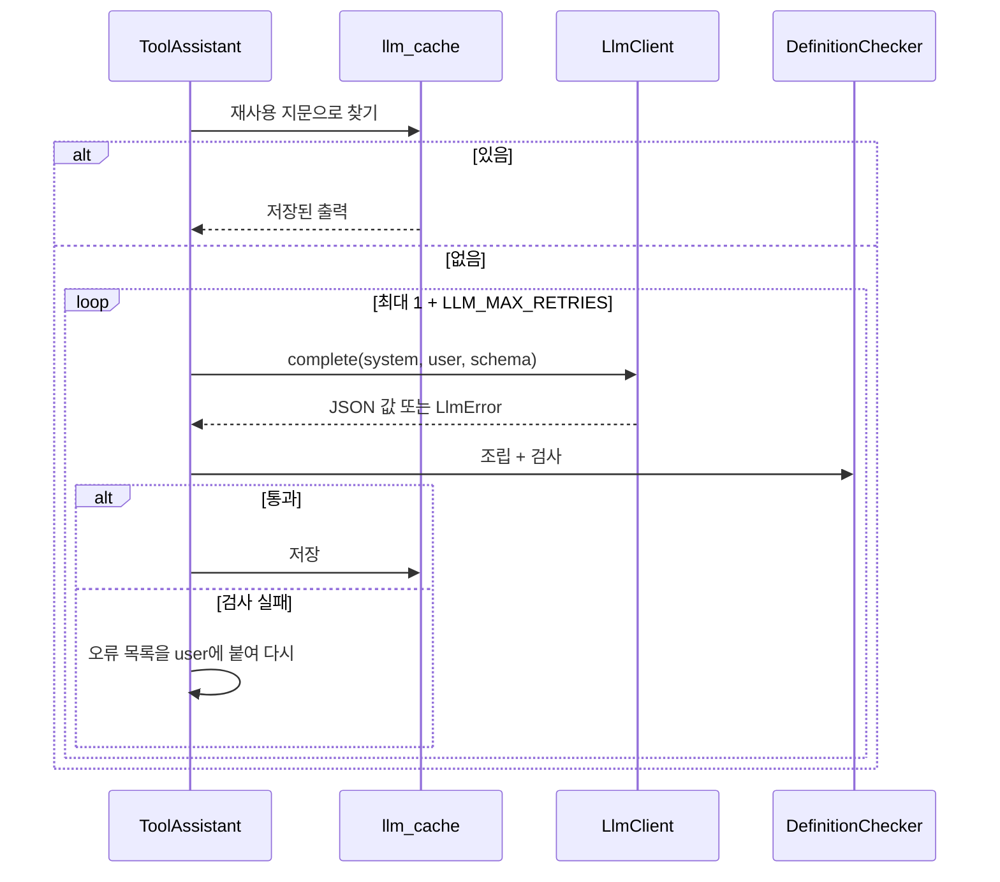

- **재사용 지문**(FR-244): sha256(정규 JSON `{작업, fragmentSha256, 프롬프트 이름@버전, 모델, 이전 정의 revision, 본보기 revision 목록, 기존 이름 목록 sha256}`). 같은 지문이면 LLM을 부르지 않는다. 검사를 통과한 출력만 저장한다.
- 형식 오류(JSON 아님, 스키마 불일치, `finish_reason ≠ stop`)는 `LlmClient`가 재시도하고, 코드 검사 실패는 `ToolAssistant`가 재시도한다. 두 재시도를 합쳐 반영당 `LLM_MAX_CALLS_PER_APPLY`를 넘지 않는다. 넘으면 남은 동작은 `failed`(`LLM_BUDGET_EXCEEDED`)이고 다음 반영 때 이어서 한다.
- 오류 종류별 처리: `auth`는 반영 전체 실패, `timeout`·`rate_limit`·`unavailable`·`output_format`은 그 동작만 `failed`.

## 10. LLM 클라이언트 (`a4w_clients.llm`)

```python
@dataclass(frozen=True)
class LlmRequest:
    system: str
    user: str
    output_schema: dict        # JSON Schema
    model: str
    timeout_seconds: float
    max_output_tokens: int
    temperature: float | None = None
    reasoning_effort: str | None = None

@dataclass(frozen=True)
class LlmResult:
    value: dict                # 스키마를 통과한 값
    model: str                 # 응답의 실제 모델
    usage: LlmUsage            # prompt·completion·reasoning 토큰
    attempts: int

class LlmError(Exception):
    kind: Literal["auth", "timeout", "rate_limit", "output_format", "unavailable"]

class LlmClient(ABC):
    @abstractmethod
    def complete(self, request: LlmRequest) -> LlmResult: ...
```

### 10.1 `openai_compatible`

| 항목 | 처리 |
|---|---|
| 요청 | `POST {LLM_BASE_URL}/v1/chat/completions`, `Authorization: Bearer {LLM_API_KEY}`, `messages=[system, user]`, `max_tokens`, `temperature`, (값이 있으면) `reasoning_effort` |
| `json_object` | `response_format: {"type": "json_object"}`. system 끝에 "출력 JSON Schema"를 붙인다 |
| `json_schema` | `response_format: {"type": "json_schema", "json_schema": {"name", "schema", "strict": true}}` (선택용, 기본 아님) |
| 성공 판정 | 200, `choices[0].finish_reason == "stop"`, `message.content`가 JSON 객체, 우리 쪽 스키마 검사 통과 |
| 오류 분류 | 401·403 → `auth`, 429 → `rate_limit`, 408·시간 초과 → `timeout`, 5xx·접속 실패 → `unavailable`, JSON 아님·스키마 불일치·`length` → `output_format` |
| 재시도 | `rate_limit`(`Retry-After`가 있으면 따름), `unavailable`, `output_format`을 `LLM_MAX_RETRIES`번. 형식 오류 재시도는 앞선 오류 요약을 user 끝에 붙인다 |
| 버리는 것 | `message.reasoning_content`는 읽지 않는다. 로그·DB에 남기지 않는다(FR-254) |
| 로그 | 모델, 소요 시간, 토큰 수, 시도 수, 결과 종류만 (NFR-206) |

- proxy는 환경변수를 따른다(`trust_env`). LLM 주소는 `NO_PROXY` 밖이라 proxy로 나간다.
- `anthropic`·`claude_cli`는 등록만 하고 만들면 `UnsupportedProvider`(시작 시 설정 오류)다(FR-252).

### 10.2 계약 시험

같은 시험 묶음을 provider마다 돌린다(FR-256, AC-7). HTTP 응답은 실제 엔드포인트에서 녹화한 것(key·사고 내용 제거)을 `httpx.MockTransport`로 재생한다.

| 경우 | 기대 |
|---|---|
| 정상 | `LlmResult`, `value`가 스키마 통과 |
| 스키마 불일치 후 정상 | 재시도 1회, `attempts == 2` |
| `finish_reason: length` 계속 | `LlmError(output_format)` |
| 401 | `LlmError(auth)`, 재시도 없음 |
| 429 후 정상 | `Retry-After`만큼 기다린 뒤 성공 (시계는 가짜) |
| 시간 초과 | `LlmError(timeout)` |

## 11. 실호출 검증과 Detection 보강

### 11.1 역할 나누기

| | manufacture (`VerifyStep`) | detection (보강) |
|---|---|---|
| 정하는 것 | 무엇을 검증할지(대상 tool), 어떤 입력으로(시나리오), 결과로 무엇을 할지(묶음에 넣기·보류·실패) | 타겟에서 어떻게 실행할지 |
| 하는 일 | 검증 요청 만들기, 결과 조회, 판단 | 받은 정의 검사, 시험 환경 준비, 공통 실행기로 호출, 호출 규약, 정리, scope 확인 |
| 가진 것 | 카탈로그(시나리오) | 타겟 주소, token, TLS, 타겟 어댑터(scope·오류 해석·시험 환경) |

- 대상: 이번 반영에서 새로 만들었거나 `revision`이 바뀐 tool(FR-261). `redescribe`로 설명만 바뀐 tool은 HTTP가 같으므로 검증을 건너뛰고 이전 결과를 잇는다.
- 위험 동작 tool과 보류 대상도 검증한다. 보류 항목에 검증 결과를 붙여 두면 사람이 판단하기 쉽고, 승인 뒤 다시 검증하지 않아도 된다.
- **Detection은 보강 뒤에도 LLM을 쓰지 않는다**(과제정의서 1.2절 "rule/code 기반"). 새 일은 모두 결정적이다: token 클레임 읽기, 정해진 순서의 시험 환경 준비·정리, 선언형 정의대로의 실행, 기대값 비교, 이름 맞추기 규칙의 자동 시나리오. 판단이 필요한 일(이름·설명, 나중에 LLM으로 시나리오를 쓴다면 그것도)은 manufacture가 하고 결과만 넘긴다.
- Detection 안의 순서: 정의 검사 → 시험 환경 준비 → 읽기 tool → 쓰기 tool → 상위 tool → 시험 환경 정리. 모든 호출은 공통 실행기로 하므로 호출 규약(한도·재시도)을 그대로 지킨다(FR-265).
- **아키텍처 원칙과의 관계**: 시스템아키텍처 1절은 서비스 사이 호출을 "조회와 tool 사용(MCP)"으로 한정했다. 검증 요청은 Detection에 일을 시키는 호출이라 이 원칙을 넓힌다. 다만 숨은 연쇄는 아니다. manufacture 반영 작업의 한 단계로 Detection을 부르고, Detection은 다른 서비스를 부르지 않는다. 시스템아키텍처 1절을 "조회, 검증 요청, tool 사용"으로 고친다(21절).

### 11.2 흐름

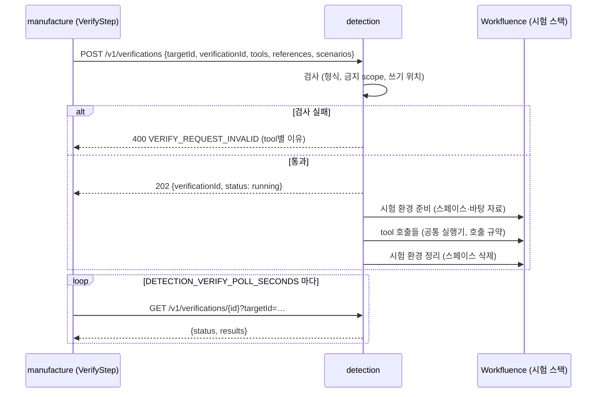

- `verificationId`는 manufacture가 정한다(`vf-` + applyId + 차수). 같은 id로 다시 보내면 Detection은 새로 실행하지 않고 그 검증의 상태를 돌려준다(멱등). manufacture가 폴링 중 재시작해도 같은 결과를 이어 받는다.
- manufacture는 `DETECTION_VERIFY_TIMEOUT_SECONDS`까지 기다린다. 넘으면 반영 전체를 실패(`VERIFY_TIMEOUT`)로 끝내고 포인터를 바꾸지 않는다.

### 11.3 Detection 검증 API (FR-332)

`POST /v1/verifications`

```json
{
  "targetId": "workfluence",
  "verificationId": "vf-ap-20261013T060000Z-k3j9q1-1",
  "tools": [{"…tool 정의 (a4w.tool/v1)…": ""}],
  "references": [{"…상위 tool step이 참조하지만 이번 검증 대상이 아닌 단순 tool 정의…": ""}],
  "scenarios": {"add_comment": {"call": {"args": {"pageId": "${sandbox.pageId}", "body": "검증 댓글 ${run.id}"}},
                                "expect": {"ok": true, "fields": ["id"]}}}
}
```

`GET /v1/verifications/{verificationId}?targetId=workfluence` 응답

```json
{
  "verificationId": "vf-…",
  "targetId": "workfluence",
  "status": "done",
  "startedAt": "…", "finishedAt": "…",
  "results": [
    {"tool": "add_comment", "revision": "r-1f2e3d4c5b6a", "result": "passed", "calls": 1, "elapsedMs": 412},
    {"tool": "list_pages_by_label", "revision": "r-…", "result": "unverified", "reason": "NO_SCENARIO"},
    {"tool": "update_page", "revision": "r-…", "result": "failed",
     "error": {"code": "TARGET_ERROR", "targetCode": "VERSION_CONFLICT", "requestId": "…", "httpStatus": 409}}
  ],
  "sandbox": {"prepared": true, "cleanup": "ok", "cleanupFailures": []},
  "error": null
}
```

| 값 | 뜻 |
|---|---|
| `status` | `running`, `done`(tool별 결과 있음), `failed`(검증 전체 실패: 시험 환경 준비 실패 등, `error`에 코드) |
| `result` | `passed`, `failed`, `unverified`(시나리오를 만들 수 없음 `NO_SCENARIO`, 또는 시나리오가 쓰는 맥락 키 값이 이번 시험 환경에 없음 `SANDBOX_VALUE_MISSING`), `skipped`(참조 tool이 실패해 상위 tool을 돌리지 않음) |

| HTTP | `code` | 때 |
|---|---|---|
| 400 | `VERIFY_REQUEST_INVALID` | 정의 형식 오류, 금지 scope, 시험 환경 밖을 쓰는 시나리오, tool 수 상한 초과 (`details`에 tool별 이유) |
| 404 | `TARGET_NOT_FOUND` · `VERIFICATION_NOT_FOUND` | |
| 409 | `VERIFY_IN_PROGRESS` | 같은 타겟의 다른 검증이 진행 중 (FR-336) |
| 501 | `UNSUPPORTED_SANDBOX` | 타겟에 검증 환경 구현이 없음 |

- 검증 작업 실패 코드(`error.code`): `SANDBOX_UNAVAILABLE`(준비 실패), `TARGET_UNAVAILABLE`(접속 실패), `TARGET_AUTH`(401·403 token 문제), `INTERRUPTED`, `INTERNAL_ERROR`.
- 검증 잠금은 변경 식별 잠금과 따로다(`locks/verify-<targetId>.lock`). 변경 식별은 token을 쓰지 않으므로 둘이 같이 돌아도 호출 한도가 겹치지 않는다.
- 기록은 Detection SQLite의 `verifications` 표(id, target, 상태, 요청 요약, 결과 JSON, 시각)에 둔다. 요청의 tool 정의 전문은 남기지 않고 이름·revision만 남긴다. `DETECTION_VERIFY_RESULT_DAYS`가 지난 행은 다음 검증 접수 때 지운다.
- 시작할 때 `running`으로 남은 행은 `failed`(`INTERRUPTED`)로 바꾼다. 남은 시험 스페이스는 다음 검증의 준비 단계가 지운다.

### 11.4 받은 정의 검사 (`verify/guard.py`, FR-334)

Detection은 manufacture가 보낸 정의를 그대로 실행하지 않는다.

| 검사 | 거절 조건 |
|---|---|
| 형식 | `a4w_tools`의 `tool.v1` 스키마 불통과, 상위 tool step이 `tools`·`references`에 없는 tool을 참조 |
| 금지 scope | 정의의 `scopes`에 `VERIFY_DENY_SCOPES`(Workfluence는 `admin`)가 있음 |
| 경로 | 정의의 `http.path`가 Detection이 보관한 현재 명세에 없는 `(METHOD, path)` |
| 쓰기 위치 | 쓰기 tool(메서드가 GET이 아님)의 시나리오에서 경로 칸 값이 `${sandbox.*}`·`${saved.*}`·`${setup.*}`가 아님 |

- 경로 검사는 Detection이 가진 명세(spec-store의 현재 버전)로 한다. manufacture가 명세에 없는 곳을 부르게 할 수 없다.
- 이 검사는 manufacture의 정의 검사(8절)와 겹치지만 일부러 둔다. 타겟을 부르는 쪽이 마지막으로 막는다.

### 11.5 타겟 정보 API (FR-331)

`GET /v1/targets/{targetId}/profile`

```json
{"targetId": "workfluence", "tokenScopes": ["admin", "read", "write"],
 "verification": {"available": true, "sandbox": "workfluence_space",
                  "contextKeys": ["spaceId", "spaceName", "pageId", "pageTitle", "currentVersionNo", "labelName", "commentId"]}}
```

- `tokenScopes`는 타겟 어댑터의 `ScopeProvider`가 정한다. Workfluence 구현(`workfluence_jwt`): token 확인 API(`/me` 등)가 없어 token(JWT) payload의 `scope` 클레임(공백 구분)을 서명 검증 없이 읽는다. 권한을 주는 용도가 아니라 "권한이 없을 tool을 미리 빼는" 용도라 서명 검증이 필요 없다. 실제로 모자라면 실행 때 403 `INSUFFICIENT_SCOPE`로 드러난다. 클레임을 읽지 못하는 token이면 `config` 구현(`TARGET_TOKEN_SCOPES`)을 쓴다.
- token 값과 주소는 응답에 넣지 않는다.
- `contextKeys`는 시나리오에서 쓸 수 있는 `${sandbox.*}` 이름이다. manufacture는 시나리오의 `${sandbox.*}`가 이 목록 안인지 미리 검사한다.
- 타겟 token이 없는 타겟이면 `tokenScopes: []`, `verification.available: false`다.

### 11.6 시험 환경 (`VerifySandbox`, Detection 안)

```python
class VerifySandbox(ABC):
    def prepare(self) -> SandboxContext: ...       # 시험 위치 준비, 값 묶음(예: spaceId, pageId)을 돌려줌
    def track(self, kind: str, ref: str) -> None: ...  # 검증 중 만든 자료를 기록
    def cleanup(self) -> CleanupReport: ...        # 기록한 자료 정리, 실패는 보고
```

- Workfluence 구현(`workfluence_space`)은 17.2절 W1·W4·W5 답을 따른다. 시험 스택에는 쓸 만한 스페이스도 고정 시험 자료도 없다. 그래서 **검증마다 시험 스페이스를 새로 만들고, 끝나면 통째로 지운다.**

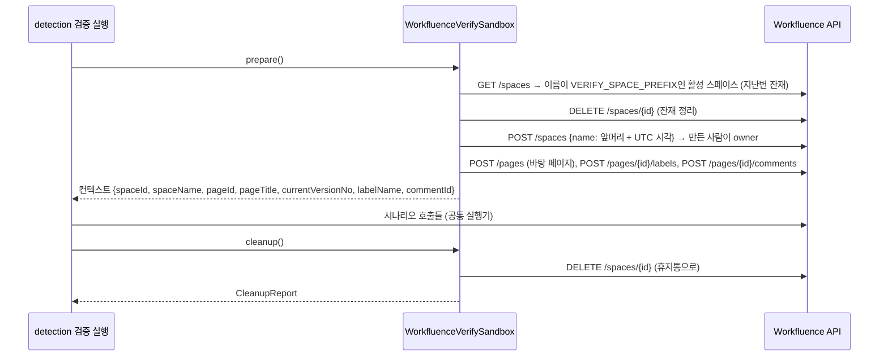

  - `prepare`: 지난번 잔재(앞머리가 같은 활성 스페이스)를 먼저 지운 뒤, 새 팀 스페이스를 만든다. 스페이스에는 key가 없고 uuid로 식별한다. 이름은 실행마다 유일하게(앞머리 + UTC 시각) 해서 이름 겹침(409 `SPACE_AMBIGUOUS`)을 피한다. 만든 계정이 owner라 별도 권한 설정이 없다. 그 안에 바탕 페이지·라벨·댓글을 만들어 읽기 tool 검증 자료로 쓴다.
  - 시험 스페이스 생성·삭제는 tool이 아니라 어댑터가 공개 API를 직접 부른다. 스페이스 생성·삭제는 tool 대상에서 빠지지만(5.2) 검증 환경 준비에는 필요하다. 호출은 같은 `TargetHttpClient`·`CallPolicy`를 쓴다.
  - `cleanup`: 스페이스를 통째로 `DELETE`한다. 페이지·댓글·첨부·라벨을 하나씩 지우지 않는다. 휴지통에 30일 남고 보존 기간 뒤 배치가 완전히 지운다. 공개 API에 완전 삭제가 없어 이것이 최선이다(`workf` 권장). 감사로그는 지울 수 없고 남는다.
  - 정리 실패는 검증 결과 `sandbox.cleanupFailures`에 담고, manufacture가 반영 기록과 응답에 옮긴다(FR-263). 다음 검증의 `prepare`가 잔재를 다시 지운다.
- **쓰기 위치 제한**: 쓰기 시나리오는 컨텍스트 안의 자료(이번 시험 스페이스와 그 안에서 만든 것)만 건드린다(11.4). 시나리오 본문에는 @멘션을 쓰지 않는다(알림 부수효과, W6).
- **admin 경로는 검증하지 않는다.** 검증 token(`agent-test`)에 admin scope가 있지만 admin 동작은 tool 대상이 아니고(5.2), Detection도 admin scope tool을 거절한다(11.4). root 계정·기존 계정을 대상으로 하는 동작은 실행하지 않는다(W7). 사용자 정지·세션 종료는 이 token까지 끊는다.

#### 11.6.1 검증 상대 계정 (peer, 2026-10-13 더함)

알림은 다른 사람이 행동해야 생긴다(자기 멘션은 알림이 없다). 그래서 알림 tool의 성공 경로를 검증하려고 두 번째 계정 `aiagent-peer`(member, read·write)를 둔다. peer는 검증 환경 준비·정리에만 쓰고 tool을 실행하지 않는다.

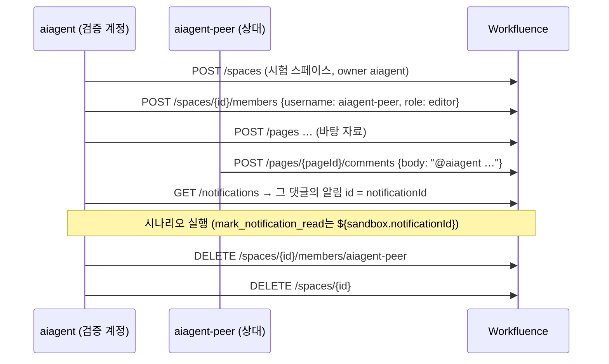

- 멘션은 본문 평문의 `@username`이다. 받는 사람이 그 스페이스를 읽을 수 있어야 알림이 가므로 peer를 먼저 멤버로 넣는다.
- **정리 순서**: 다른 멤버가 있으면 owner도 스페이스를 지울 수 없다(403). peer를 빼고 지운다. 잔재 정리도 같은 순서다. 스페이스를 중지시키지 않는다(중지된 스페이스는 관리자만 지운다).
- peer 비밀(`VERIFY_PEER_SECRETS`)이 없으면 이 단계를 건너뛴다. 그때 `notificationId`가 없으므로 그 값을 쓰는 시나리오는 그 tool만 `unverified`(`SANDBOX_VALUE_MISSING`)가 되고 `VERIFY_NO_SCENARIO`를 따른다(I30). 환경이 값을 못 만든 것이지 tool의 잘못이 아니기 때문이다.
- peer token도 Detection에만 붙인다(타겟 비밀 디렉터리).

### 11.7 시나리오 (`catalog/scenarios/<tool>.yaml`, manufacture가 보냄)

```yaml
tool: add_comment
call:
  args: {pageId: "${sandbox.pageId}", body: "검증 댓글 ${run.id}"}
expect:
  ok: true
  fields: [id]                    # 가공된 결과에 있어야 할 필드
save: {commentId: /id}            # 뒤에서 쓸 값
```

- 시나리오 파일은 manufacture의 카탈로그에 있고, 검증 요청에 담아 보낸다. 값 채우기와 실행은 Detection이 한다.
- 값 채우기: `${sandbox.*}`(11.5 `contextKeys`), `${run.id}`(검증 id), `${saved.*}`, `${setup.<n>.*}`. 선택 칸 `setup`(같은 문법의 앞 호출 목록)이 있다. 정리는 시험 스페이스를 통째로 지우므로 시나리오에 정리 단계를 쓰지 않는다.
- 기대: `ok`(성공 여부), `fields`, `error`(실패를 기대할 때 오류 코드). 응답 가공 규칙이 적용됐는지는 `fields` 밖의 필드가 없는지와 `maxChars`로 본다(FR-262).
- **시나리오가 없는 tool**(LLM이 새로 만든 tool 등):
  - 읽기 tool은 Detection이 자동 시나리오를 시도한다. 필수 칸을 (1) 같은 이름의 컨텍스트 값, (2) enum의 첫 값·기본값, (3) 문자열이면 `"a4w"`로 채운다. 채우지 못한 칸이 있으면 자동 시나리오를 만들 수 없다. 자동 시나리오는 성공 응답(`ok`)만 본다.
  - 쓰기 tool은 자동 시나리오를 만들지 않는다.
  - 시나리오를 만들 수 없으면 `unverified`이고 `VERIFY_NO_SCENARIO`(`pending`·`exclude`)를 따른다(FR-264). 기본 `pending`이라 사람이 시나리오를 더하거나 승인한다.
- 승인한 `unverified` tool은 manifest에 `verified: unverified`로 들어간다.

## 12. 사람 확인 (`ReviewGate`)

### 12.1 보류 대상

| 이유 코드 | 조건 |
|---|---|
| `TOOL_REMOVED` | 동작 `removed`로 tool이 빠짐 |
| `SCOPE_CHANGED` | 같은 동작의 필요 scope가 바뀜 |
| `DANGER_ADDED` | `risk: danger` tool이 새로 들어감 (상위 tool 포함) |
| `SPEC_REVIEW` | Detection 변경분이 `needsReview`이고 그 이유가 이 동작에 해당 (`OPERATION_REMOVED`·`OPERATION_CHANGED`) |
| `COMPOSITE_BROKEN` | 상위 tool이 참조 변경으로 검사 실패 |
| `NEW_COMPOSITE` | LLM이 제안한 상위 tool |
| `UNVERIFIED` | 시나리오 없음 또는 시험 환경에 맥락 키 값이 없음, `VERIFY_NO_SCENARIO=pending` |

- Workfluence는 v1이 더하기만 하므로 `OPERATION_CHANGED`(설명만이 아닌 변경)는 모두 보류된다. 그 동작의 새 정의는 만들고 검증까지 한 뒤 보류하고, 승인 전까지 이전 정의가 서빙된다.
- 문서 수준 검토 이유(`SECURITY_CHANGED`, `SPEC_VERSION_CHANGED`)는 동작에 묶이지 않는다. 보류 목록에 `notice` 항목으로 남기고 tool 반영을 막지 않는다.
- 보류는 다른 tool 반영을 막지 않는다(FR-273). 마지막 반영 명세 버전은 보류가 있어도 올라간다.
- 같은 동작에 새 변경분이 오면 이전 보류 항목은 `superseded`가 되고 새 항목이 생긴다.

### 12.2 승인 수단 — REST API

| API | 하는 일 |
|---|---|
| `GET /v1/reviews?targetId=…&status=pending` | 보류 목록 (이유, 동작, 새 정의 요약, 검증 결과, 만든 반영) |
| `GET /v1/reviews/{reviewId}` | 보류 항목 하나 (새 정의 전문, 이전 정의와의 차이) |
| `POST /v1/reviews/{reviewId}/decision` | `{"decision": "approve"|"reject", "by": "…", "note": "…"}`. 결정만 기록한다 |

- 승인한 항목은 다음 `POST /v1/apply`(4.2) 때 들어간다(FR-272). 결정과 반영을 나눈 이유: 여러 항목을 승인한 뒤 한 번에 새 tool 버전을 만들기 위해서다.
- 거절: 추가·변경은 이전 상태 유지(새 정의 버림), 삭제 거절은 tool을 남긴다(사람의 판단). `rejected` 동작은 같은 동작의 다음 변경분이 올 때까지 다시 보류하지 않는다.
- REST를 고른 이유: 서비스에 이미 HTTP와 인증이 있고, 사람(curl)과 workflow 도구가 같은 방법을 쓴다. 파일·PR 방식은 container 안 파일을 사람이 고쳐야 하거나 Git 연동이 필요하다(미정 항목 5).

## 13. `tool-store`

### 13.1 디렉터리

```
/data/tool-store/                         # MANUFACTURE_TOOL_STORE_PATH
  manufacture.db                          # SQLite (manufacture만 읽고 씀)
  locks/<targetId>.lock
  targets/<targetId>/
    current.json                          # 현재 포인터 {"toolVersion", "updatedAt"}
    versions/
      tv-000001-1a2b3c4d/
        manifest.json
        tools/<name>.json
      tv-000002-…/
    staging/<applyId>/                    # 쓰는 중인 묶음 (정의 조회 API는 보지 않음)
```

- `toolVersion` = `tv-` + 6자리 순번 + `-` + manifest의 tools 목록(이름·revision) 정규 JSON sha256 앞 8자. 순번으로 순서를, 해시로 내용을 알 수 있다.
- 묶음은 `staging/<applyId>/`에 모두 쓰고 `fsync`한 뒤 `versions/`로 `rename`한다. 한 번 들어간 묶음은 바꾸지 않는다(FR-281).
- 포인터 교체: `current.json.tmp`에 쓰고 `fsync` 후 `os.replace`로 바꾼다(원자적, FR-282). 정의 조회 API(Phase 3)는 `current.json` → `versions/<v>/manifest.json` 순서로만 읽는다.
- 같은 내용이면 새 버전을 만들지 않는다(4.3).

### 13.2 머리(head)와 포인터, 되돌리기

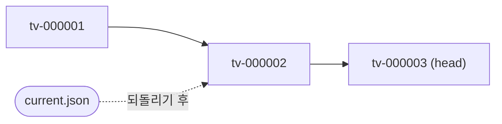

- **head**는 마지막으로 만든 버전, **포인터**는 서빙하는 버전이다. 평소에는 같다.
- **되돌리기**(FR-283): `POST /v1/rollback {"targetId", "toolVersion"}`는 포인터만 옮기고 색인을 그 버전에 맞춘다. head와 마지막 반영 명세 버전은 그대로다. 같은 API로 head를 지정하면 원래대로 돌아온다.
- 되돌린 상태에서 새 반영이 오면 **head 위에** 새 버전을 만들고 포인터를 새 버전으로 옮긴다. 되돌리기는 서빙을 잠시 옛 버전으로 돌리는 비상 수단이고, 이력은 한 줄로 이어진다. 그래야 변경분 순서(`fromVersion`) 규칙이 깨지지 않는다.
- 되돌리기도 타겟 잠금을 잡는다(반영과 동시에 돌지 않음). 동기로 끝난다.

### 13.3 SQLite 테이블

```sql
CREATE TABLE target_state (
  target_id                 TEXT PRIMARY KEY,
  last_applied_spec_version TEXT,             -- 첫 반영 전 NULL
  last_change_set_id        TEXT,
  head_tool_version         TEXT,
  current_tool_version      TEXT,             -- current.json과 같은 값 (조회용)
  updated_at                TEXT NOT NULL
);

CREATE TABLE applies (
  apply_id        TEXT PRIMARY KEY,           -- ap-<UTC 시각>-<난수 6자>
  target_id       TEXT NOT NULL,
  change_set_id   TEXT,                       -- 정리 반영이면 NULL
  status          TEXT NOT NULL,              -- running | applied | partial | noop | failed
  error_code      TEXT,
  tool_version    TEXT,
  result          TEXT,                       -- JSON (16.2의 응답 본문)
  started_at      TEXT NOT NULL,
  finished_at     TEXT
);
CREATE UNIQUE INDEX applies_done ON applies(target_id, change_set_id)
  WHERE change_set_id IS NOT NULL AND status IN ('applied','partial','noop');

CREATE TABLE operations (                      -- 동작 상태 (4.4)
  target_id        TEXT NOT NULL,
  method           TEXT NOT NULL,
  path             TEXT NOT NULL,
  operation_id     TEXT,
  fragment         TEXT,                      -- JSON, 최신 조각 (removed면 NULL)
  fragment_sha256  TEXT,
  structure_sha256 TEXT,
  spec_version     TEXT NOT NULL,
  selection        TEXT NOT NULL,             -- tool | excluded | codeOwned
  reason           TEXT,                      -- 제외 이유, fallback 표시
  tool_name        TEXT,
  state            TEXT NOT NULL,             -- active | building | pending | failed | excluded | codeOwned | rejected | removed
  last_error       TEXT,                      -- JSON (코드 목록)
  updated_at       TEXT NOT NULL,
  PRIMARY KEY (target_id, method, path)
);

CREATE TABLE apply_items (                     -- 반영 기록의 동작별 결과 (FR-208·214)
  apply_id    TEXT NOT NULL REFERENCES applies(apply_id),
  seq         INTEGER NOT NULL,
  method      TEXT, path TEXT, operation_id TEXT, tool_name TEXT,
  outcome     TEXT NOT NULL,                  -- added | updated | removed | unchanged | pending | failed | excluded | codeOwned
  origin      TEXT,                           -- seed | llm | llm-doc | cache
  reason      TEXT,
  verify      TEXT,                           -- JSON (검증 결과 요약)
  PRIMARY KEY (apply_id, seq)
);

CREATE TABLE reviews (
  review_id     TEXT PRIMARY KEY,             -- rv-…
  target_id     TEXT NOT NULL,
  apply_id      TEXT NOT NULL,
  kind          TEXT NOT NULL,                -- tool | notice
  method TEXT, path TEXT, operation_id TEXT, tool_name TEXT,
  reasons       TEXT NOT NULL,                -- JSON 배열
  definition    TEXT,                         -- JSON (추가·변경의 새 정의)
  previous_revision TEXT,
  verify        TEXT,                         -- JSON
  status        TEXT NOT NULL,                -- pending | approved | rejected | applied | superseded
  decided_by TEXT, decided_at TEXT, note TEXT,
  applied_in    TEXT                          -- 들어간 tool 버전
);

CREATE TABLE llm_cache (
  cache_key    TEXT PRIMARY KEY,              -- 9.5 재사용 지문
  task         TEXT NOT NULL,
  model        TEXT NOT NULL,
  prompt       TEXT NOT NULL,                 -- 이름@버전
  output       TEXT NOT NULL,                 -- JSON (검사 통과한 LLM 출력)
  usage        TEXT NOT NULL,
  created_at   TEXT NOT NULL
);

CREATE TABLE index_state (                     -- 색인에 실제로 올라간 것 (14.3)
  target_id    TEXT NOT NULL,
  tool_name    TEXT NOT NULL,
  point_id     TEXT NOT NULL,
  revision     TEXT NOT NULL,
  content_sha256 TEXT NOT NULL,
  indexed_at   TEXT NOT NULL,
  PRIMARY KEY (target_id, tool_name)
);
```

- 포인터 교체와 DB 커밋 순서: 묶음 `rename` → DB 트랜잭션(동작 상태, 반영 기록, `target_state`의 head·명세 버전) → 포인터 `os.replace` → `target_state.current_tool_version` 갱신. DB 커밋 뒤 포인터 교체 전에 죽으면, 시작할 때 `current.json`과 `target_state.head_tool_version`을 비교해 포인터를 head로 옮긴다(되돌리기 상태가 아니었던 경우만, `current_tool_version`으로 구분). 묶음은 이미 완전하므로 안전하다.
- 스키마 버전은 `PRAGMA user_version`으로 관리한다(Phase 1과 같음).

## 14. AI Pro Plus 색인

### 14.1 `RagStore` interface (`a4w_clients.rag`)

```python
class RagStore(ABC):
    def ensure_space(self, space: RagSpace) -> RagSpaceRef: ...        # 컬렉션·도메인 준비
    def upsert(self, ref: RagSpaceRef, doc: RagDocument) -> None: ...  # doc.id 지정
    def delete(self, ref: RagSpaceRef, doc_id: str) -> None: ...
    def list_ids(self, ref: RagSpaceRef) -> dict[str, str]: ...      # id → source
    def search(self, ref: RagSpaceRef, query: str, limit: int) -> list[RagHit]: ...
```

`RagDocument(id, content, extended_content, source)`. `RagHit(id, score, content, extended_content, source)`. 검색은 Phase 4와 색인 평가가 쓴다.

### 14.2 AI Pro Plus 구현 (`aipro_plus`)

`aipro` 확인 내용(2026-10-13, 서버 코드 기준)과 host 확인을 따른다.

| 일 | 호출 |
|---|---|
| 컬렉션 확인·생성 | `GET /api/collections`에 `collection_name`이 없으면 `POST /api/collections {"collection_name", "name", "description", "search_method": "vector"}`. 이미 있으면 만들지 않는다(중복 생성 시 500 가능) |
| 도메인 확인·생성 | `GET /api/domains`에서 이름으로 찾고, 없으면 `POST /api/domains {"name"}` → 정수 `id`. 이 id를 `RagSpaceRef`에 담는다 |
| 등록·재등록 | `POST /api/rag/knowledge {"collection_name", "domain_id", "content", "extended_content", "source", "point_id"}`. 같은 `point_id`는 덮어쓴다 |
| 삭제 | `DELETE /api/rag/knowledge/{collection_name}/{point_id}` (없는 id도 성공) |
| 목록 | `POST /api/rag/search {"collection_id", "domain_id", "limit": RAG_LIST_LIMIT}` (`query` 생략 = 목록, 점수 0). 전용 목록 API가 없다 |
| 검색 | `POST /api/rag/search {"collection_id", "domain_id", "query", "search_method": "vector", "limit"}`. `collection_id`를 늘 넣는다(빠지면 전 컬렉션 검색) |

- 이름 규약: 컬렉션 `RAG_COLLECTION_PREFIX + targetId`(예: `a4w_tools_workfluence`), 도메인 `RAG_DOMAIN_PREFIX + targetId`(예: `a4w-tools-workfluence`). 타겟마다 컬렉션 하나·도메인 하나다(FR-294, 미정 항목 8). 클라이언트는 앞머리가 맞지 않는 컬렉션·도메인 이름으로 쓰기·삭제를 부르면 거절한다. 도메인 삭제(전 컬렉션에서 그 도메인 자료 삭제)와 컬렉션 삭제는 구현하지 않는다.
- 인증: `RAG_AUTH_MODE=none`이면 `Authorization`을 보내지 않고 `X-Virtual-User: RAG_VIRTUAL_USER`만 보낸다(시험 서버 nobody 모드, `aipro` 안내). `bearer`이면 `Authorization: Bearer {RAG_API_KEY}`를 보낸다. 운영 키 발급 절차와 운영 주소는 아직 모르므로 `bearer`는 시험하지 않는다(17절).
- 오류: `{"detail": …}`. 4xx는 재시도하지 않고, 5xx·접속 실패는 `RAG_MAX_ATTEMPTS`번 다시 한다. 호출 한도는 없다고 들었다.
- 주소: 시험 서버는 host 28000에 열려 있다. container에서는 `http://host.docker.internal:28000`(compose `extra_hosts: host.docker.internal:host-gateway`)으로 부른다. AI Pro Plus의 docker 네트워크(`llm-network`)에 붙는 방법도 있지만, 다른 프로젝트의 네트워크 이름에 compose가 묶이므로 쓰지 않는다. 주소는 설정이라 바꿀 수 있다.

### 14.3 색인 문서

| 필드 | 값 |
|---|---|
| `point_id` | `uuid5(NAMESPACE, "{targetId}:{toolName}")`. `NAMESPACE`는 고정 UUID 하나를 코드 상수로 둔다(식별 규칙이라 설정 대상이 아님) (FR-292) |
| `content` (임베딩) | `{title}. {index.summary}` + 줄바꿈 + 예시 질의를 ` / `로 이은 것. `RAG_CONTENT_MAX_CHARS`에서 자른다 |
| `extended_content` | JSON `{"targetId", "name", "revision", "kind", "title", "description"(앞 300자), "risk", "scopes", "group", "toolVersion"}` |
| `source` | `{targetId}/{toolName}@{revision}` |

- **요구사항 보완 (FR-293)**: 요구사항은 `source`를 `targetId/toolName@toolVersion`으로 적었다. tool 버전을 넣으면 tool 하나만 바뀌어도 모든 tool을 다시 등록해야 한다(30여 건, 각각 임베딩). 그래서 tool마다의 `revision`(정의 내용의 해시)을 넣는다. Phase 3의 버전 일치 확인(시스템아키텍처 5.4절)은 "검색 결과의 revision = 서빙 중인 tool의 revision"으로 한다. `toolVersion`은 참고용으로 `extended_content`에 둔다. 요구사항 FR-293을 이에 맞춰 고친다.
- `content`에 예시 질의를 넣는 이유: bge-m3 임베딩은 질의와 문서가 비슷한 말투일수록 가깝다. 사람이 쓸 법한 요청을 문서에 함께 두면 검색이 잘 맞는다. 효과는 색인 평가(14.5)로 확인한다. 평가가 기준에 못 미치면 구성을 바꿔 다시 잰다.

### 14.4 색인 맞추기 (`IndexSync`, FR-295)

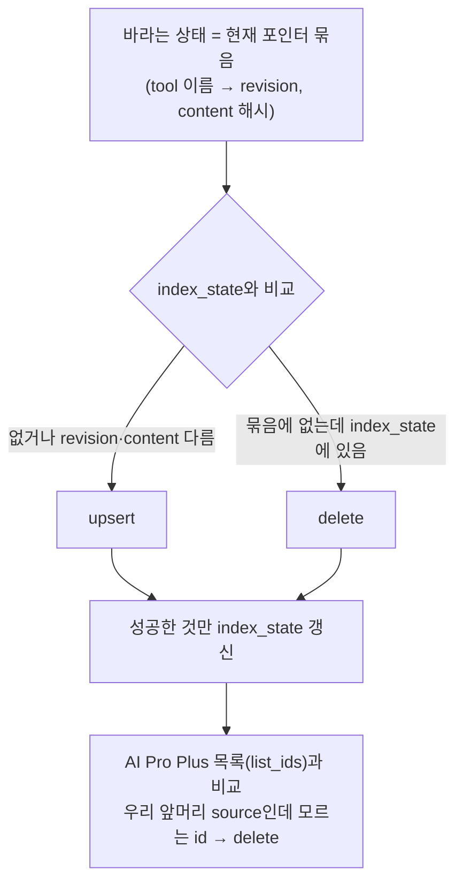

- 순서: **포인터 교체 뒤에 색인을 맞춘다.** 서빙이 정본이고 색인은 찾는 수단이다. 색인이 늦으면 Inference가 검색한 revision과 서빙 revision이 잠깐 달라 Phase 3이 실행을 거절하는데, 반대 순서면 색인이 가리키는 tool이 아직 서빙되지 않는다. 앞쪽이 덜 나쁘다.
- 색인 실패는 반영을 되돌리지 않는다. 반영 결과 `index: {upserted, deleted, failed}`와 `indexDrift: true`로 알리고, 다음 반영(정리 반영 포함) 때 같은 비교로 다시 맞춘다.
- 되돌리기(13.2)도 같은 비교로 색인을 그 버전에 맞춘다.
- 마지막 단계(목록 비교)는 지난번 기록이 사라진 경우(DB 손상 등)를 위한 것이다. `source` 앞머리가 `{targetId}/`인 것만 지운다.

### 14.5 색인 평가 (FR-296, 미정 항목 9)

- 예시 질의 세트: `catalog/queries.yaml`. 질의마다 기대 tool(하나 또는 여럿, 여럿이면 하나만 맞아도 정답)을 둔다. 과제정의서 4.3절 묶음마다, tool마다 사람이 쓴 질의 2개 이상. tool의 `index.examples`는 평가에 쓰지 않는다(문서에 들어간 문장으로 재면 점수가 부풀려진다).
- 지표: 상위 `INDEX_EVAL_TOP_N`(5) 안에 기대 tool이 드는 비율. 기준 `INDEX_EVAL_MIN_HIT_RATE`(0.9). 상위 1개 비율과 점수 분포도 함께 기록한다.
- N을 5로 둔 이유: Inference는 검색 결과 몇 개의 정의를 받아 작은 모델에게 고르게 한다(시스템아키텍처 5.4절). 5개 정도면 작은 모델의 선택 부담이 작다. 최종값은 Phase 4에서 Inference의 후보 수와 맞춘다.
- score 컷(점수 이하 버리기)은 이번에 정하지 않는다. 평가에서 정답·오답 점수 분포를 기록해 Phase 4가 정한다.
- 실행: live 시험(AC-10)과 명령 `python -m a4w_manufacture.evaluate_index --target workfluence`. 반영 흐름에는 넣지 않는다(질의 30~70건 검색).
- AC-3b의 (6)은 새 tool의 `index.examples`로 검색해 그 tool이 상위 N개에 드는지 본다. 사람 질의가 없는 새 tool의 최소 확인이다.

## 15. 공통 tool 실행기 (`a4w_tools`)

실행기를 쓰는 곳은 Detection(실호출 검증, 이번 phase)과 공용 MCP server `a4w_mcp`(tool 실행, Phase 3)다. manufacture는 쓰지 않는다. 타겟 어댑터의 오류 해석기·호출 규약 설정도 실행하는 쪽(Detection)이 읽는다.

### 15.1 구성

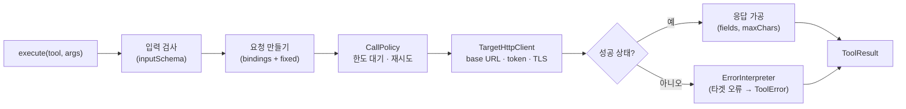

```python
@dataclass(frozen=True)
class ToolResult:
    ok: bool
    data: Any | None              # 가공된 결과
    truncated: bool
    error: ToolError | None
    meta: dict                    # status, attempts, elapsedMs, requestId

@dataclass(frozen=True)
class ToolError:
    code: str                     # INPUT_INVALID | TARGET_ERROR | RATE_LIMITED | TIMEOUT | OUTCOME_UNKNOWN | NOT_FOUND | AMBIGUOUS | STEP_FAILED | UNSUPPORTED
    message: str
    target_code: str | None       # 타겟 오류 코드 (예: VERSION_CONFLICT)
    request_id: str | None        # 타겟 requestId 그대로 (FR-304)
    http_status: int | None
    retryable: bool
    hint: str | None              # 모델이 다음에 할 일 (과제정의서 1.2절)
    step: str | None              # 상위 tool의 실패 step (FR-306)
```

- `ToolExecutor(http: TargetHttpClient, policy: CallPolicy, interpreter: ErrorInterpreter, handlers: HandlerRegistry)`. 웹·MCP를 모른다(FR-307). `manufacture-mcp`는 같은 객체를 만들어 `tools/call`에서 부른다.
- 입력 검사는 JSON Schema 2020-12(`jsonschema`)로 한다(FR-302). 실패하면 HTTP를 부르지 않고 `INPUT_INVALID`와 칸별 오류를 돌려준다.
- 결과는 예외가 아니라 `ToolResult`다. 모델이 읽고 고칠 수 있게 오류에 `hint`를 담는다.

### 15.2 호출 규약 (`CallPolicy`)

`ConfigCallPolicy`는 타겟 설정 값만으로 동작하는 일반 구현이다. Workfluence 규약(과제정의서 4.2절)이 이 구현과 설정 값으로 표현된다.

| 상황 | 처리 |
|---|---|
| 한도 | 읽기(GET)·쓰기(그 밖)별 60초 창 한도(`CALL_READ_PER_MINUTE`, `CALL_WRITE_PER_MINUTE`). 한도에 닿으면 창이 열릴 때까지 기다린다(프로세스 안 공유, 같은 token) |
| 429 | `Retry-After`(초)만큼 기다린 뒤 다시. `CALL_MAX_RETRY_WAIT_SECONDS`를 넘으면 기다리지 않고 `RATE_LIMITED`(`retryable: true`) |
| 5xx | 읽기만 다시(`CALL_MAX_ATTEMPTS`까지). 쓰기는 다시 보내지 않는다 |
| 쓰기 시간 초과·접속 끊김 | 다시 보내지 않고 `OUTCOME_UNKNOWN`. `hint`: "만들어졌을 수 있다. 목록으로 확인한 뒤 다시 하라" (명세 머리말) |
| 400·401·403·404 | 다시 하지 않는다 |
| 409 | 다시 하지 않는다. 오류 해석기가 안내문을 붙인다 |

- **409를 자동으로 다시 하지 않는 이유**: Workfluence 페이지 고치기는 본문 전체 교체다. 실행기가 다시 읽어 `baseVersionNo`만 바꿔 보내면 그 사이 남이 고친 내용을 덮는다. 충돌 처리는 "덮어쓰지 않고 멈춘 뒤 모델에게 다시 읽으라고 알리는 것"으로 정한다. 과제정의서 4.2절의 "다시 읽고 재시도"는 모델이 다시 읽고 내용을 합친 뒤 고치는 것으로 해석한다.
- 한도는 tool 실행만이 아니라 시험 환경 준비·정리 호출에도 걸린다. Detection 안에서 같은 `TargetHttpClient`와 `CallPolicy`를 쓴다.
- 한도는 프로세스 안에서만 센다. 한도는 token 단위이고(workf 확인), Phase 3부터 검증 계정과 agent 계정을 나눠 token이 겹치지 않는다(Phase 3 요구사항 8절 3번). 아래는 그 전의 기록이다: Phase 3에서 `manufacture-mcp`도 같은 token으로 실행하면 두 container가 한도를 따로 세게 된다. 이 문제는 Phase 3에서 tool 실행 경로를 정할 때 다룬다(21절).

### 15.3 오류 해석 (`ErrorInterpreter`)

- interface: `interpret(status, headers, body) -> ToolError`. 타겟 오류 모양과 코드별 안내문은 타겟 어댑터가 안다.
- Workfluence 구현: 본문 `{"error":{"code","message","requestId"}}`에서 `target_code`·`message`·`request_id`를 꺼낸다. 안내문 예: `TOKEN_*`·`ACCOUNT_INACTIVE` → "사람이 토큰을 새로 줘야 한다. 다시 하지 마라", `INSUFFICIENT_SCOPE` → "이 tool은 권한이 없다", 409 → "페이지를 다시 읽어 currentVersionNo를 baseVersionNo로 넣고, 그 사이 바뀐 내용을 합쳐 다시 고쳐라". 코드 목록은 명세 머리말에서 옮기고, 모르는 코드는 `message`만 전한다.
- 안내문은 어댑터 패키지의 데이터 파일(`catalog/hints.yaml`)에 둔다.

### 15.4 응답 가공

- `response.fields`가 있으면 그 경로만 남긴다. `items[].id`는 배열의 각 원소에서 `id`만 남긴다. 없는 경로는 무시한다.
- 직렬화한 결과가 `maxChars`를 넘으면, 배열이면 원소를 뒤에서부터 빼고, 문자열 필드면 끝을 자른다. `truncated: true`와 `meta.originalCount`(배열이었으면)를 담는다.
- 응답이 JSON이 아니면(설정 실수 등) 앞 `maxChars`의 글로 돌려준다.

### 15.5 `TargetHttpClient`

- `TARGET_API_BASE_URL`(비밀 파일)에 tool 경로를 붙인다. `Authorization: Bearer {TARGET_API_TOKEN}`을 넣는다. TLS는 Phase 1의 `TLS_VERIFY`·`TLS_CA_FILE` 규칙을 그대로 쓴다.
- 경로 칸 값은 URL 인코딩한다. 경로 템플릿에 남은 `{…}`가 있으면 `INPUT_INVALID`다.
- token은 로그·오류 메시지·`ToolResult`에 넣지 않는다.

## 16. API 계약

### 16.1 `POST /v1/apply`

요청: `{"targetId": "workfluence", "changeSetId": "cs-…"}` 또는 `{"targetId": "workfluence"}`

| 응답 | 때 |
|---|---|
| 202 `{"status": "running", "applyId", "targetId", "changeSetId"}` | 새 작업 시작 |
| 200 (16.2 본문) | 이미 반영한 `changeSetId` (FR-205) |
| 404 `TARGET_NOT_FOUND` · `CHANGESET_NOT_FOUND` | |
| 409 `CHANGESET_OUT_OF_ORDER` `{"lastAppliedSpecVersion", "changeSetFromVersion"}` | `fromVersion` ≠ 마지막 반영 버전 (FR-203). 첫 반영은 `fromVersion: null`만 받는다 |
| 409 `APPLY_IN_PROGRESS` `{"applyId"}` | 같은 타겟 작업 진행 중 (FR-204) |
| 502 `DETECTION_UNAVAILABLE` | Detection 조회 실패 |

409 응답의 추가 값은 `error.details`에 담는다(오류 모양은 `{"error":{"code","message","details"}}`, Phase 1과 같은 모양에 `details`만 선택으로 더함).

### 16.2 `GET /v1/applies/{applyId}`

```json
{
  "applyId": "ap-20261013T060000Z-k3j9q1",
  "status": "partial",
  "targetId": "workfluence",
  "changeSetId": "cs-…",
  "fromVersion": null,
  "toVersion": "8c83f9c6…",
  "toolVersion": "tv-000001-1a2b3c4d",
  "summary": {"added": 30, "updated": 0, "removed": 0, "unchanged": 0,
              "pending": 7, "failed": 0, "excluded": 32, "codeOwned": 9},
  "items": [{"operationId": "comments.create", "tool": "add_comment", "outcome": "added", "origin": "seed",
             "verify": {"result": "passed", "calls": 1}}],
  "pendingReview": [{"reviewId": "rv-…", "operationId": "pages.delete", "tool": "delete_page", "reasons": ["DANGER_ADDED"]}],
  "excluded": [{"operationId": "users.create", "reason": "ADMIN"}],
  "codeOwnedChanges": [{"operationId": "chat.send", "method": "POST", "path": "/chat/rooms/{id}/messages", "change": "added"}],
  "verification": {"passed": 30, "failed": 0, "unverified": 0, "cleanupFailures": []},
  "index": {"upserted": 30, "deleted": 0, "failed": 0, "drift": false},
  "llm": {"calls": 0, "cacheHits": 0, "promptTokens": 0, "completionTokens": 0},
  "startedAt": "…", "finishedAt": "…",
  "error": null
}
```

- `status`: `running`, `applied`(보류·실패 없음), `partial`(보류 또는 동작 실패가 있음), `noop`(바뀐 것 없음), `failed`(반영 전체 실패, 이전 tool 버전 유지, `error`에 코드).
- 위 예는 위험 동작을 켠 첫 반영이다. `added` 30 = 단순 tool 27 + 상위 tool 3, 위험 동작 7개는 보류다. 기본 설정이면 `pending: 0`, `excluded: 39`(`GROUP_DISABLED` 7 포함)이다.
- 시스템아키텍처 5.3절 예의 `tools`·`indexed` 키는 이 모양(`summary`·`index`)으로 바꾼다.

### 16.3 그 밖의 API

| API | 내용 |
|---|---|
| `GET /v1/reviews`, `GET /v1/reviews/{id}`, `POST /v1/reviews/{id}/decision` | 12.2 |
| `POST /v1/rollback` `{"targetId", "toolVersion"}` | 13.2. 200 `{"targetId", "currentToolVersion", "headToolVersion", "index": {…}}` |
| `GET /v1/targets/{targetId}/state` | `target_state`와 tool 버전 목록 (사람 확인용) |
| `GET /health` | `{"status": "ok", "toolStore": "ok"}`. `tool-store`에 쓰지 못하면 503. 바깥 시스템은 넣지 않는다(FR-311). 인증 없음 |
| `GET /openapi.json` | FastAPI 자동 생성 (FR-313) |

### 16.4 오류 코드

| HTTP | `code` | 때 |
|---|---|---|
| 400 | `VALIDATION_ERROR` | 요청 모양이 틀림 |
| 401 | `UNAUTHORIZED` | `bearer` 모드에서 토큰이 없거나 틀림 |
| 404 | `TARGET_NOT_FOUND` | 등록되지 않은 `targetId` (FR-201) |
| 404 | `CHANGESET_NOT_FOUND` | Detection에 없는 변경분 (FR-202) |
| 404 | `APPLY_NOT_FOUND` · `REVIEW_NOT_FOUND` · `TOOL_VERSION_NOT_FOUND` | |
| 409 | `CHANGESET_OUT_OF_ORDER` | 13.3 `last_applied_spec_version`과 다름 |
| 409 | `APPLY_IN_PROGRESS` | 타겟 잠금 |
| 409 | `REVIEW_ALREADY_DECIDED` | |
| 502 | `DETECTION_UNAVAILABLE` | Detection 접속 실패·5xx |
| 500 | `STORAGE_ERROR` · `INTERNAL_ERROR` | |

반영 작업 안의 실패 코드(`applies.error_code`, 응답 `error.code`): `DETECTION_UNAVAILABLE`, `SCOPE_UNKNOWN`, `VERIFY_FAILED_ALL`(Detection 검증 `status: failed`, Detection의 코드를 `details`에), `VERIFY_TIMEOUT`, `LLM_AUTH`, `STORAGE_ERROR`, `INTERRUPTED`, `INTERNAL_ERROR`. 동작별 실패 코드(`apply_items.reason`): 8절 검사 코드, `LLM_TIMEOUT`, `LLM_UNAVAILABLE`, `LLM_OUTPUT_INVALID`, `LLM_BUDGET_EXCEEDED`, `VERIFY_FAILED`, `SEED_MAPPING_MISMATCH`.

### 16.5 인증

Phase 1과 같다. `MANUFACTURE_AUTH_MODE=none|bearer`, `/health`와 `/openapi.json`은 검사하지 않는다(FR-314).

### 16.6 Detection 클라이언트 (`detection_client.py`)

| 클라이언트 | 호출 | 오류 |
|---|---|---|
| `HttpChangeSetSource` | `GET /v1/changesets/{id}?targetId=…` → `a4w_core.models.ChangeSet` | 404 → `CHANGESET_NOT_FOUND`, 그 밖 → `DETECTION_UNAVAILABLE` |
| `HttpTargetProfileSource` | `GET /v1/targets/{id}/profile` (11.5) | 실패 → `SCOPE_UNKNOWN` |
| `HttpVerificationService` | `POST /v1/verifications`, `GET /v1/verifications/{id}` (11.3) | 400 → 그 tool들을 `failed`(`VERIFY_REJECTED`, 이유 그대로), 409 → 잠시 뒤 다시 접수(`DETECTION_VERIFY_POLL_SECONDS` 간격, 제한 시간 안), 그 밖 → `DETECTION_UNAVAILABLE` |

- 응답 모양은 Detection 쪽 계약 시험의 JSON Schema를 manufacture 계약 시험에도 복사해 고정한다(바뀌면 둘 다 깨진다).
- 변경분·타겟 정보 조회는 재시도하지 않는다(Phase 1 10절과 같은 원칙). 검증 결과 조회는 폴링이라 일시 실패를 제한 시간 안에서 다시 한다.

## 17. 외부 확인

### 17.1 AI Pro Plus (`aipro`, 2026-10-13)

| # | 내용 | 결과 | 설계 반영 |
|---|---|---|---|
| R1 | 시험 주소 | host `127.0.0.1:28000`(host에서 `GET /openapi.json` 200 확인). container에서는 `host.docker.internal:28000`(host-gateway) 또는 `llm-network`의 `llm-agent:8000`. 운영 주소는 모름 | 14.2 |
| R2 | 인증 | 시험 서버 `NON_LOGIN_SERVICE=true`. 헤더 없이 nobody(Admin). `Authorization`은 보내지 말고 `X-Virtual-User`만 붙이라는 안내. 운영 bearer는 지금 구현하지 않아도 된다는 안내 | `RAG_AUTH_MODE=none` 구현·시험. `bearer`는 헤더만 넣는 구현이고 시험하지 않음 |
| R3 | 컬렉션·도메인 | 도메인은 등록에 필수(정수 id), 컬렉션과 독립. 도메인을 지우면 모든 컬렉션에서 그 도메인 자료가 지워짐 | 타겟별 컬렉션 1 + 도메인 1, 앞머리 규약, 삭제 미구현 |
| R4 | 등록 | `point_id` 지정 가능, 같은 id는 upsert. UUID 권장. 일괄 JSON API 없음 | uuid5, 건별 등록 |
| R5 | 목록 | 전용 API 없음. `query` 없는 search가 목록(페이지 없음) | `RAG_LIST_LIMIT` |
| R6 | 검색 | `collection_id` 빠지면 전 컬렉션. vector(cosine)·text_matching만, rerank 없음, score 컷 파라미터 없음 | 늘 `collection_id` 지정 |
| R7 | 임베딩 | bge-m3(1024, cosine), `content`만 임베딩, 자동 청킹 없음 | 14.3 |
| R8 | 지연·한도 | 등록은 동기. 앱 코드에 호출 한도 없음 | 즉시 검색 반영은 live 시험으로 확인 |

### 17.2 Workfluence (`workf`) — Detection 보강의 입력

**명세로 알 수 있는 것은 Detection에서 받는다.** 동작 목록, 입력·응답 모양, 필요 scope, 오류 모양은 Detection 변경분 조회 API가 주는 명세 조각이 정본이고, Manufacture 실행에 `workf`가 끼지 않는다. 아래는 명세에 없는 운영 사실(시험 스택에 무엇이 있는지, 어떤 token을 쓰는지, 지워진 자료가 어떻게 되는지)만 `workf`에게 물은 것이다. `workf`가 Workfluence 코드와 시험 스택 DB를 보고 답했다(2026-10-13). 실제 호출로 검증하지는 않았다. 이 사실들은 모두 타겟과 맞닿는 쪽, 곧 Detection의 Workfluence 어댑터(시험 환경·scope·오류 해석)에 들어간다. manufacture 설계는 이 사실에 기대지 않는다.

| # | 질문 | 결과 | 설계 반영 |
|---|---|---|---|
| W1 | 시험 전용 스페이스 | 쓸 만한 스페이스가 없다(스모크 잔재뿐). `POST /spaces {"name", "description"?, "category"?}`로 만들 수 있고(write + space.create 권한, member 이상이 가짐), 늘 팀 스페이스이며 만든 사람이 owner. key 개념이 없고 uuid로 식별. 이름이 겹치면 이름으로 고르는 경로에서 409 `SPACE_AMBIGUOUS`. 권장 이름 `aiagent-manufacture-<UTC시각>` | 11.6: 반영마다 새 스페이스, `VERIFY_SPACE_PREFIX` |
| W2 | 검증용 계정과 token | 이미 가진 `agent-test` token을 쓴다(사용자 확인). root 계정, scope `read write admin`, 만료 2027-10-12. 권한은 token scope와 사람 권한이 모두 허락해야 한다 | `config/secrets/targets/workfluence.env`의 token 그대로(Detection에만 붙임). admin scope가 있어 11.6의 금지 규칙을 둔다. read·write만 가진 token으로 바꾸는 것은 과제정의서 미정 16 |
| W3 | token scope를 API로 아는 방법 | `GET /me`·token 정보 API가 없다(404 실측). token이 HS256 JWT라 payload `scope` 클레임(공백 구분)으로 안다. 서버는 DB 행 scope와 겹치는 것만 인정. 판정: GET·HEAD·OPTIONS는 read, 그 밖은 write, write는 read 포함, `/users`·`/settings/policy`·`/audit`은 admin 추가 | 11.5 `workfluence_jwt`, 카탈로그 `scopeImplies` |
| W4 | 정리 | 페이지·스페이스 DELETE는 휴지통(soft), 댓글·첨부 DELETE는 삭제 표시(soft), 라벨은 떼기. 휴지통은 보기·되살리기만, 완전 삭제는 공개 API에 없고 보존 기간(시험 스택 30일) 뒤 배치. 권장: 시험 스페이스를 통째로 DELETE. 감사로그는 남음 | 11.6 `cleanup` |
| W5 | 고정 시험 자료 | 없다. 시작할 때 만들어 쓰라는 권장 | 11.6 `prepare`에서 바탕 페이지·라벨·댓글 생성 |
| W6 | 호출 주의 | 한도는 token별 read 120/분·write 30/분, 429 `RATE_LIMITED` + `Retry-After`. 그 밖 동시성 제약 없음. `PATCH /pages/{id}`는 `baseVersionNo` 필수(없으면 400), 응답의 `currentVersionNo`로 매번 갱신, 사이에 다른 저장이 있으면 409 `VERSION_CONFLICT`. 브라우저에서 실시간 편집 중이면 수정·버전 복원이 409. 부수효과: @멘션은 알림, 메일은 시험 스택에서 꺼짐, 쓰기 대부분과 첨부 받기·내보내기는 감사로그 | 15.2 409 처리, 11.6 멘션 금지, 시나리오의 `save`로 `currentVersionNo` 이어 받기 |
| W7 | 위험 동작 | 개인 시험 스택이라 시험 스페이스 안의 삭제·멤버 변경·스페이스 중지/삭제는 된다. admin 경로(사용자 정지·역할 변경·세션 종료·정책 변경)와 root·기존 계정 대상 동작은 실행 전에 사용자 확인 | 11.6 admin 경로 검증 안 함 |

- 시험 스택은 `restart` 옵션이 없어 host가 재부팅되면 내려간다. live 시험이 접속 실패하면 스택이 떠 있는지부터 본다.
- container에서 `wf.internal`은 `NO_PROXY`에 넣어야 닿는다(이미 `.env`에 있음, Phase 1 I5).

## 18. 이미지와 실행

### 18.1 Dockerfile

| 이미지 | 바뀌는 것 |
|---|---|
| `agents/manufacture/Dockerfile` (신규) | Phase 1과 같은 4단계(`base`·`deps`·`test`·`runtime`). `git`은 필요 없다. 넣는 패키지: `a4w_core`, `a4w_tools`, `a4w_clients`, `packages/targets/*`(카탈로그), `a4w_manufacture`, 프롬프트 디렉터리. 새 의존성 `jsonschema`. 보관소 디렉터리는 빌드 인자 `MANUFACTURE_TOOL_STORE_PATH`로 만든다(Phase 1 I7) |
| `agents/detection/Dockerfile` (보강) | `a4w_tools`를 더 넣는다. 새 의존성 `jsonschema` |

- Phase 3에서 manufacture 이미지에 MCP 진입점을 더한다(NFR-204). 이번에는 반영 앱 진입점만 둔다.

### 18.2 빌드·시험 스크립트

`scripts/build.sh manufacture [runtime|test]`, `scripts/test.sh manufacture [--src]`는 서비스 이름만 바꿔 그대로 쓴다. live 시험(`A4W_LIVE_TESTS=1`)에서 붙이는 것은 서비스마다 다르다.

| 서비스 | 붙이는 비밀 | `--add-host` |
|---|---|---|
| detection | `config/secrets/targets/` (타겟 token) | `TARGET_HOST_ALIAS` |
| manufacture | `config/secrets/manufacture-llm.env` | `host.docker.internal:host-gateway` (AI Pro Plus) |

- 스크립트가 서비스별로 붙일 비밀 목록은 `.env`의 `<SERVICE>_TEST_SECRETS`로 받는다.
- manufacture → Detection 흐름의 live 시험(AC-1, AC-9)은 compose로 두 container를 올려서 한다.

### 18.3 `docker-compose.yml`

```yaml
  detection:                           # 기존 서비스에 더하는 것만
    volumes:
      - ./config/secrets/targets:${DETECTION_SECRETS_DIR}:ro

  manufacture:
    image: ${MANUFACTURE_IMAGE}:${MANUFACTURE_TAG}
    env_file:
      - .env
      - ./config/secrets/manufacture-llm.env
    extra_hosts:
      - "host.docker.internal:host-gateway"   # AI Pro Plus. 타겟 주소(TARGET_HOST_ALIAS)는 넣지 않는다
    ports:
      - "${MANUFACTURE_PORT}:${MANUFACTURE_PORT}"
    volumes:
      - tool-store:${MANUFACTURE_TOOL_STORE_PATH}
      - ./config/targets:${MANUFACTURE_TARGETS_DIR}:ro
    depends_on: [detection]
    healthcheck: …                     # detection과 같은 방식, MANUFACTURE_PORT
    restart: unless-stopped
volumes:
  tool-store:
```

- **타겟 비밀 위치를 옮긴다**: `config/secrets/<targetId>.env` → `config/secrets/targets/<targetId>.env`. Detection에 타겟 비밀 디렉터리만 붙이고 LLM key 같은 다른 서비스 비밀이 보이지 않게 하기 위해서다. CLAUDE.md의 설정 줄도 고친다(21절).
- manufacture에는 타겟 비밀도 타겟 주소도 붙이지 않는다(AC-14). `config/targets`는 붙이지만 manufacture는 3.3의 tool 만들기 쪽 변수만 읽는다.
- `depends_on`은 시작 순서만 정한다. manufacture는 시작할 때 Detection을 부르지 않는다.

### 18.4 사람이 돌리는 순서

```bash
scripts/build.sh manufacture runtime
docker compose up -d detection manufacture
CS=$(curl -s -X POST localhost:${DETECTION_PORT}/v1/detect -H 'Content-Type: application/json' \
       -d '{"targetId":"workfluence"}' | jq -r .changeSetId)
AP=$(curl -s -X POST localhost:${MANUFACTURE_PORT}/v1/apply -H 'Content-Type: application/json' \
       -d "{\"targetId\":\"workfluence\",\"changeSetId\":\"$CS\"}" | jq -r .applyId)
curl -s localhost:${MANUFACTURE_PORT}/v1/applies/$AP | jq '{status, toolVersion, summary}'
```

## 19. 시험 설계 (TDD)

| 묶음 | 대상 | 방식 |
|---|---|---|
| `unit` (a4w_tools) | 요청 만들기(위치별, 고정값, 인코딩), 입력 검사, 응답 가공(필드·자르기), 호출 규약(한도 대기, 429·5xx·쓰기 시간 초과·409), 오류 해석, 상위 tool(값 참조, `expect`, 실패 step), 정의·manifest 스키마, `ToolsetReader` | 가짜 HTTP(`MockTransport`), 가짜 시계 |
| `unit` (manufacture) | 대상 선정(규칙 순서, fallback, 묶음 끔, scope), 기계 변환(결정성, 형식 고르기, 본문 펼침, 이름 겹침, 순환), 지문, seed 찾기, 검사 코드 전부, LLM 조립(`update`의 이름 고정·칸 설명 옮기기, `redescribe`), 재사용 지문, 호출 상한, 보류 판단, 검증 요청 만들기·결과 판단(통과·실패·검증 안 됨·거절·시간 초과), 색인 문서·point id·맞추기 비교, `ApplyService` 흐름(첫 반영, 추가, 변경, 삭제, 설명만, codeOwned, 동작 실패, 전체 실패 후 포인터 그대로, 정리 반영, 승인 반영, 되돌리기 후 반영) | 모든 port를 가짜로 |
| `unit` (detection 보강) | 받은 정의 검사(형식, 금지 scope, 명세에 없는 경로, 쓰기 위치), 시나리오 값 채우기, 자동 시나리오, 검증 실행 순서와 결과 모양, 멱등(같은 `verificationId`), 검증 잠금, scope 읽기(JWT 클레임, config), 시험 환경 준비·정리(잔재 정리 포함, 정리 실패 보고) | 가짜 HTTP로 Workfluence 흉내 |
| `contract` | Detection 변경분·타겟 정보·검증 응답 모양(Detection 쪽과 manufacture 쪽에 같은 스키마), `LlmClient` 계약(10.2), `RagStore` 계약(AI Pro Plus 녹화 응답), tool·manifest JSON Schema 고정 | 녹화한 HTTP 응답, 저장한 스키마 |
| `integration` | `FileToolStore`(staging·rename·포인터·같은 내용 재사용·시작 시 복구), `SqliteManufactureDb`, 잠금, manufacture API 전체(202·폴링·409·멱등·오류 모양), detection 검증 API 전체 | 임시 디렉터리, FastAPI TestClient + 가짜 외부 |
| `isolation` | manufacture 패키지가 `a4w_tools.executor`·`target_http`와 타겟 어댑터의 `scopes`·`sandbox`·`errors`를 import하지 않는다. manufacture 설정 읽기에 `TARGET_API_*`가 없다 (AC-14) | import 검사 시험 |
| `fixtures` | 66 → 75 변경분(AC-3a), 빈 명세 → 75 전체(AC-1의 선정 결과), 손으로 만든 명세 쌍(추가·변경·삭제·설명만, AC-3) | Phase 1 고정 자료로 만든 변경분 JSON |
| `live` | LLM 실호출(AC-8, AC-3b의 1~4), Detection 검증 API로 시험 스택 검증·정리(AC-15), compose로 첫 반영·검증(AC-1, AC-9), AI Pro Plus 색인·평가(AC-10, AC-3b의 6), compose 흐름(AC-12) | `A4W_LIVE_TESTS=1`일 때만 |
| 회귀 | Phase 1 Detection 시험 전부 (FR-337) | 기존 시험 그대로 |

- 가짜 LLM은 정상·비정상 출력 묶음(`fixtures/llm/*.json`)을 돌려준다. 비정상: 매핑 바꾸기, 칸 지어내기, 필수 칸 숨기기, 이름 바꾸기, id 든 예시, 없는 tool 참조(AC-2).
- AC-3b의 추가 API 자료: seed에서 일부러 뺀 실제 동작(시험용 seed 부분집합으로 반영) + 가상 동작 2개(페이지 지켜보기, 역링크 목록) 조각. 가상 동작은 실호출 검증을 하지 않는다(요구사항 7절).
- 첫 구현 순서(red → green): `a4w_tools` 형식·실행기 → Detection 보강(타겟 정보·검증 API, 시험 환경) → 기계 변환·선정 → 저장소 → `ApplyService`(가짜 port) → seed 작성 → LLM 클라이언트·보조 → 검증 요청 → 색인 → API → live.

## 20. 요구사항 대응

| 요구사항 | 설계 위치 |
|---|---|
| FR-201~208 | 4절, 13.3절, 16.1~16.2절 |
| FR-211~216 | 5절 |
| FR-221~226 | 6절, 8절 |
| FR-231~233 | 7.1절 |
| FR-235~239 | 6.4절, 7.2~7.3절, 9.3절 |
| FR-240~246 | 9절 |
| FR-251~256 | 10절 |
| FR-261~265 | 11절 |
| FR-271~273 | 12절 |
| FR-281~284 | 13절 |
| FR-291~297 | 14절 (FR-293 보완) |
| FR-301~307 | 15절 |
| FR-311~315 | 4.1절, 16.3~16.5절 |
| FR-321~323 | 2절, 7.1절, 10절, 14.1절, 11.6절 |
| FR-331~337 | 11.3~11.6절, 3.2.1절, 18절 |
| NFR-201~209 | 3절, 10.1절, 14.2절, 18절, 19절 |
| AC-14·15 | 2절, 3.2절, 11.4절, 18.3절, 19절 (`isolation`) |

## 21. 요구사항·상위 문서에 되돌려 고칠 것

| 문서 | 고칠 것 | 이유 |
|---|---|---|
| 요구사항 FR-293 | `source`를 `targetId/toolName@revision`으로 | 14.3 |
| 요구사항 FR-207 | 응답이 비동기(202 + 조회)임을 적음 | 4.1 |
| 요구사항 4.1절 | `changeSetId` 없는 정리 반영 | 4.2 |
| 과제정의서 4.3절 | 대상 수(51 → 단순 tool 27, 위험 동작 켜면 34), admin 수(15 → 12) | 5.2 |
| 시스템아키텍처 5.3절 | 응답 예(`summary`·`index`), 202 | 16.2 |
| 시스템아키텍처 5.4절 | 버전 일치를 tool `revision`으로 | 14.3 |
| 시스템아키텍처 1절 | 서비스 사이 호출에 "검증 요청"을 더함. Detection은 타겟 창구 | 11.1 |
| 시스템아키텍처 2·3·6절 | 구성도·container 표·비밀 배분: Detection이 타겟 token을 갖고 검증을 함, manufacture의 외부 호출에서 "타겟 시험 환경"을 뺌 | 1절, 11절 |
| 과제정의서 2.1절·5절 | Detection의 하는 일에 타겟 정보·실호출 검증 추가. "타겟 token은 Manufacture만 가진다" → "Detection이 갖는다(manufacture-mcp의 실행 경로는 Phase 3에서)" | 사용자 결정 2026-10-13 |
| Phase 1 문서 | Detection API가 늘었음을 요구사항·설계 머리에 적고 이 문서 11절로 잇는다(Phase 1 계약은 그대로) | FR-337 |
| CLAUDE.md 설정 줄 | 타겟 비밀 경로 `config/secrets/targets/<targetId>.env` | 18.3 |

- 반영 상태(2026-10-13, 설계 검토 완료 뒤): 위 표의 문서는 모두 고쳤다. 요구사항 FR-201·207·293, 과제정의서 1.1·2.1·2.2·4.3·5·6·7절, 시스템아키텍처 1·2·3·5.3·5.4·6절과 A2, Phase 1 문서 머리. 남은 것은 CLAUDE.md 비밀 경로 줄과 비밀 파일 이동(`config/secrets/targets/`)이다. 실제 파일을 옮기는 구현 단계에서 같이 바꾼다(지금 바꾸면 CLAUDE.md와 실제 위치가 어긋난다).

### 21.1 Phase 3로 넘기는 질문

- **tool 실행 경로 (결정, 사용자 확정 2026-10-13)**: `manufacture-mcp` container는 두지 않는다. Manufacture는 tool 정의 조회 API로 정의(JSON)만 내주고, Inference agent 곁의 **공용 MCP server**(`a4w_mcp`, code 하나)가 정의를 받아 agent **자기 계정 token**으로 Workfluence를 직접 실행한다(공유 실행기 `a4w_tools`). token은 agent 밖으로 넘기지 않는다. agent가 아닌 클라이언트가 공용 계정으로 실행해야 하면 Detection 경유 실행을 더한다(interface만). 채팅 어댑터(Phase 5)도 agent token으로 직접이다. 시스템아키텍처 1절 7·5.4·5.5절. **이 문서 본문의 `manufacture-mcp`는 "Inference 쪽 공용 MCP server"로 읽는다** — 정의를 읽는 쪽은 파일(ToolsetReader)이 아니라 Manufacture의 정의 조회 API를 거친다(Phase 3에서 API 안에서 ToolsetReader를 쓴다). 아래 표는 결정 전의 비교다.

| 안 | 경로 | 좋은 점 | 대가 |
|---|---|---|---|
| A. Detection 경유 | inference → manufacture-mcp → detection → Workfluence | 타겟과 맞닿는 곳이 하나, 호출 한도를 한 곳에서 셈 | Detection이 일괄 작업 서비스에서 사용자 요청마다 거치는 상시 경로가 됨. Detection이 멈추면 tool 실행이 모두 멈춤(시스템아키텍처 1절이 manufacture와 mcp를 나눈 이유와 같은 문제). 호출마다 한 단계 지연 |
| B. 공유 코드, 실행은 mcp | inference → manufacture-mcp → Workfluence | 서빙이 Detection과 독립. 연계 지식은 공유 패키지(`a4w_target_workfluence`, `a4w_tools`) 하나에 있어 고칠 곳은 하나 | token이 두 container에 있음. 같은 token의 호출 한도를 Detection과 mcp가 따로 세므로 나눠 갖는 규칙이 필요 |

- **채팅 어댑터(Phase 5)도 같은 질문이다.** inference container의 채팅 어댑터는 `/chat/*` REST와 WebSocket으로 Workfluence에 직접 닿는다(코드 소유 동작). A로 끝까지 가면 WebSocket 상시 연결도 Detection이 맡아야 한다.
- Phase 2의 실행기와 타겟 어댑터는 라이브러리로 두므로 A·B 어느 쪽이든 그대로 쓴다.

## 22. 구현 중 바뀐 것

| # | 설계 | 구현 | 이유 |
|---|---|---|---|
| I1 | Detection 검증 기록은 Detection SQLite의 `verifications` 표 | 같은 볼륨의 별도 파일 `verifications.db` | 변경 식별 DB의 스키마 버전을 올리지 않고 따로 관리하기 위해 |
| I2 | `TARGET_API_BASE_URL`에 tool 경로를 붙인다 | 타겟 설정 `TARGET_API_PATH_PREFIX`(Workfluence `/api/v1`)를 서버 주소와 명세 경로 사이에 넣는다 | 비밀 파일의 주소는 서버 주소이고, 명세 경로는 `/api/v1`을 뺀 꼴이다(명세 머리말) |
| I3 | runtime 사용자 uid 10001 | 빌드 인자 `A4W_UID`(`.env`, host 사용자 uid). 기존 `spec-store` 볼륨 소유자를 바꿈 | 권한 600인 타겟 비밀을 container가 읽어야 한다 |
| I4 | 시험 스페이스 바탕 자료: 페이지·라벨·댓글 | + 첨부(`attachmentId`), 맥락 키 `homeSpace`, 페이지 제목에 검증 id, 바탕 자료를 다 만든 뒤 페이지를 다시 읽어 `currentVersionNo` | 첨부 받기 검증, 고정 맥락(6.3.1), 제목 검색 상위 tool이 하나로 좁혀지게, 버전 충돌 방지 |
| I5 | 쓰기 위치 검사는 경로 칸 | 경로 칸 + 이름이 대상 자료를 가리키는 칸(`space`, `parent`, `…Id`, `id`) | 본문 칸으로 다른 스페이스를 쓰게 하는 시나리오를 막기 위해 |
| I6 | 상위 tool 예의 `/items/0/id` | `/items/0/pageId` | Workfluence 검색 결과 항목의 id 필드 이름 |
| I7 | `scripts/test.sh`는 Detection 기준 | 서비스별 `<SERVICE>_TARGETS_DIR`, `<SERVICE>_TEST_SECRETS`, `<SERVICE>_TEST_HOSTS`, `--src`는 `packages/*` 전부 | 서비스가 둘이 되고 붙일 비밀이 다르다 |
| I8 | LLM 본보기는 같은 tag → 메서드 → 이름 | 같은 묶음(group) → 메서드 → 이름 | tool 정의에 tag가 없다 |
| I9 | `apply_items` 열 여럿 | 항목 하나를 JSON 한 칸으로 | 응답 `items`와 같은 모양을 그대로 남기기 위해 |
| I10 | `MANUFACTURE_SECRETS_DIR`, `MANUFACTURE_STAGING_KEEP` | 둘 다 없음. LLM 비밀은 env_file, 임시 묶음은 시작할 때 늘 지운다 | manufacture는 타겟 비밀을 읽지 않는다. 남길 이유가 없었다 |
| I11 | 프롬프트 작업별 파일 | + 공통 부분 `_common.v1.md`(`{{common}}`), `PROMPT_VERSIONS`에 `common` | 세 작업의 원칙이 같다 |
| I12 | (없음) | 6.3.1 입력 칸 최소화: 기계 기본 숨김, `http.omitted`, 맥락 고정값(`context`), `TOOL_MAX_VISIBLE_INPUTS` | 사용자 요구(2026-10-13). 구현 도중 설계에 넣었다 |
| I13 | seed JSON을 사람이 쓰고 도구가 지문을 찍는다 | 사람은 `seed/authoring.yaml`(글)만 쓰고, `a4w-seedtool build`가 같은 기계 변환으로 JSON을 만든다. `check`로 저장소 seed가 명세와 맞는지 시험한다 | 매핑을 손으로 옮기다 틀릴 일이 없다. 글과 매핑이 나뉜다 |
| I14 | (언급 없음) | tool 파일은 키를 정렬하지 않고 쓴다. revision은 정규 JSON으로 따로 계산 | 입력 칸 순서가 모델에게 보이는 순서다 |
| I15 | `redescribe`는 검증을 건너뛴다 | HTTP가 이전과 같을 때만 건너뛰고 `verify: inherited` | 설명만 바뀌어도 숨김이 바뀌면 HTTP가 달라질 수 있다 |
| I16 | 상위 tool의 참조가 끊기면 `COMPOSITE_BROKEN` 보류 | 참조 tool의 삭제가 승인돼 빠지면 상위 tool도 자동으로 뺌(`DEPENDENCY_REMOVED`). 처음부터 참조 tool이 없으면 `excluded(DEPENDENCY_MISSING)` | 삭제는 이미 사람이 승인했다. 같은 일을 두 번 묻지 않는다 |
| I17 | 시나리오가 없으면 자동 시나리오 또는 보류 | 알림 읽음 표시 2개는 일부러 시나리오를 두지 않는다 → 보류(`UNVERIFIED`) | 검증 token이 사용자 본인 계정이라 실제 알림을 건드린다 |
| I18 | (언급 없음) | 시나리오 setup이 쓰는 tool은 `references`로 보내고, 그 tool이 이번 묶음에 없으면 그 시나리오만 빼고 보낸다 | Detection은 요청 하나라도 틀리면 전체를 거절한다 |
| I19 | `LLM_PROPOSE_COMPOSITES` | 구현하지 않음(설정만 false) | 이번 범위의 인수 기준에 없다. 상위 tool은 seed 3개 |
| I20 | (없음) | `MANUFACTURE_LIVE_DETECTION_URL` | live 시험이 compose의 Detection을 부르기 위해 |
| I21 | 되돌리기 | `ApplyRunner`가 타겟 잠금을 잡고 부른다. `GET /v1/targets/{id}/state`에 tool 버전 목록 | 반영과 동시에 돌지 않게 |
| I22 | Detection 400이면 tool들 실패 | tool별 이유 `VERIFY_REJECTED`(Detection의 이유 그대로) | 사람이 원인을 바로 보게 |
| I23 | 실행기 오류 코드 | + `CONTEXT_MISSING`(맥락 키 값이 없음) | 6.3.1 |
| I24 | `trash.pages`(휴지통 목록)의 위험 등급 | 묶음 바닥값을 따라 `danger` | 위험 동작 묶음(휴지통 복원 짝)에 넣었다 |
| I25 | 같은 `verificationId`면 앞선 기록을 돌려준다(멱등) | 요청 내용 지문(tool·참조의 이름·revision, 시나리오 전문)이 다르면 `VERIFY_REQUEST_INVALID`로 거절한다 | 같은 id에 다른 요청이 오면 낡은 결과를 조용히 돌려주는 일이 있었다(test 결과서 8.1절) |
| I26 | 보류 항목은 같은 조각이면 그대로 둔다 | 이유가 `UNVERIFIED`뿐인 보류는 다음 반영 때 다시 만들고 다시 검증한다. 들어가면 옛 보류는 `superseded` | 시나리오가 뒤에 생기면 사람 승인 없이 검증으로 들어갈 수 있어야 한다 |
| I27 | (I17 갱신) 알림 읽음 tool 2개는 시나리오 없음 | agent 전용 계정으로 바뀌어 시나리오를 넣었다. `mark_notification_read`는 실패 경로(404 `NOT_FOUND`)로 검증. live 시험의 반영 id는 실행마다 유일 | 검증 token이 사용자 본인 계정이 아니게 됐다 |
| I28 | (21.1절) `manufacture-mcp`가 `tool-store`를 읽기 전용으로 붙여 서빙·실행 | `manufacture-mcp` 없음. Manufacture는 tool 정의 조회 API, 실행은 Inference agent 곁 공용 MCP server가 agent token으로 | 사용자 결정(2026-10-13): agent마다 계정·권한이 다르고, tool은 JSON만 주고받는다 |
| I29 | (11.6) 검증 계정 하나 | 검증 상대 계정(peer)을 선택으로 둔다. 시험 스페이스에 멤버로 넣고 @멘션 댓글로 알림을 만든다. 맥락 키 `notificationId`. 정리는 멤버를 뺀 뒤 스페이스 삭제 | 알림 tool의 성공 경로를 검증하기 위해(사용자 요청). 다른 멤버가 있으면 owner도 스페이스를 못 지운다 |
| I30 | (11.6.1) peer가 없어 `notificationId`가 없으면 그 시나리오는 `failed`(`SCENARIO_INVALID`) | 맥락 키 값이 이번 환경에 없으면 `unverified`(`SANDBOX_VALUE_MISSING`). `${saved.*}`·`${setup.*}`가 없는 것은 그대로 `SCENARIO_INVALID` | 사용자 결정(2026-10-14): 환경이 덜 갖춰진 것을 tool 실패로 보지 않는다 |
