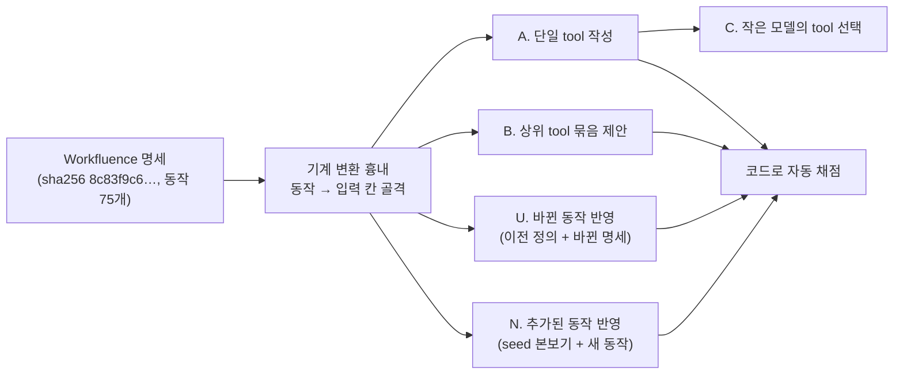

# Phase 2 부록 — Manufacture LLM 모델 선정과 시험 결과

- 작성일: 2026-10-13
- 상태: 확정 (사용자 결정, 2026-10-13)
- 상위 문서: [`1_요구사항정의.md`](1_요구사항정의.md) 4.6·4.7절, 부록 A
- 평가 스크립트: [`eval/`](eval/) (제품 코드가 아니라 평가 기록용이다)

## 1. 결론

| 항목 | 결정 |
|---|---|
| Manufacture 기본 모델 | **`zai-org/GLM-5.2`** |
| 접속 | 사내 OpenAI 호환 엔드포인트(SCP Simple AI Inference), `POST /v1/chat/completions` |
| 출력 형식 | `response_format: {"type": "json_object"}` + 스키마를 system prompt에 넣고, 받은 값을 우리 쪽에서 JSON Schema로 검사한다. `json_schema`(strict) 모드는 쓰지 않는다 |
| 재시도 | 형식 오류(JSON 깨짐, 스키마 불일치, `finish_reason: length`)는 오류 내용을 붙여 다시 요청한다 |
| 교체 | 모델은 설정 값이다(`LLM_MODEL`). 더 좋은 모델이 생기면 이 문서의 평가를 다시 돌려 비교한 뒤 바꾼다 |
| Inference 모델 | 계획대로 gpt-oss급(Phase 4에서 정함). 이번 결정과 무관하다 |

**선정 이유**: 두 후보 모두 tool 정의의 구조(입력 칸 매핑, 숨김 규칙, 묶음의 참조 무결성)는 정확했다. 차이는 지시를 지키는 정도에서 났다. Manufacture의 LLM은 첫 반영 뒤의 **변경분**만 맡는다(seed 방식, 요구사항 FR-235~240). 그래서 "이전 정의를 지키고 바뀐 부분만 고친다", "본보기 문체를 따른다"가 가장 중요한 능력이다. 이 두 가지에서 GLM-5.2가 확실히 앞섰다.

## 2. 배경

- 과제정의서는 Manufacture에 Opus급 모델을 원했다. 그러나 Anthropic API key가 없고, Claude Code CLI 방식은 사용자 결정으로 보류했다.
- 쓸 수 있는 경로는 사내 OpenAI 호환 엔드포인트 하나다. 이 엔드포인트의 언어 모델은 `openai/gpt-oss-120b`, `zai-org/GLM-5.2`, `Qwen/Qwen3.8-27B`, `Qwen/Qwen3.6-27B`, `google/gemma-4-31B-it`이다(2026-10-13 `GET /v1/models`).
- 사전 확인에서 세 모델(`gpt-oss-120b`, `GLM-5.2`, `Qwen3.8-27B`)이 구조화 출력을 냈다. 이 중 크기가 큰 `gpt-oss-120b`와 `GLM-5.2`를 후보로 비교했다.

## 3. 평가 방법



### 3.1 공통 조건

| 항목 | 값 |
|---|---|
| 명세 | Workfluence 공개 API 사본 `openapi.yaml` (sha256 `8c83f9c66a3a6a0a…`, 동작 75개). 대상 범위는 admin·채팅·명세·구조 변경 동작을 뺀 35개 |
| 실행 위치 | container (`a4w/detection:0.1.0-test` 이미지의 Python과 `a4w_core` 명세 해석기를 빌려 씀), host proxy 경유 |
| 요청 | temperature 0.2, 출력 한도 12000~32000 토큰, gpt-oss는 `reasoning_effort` high·medium, GLM은 지정 안 함 |
| 프롬프트 | tool 설계 원칙(한 tool 한 일, 영어 snake_case 이름, 한국어 설명, 주어진 입력 칸만, 필수 칸은 기본값이 있을 때만 숨김, 명세 제약을 설명에 적음, 색인 요약, 예시 질의 3개). 전문은 `eval/eval.py`의 `SYS_A`·`SYS_B` |
| 출력 형식 | 1차 평가는 `json_schema`(strict), 2차부터 `json_object`. 아래 4.1절 참고 |

### 3.2 시험 항목과 채점 기준

| 항목 | 내용 | 통과 기준 (모두 코드로 채점) |
|---|---|---|
| A. 단일 tool 작성 | 동작 12개(검색, 페이지 읽기·고치기·만들기·트리, 댓글 쓰기·고치기, 라벨 붙이기, 알림 모두 읽음, 첨부 올리기·받기, 버전 비교) | 입력 칸 누락·지어냄 없음, 필수·경로 칸을 기본값 없이 숨기지 않음, 이름 형식, 동작별 명세 제약이 설명에 있음(예: 페이지 고치기의 `baseVersionNo`·409, 첨부 올리기의 base64, 검색어 두 글자), 첨부 받기의 `format=json` 기본값 |
| B. 상위 tool 묶음 | 대상 범위 35개 동작 목록을 주고 묶음 3~5개 제안 | step이 범위 안 동작만 참조, 바인딩 칸이 실제 입력 칸, 필수 칸이 모두 바인딩됨, 앞 step 응답 경로가 실제 응답 스키마에 있음 |
| C. tool 선택 | A에서 만든 이름·설명으로 gpt-oss가 한국어 요청 15개에 맞는 tool을 고름 | 정답률. 원 명세 summary로 고른 기준선과 비교 |
| U. 바뀐 동작 반영 | 이전 정의(seed 흉내)와 바뀐 명세(검색에 `label` 칸 추가, 댓글 쓰기에 `parentCommentId` 칸 추가) | 이름 유지, 새 칸 반영, 바뀌지 않은 칸의 설명을 그대로 둠 |
| N. 추가된 동작 반영 | seed 본보기 2개 + seed에 없는 동작 10개(실제 명세 8개, 명세에 없는 가상 동작 2개: 페이지 지켜보기, 역링크 목록) | A의 기준 + 기존 이름과 겹치지 않음 + 예시 질의에 id 값을 쓰지 않음(자연스러운 요청) + 가상 동작의 제약(`scope: tree`, `cursor` 페이지 넘김)이 설명에 있음 |

## 4. 결과

### 4.1 출력 형식 모드 — `json_schema`(strict)는 쓰지 않는다

1차 평가에서 `json_schema` 모드로 요청하자, 일부 입력에서 출력이 끝나지 않고 한도까지 이어지다 잘렸다(`finish_reason: length`).

| 조건 (`search.find`, `pages.tree`, 각 2회) | 결과 |
|---|---|
| `json_schema`, 추론 high·medium·low, temperature 0.2·0.0 | 16회 중 15회 한도까지 이어짐 |
| `json_object` + 스키마를 프롬프트에, 추론 high·medium | 8회 모두 정상 종료(5~28초) |

- 1차 A 평가(`json_schema`)에서 gpt-oss는 3회 모두 같은 두 동작이 실패했고(8~9/12), GLM-5.2는 1회 중 1건 실패했다(10/12). B 평가에서도 gpt-oss 1회가 32000 토큰 한도에서 잘렸다.
- 그래서 출력 형식은 `json_object` + 우리 쪽 스키마 검사로 정했다(요구사항 FR-253). 아래 결과는 모두 `json_object` 모드다.

### 4.2 모델별 결과 (`json_object` 모드)

| 항목 | gpt-oss-120b (high) | gpt-oss-120b (medium) | **GLM-5.2** |
|---|---|---|---|
| A. 단일 tool 작성 | 29/36 (3회) | 21/24 (2회) | **35/36** (3회) |
| B. 상위 tool 묶음 무결성 | 3/3 | 2/2 | 3/3 |
| C. tool 선택 정답률 | 100% ×3 | 100% ×2 | 93%, 100%, 100% |
| U. 이름 유지 | 12/12 | 6/6 | 11/11 (형식 오류 1건 제외) |
| U. 바뀌지 않은 칸 설명 유지 | 8/36 | 10/18 | **33/33** |
| N. 추가된 동작 반영 (10개 × 2회) | 9/20 | 12/20 | **20/20** |
| 형식 오류 (JSON 깨짐·한도 초과) | 0 | 0 | 2 (A 36건 중 1, U 12건 중 1) |
| 평균 소요 시간 (A, 동작 하나) | 16~23초 | 7~12초 | 14~25초 |

```mermaid
xychart-beta
    title "통과율 (%) — json_object 모드"
    x-axis ["A 단일 작성", "U 설명 유지", "N 추가 반영"]
    y-axis "통과율" 0 --> 100
    bar [81, 22, 45]
    bar [97, 100, 100]
```



(앞 막대: gpt-oss-120b high, 뒤 막대: GLM-5.2)

### 4.3 실패 내용

| 모델 | 실패 | 건수 | 대응 |
|---|---|---|---|
| gpt-oss | 예시 질의에 UUID를 넣음 (예: "ID가 3fa85f64-…인 페이지를 …") | N에서 실패 11건 전부 | 자연스러운 검색 질의가 아니어서 색인 평가를 흐린다. 코드 검사로 걸러 재요청 |
| gpt-oss | 바뀌지 않은 칸의 설명을 새로 고쳐 씀 | U 36건 중 28건 | "고치지 마라" 지시를 잘 지키지 않음. 설계에서 바뀌지 않은 칸은 코드가 이전 값을 그대로 옮기는 방식을 검토 |
| 공통 | 첨부 받기에서 `format=json`을 기본값으로 두지 않음 | gpt-oss 5/5, GLM 1차 1/1 (2차는 지킴) | 요청·응답 형식 고르기는 기계 변환 규칙이다(FR-233). LLM에 맡기지 않는다 |
| 공통 | 검색어 "두 글자 이상" 같은 세부 제약을 설명에서 빠뜨림 | gpt-oss 다수, GLM 드묾 | seed에서 바로잡고, 변경 반영 때는 본보기로 따르게 함 |
| 공통 | 이전 정의에 없던 실제 칸(`comments.create`의 `parentId`)을 명세에 있는데도 빠뜨림 | U에서 두 모델 모두 대부분 | 이전 정의를 명세보다 우선해 따름. FR-243 검사(입력 칸 누락)로 거절되고, 오류를 붙여 재요청한다 |
| GLM | 형식 오류(JSON 깨짐 1, 한도 초과 1) | 48건 중 2 | FR-255 재시도로 처리 |

### 4.4 상위 tool 묶음의 내용

참조 무결성은 모두 통과했지만, 제안한 묶음에 위험 동작이 섞였다. GLM의 `list_and_delete_first_attachment`, `restore_latest_trashed_page`, gpt-oss의 `trash_and_restore_page`가 그 예다. 그래서 상위 tool의 위험 등급은 LLM이 정하지 않고, step 동작들의 등급 중 가장 높은 것으로 코드가 정한다. 위험 동작을 품은 묶음은 사람 확인(FR-271)을 거친다. 이 규칙은 설계에서 반영한다.

## 5. 한계 (확인하지 못한 것)

- **표본이 작다.** 동작 12~22개를 2~3회 돌렸다. 통계적 차이를 주장할 수준은 아니다. 다만 U·N 항목은 차이가 커서 결론을 바꿀 정도는 아니라고 봤다.
- **C(tool 선택)는 변별력이 없었다.** tool 12개 안에서 고르는 일이라 원 명세 summary만 써도 100%였다. 실제 검색 품질은 AI Pro Plus에 색인한 뒤 요구사항 FR-296(예시 질의 세트, 상위 N개)으로 다시 잰다.
- **채점은 코드 기준만 봤다.** 설명의 자연스러움, 한국어 품질은 사람이 따로 보지 않았다.
- 동작 수십 개를 한 번에 주는 긴 입력, 엔드포인트의 호출 한도와 429 응답 모양, 제한 시간 동작은 시험하지 않았다.
- GLM-5.2에는 `reasoning_effort`를 주지 않았다. 추론 강도 조절이 되는지 확인하지 않았다.
- Qwen3.8-27B 등 나머지 모델은 비교하지 않았다.

## 6. 다시 평가하는 방법

모델을 바꾸려 할 때 같은 평가를 돌려 이 문서의 표와 비교한다. LLM 주소와 key는 `config/secrets/manufacture-llm.env`(`LLM_BASE_URL`, `LLM_API_KEY`)에서 읽는다.

```bash
SPEC=/data/tiffanie/projects/workfluence/docs/spinoff/public-api/openapi.yaml
E=docs/phase2_manufacture/eval

# A·B·C: <모델> <추론 강도|none> <회수>
$E/run.sh eval.py $SPEC zai-org/GLM-5.2 none 3 > report.json
docker run --rm -v "$PWD":/r -w /r a4w/detection:0.1.0-test python $E/summ.py report.json   # 요약

# U: 바뀐 동작 반영
PROBE_MODEL=zai-org/GLM-5.2 $E/run.sh probe_upgrade.py $SPEC

# N: 추가된 동작 반영 (PROBE_RUNS 회)
PROBE_MODEL=zai-org/GLM-5.2 PROBE_RUNS=2 $E/run.sh probe_added.py $SPEC

# 출력 형식 모드 비교
PROBE_MODEL=zai-org/GLM-5.2 $E/run.sh probe_mode.py $SPEC
```

- 평가 스크립트는 일회성 기록이라 TDD 대상이 아니고, 제품 코드에서 import하지 않는다.
- 명세가 바뀌면 동작별 채점 기준(`eval.py`의 `RUBRIC`)도 함께 확인한다.
- 이 평가 형태는 Phase 2 구현에서 LLM 실호출 시험(인수 기준 AC-3b, `A4W_LIVE_TESTS=1`)으로 옮긴다.
