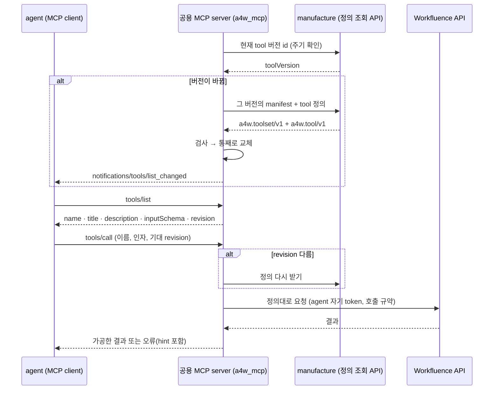

# Phase 3 요구사항 정의 — tool 서빙 (정의 조회 API + 공용 MCP server)

- 작성일: 2026-10-14
- 상태: 확정 (사용자가 설계 진행을 지시, 2026-10-14). 설계는 [`2_설계.md`](2_설계.md)
- 상위 문서: [`과제정의서.md`](../과제정의서.md) 2.2·7절, [`시스템아키텍처.md`](../시스템아키텍처.md) 1절 7, 4·5.4·5.5절
- 선행: Phase 2의 tool 정의 형식(`a4w.tool/v1`·`a4w.toolset/v1`, Phase 2 설계 6절), `tool-store`(13절), 공통 실행기 `a4w_tools`(15절), 색인 문서의 `revision`(14.3절)
- 요구사항 번호: Phase 2가 FR-3xx까지 썼으므로 이 phase는 `FR-T`·`NFR-T`·`AC-T`를 쓴다.

## 1. 목표

Manufacture가 만든 tool 정의(JSON)를 Inference의 agent가 MCP tool로 쓸 수 있게 한다. 두 가지를 만든다.

1. **tool 정의 조회 API** (`manufacture`): `tool-store`의 현재 tool 버전을 JSON으로 내준다. 클라이언트는 버전 id만 먼저 묻고, 바뀌었을 때만 정의를 받는다.
2. **공용 MCP server** (패키지 `a4w_mcp`): agent 곁에 agent마다 하나씩 뜬다. 조회 API에서 정의를 받아 `tools/list`로 내주고, `tools/call`은 **그 agent의 계정 token으로 타겟 API를 직접** 부른다. 실행은 Phase 2의 공통 실행기 `a4w_tools`를 그대로 쓴다. 그래서 검증한 대로 실행된다.

tool이 더해지거나 바뀌어도 JSON만 바뀐다. MCP server를 다시 빌드하거나 배포하지 않는다. token은 MCP server 밖으로 나가지 않는다(token passthrough를 쓰지 않음, 시스템아키텍처 1절 7).

이번 phase의 타겟은 Workfluence 하나다. MCP server 코드에는 Workfluence 고유 값이 없다. 타겟별로 다른 것(오류 해석, 호출 규약, scope 읽기)은 Phase 2의 타겟 어댑터와 타겟 설정을 그대로 쓴다.

## 2. 범위

| 포함 | 제외 |
|---|---|
| Manufacture tool 정의 조회 API | `inference` container, 요청 수행 API, gpt-oss 연동 (Phase 4) |
| 공용 MCP server 패키지 `a4w_mcp`: 정의 받기·갱신, `tools/list`, `tools/call`, 갱신 알림, 버전 일치 확인 | AI Pro Plus 검색(Inference가 함, Phase 4). MCP server는 검색하지 않는다 |
| agent 하나분의 MCP server 설정(token, 고정 맥락, 조회 API 주소)과 그 설정의 모양 | agent 여러 개의 계정·token 관리, 요청자 권한 (Phase 4·5) |
| `a4w_mcp` 시험 이미지와 container 안 시험(가짜 타겟·실호출) | 쓰기·위험 동작 전 요청자 확인 (Phase 4, 미정 13) |
| Detection 경유 실행의 interface 자리 (구현 없음) | 채팅 어댑터 (Phase 5) |
| Phase 2 문서의 `manufacture-mcp` 표현 정리 | tool 생성·검증·색인 로직 변경 |

## 3. 처리 흐름

## 4. 기능 요구사항

### 4.1 tool 정의 조회 API (`manufacture`)

| ID | 요구 |
|---|---|
| FR-T01 | 타겟의 현재 tool 버전 id만 돌려주는 가벼운 조회가 있다. 클라이언트는 이것으로 바뀌었는지만 확인한다. |
| FR-T02 | 현재 tool 버전의 manifest(`a4w.toolset/v1`)와 모든 tool 정의(`a4w.tool/v1`)를 한 번에 돌려주는 조회가 있다. 응답에 `toolVersion`을 담는다. |
| FR-T03 | 지정한 tool 버전을 돌려주는 조회가 있다. 그사이 포인터가 바뀌어도 클라이언트가 확인한 버전을 그대로 받을 수 있게 하기 위해서다. 없는 버전은 404다. |
| FR-T04 | 내주는 것은 포인터가 가리키는 묶음(또는 지정한 묶음)뿐이다. 쓰는 중인 묶음(`staging`)과 보류 항목은 내주지 않는다. 반쯤 쓴 버전이 나가지 않는다(Phase 2 FR-282). |
| FR-T05 | 정의는 `tool-store`에 있는 그대로 내준다. 고치거나 값을 채우지 않는다. 맥락 키 값(`homeSpace` 등)은 정의에 없고, 실행하는 쪽이 채운다(Phase 2 설계 6.3.1). |
| FR-T06 | 등록되지 않은 `targetId`는 404, 아직 tool 버전이 없는 타겟도 404로 거절한다(오류 코드는 다르게). |
| FR-T07 | 조회는 저장소를 바꾸지 않는다. 반영·되돌리기 중에도 조회할 수 있다(타겟 잠금을 잡지 않는다). |
| FR-T08 | 인증은 Manufacture의 다른 API와 같다(`MANUFACTURE_AUTH_MODE`). 응답에 비밀이 없다. |

### 4.2 정의 받기와 갱신 (`a4w_mcp`)

| ID | 요구 |
|---|---|
| FR-T11 | MCP server는 설정한 조회 API 주소에서 설정한 타겟의 정의를 받는다. `tool-store`를 직접 읽지 않는다. |
| FR-T12 | 설정한 간격마다 현재 버전 id를 확인하고, 바뀌었을 때만 정의를 다시 받는다. 확인은 조회이고 실행이 아니다(시스템아키텍처 3절). |
| FR-T13 | 받은 묶음은 `a4w_tools`의 스키마로 검사한다. 검사를 통과한 묶음만 쓰고, 통째로 바꾼다. 통과하지 못하면 이전 묶음을 계속 쓰고 이유를 기록한다. |
| FR-T14 | 묶음이 바뀌면 연결된 client에게 `notifications/tools/list_changed`를 보낸다. |
| FR-T15 | 바꾸는 중에 진행 중인 `tools/call`은 시작할 때의 정의로 끝난다. 한 호출 안에서 정의가 섞이지 않는다(상위 tool의 step 포함). |
| FR-T16 | 조회 API에 닿지 않으면 가진 묶음으로 계속 서빙하고, 마지막으로 받은 시각과 실패를 상태로 드러낸다. 처음 뜰 때 받지 못하면 tool이 없는 상태로 뜨고 계속 다시 시도한다. 디스크 캐시를 둘지는 설계에서 정한다. |

### 4.3 `tools/list`

| ID | 요구 |
|---|---|
| FR-T21 | MCP tool 하나는 tool 정의 하나다. `name`, `title`, `description`, `inputSchema`는 정의 값을 그대로 쓴다. 숨긴 칸·고정값·맥락 키·HTTP 매핑은 내보내지 않는다(작은 모델에게 보이는 것은 `inputSchema`뿐). |
| FR-T22 | tool 이름은 `targetId`로 이름공간을 나눈다. 한 server에 타겟이 여럿 붙어도 이름이 겹치지 않는다. 이름 규칙은 MCP 이름 제약 안에서 설계로 정한다. |
| FR-T23 | 각 tool에 정의의 `revision`, `risk`, `toolVersion`을 함께 싣는다(MCP `_meta`). `risk`는 MCP tool annotation(`readOnlyHint`, `destructiveHint` 등)으로도 나타낸다. |
| FR-T24 | agent token에 없는 scope가 필요한 tool은 내보내지 않는다. token scope는 Phase 2와 같은 방법(타겟 설정 `TARGET_SCOPE_PROVIDER`)으로 읽는다. 읽을 수 없으면 뜨지 않거나 설정으로 정한 동작을 한다(설계). |
| FR-T25 | agent 설정으로 내보낼 tool을 더 좁힐 수 있다(예: 허용 `risk` 상한, 묶음). 기본은 좁히지 않는다. |

### 4.4 `tools/call`

| ID | 요구 |
|---|---|
| FR-T31 | 정의대로 `a4w_tools`의 `ToolExecutor`로 실행한다. 입력 검사, 호출 규약(한도·재시도·충돌), 오류 해석, 응답 가공은 Phase 2와 같은 코드다. MCP server에 tool별 코드가 없다. |
| FR-T32 | 타겟 호출에는 그 agent의 token만 쓴다. token은 agent 설정의 비밀에서만 읽고, 조회 API·로그·결과·오류에 넣지 않는다. |
| FR-T33 | 고정 맥락(`homeSpace` 등)은 agent 설정에서 읽어 `context`로 넘긴다. 정의가 요구하는 맥락 값이 없으면 타겟을 부르지 않고 `CONTEXT_MISSING`이다(Phase 2 I23). |
| FR-T34 | **버전 일치 확인**: client가 기대 `revision`을 보내면(AI Pro Plus 색인의 `source`에서 얻은 값) 서빙 중인 tool의 `revision`과 비교한다. 다르면 정의를 한 번 다시 받는다. 그래도 다르면 실행하지 않고 이유(기대·현재 revision)를 돌려준다. 보내지 않으면 확인하지 않는다(Phase 2 설계 14.3절). |
| FR-T35 | 없는 tool, 내보내지 않은 tool(scope·설정으로 걸러진 것)은 실행하지 않는다. |
| FR-T36 | 결과는 MCP 결과로 돌려준다. 성공은 가공한 결과(JSON), 실패는 `isError: true`와 `ToolError`(코드, 메시지, 타겟 오류 코드, `requestId`, `hint`, 실패 step)다. 모델이 읽고 다음 행동을 고를 수 있어야 한다. `truncated`도 전한다. |
| FR-T37 | 호출 한도는 이 MCP server 안에서 그 token 기준으로 센다. 그래서 한 token(계정)은 한 곳에서만 쓴다. 검증 계정과 agent 계정을 나눈다(8절 3번). |

### 4.5 실행 방식과 설정

| ID | 요구 |
|---|---|
| FR-T41 | MCP server는 agent마다 하나 띄운다. 한 server는 agent 하나의 token과 맥락만 가진다. |
| FR-T42 | MCP 전송 방식은 설계에서 정한다. 기본안은 stdio다(agent가 자기 비밀을 넘겨 자식 프로세스로 띄우고, 바깥에 포트를 열지 않는다). |
| FR-T43 | agent 하나분의 설정은 다음과 같다. 타겟 id, 조회 API 주소와 인증, 갱신 간격, 타겟 설정 파일(호출 규약·TLS 등, Phase 2의 `config/targets/<targetId>.env`), agent 비밀(타겟 API 주소와 token), 고정 맥락, tool 좁히기. 값은 모두 설정이다. |
| FR-T44 | 고정 맥락은 agent 설정에 둔다. 타겟 설정에 있던 `AGENT_CONTEXT`는 agent 설정 `config/agents/<agentId>/<targetId>.env`로 옮긴다(설계 3.1절, 타겟 기본값으로 남기지 않음). Workfluence 시험 스택의 `homeSpace`는 "AI Agent 작업공간"이다(id는 설정에 있다). |
| FR-T45 | 상태 확인 수단(현재 `toolVersion`, 마지막으로 받은 시각, 조회 실패, tool 수)을 둔다. 수단은 MCP resource `a4w://status`와 stderr 로그다(설계 D8). |

### 4.6 확장 interface (구현은 비워 둠)

| ID | 요구 |
|---|---|
| FR-T51 | tool 실행 경로를 interface 뒤에 둔다. 구현은 "agent token으로 직접"만 만든다. agent가 아닌 client가 공용 계정으로 실행해야 할 때를 위한 Detection 경유 실행은 자리만 둔다(시스템아키텍처 1절 7). |
| FR-T52 | 정의를 받는 곳을 interface 뒤에 둔다. 구현은 Manufacture 조회 API만 만든다(시험에서는 가짜 구현). |
| FR-T53 | `kind: handler` tool은 Phase 2와 같이 등록된 handler만 실행한다. Workfluence에는 없다. |

## 5. 비기능 요구사항

| ID | 요구 |
|---|---|
| NFR-T01 | **설정**: 조회 API 주소, 갱신 간격, 제한 시간, 전송 방식, 이름공간 규칙의 구분자, 좁히기 규칙은 설정으로 받는다. 코드에 하드코딩하지 않는다. |
| NFR-T02 | **비밀**: agent token은 agent 비밀 파일(`.env`, 600, Git 제외)로만 받는다. Manufacture container에는 타겟 token이 없다(Phase 2 AC-14 유지). 조회 API 인증 token과 타겟 token을 섞지 않는다. |
| NFR-T03 | **로그**: token을 남기지 않는다. tool 인자와 결과 본문을 통째로 남기지 않는다. 호출마다 tool 이름, revision, 결과 코드, 소요 시간, 타겟 `requestId`만 남긴다. |
| NFR-T04 | **의존**: `a4w_mcp`는 MCP 공식 Python SDK와 `a4w_tools`·`a4w_core`·타겟 어댑터 패키지에만 기댄다. `a4w_tools`는 MCP를 모르는 채로 둔다(Phase 2 FR-307). |
| NFR-T05 | **범용성**: `a4w_mcp`에 Workfluence 고유 값이 없다. 타겟을 더할 때 `a4w_mcp`를 고치지 않는다(OCP). |
| NFR-T06 | **실행 환경**: 빌드·시험은 container 안에서 한다. 이미지 빌드는 compose와 독립이다. `a4w_mcp` 시험 이미지를 둔다. compose 서비스는 Phase 4의 `inference`에서 더한다. |
| NFR-T07 | **호출 한도**: 한 계정(token)은 한 곳에서만 쓴다. Detection 검증은 검증 전용 계정, MCP server는 agent 계정이다(8절 3번). agent가 여럿이면 agent마다 계정이 따로다. |
| NFR-T08 | **설계 원칙·개발 방식**: SOLID, TDD(red → green). 타겟은 가짜 HTTP, Manufacture는 가짜 조회 API, MCP는 SDK의 메모리 전송으로 단위 시험한다. 실호출 시험은 `A4W_LIVE_TESTS=1`일 때만 돈다. |

## 6. 인수 기준

| # | 기준 | 확인 방법 |
|---|---|---|
| AC-T1 | 조회 API가 현재 버전 id, 현재 묶음, 지정 버전을 돌려준다. 돌려준 묶음이 `tool-store`의 manifest·tool 파일과 같다. 없는 타겟·버전, 아직 버전이 없는 타겟은 정해진 코드로 거절된다 | 통합 시험 |
| AC-T2 | 반영이 묶음을 쓰는 중에 조회해도 반쯤 쓴 버전이 나오지 않는다. 되돌리기 뒤에는 되돌린 버전이 나온다 | 통합 시험 |
| AC-T3 | MCP client(SDK)가 `tools/list`를 부르면 현재 버전의 tool이 이름공간 이름으로 나오고, `inputSchema`는 정의와 같으며, `http`·`fixed`·맥락 키는 보이지 않는다. `revision`·`risk`가 `_meta`에 있다 | 단위 시험 (메모리 전송) |
| AC-T4 | token scope에 없는 tool(예: `write` 없는 token에서 쓰기 tool)은 목록에 없고, 이름으로 불러도 실행되지 않는다 | 단위 시험 |
| AC-T5 | 조회 API의 버전이 바뀌면 설정한 간격 안에 새 묶음으로 바뀌고 `notifications/tools/list_changed`가 간다. 바꾸는 중에 진행 중이던 호출은 옛 정의로 끝난다 | 단위 시험 |
| AC-T6 | 기대 `revision`이 다르면 정의를 다시 받고, 다시 받아도 다르면 실행하지 않고 이유를 돌려준다. 타겟 호출이 없다 | 단위 시험 |
| AC-T7 | 조회 API가 멈춰도 가진 묶음으로 실행이 계속되고, 상태에 실패가 드러난다. 검사에 실패한 묶음은 쓰지 않는다 | 단위 시험 |
| AC-T8 | 단순 tool·상위 tool의 실행 결과와 오류(`INPUT_INVALID`, `CONTEXT_MISSING`, 409 안내, 429 대기)가 Phase 2 실행기 시험과 같다. 맥락 키 값은 agent 설정 값으로 채워진다 | 단위 시험 (가짜 타겟) |
| AC-T9 | 시험 스택에서 agent token으로 container 안 MCP server에 붙어 읽기 tool, 상위 tool(제목으로 찾기), 쓰기 tool(`homeSpace` 안 댓글 달기 → 지우기)을 실행해 성공한다. 시험이 남긴 자료를 지운다 | 실호출 (`A4W_LIVE_TESTS=1`) |
| AC-T10 | token이 로그·`tools/call` 결과·오류·조회 API 요청에 나오지 않는다. Manufacture container에 타겟 token이 없다 | 단위 시험(로그 수집), 검토, compose 설정 |
| AC-T11 | `a4w_mcp`에 Workfluence 고유 값과 URL·경로·token·이름공간 구분자의 하드코딩이 없다. `a4w_tools`는 MCP를 import하지 않는다 | 검토, 단위 시험 |
| AC-T12 | Phase 1·2의 시험이 그대로 통과한다 | container 안 전체 시험 |

## 7. 시험 자료

- tool 묶음: Phase 2 seed로 만든 실제 `tool-store` 묶음(30여 개)과, 버전 바뀜·revision 바뀜·검사 실패를 만들기 위한 작은 손 묶음 몇 개.
- 타겟: 단위 시험은 `httpx` 가짜 전송(Phase 2 `verify_fakes`와 같은 방식). 실호출은 시험 스택 `https://wf.internal:8444`, agent 계정 `aiagent`, `homeSpace` "AI Agent 작업공간".
- token scope: `read`만 있는 경우와 `read write`가 있는 경우를 가짜 token(또는 설정 scope)으로 만든다.
- MCP: SDK의 메모리 전송으로 client·server를 한 프로세스에 띄운다. 실호출 시험은 설계에서 정한 전송(기본 stdio)으로 띄운다.

## 8. 착수 전에 필요한 정보와 열린 질문

| # | 항목 | 상태 |
|---|---|---|
| 1 | (해결) agent용 계정·token | `aiagent`(member, read·write, 만료 2027-10-13). Phase 2 test 결과서 |
| 2 | (해결) Workfluence `homeSpace` 값 | 시험 스택 "AI Agent 작업공간"(owner `aiagent`). `config/targets/workfluence.env`의 `AGENT_CONTEXT` |
| 3 | (해결) 검증 계정과 agent 계정을 나눈다 (사용자 결정, 2026-10-14) | 검증 전용 `aiagent-verify`(member, `read write`, 만료 2027-10-14)를 workf가 발급했다. Detection 타겟 비밀(`workfluence.env`)로 쓰고, 34개 검증 통과를 확인했다(Phase 2 test 결과서 8.4). `aiagent`는 agent 전용(`workfluence.agent.env`)이다. 호출 한도는 token 단위다(계정당 token 최대 10개, 채팅 보내기만 사용자 단위 60/분) |
| 4 | (해결) MCP Python SDK 버전과 프로토콜 판 | SDK 2.x(`mcp==2.3.0`, 사용자 지시 2026-10-14). 프로토콜은 2026-07-28(요청마다 봉투, `subscriptions/listen`)과 handshake 판(2025-11-25 이하)을 모두 받는다. 설계 3절 |
| 5 | Phase 2 보류 2개(알림 읽음 tool)의 승인 | 미정. 승인하지 않으면 Phase 3 묶음에 들어가지 않을 뿐 Phase 3 진행에는 지장이 없다 |

## 9. 설계에서 정할 것

- 조회 API의 경로와 응답 모양(묶음을 한 번에 줄지, tool별로 받을지), 바뀜 확인에 `ETag`/`If-None-Match`를 쓸지
- 조회 API 오류 코드(예: `TOOLSET_NOT_FOUND`)
- MCP 전송 방식(stdio, Streamable HTTP), SDK 판, tool 이름공간 규칙
- `_meta`와 tool annotation의 키, `risk` → annotation 대응
- 기대 `revision`을 `tools/call`에 싣는 자리(`_meta` 등)와 불일치 오류 모양
- agent 설정 파일의 구성과 변수 이름, `AGENT_CONTEXT`의 위치, agent 비밀의 위치
- 갱신 간격 기본값, 조회 실패 때 다시 시도하는 규칙, 디스크 캐시 여부
- scope를 읽을 수 없을 때의 동작, tool 좁히기 규칙의 모양
- 상태 확인 수단
- `a4w_mcp` 모듈 구조, 시험 이미지(Dockerfile, `scripts/build.sh`·`scripts/test.sh` 대상 이름)
- 실호출 시험이 남기는 자료와 정리 방법

## 10. 상위·이전 문서에 고칠 것

| 문서 | 고칠 것 |
|---|---|
| Phase 2 요구사항 FR-282·FR-307·FR-335, NFR-204 | `manufacture-mcp`를 "Inference 쪽 공용 MCP server(`a4w_mcp`)"로. NFR-204(같은 이미지)는 없앤다 |
| Phase 2 설계 13.1·15·15.2절 | 같은 표현 정리(21.1절이 이미 읽는 법을 적었으므로 본문에 이 문서로 가는 줄만 더한다) |
| 시스템아키텍처 5.4절 | 경로·모양을 Phase 3 설계로 잇는다 |
