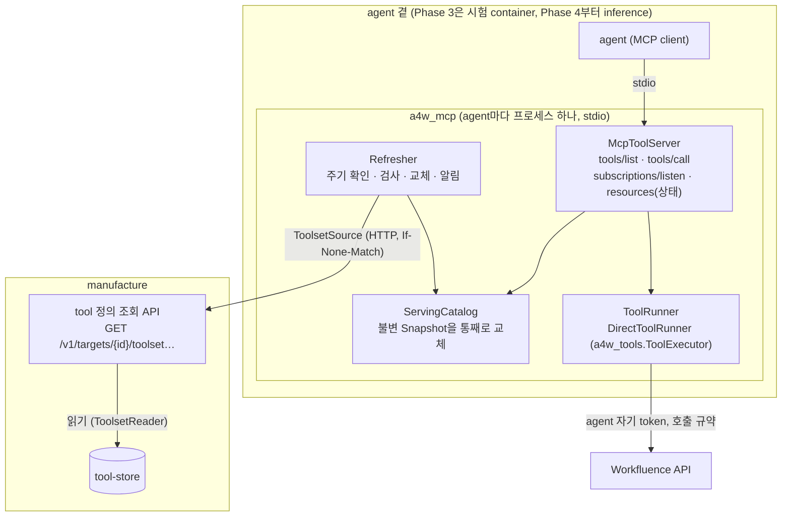
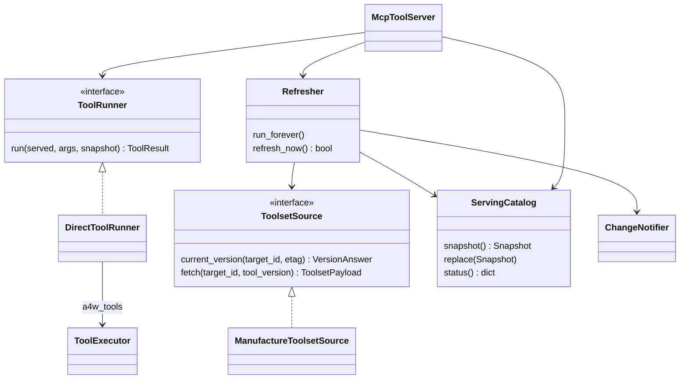
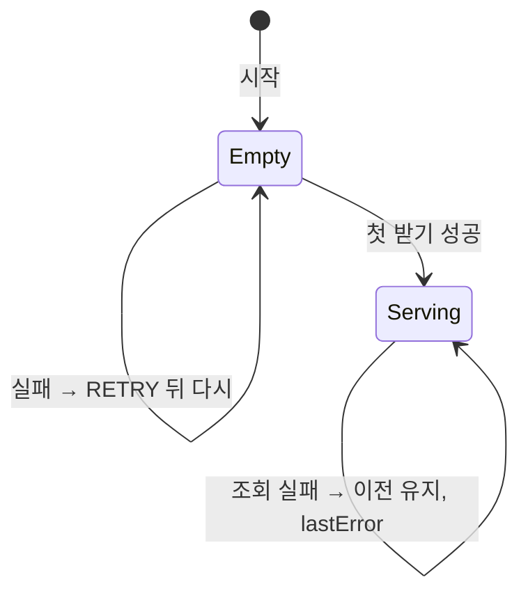
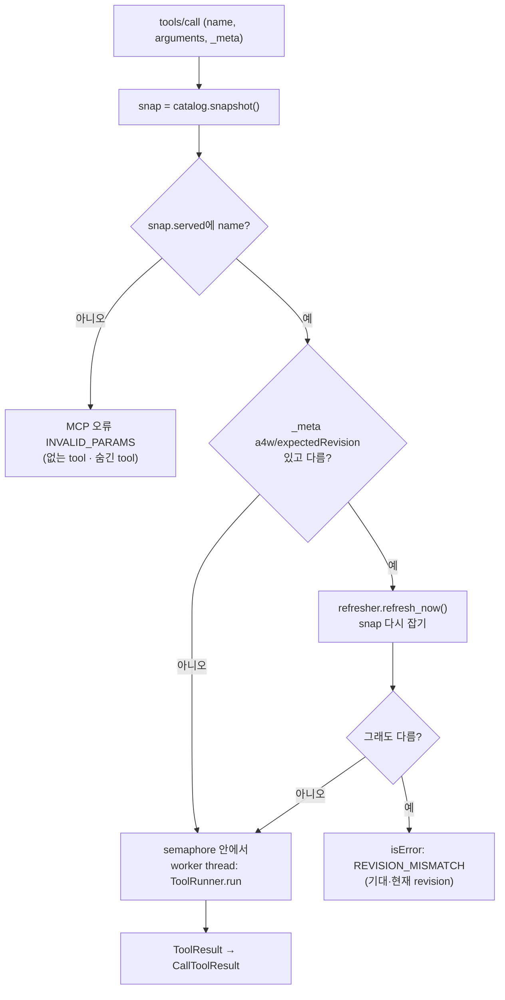

# Phase 3 설계 — tool 서빙 (정의 조회 API + 공용 MCP server)

- 작성일: 2026-10-14
- 상태: 확정 (사용자가 구현 시작을 지시, 2026-10-14). 구현 중 바뀐 것은 16절
- 요구사항: [`1_요구사항정의.md`](1_요구사항정의.md) (FR-T·NFR-T·AC-T)
- 상위·이전 문서: [`시스템아키텍처.md`](../시스템아키텍처.md) 1절 7, 5.4·5.5절. Phase 2 설계 6절(tool 형식), 13절(`tool-store`), 14.3절(색인 `revision`), 15절(`a4w_tools`)

## 1. 설계 개요



| 결정 | 내용 | 근거 |
|---|---|---|
| D1 | 조회 API는 manufacture의 기존 앱에 라우트를 더한다. 저장소는 `FileToolStore`(→ `ToolsetReader`)로 읽는다 | 저장소 소유 원칙, FR-T04·T07 |
| D2 | `a4w_mcp`는 공유 패키지 `packages/mcp`다. 웹 서버가 아니라 **stdio MCP server 프로세스**다. agent 하나 = 프로세스 하나 | FR-T41·T42, 포트를 열지 않음 |
| D3 | MCP SDK는 **2.x**(`mcp==2.3.0`, 사용자 지시). 저수준 `mcp.server.Server`에 handler를 넣는다(tool이 동적이라 데코레이터 방식 `MCPServer`는 맞지 않는다) | 4절 확인 기록 |
| D4 | 프로토콜은 두 판을 다 받는다. 2026-07-28(요청마다 봉투, 변경은 `subscriptions/listen`)과 handshake 판(2025-11-25 이하, 변경은 `notifications/tools/list_changed`). SDK가 판을 고르고, 우리는 알림을 두 길로 다 보낸다 | 다른 MCP client도 붙을 수 있게(시스템아키텍처 5.5) |
| D5 | 정의 묶음은 불변 `Snapshot`으로 두고 참조만 바꾼다. 호출은 시작할 때 잡은 Snapshot으로 끝난다 | FR-T13·T15 |
| D6 | 실행은 Phase 2의 `ToolExecutor` 그대로다. 동기 코드라 worker thread에서 돌린다. 한도 계산(`ConfigCallPolicy`)은 이미 lock으로 thread에 안전하다 | FR-T31, AC-T8 |
| D7 | agent 설정은 `config/agents/<agentId>/<targetId>.env`(비밀 아님), agent 비밀은 `config/secrets/agents/<agentId>/<targetId>.env`. `AGENT_CONTEXT`는 타겟 설정에서 agent 설정으로 옮긴다 | FR-T43·T44 |
| D8 | 상태는 MCP resource `a4w://status`로 보인다(tool로 두지 않는다. tool이면 모델에게 보인다) | FR-T45 |
| D9 | 디스크 캐시를 두지 않는다. 처음 받지 못하면 tool 없이 뜨고 다시 시도한다 | FR-T16. 같은 compose 안이고 묶음이 작다. 오래된 사본이 남는 위험을 피한다. Phase 4에서 다시 본다 |

## 2. 모듈 구조

```
packages/mcp/
  Dockerfile                    # test 단계만 (runtime은 Phase 4 inference 이미지가 이 패키지를 넣는다)
  requirements.txt              # mcp==2.3.0 (+ a4w_tools 의존과 같은 고정 판)
  requirements-test.txt
  pyproject.toml                # a4w-mcp, console script a4w-mcp = a4w_mcp.__main__:main
  src/a4w_mcp/
    __main__.py                 # 진입점: 설정 읽기 → wiring → stdio 실행. 로그는 stderr
    config.py                   # McpSettings(서비스), AgentTargetSettings(agent×타겟) 읽기·검사
    wiring.py                   # 조립 지점 (registry로 타겟 어댑터 구현 고르기)
    source.py                   # ToolsetSource(ABC), ManufactureToolsetSource(httpx)
    snapshot.py                 # Snapshot, ServedTool, 정의 → 노출 여부·MCP 이름
    catalog.py                  # ServingCatalog: 현재 Snapshot 참조, 교체, 상태 값
    refresher.py                # Refresher: 주기 확인·즉시 확인(revision 불일치)
    notifier.py                 # ChangeNotifier: subscription bus + handshake 판 session
    runner.py                   # ToolRunner(ABC), DirectToolRunner, (DetectionToolRunner 자리 없음 — registry 이름만)
    mapping.py                  # 정의 → mcp Tool, ToolResult → CallToolResult
    server.py                   # build_server(): 저수준 Server와 handler
  tests/
    fakes.py                    # 가짜 Manufacture(httpx MockTransport), 가짜 타겟, 묶음 만들기
    unit/ … integration/ … live/
agents/manufacture/src/a4w_manufacture/
  toolsets.py                   # ToolsetQuery (조회 API의 서비스)
  api/routes.py                 # 라우트 3개 더함
```



- `a4w_mcp`는 `a4w_core`(설정·registry·scope interface), `a4w_tools`(형식 검사·실행기), 설치된 타겟 어댑터(entry point `a4w.targets`)만 쓴다. Workfluence를 import하지 않는다(NFR-T05). 오류 해석기·scope 읽기는 타겟 설정의 이름(`CALL_ERROR_INTERPRETER`, `TARGET_SCOPE_PROVIDER`)으로 registry에서 만든다. Detection `wiring._verify_runtime`과 같은 조립이다.
- `a4w_tools`는 바꾸지 않는다. MCP를 모르는 채로 둔다(AC-T11).

## 3. 설정

### 3.1 파일 구성

| 파일 | 내용 | Git |
|---|---|---|
| `.env` | 서비스 설정(아래 3.2). `MCP_MANUFACTURE_TOKEN`처럼 서비스 사이 token도 여기(Detection·Manufacture와 같은 방식) | 제외 (`.env.example`만) |
| `config/targets/<targetId>.env` | 타겟 설정(호출 규약 `CALL_*`, `TARGET_API_PATH_PREFIX`, TLS, `CALL_ERROR_INTERPRETER`, `TARGET_SCOPE_PROVIDER`). Phase 2와 같은 파일을 읽기 전용으로 붙인다 | 제외 |
| `config/agents/<agentId>/<targetId>.env` | agent가 그 타겟에서 쓰는 비밀 아닌 설정: 맥락, 좁히기 | 제외 (`*.example`) |
| `config/secrets/agents/<agentId>/<targetId>.env` | agent의 타겟 비밀: `TARGET_API_BASE_URL`, `TARGET_API_TOKEN` (600) | 제외 (`*.example`) |

- agent 하나가 타겟 여럿을 쓰면 타겟마다 파일 한 쌍이다. 이번에는 `aiagent/workfluence` 하나다.
- 지금 `config/secrets/targets/workfluence.agent.env`(agent token)는 `config/secrets/agents/aiagent/workfluence.env`로 옮긴다. `config/secrets/targets/`에는 Detection 비밀만 남는다.
- `AGENT_CONTEXT`는 `config/targets/workfluence.env`에서 빼고 `config/agents/aiagent/workfluence.env`로 옮긴다. 맥락은 agent마다 다르기 때문이다(agent마다 기본 스페이스가 다를 수 있다).

### 3.2 `.env` (MCP server)

| 변수 | 뜻 | 예 |
|---|---|---|
| `MCP_IMAGE`, `MCP_TAG` | 시험 이미지 이름·태그 | `a4w/mcp`, `0.1.0` |
| `MCP_AGENT_ID` | 이 프로세스의 agent (`^[a-z0-9][a-z0-9_-]{0,62}$`) | `aiagent` |
| `MCP_TARGETS` | 이 agent가 쓰는 타겟 목록 | `workfluence` |
| `MCP_TARGETS_DIR` | 타겟 설정 디렉터리 | `/config/targets` |
| `MCP_AGENTS_DIR` | agent 설정 디렉터리 | `/config/agents` |
| `MCP_SECRETS_DIR` | agent 비밀 디렉터리 | `/config/secrets/agents` |
| `MCP_MANUFACTURE_URL` | 조회 API 주소 | `http://manufacture:18002` |
| `MCP_MANUFACTURE_TOKEN` | Manufacture가 `bearer`일 때 보낼 token. 비우면 헤더 없음 | (빈 값) |
| `MCP_MANUFACTURE_TIMEOUT_SECONDS` | 조회 제한 시간 | `10` |
| `MCP_REFRESH_SECONDS` | 버전 확인 간격 | `60` |
| `MCP_REFRESH_RETRY_SECONDS` | 실패 뒤 다시 시도할 때까지(처음 받기 실패 포함) | `10` |
| `MCP_TRANSPORT` | `stdio`(구현) · `streamable_http`(자리만) | `stdio` |
| `MCP_TOOL_NAME_SEPARATOR` | MCP 이름 = `targetId` + 구분자 + tool 이름 | `__` |
| `MCP_TOOL_NAME_MAX` | MCP 이름 최대 길이 | `64` |
| `MCP_MAX_CONCURRENT_CALLS` | 동시에 도는 `tools/call` 수 | `4` |
| `MCP_SCOPE_UNKNOWN` | token scope를 읽을 수 없을 때: `fail`(뜨지 않음) · `all`(거르지 않음) | `fail` |
| `MCP_LIVE_MANUFACTURE_URL` | live 시험이 부를 실행 중인 Manufacture | `http://host.docker.internal:18002` |
| `MCP_TEST_SECRETS`, `MCP_TEST_HOSTS` | live 시험이 붙일 비밀·이름 (Phase 2 I7 규칙) | `agents`, `host.docker.internal:host-gateway` |
| `LOG_LEVEL` | 공통 | `INFO` |

- 구분자 기본 `__`: MCP 이름은 `[A-Za-z0-9_.-]`를 허용하지만, Phase 4가 tool을 넘길 OpenAI 호환 function 이름은 `^[a-zA-Z0-9_-]{1,64}$`다. `.`을 쓰면 Phase 4에서 다시 바꿔야 한다. 그래서 `__`와 64자를 기본으로 하고 둘 다 설정으로 둔다.
- 코드에는 기본값이 없다(Phase 1·2와 같은 규칙). `.env.example`에 모두 적는다.

### 3.3 `config/agents/<agentId>/<targetId>.env`

| 변수 | 뜻 | 예 |
|---|---|---|
| `AGENT_CONTEXT` | 고정 맥락 `키=값,…` (Phase 2 설계 6.3.1) | `homeSpace=f05f841a-…` |
| `AGENT_TOOL_MAX_RISK` | 내보낼 tool의 위험 상한 `read` · `write` · `danger` | `danger` (좁히지 않음) |
| `AGENT_TOOL_GROUPS` | 내보낼 묶음. `*`이면 전부 | `*` |

- 맥락 값에 `,`·`=`가 들어갈 일은 없다(id). 들어가야 하는 타겟이 생기면 형식을 바꾼다.

## 4. MCP SDK 2.x 확인 기록 (2026-10-14)

시험 이미지와 같은 기본 이미지에 `mcp==2.3.0`을 설치하고 작은 시제품을 돌려 확인했다(쓰고 지운 container).

| 확인 | 결과 |
|---|---|
| 판 | `LATEST_PROTOCOL_VERSION = 2026-07-28`. handshake 판 2024-11-05 ~ 2025-11-25, 요청마다 봉투를 쓰는 판 2026-07-28. 저수준 `Server`는 두 판을 다 받는다 |
| 동적 tool | `Server(name, on_list_tools=…, on_call_tool=…)`. handler는 `(ctx, params)`를 받는 async 함수다. 부를 때마다 목록을 새로 만들 수 있다 |
| tool 필드 | `Tool(name, title, description, input_schema, output_schema, annotations, meta, …)`. `ToolAnnotations(title, read_only_hint, destructive_hint, idempotent_hint, open_world_hint)` |
| `_meta` | tool의 `meta`가 client에 그대로 간다. `call_tool(…, meta={"a4w/expectedRevision": …})`의 값이 server의 `params.meta`로 온다(2026-07-28이면 SDK가 판·client 정보 키를 더한다) |
| 결과 | `CallToolResult(content, structured_content, is_error)` |
| 변경 알림 (2026-07-28) | `ListenHandler(InMemorySubscriptionBus())`를 `on_subscriptions_listen`에 넣고 `bus.publish(ToolsListChanged())` → client `listen(tools_list_changed=True)`가 받았다 |
| 변경 알림 (handshake 판) | 이 판에서는 `listen`이 `ListenNotSupportedError`다. handler의 `ctx.session.send_tool_list_changed()`로 보낸 `ToolListChangedNotification`을 client `message_handler`가 받았다 |
| client 캐시 | SDK client는 `tools/list`를 캐시하지만, 알림을 받은 뒤 다시 부르면 새 목록이 나왔다 |
| 시험 | `Client(server, mode="2026-07-28")` 또는 `mode="legacy"`가 메모리 안에서 server를 띄운다(`InMemoryTransport`). 단위 시험에 쓴다 |
| 의존 | `anyio`, `pydantic`, `starlette`, `uvicorn`, `httpx2`(2.13.1, `httpx`와 다른 패키지), `mcp-types` 등. Detection 시험 이미지(`httpx==0.28.1` 등)에 같이 설치해 `pip check` 통과 |
| capability | `create_initialization_options(NotificationOptions(tools_changed=True))`이면 tools `listChanged: true`. 기본은 false |

- 서버 밖(주기 갱신)에서 handshake 판 session에 알림을 보내려면 session을 알고 있어야 한다. 그래서 `ChangeNotifier`가 요청을 받을 때 본 handshake 판 session을 약한 참조로 모아 둔다(7.3).
- bus 알림이 handshake 판 session에도 가는지는 확인하지 않았다. 두 길로 다 보내고, 같은 client가 두 번 받는 일은 없다(판이 하나다).

## 5. tool 정의 조회 API (`manufacture`)

### 5.1 경로

| API | 응답 | 비고 |
|---|---|---|
| `GET /v1/targets/{targetId}/toolset/current` | `200 {"targetId", "toolVersion", "updatedAt"}` + `ETag: "<toolVersion>"`. `If-None-Match`가 같으면 `304` | FR-T01. 가벼운 확인 |
| `GET /v1/targets/{targetId}/toolset` | 현재 버전의 묶음(5.2) | FR-T02 |
| `GET /v1/targets/{targetId}/toolsets/{toolVersion}` | 지정 버전의 묶음(5.2). `ETag: "<toolVersion>"`, `Cache-Control: immutable` | FR-T03. 묶음은 바뀌지 않는다(Phase 2 FR-281) |

- MCP server는 `current`로 버전을 보고, 바뀌면 **그 버전 id로** `toolsets/{v}`를 받는다. 두 호출 사이에 포인터가 또 바뀌어도 받은 묶음은 확인한 버전과 같다. 다음 확인에서 새 버전을 본다.
- `toolset`(현재 묶음)은 사람이 curl로 볼 때 쓴다.
- 셋 다 `tool-store`를 읽기만 하고 타겟 잠금을 잡지 않는다(FR-T07). `current.json`은 원자적으로 바뀌고 묶음은 불변이므로(Phase 2 13.1) 잠금이 필요 없다.

### 5.2 묶음 응답

```json
{
  "targetId": "workfluence",
  "toolVersion": "tv-000002-8a2b35b1",
  "manifest": {"schema": "a4w.toolset/v1", "targetId": "workfluence", "toolVersion": "tv-000002-8a2b35b1", "tools": ["…"]},
  "tools": {"add_comment": {"schema": "a4w.tool/v1", "kind": "operation", "name": "add_comment", "…": "…"}}
}
```

- `manifest`와 `tools`는 `tool-store` 파일 내용 그대로다(FR-T05). `ToolsetReader.version()`이 이미 스키마·이름·revision 일치를 검사한다. 검사에 실패한 묶음은 `500 STORAGE_ERROR`다(저장소가 망가진 것이므로).
- 크기: 지금 서빙 묶음(`tv-000002-8a2b35b1`, tool 30개) 기준 수십 KB다. 나눠 받지 않는다.

### 5.3 오류

| HTTP | `code` | 때 |
|---|---|---|
| 404 | `TARGET_NOT_FOUND` | 등록되지 않은 `targetId` (기존 코드) |
| 404 | `TOOLSET_NOT_FOUND` | 등록된 타겟이지만 현재 버전이 아직 없음 (새 코드) |
| 404 | `TOOL_VERSION_NOT_FOUND` | 없는 버전 (기존 코드) |
| 400 | `VALIDATION_ERROR` | 버전 id 모양이 틀림(`^tv-[0-9]{6}-[0-9a-f]{8}$`) |
| 401 | `UNAUTHORIZED` | `bearer` 모드에서 token이 없거나 틀림 (기존 `require_auth`) |
| 500 | `STORAGE_ERROR` | 묶음 검사 실패, 읽기 실패 |

### 5.4 구현

- `ToolsetQuery(targets, store: FileToolStore)`: `current(target_id)`, `read(target_id, version)`. 라우트는 이것만 부른다(`ApplyService`를 거치지 않는다).
- 라우트 3개를 `v1` 라우터에 더한다. 기존 라우트·계약은 바꾸지 않는다.

## 6. 정의 받기와 교체

### 6.1 `ToolsetSource`

```python
@dataclass(frozen=True)
class VersionAnswer:
    tool_version: str | None      # None: 304 (바뀌지 않음)
    etag: str | None

class ToolsetSource(ABC):
    def current_version(self, target_id: str, etag: str | None) -> VersionAnswer: ...
    def fetch(self, target_id: str, tool_version: str) -> dict: ...   # 5.2 묶음
```

- `ManufactureToolsetSource`: httpx 동기 client, `MCP_MANUFACTURE_TIMEOUT_SECONDS`, `MCP_MANUFACTURE_TOKEN`이 있으면 `Authorization`. 이 client에는 **타겟 token이 없다**(다른 객체). 접속 실패·5xx·시간 초과는 `ToolsetUnavailable`, 404 `TOOLSET_NOT_FOUND`는 `ToolsetMissing`(아직 버전 없음, 정상 상태로 다룬다).
- 내부 주소라 proxy를 거치지 않게 `NO_PROXY`에 `manufacture`를 넣는다(실행 설정).

### 6.2 검사 (`snapshot.build`)

받은 묶음으로 `Snapshot`을 만들기 전에 검사한다. 하나라도 틀리면 묶음 전체를 버리고 이전 Snapshot을 쓴다(FR-T13).

| 검사 | 실패 코드 (상태·로그) |
|---|---|
| `a4w_tools.validate_toolset(manifest)`, tool마다 `validate_tool` | `TOOLSET_INVALID` |
| 응답 `targetId`·`toolVersion` = 요청한 값 = manifest 값 | `TOOLSET_MISMATCH` |
| manifest의 tool 이름·revision = tool 정의의 이름·revision, 빠진 tool 없음 | `TOOLSET_MISMATCH` |
| 상위 tool의 step이 같은 묶음의 `kind: operation` tool을 가리킴 | `TOOLSET_INVALID` |

### 6.3 `Snapshot`과 노출 규칙

```python
@dataclass(frozen=True)
class ServedTool:
    mcp_name: str               # workfluence__add_comment
    target_id: str
    definition: Mapping          # 원본 정의 (읽기 전용으로 감싼다)
    tool_version: str

@dataclass(frozen=True)
class Snapshot:
    tool_versions: Mapping[str, str]                 # targetId → toolVersion
    served: Mapping[str, ServedTool]                 # mcp 이름 → tool (노출하는 것만)
    toolsets: Mapping[str, Mapping[str, Mapping]]    # targetId → 이름 → 정의 (상위 tool 실행용, 숨긴 것 포함)
    hidden: Mapping[str, str]                        # mcp 이름 → 숨긴 이유 (상태용)
```

노출 여부는 tool마다 이렇게 정한다(FR-T24·T25).

| 순서 | 규칙 | 숨김 이유 |
|---|---|---|
| 1 | tool `scopes` ⊆ agent token scope | `SCOPE` |
| 2 | `risk` ≤ `AGENT_TOOL_MAX_RISK` (`read` < `write` < `danger`) | `RISK` |
| 3 | `AGENT_TOOL_GROUPS`가 `*`이거나 tool `group`을 포함 | `GROUP` |
| 4 | MCP 이름이 `^[A-Za-z0-9_-]+$`이고 `MCP_TOOL_NAME_MAX` 이하 | `NAME` |

- 상위 tool은 자기 `risk`·`scopes`로 판단한다(Phase 2가 step의 최댓값·합집합으로 정해 둠). 숨긴 단순 tool도 `toolsets`에는 남아 상위 tool의 step으로 쓰인다. 상위 tool이 보이면 그 step이 필요로 하는 권한도 이미 상위 tool의 `scopes`에 들어 있다.
- token scope는 시작할 때 한 번 읽는다(`ScopeProvider.scopes(token)`, Workfluence는 JWT의 `scope` 클레임). 읽지 못하면 `MCP_SCOPE_UNKNOWN`을 따른다(`fail`이면 시작하지 않고 이유를 stderr에 남김).
- 맥락 키 검사: 보이는 tool이 요구하는 맥락 키(`http.fixed[].context`, 상위 tool은 step tool의 것)가 `AGENT_CONTEXT`에 없으면 숨기지 않고 상태에 `contextMissing`으로 드러낸다. 실행하면 실행기가 `CONTEXT_MISSING`을 돌려준다(FR-T33, 모델에게 이유가 보이는 쪽을 고른다).

### 6.4 `Refresher`



- `run_forever()`: anyio task 하나. 타겟마다 `current_version(etag)` → 바뀌었으면 `fetch` → 검사 → 모든 타겟의 결과를 합쳐 새 Snapshot → `catalog.replace()` → `notifier.tools_changed()`. 간격은 성공이면 `MCP_REFRESH_SECONDS`, 실패면 `MCP_REFRESH_RETRY_SECONDS`.
- HTTP 호출은 동기 client라 `anyio.to_thread.run_sync`로 부른다.
- `refresh_now()`: revision 불일치 때 쓴다(8.3). 이미 도는 갱신이 있으면 그 결과를 기다린다(lock 하나). 제한 시간은 `MCP_MANUFACTURE_TIMEOUT_SECONDS`.
- 처음 받기: 시작할 때 기다리지 않는다. server가 먼저 뜨고 tool이 없는 상태(`tools/list` = 빈 목록)로 응답한다. 받으면 알림을 보낸다(FR-T16). stdio client가 server를 띄우자마자 붙으므로, 시작을 막으면 client가 시간 초과를 볼 수 있다.

### 6.5 교체와 진행 중인 호출

- `ServingCatalog`는 `Snapshot` 참조 하나를 가진다. `replace()`는 참조만 바꾼다(asyncio 한 thread 안이라 원자적).
- `tools/call` handler는 처음에 `snap = catalog.snapshot()`을 잡고, 찾기·실행·결과 만들기를 모두 `snap`으로 한다. 상위 tool의 step도 `snap.toolsets`에서 찾는다(FR-T15, AC-T5).

## 7. MCP server

### 7.1 `tools/list` (mapping)

| MCP 필드 | 값 |
|---|---|
| `name` | `{targetId}{MCP_TOOL_NAME_SEPARATOR}{name}` (FR-T22) |
| `title` | 정의 `title` |
| `description` | 정의 `description` |
| `input_schema` | 정의 `inputSchema` 그대로. `http`·`fixed`·`omitted`·맥락 키는 정의의 다른 자리에 있으므로 여기 없다(FR-T21) |
| `annotations` | 아래 표 |
| `meta` | `{"a4w/targetId", "a4w/name", "a4w/revision", "a4w/risk", "a4w/toolVersion", "a4w/group"}` (FR-T23) |

| `risk` | `read_only_hint` | `destructive_hint` | `idempotent_hint` | `open_world_hint` |
|---|---|---|---|---|
| `read` | true | false | true | true |
| `write` | false | false | false | true |
| `danger` | false | true | false | true |

- `_meta` 키 앞머리 `a4w/`는 설정이 아니라 식별 규칙이다(Phase 2의 point ID 이름공간과 같은 이유). 코드 상수로 둔다.
- 목록은 한 쪽으로 다 준다(30여 개). 쪽 나누기(`cursor`)는 쓰지 않는다. SDK 캐시 힌트(`cache_hints`)는 주지 않는다(바뀌면 알림으로 알린다).
- `output_schema`는 두지 않는다. 결과 모양이 tool마다 다르고 `response.fields`로 가공된다.

### 7.2 `tools/call`



- **없는 tool·숨긴 tool**은 프로토콜 오류(`INVALID_PARAMS`)다. 모델이 고칠 수 있는 입력 오류가 아니라 client가 목록에 없는 이름을 부른 것이기 때문이다(FR-T35). 숨긴 이유는 응답에 넣지 않고 로그·상태에만 남긴다.
- **입력 검사**는 SDK에 맡기지 않고(`get_tool_input_schema` 안 씀) 실행기가 한다. 그래야 오류가 Phase 2와 같은 `INPUT_INVALID` 모양(칸별 `details`, `hint`)이다(AC-T8).
- 동시 호출은 `MCP_MAX_CONCURRENT_CALLS` semaphore로 묶는다. 한도 대기(`ConfigCallPolicy`가 sleep)는 worker thread 안에서 일어나 event loop를 막지 않는다.

### 7.3 결과 모양 (FR-T36)

성공:

```json
{"isError": false,
 "structuredContent": {"data": {"id": "c-1", "createdAt": "…"}, "truncated": false},
 "content": [{"type": "text", "text": "{\"data\":{\"id\":\"c-1\",…},\"truncated\":false}"}],
 "_meta": {"a4w/revision": "r-…", "a4w/requestId": "…", "a4w/attempts": 1, "a4w/elapsedMs": 412}}
```

실패:

```json
{"isError": true,
 "structuredContent": {"error": {"code": "TARGET_ERROR", "message": "…", "targetCode": "VERSION_CONFLICT",
                                 "requestId": "…", "httpStatus": 409, "retryable": false,
                                 "hint": "페이지를 다시 읽어 currentVersionNo를 baseVersionNo로 넣고 …", "step": null}},
 "content": [{"type": "text", "text": "{\"error\":{…}}"}]}
```

- `content`의 글은 `structuredContent`의 JSON 직렬화와 같다(structured를 못 읽는 client용). 오류 dict는 `ToolError.to_dict()` 그대로다.
- `REVISION_MISMATCH`도 같은 실패 모양이다: `{"code": "REVISION_MISMATCH", "message", "details": {"expected", "current"}, "hint": "tool을 다시 검색하라. 색인이 아직 바뀌지 않았을 수 있다"}`.

### 7.4 변경 알림 (`ChangeNotifier`)

- 2026-07-28: `InMemorySubscriptionBus`에 `ToolsListChanged()`를 publish. `ListenHandler(bus)`를 `on_subscriptions_listen`에 넣는다.
- handshake 판: handler(`tools/list`·`tools/call`·`resources/*`)가 불릴 때 `ctx`의 판이 handshake 판이면 `ctx.session`을 잡아 둔다. 교체 때 그 session에 `send_tool_list_changed()`. 보내다 실패하면 놓는다(16절 I2: 처음 설계한 `WeakSet`은 동작하지 않았다).
- stdio에서는 client가 하나라 session도 하나다. 일반 방식으로 둔 것은 Streamable HTTP(자리)를 더할 때 고치지 않기 위해서다.
- 초기화 options에 `NotificationOptions(tools_changed=True)`를 넣어 tools `listChanged: true`를 알린다(4절 확인).

### 7.5 상태 resource (FR-T45)

`resources/list`에 `a4w://status` 하나, `resources/read`는 JSON:

```json
{"agentId": "aiagent",
 "targets": {"workfluence": {"toolVersion": "tv-000002-8a2b35b1", "lastFetchedAt": "…", "lastCheckedAt": "…",
                              "lastError": null, "served": 30, "hidden": {"SCOPE": 0, "RISK": 0, "GROUP": 0, "NAME": 0},
                              "contextMissing": []}},
 "scopes": {"workfluence": ["read", "write"]}}
```

- token·주소는 넣지 않는다. 로그에도 같은 줄을 갱신마다 남긴다.

## 8. 실행 (`ToolRunner`)

### 8.1 interface

```python
class ToolRunner(ABC):
    def run(self, tool: ServedTool, args: Mapping, toolset: Mapping[str, Mapping]) -> ToolResult: ...
```

- `DirectToolRunner(executors: Mapping[targetId, ToolExecutor], contexts: Mapping[targetId, Mapping])`: `executor.execute(definition, args, toolset=toolset, context=contexts[target])`.
- 구현은 `DirectToolRunner` 하나이고 wiring이 바로 만든다. Detection 경유 실행은 `ToolRunner` interface만 있고 구현·설정이 없다(FR-T51). 필요해지면 구현을 더하고 고르는 설정 변수를 그때 둔다(OCP: server·catalog는 interface만 안다).

### 8.2 조립 (타겟마다)

| 부품 | 출처 |
|---|---|
| `TargetHttpClient.from_settings(target_cfg, agent_secrets)` | 타겟 설정(경로 앞머리·TLS) + agent 비밀(주소·token) |
| `ConfigCallPolicy.from_settings(target_cfg)` | 타겟 설정 `CALL_*`. 이 token만 센다(FR-T37). 한도는 token 단위라(workf 확인) agent token 하나 = 한도 하나 |
| `ErrorInterpreter` | registry `error_interpreter`, 이름 `CALL_ERROR_INTERPRETER` |
| `ScopeProvider` | registry `scope_provider`, 이름 `TARGET_SCOPE_PROVIDER` |
| 맥락 | agent 설정 `AGENT_CONTEXT` |

- Detection의 `_verify_runtime`과 겹치는 조립(`http`·`policy`·`interpreter` → `ToolExecutor`)은 `a4w_tools.assembly.build_target_caller(registry, target_cfg, secrets, *, transport=None)` 하나로 옮겨 둘 다 쓴다(16절 I1). Detection 동작은 바뀌지 않는다(그 시험이 그대로 통과해야 한다).

### 8.3 버전 일치 (FR-T34)

- client가 `_meta["a4w/expectedRevision"]`을 보낸 경우만 확인한다. Phase 4 agent는 AI Pro Plus 색인 `source`(`targetId/toolName@revision`)의 revision을 넣는다.
- 다르면 `refresh_now()` 뒤 다시 본다. 색인이 앞서 있으면(새 revision이 색인에만 있음) 새로 받은 묶음에서 맞는다. 묶음이 앞서 있으면(색인이 아직 옛것) 계속 다르다 → `REVISION_MISMATCH`. 앞서는 쪽을 실행하지 않는 것은, 모델이 본 설명과 다른 tool이 실행되지 않게 하기 위해서다.

## 9. 로그와 비밀

- 로그는 stderr로만 쓴다(stdout은 MCP stdio 통로).
- `tools/call`마다 한 줄: `tool=<mcp 이름> revision=<…> ok=<…> code=<…> status=<…> attempts=<…> elapsedMs=<…> requestId=<…>`. 인자와 결과 본문은 남기지 않는다(NFR-T03).
- 갱신마다 한 줄: 타겟, 이전·새 `toolVersion`, 노출·숨김 수, 실패 코드.
- token은 `TargetHttpClient`가 `repr`에서 감춘다(Phase 2). agent 비밀은 `Settings`로만 들고, 설정 오류 메시지에도 값이 아니라 변수 이름만 쓴다(`a4w_core.config` 규칙 그대로).
- 시험 하나가 로그 전부를 모아 token 문자열이 없는지 본다(AC-T10).

## 10. 이미지와 시험 실행

### 10.1 Dockerfile (`packages/mcp/Dockerfile`)

- `base` → `deps`(requirements, `packages/*`·`packages/targets/*` 설치) → `test`(requirements-test, `CMD pytest packages/mcp/tests`). manufacture Dockerfile과 같은 꼴이다.
- runtime 단계는 두지 않는다. Phase 4 `inference` 이미지가 이 패키지를 넣는다(NFR-T06). compose 서비스도 더하지 않는다.
- `requirements.txt`에 `mcp==2.3.0`과 공유 패키지의 고정 판(`httpx`, `jsonschema`)을 둔다. 다른 서비스의 requirements는 바꾸지 않는다(Detection·Manufacture에 MCP가 들어가지 않는다).

### 10.2 스크립트

| 바꿀 곳 | 내용 |
|---|---|
| `scripts/build.sh` | Dockerfile을 `agents/<s>/Dockerfile`에서 찾고, 없으면 `packages/<s>/Dockerfile`에서 찾는다 |
| `scripts/test.sh` | `--src`의 `PYTHONPATH`에 `agents/<s>/src`가 없으면 넣지 않는다(이미 `packages/*/src`는 다 붙임). live 시험에 `<SERVICE>_AGENTS_DIR`이 있으면 `config/agents`를 그 자리에 읽기 전용으로 붙인다 |
| `.env.example` | 3.2절 변수 |
| `config/agents/aiagent/workfluence.env.example`, `config/secrets/agents/aiagent/workfluence.env.example` | 3.3절, 비밀 자리 |
| `config/targets/workfluence.env(.example)` | `AGENT_CONTEXT` 빼기 (agent 설정으로 옮김) |

```bash
scripts/build.sh mcp test
scripts/test.sh mcp                          # 이미지 안 코드
scripts/test.sh mcp --src -q packages        # 작업 트리 (TDD)
A4W_LIVE_TESTS=1 scripts/test.sh mcp         # + 시험 스택 실호출 (compose의 manufacture가 떠 있어야 함)
```

### 10.3 live 시험 (AC-T9)

- 시험이 같은 container 안에서 `python -m a4w_mcp`를 stdio 자식 프로세스로 띄우고, SDK `stdio_client`로 붙는다. 실제 배치(agent가 자식 프로세스로 띄움)와 같은 꼴이다.
- 정의는 compose의 manufacture(`MCP_LIVE_MANUFACTURE_URL`)에서 받는다. 지금 서빙 중인 `tool-store` 묶음을 그대로 쓴다.
- token은 `aiagent`(agent 계정)다. 검증 계정(`aiagent-verify`)은 쓰지 않는다.
- 차례:
  1. `tools/list`: 서빙 묶음의 tool(지금 30개, `read`·`write`)이 모두 `workfluence__` 이름으로 나오고, `inputSchema`에 맥락 칸(`space`)이 없다.
  2. 읽기: `workfluence__search_pages`(`homeSpace` 안 검색).
  3. 상위 tool: `workfluence__read_page_by_title`(시험 바탕 페이지 제목).
  4. 쓰기: `workfluence__add_comment` → `workfluence__delete_comment`로 그 댓글을 지운다.
  5. 버전 일치: 틀린 `expectedRevision`으로 부르면 `REVISION_MISMATCH`이고 타겟 호출이 없다.
- 시험 바탕 페이지: `homeSpace`("AI Agent 작업공간")의 제목 `MCP_LIVE_PAGE_TITLE`(설정, 예 `a4w 시험 바탕 페이지`) 페이지를 쓴다. 없으면 시험이 `create_page`로 한 번 만들고 남겨 둔다(지우지 않는 고정 자료. `delete_page`는 위험 묶음이라 꺼져 있다). 댓글은 매번 지운다.
- 남는 것: 바탕 페이지 하나, 감사로그. 댓글은 `DELETE /comments/{id}`로 지운다(명세에 휴지통 언급이 없다. 실제로 어떻게 남는지는 결과서에 관찰한 대로 적는다).

## 11. 오류 코드

| 자리 | 코드 | 때 |
|---|---|---|
| 조회 API | `TOOLSET_NOT_FOUND` (새로 더함) | 5.3 |
| MCP 프로토콜 오류 | `INVALID_PARAMS` | 없는·숨긴 tool |
| tool 결과 (`isError`) | Phase 2 실행기 코드 전부(`INPUT_INVALID`, `TARGET_ERROR`, `RATE_LIMITED`, `TIMEOUT`, `OUTCOME_UNKNOWN`, `NOT_FOUND`, `AMBIGUOUS`, `STEP_FAILED`, `UNSUPPORTED`, `CONTEXT_MISSING`) + `REVISION_MISMATCH` (새로 더함) | 7.3 |
| 상태 `lastError` | `TOOLSET_UNAVAILABLE`, `TOOLSET_INVALID`, `TOOLSET_MISMATCH` | 6.1·6.2 |
| 시작 실패 (stderr, 종료 코드 1) | `CONFIG_ERROR`, `SCOPE_UNKNOWN` | 3절, 6.3 |

## 12. 시험 설계 (TDD)

| 묶음 | 시험 | 가짜 |
|---|---|---|
| manufacture 통합 | 조회 API 3개: 정상, `304`, 없는 타겟·버전, 버전 없는 타겟, 모양 틀린 버전 id, 묶음 = 파일 내용, 반영이 쓰는 중(staging)에 조회해도 옛 버전, 되돌리기 뒤 되돌린 버전, bearer 인증 | 임시 `tool-store` |
| `source` | 헤더(`If-None-Match`, `Authorization`), 304, 404 두 종류, 5xx·접속 실패 → `ToolsetUnavailable`, 타겟 token이 요청에 없음 | httpx `MockTransport` |
| `snapshot` | 검사 4종 실패 → 버림, 노출 규칙 4종, 숨긴 단순 tool이 상위 tool step으로 남음, 맥락 키 없음 표시 | 손 묶음 |
| `refresher` | 처음 실패 → 빈 목록 → 성공 뒤 교체·알림, 같은 버전이면 받지 않음, 검사 실패면 이전 유지, `refresh_now` 겹침 | 가짜 source, 가짜 시계 |
| `server` (메모리 전송, 두 판) | `tools/list` 모양·annotations·`_meta`, 맥락·HTTP 칸 안 보임, 숨긴 tool 호출 → `INVALID_PARAMS`, 결과·오류 모양, `REVISION_MISMATCH`(타겟 호출 없음), 교체 중 진행 호출은 옛 정의, 알림 수신(2026-07-28 `listen`, handshake `message_handler`), 상태 resource | `Client(server, mode=…)`, 가짜 타겟 |
| 실행 | 단순·상위 tool, `INPUT_INVALID`, `CONTEXT_MISSING`, 409 안내, 429 대기(가짜 시계) — Phase 2 실행기 시험과 같은 기대 | 가짜 타겟 |
| 비밀 | 로그 전부·결과·조회 요청에 token 문자열 없음 | 로그 수집 |
| 단절 | `a4w_tools`가 `mcp`를 import하지 않음, `a4w_mcp`에 `workfluence` 문자열 없음(설정 파일 제외) | 소스 검사 |
| Detection | `build_executor`로 옮긴 뒤 기존 시험 그대로 | — |
| live | 10.3 | 시험 스택, compose manufacture |

## 13. 요구사항 대응

| 요구 | 설계 |
|---|---|
| FR-T01~T08 | 5절 |
| FR-T11~T16 | 6절 (T16 디스크 캐시 없음: D9) |
| FR-T21~T25 | 7.1, 6.3 |
| FR-T31~T37 | 7.2·7.3, 8절 |
| FR-T41~T45 | 3절, 7.5, D2 |
| FR-T51~T53 | 8.1, 6.1, 실행기 handler 규칙 그대로 |
| NFR-T01~T08 | 3절, 9절, 10절, 12절 |
| AC-T1~T12 | 12절 표, 10.3 |

## 14. 요구사항·이전 문서에 되돌려 고칠 것

| 문서 | 고칠 것 | 이유 |
|---|---|---|
| Phase 3 요구사항 FR-T44 | `AGENT_CONTEXT`는 agent 설정으로 옮긴다(타겟 기본값으로 남기지 않음) | 3.1 |
| Phase 3 요구사항 FR-T45 | 상태 수단 = MCP resource `a4w://status` + 로그 | D8 |
| Phase 2 요구사항 FR-282·FR-307·FR-335, NFR-204 / 설계 13.1·15·15.2절 | `manufacture-mcp` → 공용 MCP server(`a4w_mcp`). NFR-204(같은 이미지) 없앰 | 요구사항 10절 |
| Phase 2 설계 6.3.1 | 실행하는 쪽 맥락 값의 자리: 타겟 설정 → agent 설정(`config/agents/<agentId>/<targetId>.env`) | 3.1 |
| 시스템아키텍처 5.4절 | 경로 3개와 `ETag`, 이 문서 5절로 잇는다 | 5절 |
| 시스템아키텍처 6절 | agent token 위치 `config/secrets/agents/<agentId>/<targetId>.env` | 3.1 |
| CLAUDE.md 설정 줄 | agent 설정·비밀 경로 더하기 | 3.1 |
| `agents/manufacture/Dockerfile`, `storage/bundles.py` 주석 | `manufacture-mcp` 표현 | 정리 |

## 15. 열린 질문

| # | 질문 | 제안 |
|---|---|---|
| 1 | (확인) `mcp==2.3.0`의 의존이 우리 고정 판과 맞는지 | Detection 시험 이미지에 같이 설치해 `pip check` 통과(4절). `a4w/mcp` 이미지를 빌드할 때 다시 본다 |
| 2 | 지운 댓글이 Workfluence에 어떻게 남는지(감사로그 등) | 명세 밖 사실이라 필요하면 `workf`에게 묻는다. 우선 시험 뒤 관찰한 대로 결과서에 적는다 |
| 3 | (결정) live 시험의 고정 바탕 페이지를 `homeSpace`에 남겨도 되는지 | 남긴다(10.3). 시험 스택은 시험용이다(사용자 결정, 2026-10-14) |

## 16. 구현 중 바뀐 것

| # | 설계 | 구현 | 이유 |
|---|---|---|---|
| I1 | (8.2) `build_executor(registry, target_cfg, secrets)` | `build_target_caller(…, *, transport=None)`가 `TargetCaller(http, policy, executor)`를 돌려준다. `TargetHttpClient.from_settings`도 `transport`를 받는다 | Detection은 시험 환경 준비에 `http`·`policy`도 쓴다. 시험이 가짜 타겟을 끼울 자리가 필요했다 |
| I2 | (7.4) handshake 판 session을 `WeakSet`에 모은다 | 마지막으로 본 session 하나를 강한 참조로 잡는다 | SDK 2.x의 `ServerSession`은 요청마다 새로 만드는 대리 객체라, 약한 참조는 요청이 끝나면 사라졌다(시험에서 알림이 오지 않음). 알림은 연결 단위 통로로 나가므로 지난 요청의 session으로 보내도 닿는다. 연결 객체(`_connection`)는 공개되지 않아 쓰지 않았다. stdio는 연결이 하나다. Streamable HTTP(자리)를 더할 때 연결별로 다시 정한다 |
| I3 | (7.4) 초기화 options에 `NotificationOptions(tools_changed=True)` | `Server`를 이어받아 `create_initialization_options()`의 기본값을 그렇게 바꾼다(`_A4wServer`) | transport(stdio·메모리)가 인자 없이 부른다 |
| I4 | (6.3) `Snapshot.hidden` | + `hidden_by_target`(타겟 → 이름 → 이유) | 상태의 타겟별 숨김 수를 이름에서 거꾸로 알아내지 않기 위해 |
| I5 | (3.2) `LOG_LEVEL` 공통 | `a4w_mcp` 진입점에서도 필수. 없으면 stderr에 이유를 쓰고 종료 코드 1 | 코드에 기본값을 두지 않는다 |
| I6 | (10.1) Detection·Manufacture 이미지는 MCP SDK를 넣지 않는다 | 두 이미지도 `packages/*` 시험을 돌리므로 `packages/mcp/conftest.py`가 SDK가 없으면 그 시험을 모으지 않는다 | 다른 서비스 requirements를 바꾸지 않기 위해 |
| I7 | (10.3) live 시험 차례 | + handshake 판 client로도 목록이 같은지 한 번 더 본다 | 두 판을 다 받는다는 D4를 실호출로도 확인 |

