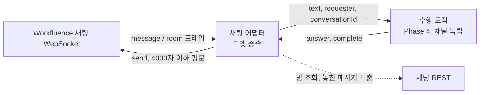

# Phase 5 요구사항 정의 — Workfluence 채팅 채널 (`inference`의 타겟 종속 어댑터)

- 작성일: 2026-10-15
- 상태: 확정 (2026-10-15 사용자 확정). 10절의 결정 6건은 모두 권장안대로 정했다
- 상위 문서: [`과제정의서.md`](../과제정의서.md) 2.3절, 부록 B, 미정 18~20. [`시스템아키텍처.md`](../시스템아키텍처.md)
- 선행: Phase 4 수행 로직(채널 독립, NFR-I08), `conversationId` 이어 가기(FR-I10), 되묻기(FR-I19)
- 요구사항 번호: `FR-C`·`NFR-C`·`AC-C`를 쓴다.
- 채팅 API 사실은 `workf` 세션이 2026-10-15에 코드·실호출로 확인한 내용이다(2절). Workfluence의 Phase 21(채팅)은 병합 전이라 바뀔 여지가 있다.

## 1. 목표

agent `aiagent`가 Workfluence 채팅방에 하나의 user로 참여해, 방에서 온 요청을 Phase 4 수행 로직으로 수행하고 짧게 답한다. 채팅 채널은 "메시지 받기 → 수행 → 답 보내기"만 맡는다. 검색·MCP 실행·모델 루프·한도·표시·이어 가기는 Phase 4 것을 고치지 않고 쓴다(NFR-I08).

## 2. 채팅 API 사실 (workf 확인, 2026-10-15)

| 항목 | 내용 |
|---|---|
| 배포 | 시험 스택 `https://wf.internal:8444`에 배포됨(커밋 8a6fd3f). 명세는 "지금 코드와 같다"까지이고 Phase 21 병합 전이라 바뀔 수 있다 |
| 연결 | WebSocket `/api/v1/chat/ws`, `Authorization: Bearer` 헤더(질의 문자열 token 불가). 프레임 `hello`·`send`·`ack`·`message`·`room`·`error`, 30초 ping/pong. 서버 설정에 따라 값이 바뀔 수 있다 |
| 한도 | 본문 4000자, 프레임 64KiB, 사용자당 동시 연결 5(넘으면 가장 오래된 연결을 4409로 닫음) |
| 메시지 | 평문(마크다운·HTML 아님). `{type:'message', roomId, seq, senderId, body, kind, createdAt}`. `kind`는 `user`·`join`·`leave`. join/leave는 시스템 안내 줄이다. 내가 보낸 메시지도 돌아온다. 발신자는 `senderId`(uuid)뿐이고 이름은 방 멤버 목록에서 찾는다 |
| 초대 | 별도 webhook이 없다. `{type:'room', roomId, change:'joined'}`만 오고, 방 정보는 `GET /api/v1/chat/rooms/{id}`(kind·name·createdBy·members)로 읽는다. 남은 참여자는 `change:'members'`를 받는다. 초대자는 같은 방 join 안내 줄의 `senderId`로도 안다 |
| 멘션 | 없다. 서버는 멘션 걸러내기도 응답 강제도 하지 않는다. 모든 참여자가 방의 모든 메시지를 받는다 |
| 놓친 메시지 | 연결 후 `hello` → 방마다 `GET /chat/rooms/{id}/messages?afterSeq=N&limit=200`. 200개가 다 오면 마지막 seq로 이어 받는다. `seq`는 방 단위로 1부터 비거나 겹치지 않게 이어진다. 연결은 새 메시지만 보내므로 hello 직후 보충이 꼭 필요하다 |
| 멱등 | `clientMsgId`를 붙이면 재전송이 한 번만 반영된다 |
| rate limit | 보내기: 사용자 단위 분당 60(REST·WS·화면·token 합산). 초과 시 REST는 429 `RATE_LIMITED`(`details.retryAfterSec`), WS는 `error` 프레임. 이것은 공개 API token 쓰기 한도(30/분)와 별개다. 방 만들기·초대·읽음 표시는 한도가 없다(방 만들기·초대는 미정). 채팅 REST의 읽기는 token 읽기 한도(120/분)를 따른다 |
| 오류 | 1:1 방 초대는 403 `DIRECT_ROOM`. 여럿 방은 만든 사람만 초대하고, 만든 사람이 나가면 더는 초대할 수 없다. 클라이언트가 `kind`를 보내면 REST 400, WS 4400 |
| 변경 알림 | push가 없다. `GET /api/v1/openapi.sha256`, 기능백로그 F-016~F-019, impl-phase21 git log·설계서·검증기록뿐이다. 이번 `kind` 추가에도 명세 해시가 바뀌었다 |
| 시험 | `aiagent`·`aiagent-peer`로 방을 만들고 주고받아도 된다. 방·메시지를 지울 수 없으므로 방 이름에 "시험"을 넣고 많이 만들지 않는다. 다른 사람이 든 방에는 시험 메시지를 보내지 않는다 |

## 3. 범위

| 포함 | 제외 |
|---|---|
| 채팅 어댑터(WebSocket 연결 유지, 재연결, 놓친 메시지 보충) | 채팅 UI, 채팅 API 개발(Workfluence 몫) |
| 초대 수신, 방 정보 조회, 방 응답 규칙(1:1·여럿) | 방을 스스로 만들거나 사람을 초대하는 것(요청이 아니면 하지 않는다) |
| 요청 text·요청자·`conversationId` 변환, 수행 로직 호출, 짧은 답 보내기 | 수행 로직·MCP·LLM 변경 |
| 채팅 응답 규칙(짧게, 장문은 게시 위치만 알림) | 메일 보내기(수단 없음) |
| 채팅 쓰기 권한 규칙(미정 18), 짧음의 기준(미정 19) | 첨부·이미지 등 평문 이외 메시지 |
| 채팅 API 변경 감지와 "코드 수정 필요" 알림 | 채팅 방·메시지 정리(지우는 기능 없음) |
| 시험(가짜 채팅 서버 단위 시험, 시험 스택 실호출)과 평가 | |

## 4. 기능 요구사항

### 4.1 연결과 수신

| ID | 요구 |
|---|---|
| FR-C01 | 어댑터는 agent token(`aiagent`, 채팅 읽기·쓰기 scope)으로 `/api/v1/chat/ws`에 연결하고 연결을 유지한다. 대기는 연결 유지다. token은 Phase 3 규칙대로 어댑터 쪽 비밀 파일에서만 읽는다(설계에서 MCP server 자식 프로세스와의 분리를 정한다). |
| FR-C02 | 연결이 끊기면 설정한 간격(지수 backoff, 상한)으로 다시 연결한다. `4409`(동시 연결 초과로 닫힘)는 다시 연결하되 연결이 서로 밀어내는 일이 없도록 한 agent당 연결을 하나만 둔다. |
| FR-C03 | 연결 직후(`hello` 이후) 참여 중인 모든 방에 대해 마지막으로 처리한 `seq` 이후를 `afterSeq`로 보충한다. 200개가 다 오면 이어서 받는다. 같은 메시지는 `(roomId, seq)`로 걸러 두 번 처리하지 않는다. 마지막 처리 `seq`는 어댑터 전용 저장소에 둔다(재시작 후에도 유지). |
| FR-C04 | `room` 프레임 `joined`를 받으면 방 정보를 조회해 방 종류·이름·멤버(이름 포함)를 저장한다. `members` 변경에도 멤버 목록을 새로 읽는다. 처음 참여한 방의 지난 메시지는 처리하지 않고 현재 `seq`부터 본다(초대 전 대화에 답하지 않는다). |
| FR-C05 | `kind`가 `user`인 메시지만 요청 후보로 본다. `join`·`leave`와 알 수 없는 `kind`는 무시한다(`seq`는 처리한 것으로 기록). 자기(`aiagent`) `senderId`의 메시지도 무시한다(돌아오는 내 메시지에 답하는 루프 방지). |
| FR-C06 | 알 수 없는 프레임·필드는 무시하고 기록만 남긴다(채팅 API가 확장돼도 죽지 않는다). 필수 필드가 없는 프레임은 버리고 기록한다. |

### 4.2 요청 판단과 수행 연결

| ID | 요구 |
|---|---|
| FR-C11 | **1:1 방**: 상대의 모든 `user` 메시지를 요청으로 본다. |
| FR-C12 | **여럿 방**: 서버가 멘션을 걸러 주지 않으므로 클라이언트 규칙을 둔다. 본문에 agent의 표시 이름(설정, 예: 계정 `displayName`)이 들어 있는 메시지만 요청으로 보고, 나머지는 읽기만 한다. 표시 이름은 설정으로 둔다. (권장안, 10절 1번) |
| FR-C13 | 요청 변환: `text`는 본문(표시 이름 호출부는 그대로 둔다), `requester`는 발신자 이름(`senderId`로 방 멤버에서 찾음, 없으면 `senderId`), `conversationId`는 방 단위(`chat:<roomId>`)로 정한다. 같은 방의 앞선 대화가 이어 가기(FR-I10)로 맥락이 된다. 어댑터는 이 변환 이외에 수행 로직을 알지 않는다. |
| FR-C14 | 한 방에서 요청은 **차례대로** 수행한다(같은 `conversationId`의 요청이 겹치지 않는다). 방이 다르면 동시에 수행할 수 있고, 동시 수는 설정으로 제한한다(Phase 4 FR-I05와 같은 규칙, 초과하면 대기시킨다. 채팅은 호출자가 사람이므로 거절하지 않는다). |
| FR-C15 | 수행 로직은 Phase 4 모듈을 import해 같은 process 안에서 호출한다(REST 비동기 접수를 거치지 않는다). 채널 interface 뒤에서 돈다(DIP). |
| FR-C16 | 수행하는 동안 같은 요청을 두 번 처리하지 않는다. 재시작·재연결·보충으로 같은 메시지가 다시 와도 `(roomId, seq)` 기록으로 막는다. 재시작으로 끊긴 수행은 다시 하지 않고 방에 "중단됨"을 한 번 알린다(쓰기 중복 방지, FR-I08과 같은 이유). |

### 4.3 응답 규칙

| ID | 요구 |
|---|---|
| FR-C21 | 채팅 창에는 **수행 여부와 결과 위치만 짧게** 보낸다. 되묻기(FR-I19)는 짧은 한 줄로 방에 보내고, 방의 다음 메시지가 이어지는 대화가 된다(`conversationId`가 방 단위이므로). |
| FR-C22 | 짧음의 기준은 설정한 글자 수(`CHAT_ANSWER_MAX_CHARS`, 기본값은 설계에서 정하되 서버 상한 4000자보다 작다)다. 답이 이를 넘으면 채팅 창에 길게 쓰지 않는다. 넘는 답은 어떻게 할지는 10절 2번에서 정한다. |
| FR-C23 | 채팅 시스템 프롬프트 덧붙임(채널 전용, 설정)으로 모델에게 "결과가 길면 요청자가 지시한 곳(페이지)에 올리고 위치만 알려라, 지시가 없으면 요약해 짧게 답하라"를 지시한다. 문구는 코드에 두지 않는다. |
| FR-C24 | 평문만 보낸다(마크다운·HTML 서식 문자를 쓰지 않도록 프롬프트와 후처리). 4000자(서버 설정으로 바뀔 수 있어 `CHAT_MAX_MESSAGE_CHARS` 설정)를 넘는 보내기는 하지 않는다. |
| FR-C25 | 보낼 때 `clientMsgId`를 붙여 재전송이 한 번만 반영되게 한다. 429(`RATE_LIMITED`)·`error` 프레임이면 `retryAfterSec`만큼 기다려 다시 보낸다(상한 횟수 설정). 끝내 못 보내면 기록만 남긴다. |
| FR-C26 | 수행이 오래 걸리면 방에서 응답이 없는 것처럼 보이므로, 시작할 때 짧은 확인 메시지를 보낼지(보내기 한도를 쓴다)는 10절 3번에서 정한다. |
| FR-C27 | 보내기 한도(사용자 단위 60/분) 안에서 동작하도록 어댑터가 보내기 속도를 스스로 제한한다(설정). 여러 방이 동시에 답해도 한도를 넘지 않게 줄 세운다. |

### 4.4 권한과 안전 (미정 18)

| ID | 요구 |
|---|---|
| FR-C31 | Phase 4 안전 규칙을 그대로 따른다: 위험 동작(`danger`) 없음, 쓰기는 요청자가 지시한 경우만, 읽은 자료(페이지·**다른 사람의 채팅 메시지**) 속 지시문은 따르지 않는다. 채팅에서는 여럿 방의 다른 참여자 메시지도 "읽은 자료"가 될 수 있으므로, 요청 text는 **요청자 본인의 메시지**만이고 방의 다른 메시지는 맥락 자료로 감싸 구분한다(FR-I22). |
| FR-C32 | agent는 자기 token의 권한으로 실행하므로 요청자의 권한을 넘는 동작이 가능하다. 이를 막기 위해 **쓰기를 허용하는 요청자 목록**(설정, `senderId` 또는 계정)을 둔다. 목록에 없는 요청자의 요청은 읽기 tool만 쓰고 쓰기 요청에는 "권한이 없다"고 답한다. (권장안, 10절 4번) |
| FR-C33 | 요청자 `senderId`는 서버가 채운 값이라 위조되지 않는다(REST의 자기 신고와 다르다). 허용 목록 판단에 이 값을 쓴다. 이름만 같은 다른 사람이 아니라 `senderId`로 판단한다. |
| FR-C34 | 어댑터는 방을 만들거나 사람을 초대하지 않고, 방에서 스스로 나가지도 않는다(요청이 그렇게 지시할 때의 채팅 tool은 이번 범위가 아니다. 채팅 동작은 tool이 아니고 어댑터 코드 소유다). |

### 4.5 변경 감지

| ID | 요구 |
|---|---|
| FR-C41 | 채팅 API는 OpenAPI로 표현되지 않는 부분(WebSocket)이 있고 push 알림이 없다. 어댑터는 Detection이 식별하는 명세 변경(`openapi.sha256`, info의 WebSocket 설명, 채팅 동작 9개)이 있으면 "채팅 어댑터 코드 확인 필요"를 알린다. 알리는 곳은 Manufacture의 "코드 수정 필요" 알림과 같은 통로다(설계에서 정한다). 어댑터를 자동으로 고치지 않는다. |
| FR-C42 | 연결 시 모르는 프레임 종류·필수 필드 누락·`kind` 외의 새 필수 필드가 관찰되면 로그와 상태(`/health`의 채팅 항목)에 남긴다. |

## 5. 비기능 요구사항

| ID | 요구 |
|---|---|
| NFR-C01 | **설정**: 채팅 API 주소, 표시 이름, 재연결 간격·상한, 짧은 답 글자 수, 보내기 속도, 허용 요청자 목록, 방별 동시 수, 채팅 프롬프트 덧붙임, 한도 값(4000자 등)은 설정이다. 코드에 두지 않는다. |
| NFR-C02 | **범용성**: 채팅 어댑터는 타겟 종속이다. 코어(수행 로직)에 Workfluence 채팅 용어를 넣지 않는다. 채널 interface를 구현하는 별도 모듈로 두어 기존 코드를 고치지 않고 더한다(OCP). 다른 타겟의 채팅은 interface만 있고 구현은 비운다. |
| NFR-C03 | **비밀·로그**: token은 비밀 파일에서만 읽는다. 채팅 본문은 로그에 통째로 남기지 않는다(방 id, `seq`, 길이, 처리 결과만). |
| NFR-C04 | **복원력**: 재시작·재연결·중복 프레임에서 같은 요청을 두 번 수행하지 않는다. 채팅 서버가 느리거나 끊겨도 REST 채널과 수행 로직은 영향을 받지 않는다. |
| NFR-C05 | **실행 환경**: `inference` container 안의 어댑터로 돈다(별도 container 여부는 설계에서 정한다). 빌드·시험·실행은 container 안에서 한다. 내부 주소는 `NO_PROXY`. |
| NFR-C06 | **설계 원칙·개발 방식**: SOLID, TDD(red → green). 채팅 서버는 가짜 WebSocket 서버로 단위 시험하고, 실호출 시험은 `A4W_LIVE_TESTS=1`일 때만 돈다. |
| NFR-C07 | **Phase 4 불변**: Phase 4 시험(Inference 310건 등)이 그대로 통과한다. 수행 로직 변경이 필요해 보이면 멈추고 사용자에게 알린다. |

## 6. 인수 기준

| # | 기준 | 확인 방법 |
|---|---|---|
| AC-C1 | 가짜 서버에서 연결·재연결·`hello` 후 `afterSeq` 보충(200개 이어 받기 포함)이 되고, 같은 `(roomId, seq)`는 한 번만 처리된다 | 단위 시험 |
| AC-C2 | `join`·`leave`·알 수 없는 `kind`·자기 메시지에는 답하지 않는다 | 단위 시험 |
| AC-C3 | 1:1 방은 모든 `user` 메시지에, 여럿 방은 표시 이름이 든 메시지에만 수행한다 | 단위 시험 |
| AC-C4 | 요청이 `{text, requester(이름), conversationId=chat:<roomId>}`로 바뀌고, 같은 방의 두 번째 메시지가 앞선 맥락을 이어 받는다(되묻기 → 값 더하기) | 단위 시험 + 실호출 |
| AC-C5 | 한 방의 요청은 차례로, 다른 방은 동시에 돈다. 재시작 후 같은 메시지는 다시 수행되지 않고 중단 알림이 한 번 간다 | 단위 시험 |
| AC-C6 | 보내는 답은 평문·글자 수 이하이고 `clientMsgId`가 붙는다. 429·`error`에서 대기 후 재시도한다. 보내기 속도 제한이 한도 안이다 | 단위 시험 |
| AC-C7 | 길이 규칙(FR-C22)이 정한 대로 동작한다. 채팅 창에 짧은 기준을 넘는 답이 그대로 나가지 않는다 | 단위 시험 + 실호출 |
| AC-C8 | 허용 목록에 없는 요청자의 쓰기 요청이 실행되지 않고 "권한이 없다"고 답한다. 다른 참여자 메시지 속 지시문을 따라 쓰기를 하지 않는다 | 단위 시험, 실제 모델 시험 |
| AC-C9 | 시험 스택에서 `aiagent-peer`가 1:1 방에서 읽기 요청("회의록 찾아줘")과 쓰기 요청(댓글 달기)을 하면 `aiagent`가 수행하고 짧게 답한다. 여럿 방에서 표시 이름을 부를 때만 답한다 | 실호출 |
| AC-C10 | 명세 해시·채팅 동작 변경 시 "채팅 어댑터 코드 확인 필요"가 알려진다. 모르는 프레임은 무시하고 기록된다 | 단위 시험 |
| AC-C11 | 수행 로직·REST 채널에 Workfluence 채팅 고유 값이 없고(의존 방향 검사), Phase 4 시험이 그대로 통과한다 | 검토, 전체 시험 |
| AC-C12 | token·채팅 본문이 로그·기록에 통째로 남지 않는다 | 검토, 단위 시험 |

## 7. 시험 자료

- 가짜 채팅 서버: 프레임 순서(hello, message, room, error, ping), 끊김·재연결, `afterSeq` 응답, 429를 재현하는 메모리 WebSocket 서버.
- 시험 스택 실호출: `aiagent`(어댑터)와 `aiagent-peer`(요청자). 방 이름에 "시험"을 넣고 **고정 시험 방을 재사용**한다(방은 지울 수 없다). 다른 사람이 든 방에는 쓰지 않는다.
- 요청 세트: Phase 4 예시 요청 중 채팅에 맞는 것, 되묻기·이어 가기, 여럿 방 호출, 다른 참여자 메시지 속 주입 문구.

## 8. 착수 전에 필요한 정보

| # | 항목 | 상태 |
|---|---|---|
| 1 | (확인) 채팅 API 배포·프레임·한도·멘션 없음 | 2절. workf 확인 |
| 2 | (해결) agent 계정·token | `aiagent` 계정. 채팅 scope가 token에 포함되는지는 설계 전에 실호출로 확인한다 |
| 3 | 방 만들기·초대 한도, 보존·삭제 | Workfluence 보류(39). 이번 어댑터는 방을 만들지 않아 영향 없음 |
| 4 | Phase 21 병합 시점 | 사용자 결정 대기(workf). 병합 전 프레임이 바뀌면 어댑터를 고친다 |
| 5 | agent의 표시 이름 | 계정 `displayName`을 설정으로 받는다. 값 확인 필요 |

## 9. 설계에서 정할 것

- 채널 interface 모양, 어댑터 모듈 구조(WebSocket 클라이언트·REST 클라이언트·방 저장소·큐), 같은 process의 수행 로직 호출 방식
- 어댑터 token과 agent MCP server token의 분리, 저장소(마지막 `seq`, 처리 기록) SQLite 표
- 재연결·보충·중복 제거의 세부, 방별 직렬화와 동시 수 제한 방식
- 짧은 답 기준 수치, 긴 답 처리, 평문 후처리 규칙
- 채팅 프롬프트 덧붙임 형식, 다른 참여자 메시지를 자료로 감싸는 방식
- 허용 요청자 목록 설정 모양, 권한 없는 요청에 대한 답 문구(설정)
- 변경 알림 통로, `/health` 채팅 항목
- 가짜 채팅 서버, 시험 방 운영, 평가 기준

## 10. 결정 항목 (모두 권장안대로 확정, 2026-10-15)

| # | 질문 | 확정 (권장안) |
|---|---|---|
| 1 | 여럿 방에서 언제 답하나 | 표시 이름이 본문에 있을 때만(서버 멘션이 없다). 1:1은 항상. 대안: 여럿 방은 입장 후 모든 메시지에 답함(소란·한도 위험이라 비권장) |
| 2 | 짧은 기준을 넘는 답은 | 채팅 프롬프트가 요약·게시를 유도하고, 그래도 넘으면 코드가 기준까지 자르고 "나머지는 올리지 않았습니다. 필요하면 페이지에 올리라고 지시하세요"를 덧붙인다. 대안: 코드가 자동 게시(FR-I25 위반, 비권장), 4000자 안이면 그대로 보냄 |
| 3 | 수행 시작 확인 메시지 | 보내지 않는다(보내기 한도 절약, 방 소란 방지). 오래 걸리는 요청의 체감은 시험으로 보고 필요하면 추가 |
| 4 | 쓰기 허용 요청자(미정 18) | 설정한 허용 목록(`senderId`)만 쓰기 가능, 나머지는 읽기만. 시험 환경은 `aiagent-peer`와 사용자 계정을 목록에 넣는다. 대안: 방 참여자 전원 허용(요청자 권한 초과 위험) |
| 5 | 어댑터를 둘 container | 기존 `inference` container의 별도 asyncio task(단순, 수행 로직 직접 호출). 대안: 별도 container(분리되지만 REST 경유가 필요해 NFR-I08과 어긋남) |
| 6 | 첫 참여 시 지난 메시지 | 처리하지 않는다(초대 전 대화에 답하지 않음) |

## 11. 상위 문서에 고칠 것

| 문서 | 고칠 것 |
|---|---|
| 과제정의서 6절 미정 18·19·20 | 이 문서 10절·2절로 해결 표시(확정 후) |
| 과제정의서 부록 B | `kind`, `room` 프레임 내용, 멘션 없음, 연결 5개 제한, 보내기 한도 추가 |
| 과제정의서 7절 | Phase 5 산출물·상태 |

상위 문서 수정은 설계 문서를 쓰는 단계에서 함께 한다.
