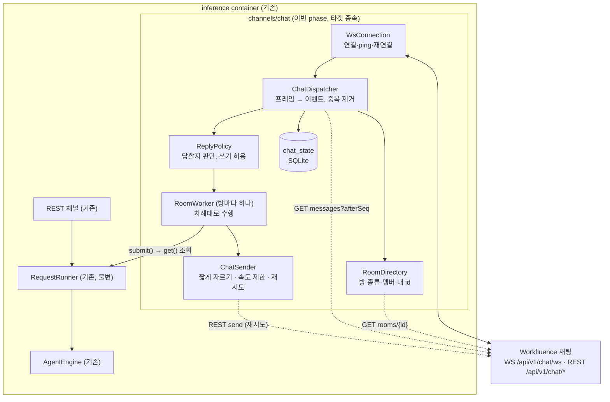
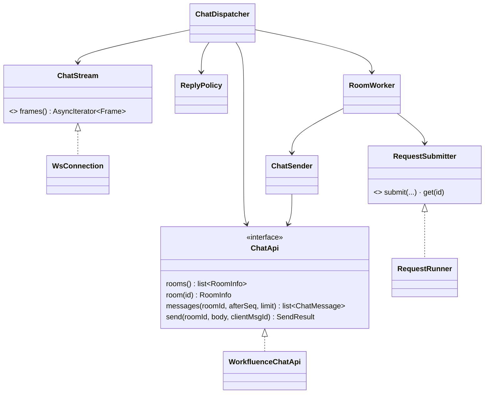
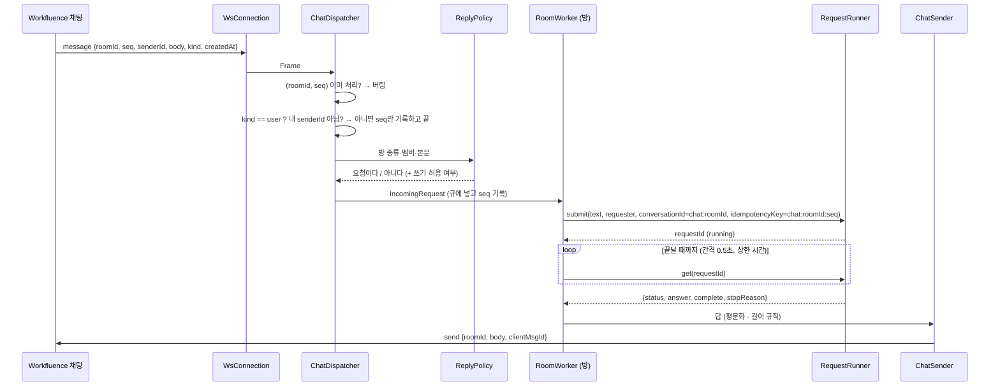

# Phase 5 설계 — Workfluence 채팅 채널 (`channels/chat`, 타겟 종속 어댑터)

- 작성일: 2026-10-15
- 상태: 확정 (2026-10-15 사용자 확정). 16절의 결정 6건은 모두 권장안대로 정했다
- 요구사항: [`1_요구사항정의.md`](1_요구사항정의.md) (FR-C·NFR-C·AC-C)
- 이전 문서: [Phase 4 설계](../phase4_inference/2_설계.md) 2·5.4·8·15절(채널 재사용 지점), [과제정의서](../과제정의서.md) 부록 B

## 1. 설계 개요

채팅 채널은 `RequestRunner.submit()`의 또 하나의 호출자다(Phase 4 D2·15절). engine·runner는 고치지 않는 것을 원칙으로 하고, 16절 1번에서 **작은 보강 하나만** 사용자에게 묻는다(NFR-C07).



| 결정 | 내용 | 근거 |
|---|---|---|
| D1 | 채팅 코드는 `channels/chat/` 한 곳에 둔다. 수행 로직·runner는 채팅 용어를 모른다. 채널은 `RequestRunner`만 안다 | NFR-C02, AC-C11 |
| D2 | 같은 process·같은 event loop에서 별도 asyncio task로 돈다. 기동·종료는 기존 `lifecycle`에 끼운다(REST 앱과 함께 올라가고 내려간다) | 요구사항 10절 5번 확정 |
| D3 | **수행은 `submit()` 후 `get()` 조회(polling)로 기다린다.** runner에 완료 callback을 더하지 않는다. 조회 간격은 설정(기본 0.5초) | runner·engine 불변. SQLite 조회 한 건이라 싸다 |
| D4 | `conversationId = chat:<roomId>`. 방마다 요청을 **어댑터가 직렬화**하므로 runner의 409(`CONVERSATION_BUSY`)가 생기지 않는다 | FR-C13·C14. runner ID 규칙(영문·숫자·`._:-`, 128자)에 맞는다 |
| D5 | agent 동시 수 초과(`AGENT_BUSY` 429)는 거절하지 않고 어댑터가 **기다렸다 다시 접수**한다(설정 간격·상한) | FR-C14. 채팅은 사람이 대화하므로 거절이 어색하다 |
| D6 | 채팅 token은 **별도 token 파일**을 쓴다. MCP 자식이 읽는 agent token과 파일·디렉터리를 나눈다 | 16절 2번. Phase 4 10.3의 "본체는 agent token을 읽지 않는다"를 지킨다 |
| D7 | 채팅 API 호출(REST·WS)은 `ChatApi` interface 뒤에 둔다. 구현은 Workfluence 어댑터(`WorkfluenceChatApi`) 하나다 | DIP, OCP. 다른 타겟의 채팅은 interface만 있다 |
| D8 | 처리한 마지막 `seq`는 SQLite에 방별로 저장한다. Phase 4 `inference.db`와 **파일을 나눈다**(`chat.db`) | 저장소 소유 원칙. 채널 상태가 수행 기록과 섞이지 않는다 |
| D9 | 방의 다른 사람 메시지는 **모델에 넣지 않는다**. 요청으로 판단한 메시지의 본문만 `text`로 넘긴다 | 16절 3번. FR-C31의 "자료로 감싸기" 대신 입구에서 막는 더 강한 방어 |

## 2. 모듈 구조

```
agents/inference/src/a4w_inference/channels/chat/
  __init__.py
  ports.py             # ChatApi, ChatSink 등 interface (ABC)
  models.py            # Frame 종류, ChatMessage, RoomInfo, Member, IncomingRequest
  frames.py            # 프레임 해석 (모르는 필드·종류 무시, 필수 누락은 버림) — FR-C06
  ws_client.py         # WsConnection: 연결·ping/pong·재연결 backoff·4409 처리
  rest_api.py          # WorkfluenceChatApi: rooms, room 조회, messages(afterSeq), send(clientMsgId)
  rooms.py             # RoomDirectory: 방 종류·멤버·displayName 캐시, 내 userId
  dispatcher.py        # ChatDispatcher: 프레임·보충 → 중복 제거 → kind 필터 → 방 worker로
  policy.py            # ReplyPolicy: 1:1 전체 / 여럿 표시 이름 호출, 쓰기 허용 목록
  worker.py            # RoomWorker: 방별 큐, submit·polling, 답 보내기
  sender.py            # ChatSender: 평문화·길이 규칙·속도 제한·재시도·clientMsgId
  store.py             # SqliteChatState: 방별 마지막 seq, 처리 기록, 중단 알림 표시
  config.py            # ChatSettings (7절)
  health.py            # 채팅 상태 (/health의 chat 항목)
  health.py            # 채팅 상태 (/health의 chat 항목)
```



- 의존 방향: `chat/* → ports(interface)`, `wiring → 구현`. `RoomWorker`는 `RequestRunner`를 직접 import하지 않고 `submit/get`만 가진 좁은 interface `RequestSubmitter`(ISP)에 의존한다. 시험은 가짜 submitter로 한다.
- 의존 검사 시험(AC-C11): `engine/`·`runner.py`·`channels/rest/`가 `channels.chat`을 import하지 않는다. `channels/chat`은 `engine`을 import하지 않고 runner의 값 모양(`SubmitRequest`, `RequestRecord`)만 쓴다.
- 보낼 때·받을 때 쓰는 HTTP·WebSocket 라이브러리는 이미지에 있는 `httpx`와 WebSocket 클라이언트 하나(`websockets`)다. 의존 추가는 16절 4번.

## 3. 메시지 한 건의 흐름



- **멱등 key**: `idempotencyKey = chat:<roomId>:<seq>`. 같은 메시지가 재시작·재연결·보충으로 다시 들어와 `submit`이 불려도 runner가 앞선 요청 결과를 돌려주고 다시 수행하지 않는다(FR-I04). 어댑터의 `(roomId, seq)` 중복 제거에 더한 **이중 방어**다(FR-C16, NFR-C04). key 유효 기간은 기록 보관 기간(FR-I62)이므로 보관 기간 안에서만 보장된다. 그보다 오래된 메시지는 보충 때도 처리하지 않는다(4.3절).
- `requester`: `ChatMessage.senderId`로 방 멤버에서 찾은 `displayName`. 없으면 `senderId`. 서버가 채운 값이라 위조되지 않는다(FR-C33).
- 허용 여부(쓰기)는 4.2절.

## 4. 연결·수신 (FR-C01~C06)

### 4.1 `WsConnection`

- `wss://…/api/v1/chat/ws`에 `Authorization: Bearer` 헤더로 접속한다(질의 문자열 token 금지). TLS는 타겟 설정과 같은 CA 파일을 쓴다(`CHAT_TLS_CA_FILE`, 없으면 시스템 CA).
- 연결 중 서버가 보내는 ping에 응답하고(라이브러리가 자동), 서버 ping 주기(30초, 서버 설정으로 바뀔 수 있음)의 `CHAT_PING_TIMEOUT_FACTOR`배 동안 아무 프레임도 없으면 끊고 다시 연결한다(조용히 죽은 연결 방지). 값은 설정.
- 끊기면 지수 backoff(`CHAT_RECONNECT_INITIAL_SECONDS`에서 두 배씩, 상한 `CHAT_RECONNECT_MAX_SECONDS`, 지터)로 다시 연결한다. 연결 성공하면 backoff를 초기화한다.
- **한 agent당 연결 하나**(FR-C02). 서버가 동시 연결 5개를 넘으면 가장 오래된 것을 `4409`로 닫으므로, 어댑터는 연결 전에 자기 연결이 없음을 보장하고 `4409`를 받으면 다시 연결하되 연달아 3번 `4409`를 받으면 "다른 곳에서 같은 계정으로 연결 중일 수 있다"는 경고를 상태에 남기고 backoff 상한으로 쉰다(서로 밀어내기 방지).
- 닫힘 코드 `4400`(잘못된 프레임), 인증 실패(`401`/`4401` 계열)는 다시 연결해 봐야 같으므로 backoff 상한으로 쉬고 상태를 `auth_failed`/`protocol_error`로 올린다. 값은 구현 때 시제품으로 확인한다(17절).

### 4.2 `ReplyPolicy` (요구사항 FR-C05·C11·C12·C31~C33)

| 순서 | 검사 | 결과 |
|---|---|---|
| 1 | `kind != user` | 무시 |
| 2 | `senderId == 내 userId` | 무시 |
| 3 | 방 종류가 `direct` | 요청 |
| 4 | 방 종류가 `group`이고 본문에 agent 표시 이름이 있음(`CHAT_MENTION_NAME`, 대소문자·공백 정규화 비교) | 요청 |
| 5 | 그 밖 | 무시(읽기만) |

- 표시 이름 비교는 정확히 부분 문자열 일치다(형태소 분석 없음). 표시 이름은 설정(`CHAT_MENTION_NAME`, 기본은 비워 두고 **비면 기동 거절**). 시험 스택의 값은 `AI Agent`(실호출로 확인, 2026-10-15). 본문 앞의 `@AI Agent`든 중간의 `AI Agent`든 포함되면 요청이다. 오탐(표시 이름이 우연히 들어 있음)은 여럿 방의 사람이 보고 무시하면 되는 비용이라 단순함을 택했다.
- 1:1 방의 상대가 agent 자신뿐인 경우(내 방)는 없다. 방 종류가 알 수 없는 값이면 무시한다(안전 기본).
- **쓰기 허용**(FR-C32): `CHAT_WRITE_ALLOWED_USERS`(콤마 구분 `senderId`)에 있으면 `allow_writes=True`. 목록이 비면 아무도 쓸 수 없다(안전 기본). 판단은 `senderId`로만 한다(이름 아님).
- 허용되지 않은 요청자에게 쓰기 전용 tool이 적용되지 않도록 하는 방법은 16절 1번이다.

### 4.3 중복 제거·보충·처음 참여 (FR-C03·C04)

- 저장: 방마다 `last_seq`(처리 완료 또는 의도적으로 건너뜀). 메시지 처리 규칙: `seq <= last_seq`면 버린다. 처리하면 `last_seq = seq`를 **수행을 큐에 넣는 시점**에 갱신한다(수행 완료 시점이 아님. 쓰기가 겹치는 재수행을 막는 쪽이 낫다. 재시작으로 끊긴 요청은 6절이 다룬다).
- 연결 직후 흐름: ① `hello` 받음 ② `GET /chat/rooms`로 참여 방 목록·멤버 읽기 ③ 방마다 `last_seq` 이후를 `GET …/messages?afterSeq=<last_seq>&limit=200`으로 받아 **seq 순서**대로 처리 ④ 200개가 다 오면 마지막 seq로 반복 ⑤ 끝나면 실시간 프레임 처리를 연다. 보충 중에 온 실시간 프레임은 버퍼에 두었다가 ⑤에서 같은 `(roomId, seq)` 규칙으로 처리한다(순서·중복 모두 이 규칙이 해결한다).
- **처음 보는 방**(`last_seq` 없음, `room joined` 또는 연결 시 목록에서 처음): 방의 현재 `lastSeq`(방 조회 응답)를 `last_seq`로 저장하고 지난 메시지는 처리하지 않는다(요구 10절 6번). 그 직후의 메시지부터 본다.
- **너무 오래된 메시지 방어**: 보충한 메시지의 `createdAt`이 `CHAT_CATCHUP_MAX_AGE_SECONDS`(기본 하루)보다 오래되면 처리하지 않고 건너뛴다(멱등 key 보관 기간 안에서만 안전하므로, 그리고 오래 꺼져 있다 켜졌을 때 낡은 요청이 한꺼번에 수행되는 것을 막는다). 건너뛴 수는 로그에 남긴다.
- 방에서 내가 나감(`leave`·`room` `left` 계열)을 받으면 그 방의 worker를 닫고 상태만 남긴다. 어댑터가 스스로 나가지는 않는다(FR-C34).
- `room` 프레임: `joined` → 방 조회 후 등록, `members` → 멤버 새로 읽기, 그 밖의 `change`는 무시하고 기록(FR-C06).

## 5. 수행 연결 (FR-C13~C16)

### 5.1 `RoomWorker`

- 방마다 큐 하나와 task 하나. 같은 방의 요청은 **하나씩** 수행한다(직렬화, D4). 방이 다르면 동시에 돌지만, agent 동시 수는 runner가 제한하므로 어댑터는 `AgentBusy`일 때 기다렸다 다시 접수한다(`CHAT_BUSY_RETRY_SECONDS` 간격, 최대 `CHAT_BUSY_RETRY_MAX_SECONDS`, 넘으면 방에 "지금 바빠서 처리하지 못했다"를 한 번 알린다. 문구는 설정).
- 큐 길이 상한(`CHAT_ROOM_QUEUE_MAX`, 기본 5). 넘으면 새 요청은 버리지 않고 방에 "앞선 요청이 끝난 뒤 다시 보내 달라"고 한 번 알린다(문구 설정). 폭주로 한도(분당 60)를 쓰는 것을 막는다.
- 큐에 든 요청의 `text`는 **받은 시점의 본문**이다. 앞선 요청이 되묻기로 끝났다면 다음 메시지가 곧 이어 가기가 된다(D4, Phase 4 FR-I10·I19).
- 수행 호출: `submit(agent_id=CHAT_AGENT_ID, text, requester, conversation_id=chat:<roomId>, idempotency_key=chat:<roomId>:<seq>)`. 그 뒤 `get(requestId)`를 `CHAT_POLL_INTERVAL_SECONDS`마다 부른다. 상한 시간(`CHAT_WAIT_MAX_SECONDS`, 기본은 Phase 4 수행 전체 시간 상한 + 여유)을 넘으면 방에 "처리가 오래 걸려 결과를 가져오지 못했다"를 한 번 알리고 그 요청을 포기한다(수행은 runner에서 계속될 수 있다). 포기해도 쓰기는 `actions`에 남으므로 기록으로 확인한다.
- 결과별 방 응답:

| 결과 | 방에 보내는 것 |
|---|---|
| `done`·`complete: true` | `answer`(짧게, 5절 5.2) |
| `done`·`complete: false`(상한) | 고정 문구 "한도에 걸려 일부만 처리했다"(설정) + `stopReason`을 사람이 읽는 말로(설정 표). `answer`는 null이다(Phase 4 16절 8번) |
| `failed` | 고정 문구 "처리하지 못했다"(설정) + 오류 코드 한 줄. 내부 메시지·본문은 보내지 않는다 |
| 접수 거절(`VALIDATION_ERROR` 등) | 고정 문구(설정). 본문이 너무 길면 "요청이 너무 길다" |

- 문구는 모두 설정 파일(`config/prompts/chat_replies.yaml` 같은 목록 또는 환경변수)이고 코드에 박지 않는다(NFR-C01). 예시는 `*.example`로 올린다.

### 5.2 `ChatSender` (FR-C21·C22·C24·C25·C27)

1. **평문화**: 마크다운·HTML 서식 문자를 걷어낸다(굵게·제목·코드 펜스·표 구분·링크 `[text](url)`는 `text (url)`). 규칙은 순수 함수 하나, 시험으로 고정한다.
2. **길이 규칙**(요구 10절 2번): 평문화한 답이 `CHAT_ANSWER_MAX_CHARS`(기본 600, 서버 상한 4000보다 작고 `CHAT_MAX_MESSAGE_CHARS`보다 작아야 기동)를 넘으면 그 글자 수까지 **줄 경계에서** 자르고 안내 줄을 붙인다("나머지는 올리지 않았다. 필요하면 페이지에 올리라고 지시해 달라", 설정). 자른 결과도 서버 상한을 넘지 않는다. 자동 게시는 하지 않는다(FR-I25).
3. **보내기**: REST `send`에 `clientMsgId`(`reply:<requestId>`)를 붙인다. WS로 보내지 않는 이유: 이미 REST 클라이언트가 있고, 재시도·오류 코드(429 `retryAfterSec`)가 분명하다. 같은 `clientMsgId`는 서버가 한 번만 반영한다(FR-C25).
4. **속도 제한**: 전체 보내기를 하나의 토큰 버킷(`CHAT_SEND_PER_MINUTE`, 기본 50, 서버 상한 60보다 낮게)으로 줄 세운다. 방이 여럿이어도 한도를 넘지 않는다(FR-C27). 버킷이 비면 기다린다(보내기가 늦어진다).
5. **재시도**: 429 `RATE_LIMITED`면 `details.retryAfterSec`(없으면 설정 기본)만큼 기다려 `CHAT_SEND_RETRY_MAX`번까지 다시 보낸다. 5xx·네트워크 오류도 같은 횟수로 재시도한다(`clientMsgId`가 같아 중복 반영되지 않는다). 4xx(429 제외)는 재시도하지 않고 기록만 남긴다. 끝내 못 보내면 오류 코드·방 id·seq만 기록한다(본문은 남기지 않는다, NFR-C03).
6. 사용자 단위 분당 60은 같은 계정의 화면·다른 token이 보내는 것과 합산된다. 어댑터는 자기 몫만 안다. 서버가 429를 주면 그것을 따른다(서버가 정본).

### 5.3 채팅 프롬프트 덧붙임 (FR-C23)

- Phase 4 시스템 프롬프트는 환경변수·파일이다(FR-I26). 채팅용 규칙("결과가 길면 요청자가 지시한 곳에 올리고 위치만 알려라, 지시가 없으면 요약해 짧게 답하라, 평문으로만 쓰라")을 어디에 붙일지가 문제다. engine은 프롬프트를 agent 설정(`AGENT_SYSTEM_PROMPT`·`_FILE`)으로 받고, **agent별로 서비스 값을 덮어쓸 수 있다**(FR-I26)는 점을 쓴다. 이 덧붙임은 **채널을 아는 문구**이므로 코어의 기본 프롬프트에 넣지 않는다.
- 채팅 요청은 채팅 전용 agent id로 나누지 않고 같은 `aiagent`를 쓴다(history·tool이 같다). 따라서 요청마다 프롬프트를 바꾸는 방법이 필요하다. 이것은 engine이 현재 지원하지 않으므로 **16절 1번의 작은 보강에 함께 묶는다**: `TurnRequest`에 선택 필드 두 개(`allow_writes: bool = True`, `channel_notes: str | None = None`)를 더한다. 둘 다 기본값이 기존 동작이다.
- 보강 없이 하는 대안: 채팅 전용 agent 항목 `aiagent-chat`(같은 타겟, 설정만 다름: 채팅 프롬프트, 읽기 전용 쓰기 허용 목록용 항목 따로). 이 경우 대화 이력이 agent별로 나뉘고 token 파일·MCP 자식이 하나 더 필요하다. 16절 1번에서 비교한다.

## 6. 복원력 (FR-C16, NFR-C04)

| 상황 | 동작 |
|---|---|
| 연결 끊김·재연결 | 보충(4.3)으로 놓친 메시지를 채운다. 중복은 `(roomId, seq)`와 멱등 key가 막는다 |
| 서비스 재시작 | Phase 4 `recover()`가 `running` 요청을 `INTERRUPTED`로 마감한다. 어댑터는 시작할 때 `chat_state`에서 "수행 중이었던 요청(큐에 넣었으나 답을 못 보낸 것)"을 읽어, 방마다 **한 번** "재시작으로 중단되었다. 필요하면 다시 요청해 달라"(문구 설정)를 보내고 그 요청을 닫는다. 다시 수행하지 않는다(쓰기 중복 방지) |
| 채팅 서버 장애 | 어댑터만 `degraded`가 되고 backoff로 재연결한다. REST 채널·수행 로직은 영향이 없다(NFR-C04). `/health`는 chat 항목을 보여 주되 전체 상태를 내리지 않는다 |
| 답을 보냈으나 확인(ack)을 못 받음 | `clientMsgId`로 재전송해도 한 번만 반영된다 |
| 같은 메시지가 다른 경로로 두 번(WS와 보충) | `(roomId, seq)` 중복 제거 |

- 처리 기록 표(`chat_state`)는 11.1절. "수행 중" 표시는 `queued → submitted → replied | abandoned` 상태다.

## 7. 설정 (NFR-C01)

모든 값은 설정이다. 서비스 `.env`에 `CHAT_*`를 두고(예시는 `.env.example`), 켜고 끄는 값 `CHAT_ENABLED`를 둔다(꺼 있으면 어댑터를 만들지 않고 Phase 4와 똑같이 동작한다). 채팅 비밀은 파일로 나눈다.

| 변수 | 의미 | 기본(예시) |
|---|---|---|
| `CHAT_ENABLED` | 채팅 채널 사용 | `false` |
| `CHAT_AGENT_ID` | 요청을 수행할 agent | (필수) |
| `CHAT_TARGET_ID` | 채팅 API 타겟(token·주소 선택) | (필수) |
| `CHAT_API_ADAPTER` | 채팅 API 구현 이름 | `workfluence` |
| `CHAT_API_BASE_URL` | 채팅 API 주소(`…/api/v1`까지, 타겟 설정에서 파생 가능) | 타겟 설정 `TARGET_API_BASE_URL` + `TARGET_API_PATH_PREFIX` |
| `CHAT_TLS_CA_FILE` | 서버 CA 파일 | 타겟과 같음 |
| `CHAT_MENTION_NAME` | 여럿 방에서 호출 표시 이름 | (필수) |
| `CHAT_WRITE_ALLOWED_USERS` | 쓰기 허용 `senderId` 목록 | 비어 있음(아무도 쓰기 불가) |
| `CHAT_ANSWER_MAX_CHARS` | 짧은 답 상한 | `600` |
| `CHAT_MAX_MESSAGE_CHARS` | 서버 본문 상한(4000) | `4000` |
| `CHAT_SEND_PER_MINUTE` | 보내기 속도(서버 상한 60보다 낮게) | `50` |
| `CHAT_SEND_RETRY_MAX`, `CHAT_SEND_RETRY_SECONDS` | 보내기 재시도 | `3`, `5` |
| `CHAT_RECONNECT_INITIAL_SECONDS`, `CHAT_RECONNECT_MAX_SECONDS` | 재연결 backoff | `1`, `60` |
| `CHAT_PING_TIMEOUT_FACTOR` | 서버 ping 주기의 몇 배 조용하면 끊을지 | `3` |
| `CHAT_CATCHUP_PAGE`, `CHAT_CATCHUP_MAX_AGE_SECONDS` | 보충 페이지 크기(200), 너무 오래된 메시지 | `200`, `86400` |
| `CHAT_POLL_INTERVAL_SECONDS`, `CHAT_WAIT_MAX_SECONDS` | 수행 결과 조회 | `0.5`, (수행 상한+여유) |
| `CHAT_ROOM_QUEUE_MAX` | 방 큐 상한 | `5` |
| `CHAT_BUSY_RETRY_SECONDS`, `CHAT_BUSY_RETRY_MAX_SECONDS` | `AGENT_BUSY` 대기 | `2`, `120` |
| `CHAT_REPLIES_FILE` | 고정 응답 문구(YAML) | `/config/prompts/chat_replies.yaml` |
| `CHAT_NOTES_FILE` | 채팅 프롬프트 덧붙임 문구 파일 | `/config/prompts/chat_notes.md` |
| `CHAT_STATE_PATH` | 채팅 상태 DB 위치 | `${INFERENCE_STORE_PATH}` 아래 `chat.db` |
| `CHAT_RETENTION_DAYS` | 처리 기록 보관 | Phase 4 보관 기간과 같음 |

- 기동 검사: `CHAT_ENABLED=true`인데 필수 값이 없거나 `CHAT_ANSWER_MAX_CHARS >= CHAT_MAX_MESSAGE_CHARS`, `CHAT_SEND_PER_MINUTE > 60`이면 기동하지 않는다(설정 오류, 변수 이름만 메시지에 쓴다).
- 채팅 token: `config/secrets/chat/<agentId>/<targetId>.env`(`CHAT_API_TOKEN`). 권한 600, Git 제외, `*.example`만 올린다. compose는 이 디렉터리를 **본체에만** 읽기 전용으로 붙이고(`CHAT_SECRETS_DIR`), `child_env()` 허용 목록에는 `CHAT_*`가 들어가지 않게 한다(자식에게 채팅 token이 가지 않는다, 시험 AC-C12).
- 응답 문구·프롬프트 덧붙임은 파일(`config/prompts/*.example`)이다. 코드에 한국어 문구를 두지 않는다.

## 8. 쓰기 권한 규칙 구현 (미정 18, FR-C31~C33)

1. 방의 어느 메시지가 요청인지는 4.2절이 정하고, 요청 본문만 모델에 간다(D9).
2. 요청자가 `CHAT_WRITE_ALLOWED_USERS`에 없으면 `allow_writes=False`로 접수한다. 이 값이 거짓이면 engine이 **쓰기·위험 tool을 후보와 function에서 빼고**, 코드 차원에서도 쓰기 호출을 실행하지 않고 오류를 돌려준다(모델이 최악으로 행동해도 막는다, Phase 4 7절 방어와 같은 층). 모델은 "권한이 없어 쓰기를 못 한다"고 답하게 하는 안내를 `channel_notes`가 담는다.
3. 위 2가 불가능한 대안은 16절 1번.
4. 허용 목록에 있어도 Phase 4 규칙(요청자가 지시한 경우만 쓰기, danger 없음, 쓰기 호출 수 상한, "AI agent 작성" 표시)은 그대로다.
5. 채팅 token은 agent token과 같은 계정이다(`aiagent`). 채팅 token으로 만든 메시지는 서버가 `aiagent`의 메시지로 남긴다. 사람처럼 보이는 계정이므로 표시 이름("AI Agent")과 방 안 안내가 필요하다는 점은 문서에 남긴다.

## 9. 응답 규칙 상세 (FR-C21~C27)

- 채팅 창에는 **수행 여부와 결과 위치만 짧게**: 프롬프트(5.3)가 유도하고, 길이 규칙(5.2 2번)이 코드로 한 번 더 막는다. "채팅 창 요약해줘"처럼 결과가 긴 요청은 모델이 요약을 짧게 답하거나(요청이 게시를 지시하지 않았다면) 요청이 지시한 게시를 tool로 하고 위치만 답한다. Inference가 스스로 게시하지는 않는다.
- 시작 확인 메시지는 보내지 않는다(요구 10절 3번). 오래 걸리는 요청의 체감은 시험에서 본다. `CHAT_WAIT_MAX_SECONDS`를 넘기면 5.1의 안내만 한 번 간다.
- 되묻기(FR-I19)는 `answer`가 그대로 한 줄 질문으로 나가고, 같은 방의 다음 메시지가 `conversationId`로 이어진다(D4). 그래서 방 하나는 사실상 하나의 대화다. 여럿 방에서 다른 사람이 호출하면 같은 대화에 섞이므로(요청자 이름은 이력에 남지 않는다) 한계로 결과서에 적는다. 해결은 16절 5번이다.

## 10. 로그와 비밀 (NFR-C03)

- 어댑터는 **본문을 로그에 남기지 않는다**. 남기는 것: 연결 상태 변화(`connected`·`reconnect attempt=n`·`closed code=…`), 프레임 종류와 `roomId`·`seq`·본문 길이·판단 결과(`reply|ignore reason=…`), 수행 결과(`request=<id> status=… complete=… elapsedMs=…`), 보내기 결과(`send ok|retry|fail code=… attempts=…`), 건너뛴 오래된 메시지 수.
- `senderId`는 사용자 식별자이므로 로그에는 앞 8자만 남긴다. 표시 이름은 로그에 남기지 않는다.
- token은 설정 객체의 `repr`·로그·오류 메시지에 나오지 않는다(`a4w_core.config`의 비밀 취급 규칙을 쓴다).
- 시험(AC-C12): 어댑터가 도는 동안의 로그 전부·SQLite 파일(`chat.db`)·`/health` 응답에 채팅 token 값과 시험 메시지 본문이 없다.

## 11. 저장소와 상태 표시

### 11.1 `chat_state` (SQLite, `chat.db`, Inference 전용 볼륨)

```sql
CREATE TABLE rooms (
  room_id        TEXT PRIMARY KEY,
  kind           TEXT NOT NULL,          -- direct | group
  last_seq       INTEGER NOT NULL,       -- 처리했거나 의도적으로 건너뛴 마지막 seq
  joined_at      TEXT NOT NULL,
  closed_at      TEXT                    -- 내가 방에서 빠짐
);
CREATE TABLE handled (
  room_id        TEXT NOT NULL,
  seq            INTEGER NOT NULL,
  state          TEXT NOT NULL,          -- queued | submitted | replied | abandoned | skipped
  request_id     TEXT,                   -- Phase 4 requests.request_id
  reply_msg_id   TEXT,                   -- 내가 보낸 clientMsgId
  created_at     TEXT NOT NULL, updated_at TEXT NOT NULL,
  PRIMARY KEY (room_id, seq)
);
CREATE INDEX ix_handled_open ON handled(state) WHERE state IN ('queued','submitted');
```

- 본문·표시 이름은 저장하지 않는다. 보관은 `CHAT_RETENTION_DAYS`로 지난 `handled`를 지운다(`rooms`는 지우지 않는다).
- WAL, 짧은 transaction, 동기 sqlite3를 worker thread에서 부른다(Phase 4와 같은 방식, repository 뒤).

### 11.2 상태 표시 (FR-C42). 채팅 API 변경 감지는 하지 않는다 (FR-C41)

채팅 API가 바뀌었는지 어댑터는 감지하지 않는다. 바뀌면 사람이 어댑터 코드를 고치고 다시 배포한다(사용자 확정 2026-10-15). 아래는 운영 확인용 상태 표시뿐이다.

- 모르는 프레임 종류·필드는 무시하고 `unknownFrames`를, 필수 필드가 없는 프레임은 버리고 `badFrames`를 센다(FR-C06).
- `/health`의 chat 항목: `{"chat":{"state":"connected|reconnecting|auth_failed|protocol_error|chat_disabled|conflict|stopped|disabled","rooms":N,"lastFrameAt":…,"lastEnd":…,"reconnects":N,"handlerErrors":N,"unknownFrames":N,"badFrames":N,"unknownRoomChanges":N,"catchupFailures":N,"staleSkipped":N,"sinkErrors":N,"worker":{…}}}`. 방 id·이름·본문·token은 담지 않는다. 채팅이 나빠도 전체 `status`는 내리지 않는다(FR-I07 규칙과 같다). 채팅을 연결하지 않으면 chat 항목이 없다(Phase 4와 같은 응답).

## 12. 이미지·compose·스크립트

| 바꿀 곳 | 내용 |
|---|---|
| `agents/inference/requirements.txt` | WebSocket 클라이언트(`websockets`) 추가. 16절 4번 |
| `docker-compose.yml` | `inference`에 `./config/secrets/chat:${CHAT_SECRETS_DIR}:ro`(본체만 읽음), `./config/prompts`는 이미 있음 |
| `.env.example` | 7절 `CHAT_*` |
| `config/secrets/chat/<agentId>/<targetId>.env.example` | `CHAT_API_TOKEN` 예시. 실제 파일은 Git 제외 |
| `config/prompts/chat_replies.yaml.example`, `chat_notes.md.example` | 응답 문구, 프롬프트 덧붙임 |
| `scripts/test.sh` | live 시험에 채팅 token·가짜 서버 포트가 필요하면 읽기 전용으로 붙임 |
| `.gitignore` | `config/secrets/chat/*`(`*.example` 제외) |

## 13. 시험 계획 (TDD, red → green)

### 13.1 순서

1. **S1 프레임·모델**: 프레임 해석(`frames`), 모르는 필드·종류 무시, 필수 누락 버림, `kind` 필터. 순수 함수라 먼저 쓴다.
2. **S2 정책·평문화·길이 규칙**: `ReplyPolicy`(1:1·여럿·표시 이름·자기 메시지·허용 목록), 평문화 함수, 줄 경계 자르기.
3. **S3 저장·중복 제거**: `SqliteChatState`, `(roomId, seq)`, 처음 보는 방, 오래된 메시지 건너뛰기, 보관 삭제.
4. **S4 연결·보충**(가짜 WebSocket·REST 서버): 연결·ping 타임아웃·backoff·4409·연속 4409, `hello` 후 `afterSeq` 보충(200개 이어 받기), 보충 중 실시간 프레임 합치기.
5. **S5 worker·수행**(가짜 `RequestSubmitter`): 방별 직렬화, 방 간 동시, `AGENT_BUSY` 대기, 큐 상한, polling 결과 처리(`done`·`complete false`·`failed`·거절), 대기 상한 초과, 재시작 후 중단 알림 한 번.
6. **S6 보내기**: `clientMsgId`, 토큰 버킷, 429 `retryAfterSec`, 5xx 재시도, 4xx 비재시도, 본문 미기록.
7. **S7 설정·조립·구조**: 기동 검사(필수 값·크기 관계·분당 한도), `CHAT_ENABLED=false`일 때 Phase 4와 같은 동작, 의존 방향 검사(AC-C11), token이 자식 환경에 없음(AC-C12).
8. **S8 상태 표시**: `/health` chat 항목(`ChatHealth`), 마지막 프레임 시각, 방을 나간 사람 이름(`pastMembers`).
9. **S9 engine 보강**(16절 1번이 확정되면): `allow_writes=False`일 때 쓰기 tool이 빠지고 실행도 막힘, `channel_notes`가 프롬프트에 들어감. **Phase 4 시험 전부가 그대로 통과**해야 한다(NFR-C07).
10. **live(`A4W_LIVE_TESTS=1`)**: 시험 스택에서 `aiagent`(어댑터)와 `aiagent-peer`(요청자)가 고정 시험 방에서 AC-C9 시나리오를 수행한다.

### 13.2 가짜 채팅 서버

- 메모리 WebSocket 서버와 REST(방 목록·방 조회·messages·send)를 한 프로세스에서 흉내 낸다. 프레임 순서 지정, 연결 끊기, 닫힘 코드, 느린 응답, 429를 시험이 지정한다. 실제 서버의 프레임 모양은 workf 답변과 `API사용가이드` 3.13절 기준으로 녹화·고정한다(녹화에서 비밀·실제 id는 뺀다).

### 13.3 live 시험 운영 (방은 지울 수 없다)

- **고정 시험 방 두 개**(1:1 `aiagent`↔`aiagent-peer`, 여럿 `aiagent`·`aiagent-peer` 둘)를 한 번 만들어 재사용한다. 방 이름에 "시험"을 넣고 id를 시험 설정(Git 제외)에 둔다. 실행마다 방을 새로 만들지 않는다.
- 다른 사람이 든 방에는 보내지 않는다. 시험 스택에는 사람이 만든 방 "TEST"가 있고 `aiagent`가 들어 있다(2026-10-15 확인). 이 방은 시험에 쓰지 않는다.
- 멱등·새 실행 확인: 시험 메시지에는 매 실행 유일한 값을 넣어, 이전 실행 결과가 아닌 새로 돈 것임을 확인한다(메모리 규칙).
- 시험 메시지 수를 최소로 한다(방과 메시지는 지울 수 없다).

### 13.4 test 결과서에 반드시 적을 것

- 실행한 명령, 통과·실패 건수, Phase 4 시험 회귀 건수.
- live에서 확인하지 못한 것(WebSocket 장시간 유지·서버 재시작·`4409`·429 실호출 등은 시험 스택에서 재현하기 어려운 것).
- Phase 21 병합 전 상태에서 확인했다는 사실과 날짜(프레임이 바뀔 수 있음).
- 한계: 같은 container·같은 사용자라 채팅 token을 본체가 읽는다(채팅 token과 MCP token은 분리했지만 OS 격리는 아님), 여럿 방에서 요청자가 섞이는 대화.

## 14. 상위 문서에 고칠 것

| 문서 | 고칠 것 |
|---|---|
| 과제정의서 6절 미정 18·19·20 | 해결 표시(18: 요구 10절 4번, 19: 요구 10절 2번과 `CHAT_ANSWER_MAX_CHARS`, 20: 채팅 보내기 사용자 단위 60/분, token 쓰기 한도와 별개 확인) |
| 과제정의서 부록 B | `kind`, `room` 프레임 내용, 멘션 없음, 연결 5개, 보내기 한도 |
| 과제정의서 7절 | Phase 5 산출물·상태 |
| 시스템아키텍처 | 채팅 채널과 `chat.db`, 채팅 token 경계 |
| Phase 4 설계 15절 | 채팅이 쓴 지점 표시, engine 보강(확정 시)을 18절 변경으로 기록 |

상위 문서 수정은 구현이 끝난 뒤 결과서와 함께 한다(Phase 4와 같은 순서).

## 15. 요구사항 대응

| 요구 | 설계 위치 |
|---|---|
| FR-C01~C06 | 4절 |
| FR-C11~C16 | 3·4.2·5.1·6절 |
| FR-C21~C27 | 5.2·5.3·9절 |
| FR-C31~C34 | 4.2·8절 |
| FR-C41(하지 않음)·C42 | 11.2절 |
| NFR-C01~C07 | 7·10·12·13절, D1·D6·D7 |
| AC-C1~C12 | 13절 시험 계획 |

## 16. 결정 (모두 권장안대로 확정, 2026-10-15)

| # | 항목 | 확정 (권장안) |
|---|---|---|
| 1 | **engine에 작은 보강 허용**: `TurnRequest`에 선택 필드 `allow_writes: bool = True`, `channel_notes: str \| None = None`를 더한다(기본값은 현재 동작). 요청자별 쓰기 허용(FR-C32)과 채팅 프롬프트 덧붙임(FR-C23)을 코드로 하려면 필요하다. Phase 4 요구 NFR-C07("수행 로직 변경이 필요하면 사용자에게 알린다")에 따라 묻는다 | **허용**. 기본값이 기존 동작이라 Phase 4 시험은 그대로 통과해야 한다. 대안(채팅 전용 agent `aiagent-chat`·읽기 전용 agent 추가)은 이력이 agent별로 갈라지고 MCP 자식·token 파일이 늘어난다 |
| 2 | **채팅 token을 따로 발급**(`config/secrets/chat/…`). 현재 agent token(`read write`)으로 채팅 REST 읽기는 되는 것을 확인했다(2026-10-15, 방 목록 200). 같은 token을 쓰면 본체가 agent token을 읽게 되어 Phase 4 10.3의 분리가 깨진다. 별도 token이면 채팅 읽기 한도(token당 120/분)도 따로 쓴다 | **별도 발급**(사람이 화면에서 발급, 같은 `aiagent` 계정, `read write`). 발급은 사용자나 `workf`에게 요청해야 한다(token은 사람이 화면에서만 발급) |
| 3 | 방의 다른 사람 메시지를 **모델에 넣지 않는다**(D9). 요구사항 FR-C31의 "맥락 자료로 감싸기" 대신 입구에서 막는다. 방의 대화 흐름은 이력(요청과 답)만 본다 | 넣지 않는다. 읽은 자료 경로가 줄고 구현이 단순하다. 필요하면 나중에 감싸 넣는 방식을 더한다 |
| 4 | WebSocket 클라이언트 의존성 `websockets`를 이미지에 추가 | 추가(표준적이고 작다). 대안: `httpx-ws` 등 |
| 5 | 여럿 방에서 요청자가 섞이는 문제(이력에 요청자 이름이 없다). 이번에는 방 하나 = 대화 하나로 두고 한계를 결과서에 적는다. 대안: `text`에 `[이름] ` 접두를 붙여 이력에 남긴다 | **접두를 붙이지 않고** 한계로 적는다(Phase 4 이력 형식을 건드리지 않음). 실제로 문제가 되면 접두를 설정으로 더한다 |
| 6 | 요구사항 10절 2번의 짧은 기준 기본값 600자, 보내기 속도 50/분 | 600자(한국어 몇 문단), 50/분(서버 상한 60 아래). 시험 후 조정 |

## 17. 구현 전에 확인할 것

| 항목 | 확인 방법 |
|---|---|
| (workf 확인 2026-10-15, 녹화로 재확인 필요) WebSocket 닫힘 코드와 `hello` 모양 | 4400 모르는 type·칸·JSON 아님·바이너리, 4401 세션·token 죽음(다시 붙지 말 것), 4409 연결 상한 초과, 1001 서버 종료, 1009 프레임 과대. 연결 단계 거절은 HTTP 상태(401 token 없음·틀림·`?token=`, 403 read scope 없음, 404 채팅 꺼짐). 쓰기 scope 없는 send는 연결을 닫지 않고 error `INSUFFICIENT_SCOPE`(roomId·clientMsgId 포함). `hello`는 `{type, userId, roomIds}`(userId는 내 id). 정본은 Workfluence `packages/shared/src/chat.ts`의 `CHAT_CLOSE`. 4.1절의 "auth_failed" 처리는 4401·HTTP 401로 확정 |
| (workf 확인) `send` REST: `POST /api/v1/chat/rooms/{id}/messages`, 본문 `body`(필수)·`clientMsgId`(선택 1~64자), 모르는 칸은 400 `INVALID_REQUEST`. 오류 `{error:{code,message,requestId,details?}}`, `details`는 `RATE_LIMITED`의 `{retryAfterSec}` 정도, 본문 문제는 400 `EMPTY`·`TOO_LONG`·`BAD_CHAR` | openapi.yaml `Error` 스키마를 구현 때 대조 |
| `message` 프레임의 `senderId`가 내가 보낸 메시지에도 나의 id인지, `leave` 때 내가 나갔는지 구분하는 방법 | 같음 |
| 방 목록 응답의 `lastSeq`로 "처음 보는 방" 시작점을 잡을 수 있는지 | 확인됨(2026-10-15 방 목록에 `lastSeq` 있음). 단 `limit`·페이지 규칙은 확인 |
| 채팅 token 발급 가능 여부·scope(`read write`)·기본 만료 | 사용자·`workf` 확인(16절 2번) |
| `AGENT_BUSY` 대기 중 REST와의 동시 수 경쟁 | S5 시험과 live에서 확인 |
