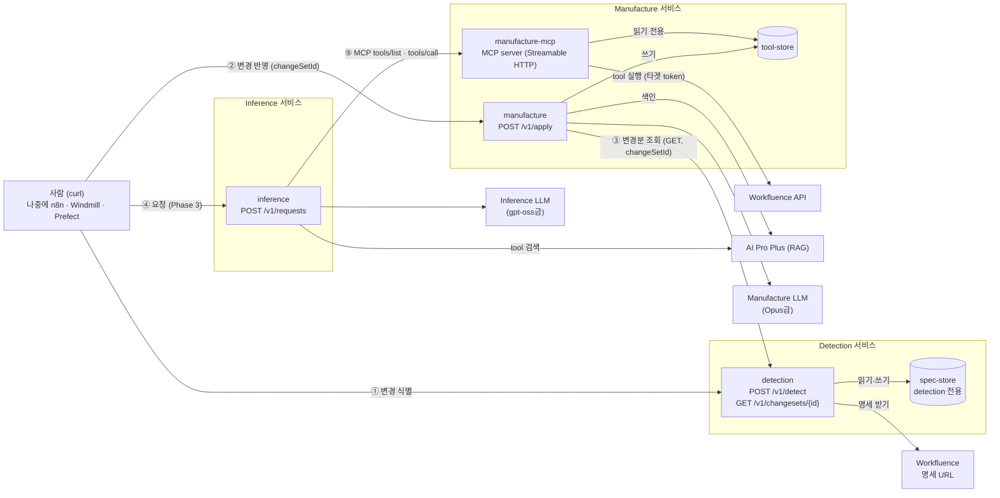
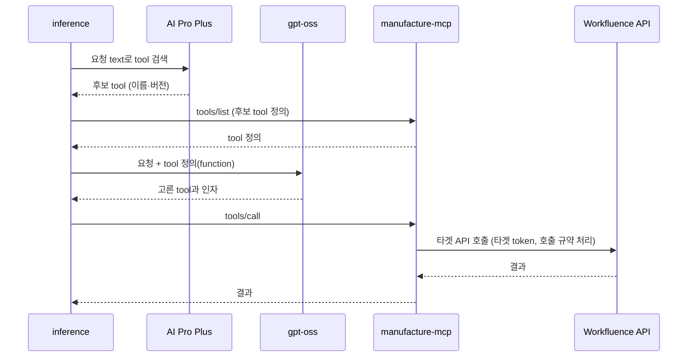
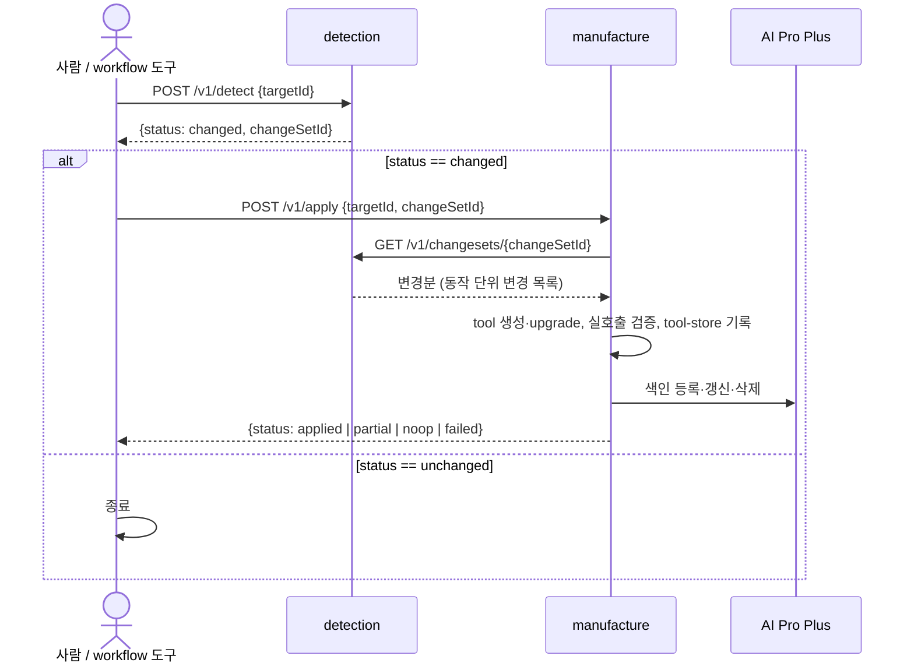

# 시스템 아키텍처 정의서

- 작성일: 2026-10-12
- 상태: 초안
- 이 문서는 phase 0 산출물이다. 과제 범위와 결정은 [`과제정의서.md`](과제정의서.md)가 정본이다.

## 1. 핵심 결정

1. **agent는 서비스 단위로 독립된 Docker container로 동작한다.** 따로 빌드하고, 따로 재시작하고, 따로 시험한다. container는 4개다.
   - Detection 서비스: `detection`
   - Manufacture 서비스: `manufacture`(tool 생성·반영) + `manufacture-mcp`(tool 서빙). 빌드 작업과 상시 서빙을 나눠, 반영 작업이나 재배포가 tool 서빙을 멈추지 않게 한다.
   - Inference 서비스: `inference`
2. **저장소는 소유 서비스만 접근한다.** 다른 서비스는 저장소를 직접 읽지 않고, 소유 서비스가 제공하는 API로 조회한다.
   - `spec-store`(명세 버전·변경분)는 Detection만 접근한다. Manufacture는 Detection의 조회 API로 변경분을 읽는다.
   - `tool-store`(tool 정의·버전)는 Manufacture 서비스만 접근한다. `manufacture`가 쓰고, `manufacture-mcp`는 읽기 전용으로 붙인다. Inference는 `manufacture-mcp`의 MCP server로 tool을 받아 쓴다.
3. **실행을 연쇄로 걸지 않는다.** Detection이 Manufacture를 불러 update 하게 하지 않는다. 실행 순서는 바깥(지금은 사람, 나중에는 workflow 도구)이 정한다. 다른 서비스의 API 호출은 **조회**와 **tool 사용(MCP)**만 허용한다.
4. **각 서비스는 실행 API를 하나씩 연다.**
   - Detection: **변경 식별** API 1개 (+ 변경분 조회 API)
   - Manufacture: **변경 반영 실행** API 1개 (+ MCP server)
   - Inference: **요청 수행** API 1개 (Phase 3)
5. **agent는 호출되면 실행되는 구조만 갖는다.** 언제 실행할지(일정, 순서)는 바깥이 정한다. **지금은 사람이 curl로 실행한다.** 나중에 n8n, Windmill, Prefect 같은 workflow 도구의 한 단계로 그대로 끼울 수 있게 API를 만든다.

## 2. 구성도



- ① 사람이 Detection 변경 식별을 실행하면 `changeSetId`가 나온다.
- ② 사람이 그 `changeSetId`로 Manufacture 변경 반영을 실행한다.
- ③ `manufacture`는 그 `changeSetId`를 key로 Detection 조회 API를 불러 변경분을 읽는다. 실행을 부르는 것이 아니라 읽기만 한다.
- ④ 요청이 Inference로 들어온다(REST, Phase 4부터 채팅도).
- ⑤ Inference는 AI Pro Plus에서 필요한 tool을 찾고, `manufacture-mcp`에 MCP로 tool 정의를 받아 실행한다.

## 3. container

| container | 서비스 | 역할 | 여는 API | 저장소 | 다른 서비스 호출 | 외부 호출 |
|---|---|---|---|---|---|---|
| `detection` | Detection | 명세 수집·버전 보관·diff·변경분 산출 | 변경 식별(실행), 변경분 조회 | `spec-store` 읽기·쓰기 | — | 타겟 명세 URL |
| `manufacture` | Manufacture | tool 생성·upgrade·실호출 검증·RAG 색인 | 변경 반영(실행) | `tool-store` 읽기·쓰기 | Detection 변경분 조회 | AI Pro Plus(쓰기), Manufacture LLM, 타겟 시험 환경 |
| `manufacture-mcp` | Manufacture | tool 서빙과 실행 | MCP server (Streamable HTTP) | `tool-store` 읽기 전용 | — | 타겟 API (타겟 token) |
| `inference` | Inference | text 요청 수행, 채팅 어댑터(Phase 4) | 요청 수행(실행) | — | `manufacture-mcp` (MCP client) | AI Pro Plus(검색), Inference LLM |

- container마다 `GET /health`를 둔다. 살아 있는지 확인하는 용도다.
- **일정 실행은 agent가 하지 않는다.** "재시작 시 확인", "하루 1회 확인" 같은 일정은 외부 scheduler나 workflow 도구가 맡고, 그 일정은 그쪽의 환경변수로 설정한다. container 안에 scheduler를 두지 않고, 시작할 때 저절로 실행하지도 않는다.
- `manufacture`와 `manufacture-mcp`는 같은 코드베이스(같은 tool 정의 형식과 실행기)를 쓰고, 실행 진입점만 다르다. 실호출 검증도 같은 실행기로 한다.

## 4. 저장소

| 저장소 | 내용 | 접근 | 다른 서비스에 내주는 방법 |
|---|---|---|---|
| `spec-store` | 타겟별 명세 버전(자체 Git 이력), 변경분(changeset) | `detection` 전용 볼륨 | Detection 변경분 조회 API |
| `tool-store` | 타겟별 tool 정의와 tool 버전, 반영 기록 | `manufacture` 쓰기, `manufacture-mcp` 읽기 전용 | `manufacture-mcp`의 MCP server |

- 볼륨은 소유 서비스의 container에만 붙인다. 서비스 사이의 공유 볼륨은 없다.
- 모든 산출물은 `targetId` 아래에 둔다.
- 명세 버전은 `spec-store` 안의 자체 Git 이력으로 두고, 코드 저장소에 커밋하지 않는다.
- 저장소 내부 구조와 파일 형식은 소유 서비스의 내부 사항이다. 다른 서비스는 API·MCP 응답 모양에만 의존한다. 세부는 Phase 1(spec-store)과 Phase 2(tool-store) 설계에서 정한다.

## 5. API

### 5.1 공통 규칙 (workflow 도구에 끼우기 좋게)

| 규칙 | 내용 |
|---|---|
| 형식 | HTTP + JSON. 요청·응답 본문은 JSON이다. |
| 한 단계 = 한 호출 | API 하나가 한 단계를 끝까지 수행하고 결과를 돌려준다. 숨은 연쇄 실행이 없다. |
| 다음 단계 입력 | 응답에 다음 단계가 쓸 값(예: `changeSetId`)을 담는다. workflow 도구는 이 값을 다음 단계 요청에 넘긴다. |
| 멱등 | 같은 입력으로 다시 실행해도 결과가 같다. 이미 반영한 변경분을 다시 반영하면 아무것도 하지 않고 같은 결과를 돌려준다. workflow 도구의 자동 재시도에 안전하다. |
| 상태 표시 | 응답에 `status`를 둔다. 분기는 HTTP 코드와 `status`로 한다. |
| 오류 | `{"error":{"code","message"}}` 한 가지 모양. `code`로 분기한다. |
| 명세 공개 | 각 서비스는 자기 API의 OpenAPI 명세(`/openapi.json`)를 연다. workflow 도구가 가져다 쓸 수 있다. |
| 설정 | 포트, 경로, 인증 여부는 `.env`로 둔다. |

### 5.2 Detection — 변경 식별

`POST /v1/detect`

| | 내용 |
|---|---|
| 요청 | `{"targetId": "workfluence"}` |
| 하는 일 | 타겟 명세의 변경 여부를 확인한다. 바뀌었으면 명세를 받아 새 버전으로 보관하고, 이전 버전과 diff 해서 변경분을 `spec-store`에 쓴다. |
| 응답 `status` | `changed`: 새 변경분을 만들었다. `unchanged`: 명세가 같다. |
| 응답 예 | `{"status":"changed","targetId":"workfluence","changeSetId":"…","fromVersion":"…","toVersion":"…","summary":{"added":3,"removed":0,"modified":1},"needsReview":false}` |
| 비고 | 첫 실행은 빈 버전 대비 전체를 변경분으로 만든다. 삭제·변경이 있으면(Workfluence에서는 v2 신호) `needsReview: true`. |

```bash
curl -s -X POST http://localhost:${DETECTION_PORT}/v1/detect \
  -H 'Content-Type: application/json' -d '{"targetId":"workfluence"}'
```

**변경분 조회** `GET /v1/changesets/{changeSetId}?targetId=workfluence`

| | 내용 |
|---|---|
| 하는 일 | `spec-store`의 변경분을 읽어 돌려준다. 저장소를 바꾸지 않는다. |
| 응답 | 변경분 머리(`changeSetId`, `fromVersion`, `toVersion`, `needsReview`)와 동작 단위 변경 목록(추가·삭제·변경된 동작과 각 동작의 새 명세 조각) |
| 쓰는 쪽 | Manufacture(반영할 때, `changeSetId`를 key로 조회), 사람(내용 확인할 때) |
| 비고 | 응답 모양의 세부는 Phase 1 설계에서 정한다. 이 응답 모양이 Detection과 Manufacture 사이의 계약이다. |

### 5.3 Manufacture — 변경 반영 실행 (`manufacture`)

`POST /v1/apply`

| | 내용 |
|---|---|
| 요청 | `{"targetId": "workfluence", "changeSetId": "…"}` |
| 하는 일 | `changeSetId`를 key로 Detection 변경분 조회 API를 불러 변경분을 읽고, tool을 생성·upgrade 하고, 시험 환경에서 실호출로 검증하고, AI Pro Plus 색인을 갱신하고, 결과를 `tool-store`에 쓴다. |
| 응답 `status` | `applied`: 모두 반영했다. `partial`: 일부는 사람 확인이 필요해 보류했다. `noop`: 이미 반영했거나 반영할 것이 없다. `failed`: 검증 실패 등으로 반영하지 않았다(이전 tool 버전 유지). |
| 응답 예 | `{"status":"partial","targetId":"workfluence","changeSetId":"…","toolVersion":"…","tools":{"added":2,"updated":1,"removed":0},"indexed":3,"pendingReview":[{"operation":"pages.delete","reason":"위험 동작"}]}` |
| 비고 | 사람 확인 대상(삭제·권한 변경·admin·위험 동작 추가)은 반영하지 않고 `pendingReview`로 돌려준다. 승인 방법은 Phase 2에서 정한다. 변경분 적용 순서 규칙은 8절 A6. |

```bash
curl -s -X POST http://localhost:${MANUFACTURE_PORT}/v1/apply \
  -H 'Content-Type: application/json' -d '{"targetId":"workfluence","changeSetId":"<위 응답의 changeSetId>"}'
```

### 5.4 Manufacture — MCP server (`manufacture-mcp`)

| | 내용 |
|---|---|
| 전송 | MCP Streamable HTTP |
| 제공 | `tools/list`(tool 정의), `tools/call`(tool 실행). tool은 `targetId`별 이름공간으로 나눈다. |
| 실행 | tool 실행 시 타겟 API를 타겟 token으로 부른다. 재시도·호출 한도·충돌 처리 같은 타겟 호출 규약은 이 실행기가 처리한다. 타겟 token은 이 container만 가진다. |
| 갱신 | `manufacture`가 `tool-store`를 바꾸면 새 tool 버전을 읽어 서빙하고 `notifications/tools/list_changed`로 알린다. |
| 버전 일치 | AI Pro Plus 색인의 tool 버전과 MCP가 서빙하는 tool 버전이 같아야 한다. 검색 결과의 버전과 서빙 버전이 다르면 실행을 거절하고 이유를 돌려준다. |
| 클라이언트 | Inference. 표준 MCP라서 다른 MCP client도 붙을 수 있다. |

**Inference가 tool을 쓰는 흐름**



1. 요청 text로 AI Pro Plus에서 필요한 tool을 자연어 검색한다.
2. 찾은 tool들의 정의를 `manufacture-mcp`에서 받는다. 전체 목록을 모델에 싣지 않는다.
3. 그 tool들을 gpt-oss의 function 정의로 바꿔 넘긴다.
4. 모델이 고른 tool을 MCP `tools/call`로 실행한다.

### 5.5 Inference — 요청 수행 (Phase 3)

`POST /v1/requests` — text 요청을 받아 수행한다. 요청·응답 모양, 인증, 동기·비동기는 Phase 3 설계에서 정한다(과제정의서 미정 12번). Workfluence 채팅 어댑터(Phase 4)는 이 container 안에서 같은 수행 로직을 쓴다.

### 5.6 사람이 curl로 돌리는 흐름

```bash
# 1. 변경 식별
R=$(curl -s -X POST http://localhost:${DETECTION_PORT}/v1/detect \
      -H 'Content-Type: application/json' -d '{"targetId":"workfluence"}')
echo "$R"
# 2. 바뀌었으면 반영
CS=$(echo "$R" | jq -r 'select(.status=="changed") | .changeSetId')
[ -n "$CS" ] && curl -s -X POST http://localhost:${MANUFACTURE_PORT}/v1/apply \
      -H 'Content-Type: application/json' -d "{\"targetId\":\"workfluence\",\"changeSetId\":\"$CS\"}"
```



workflow 도구로 옮길 때는 위 두 호출을 두 단계로 두고, 1단계의 `status`로 분기하고 `changeSetId`를 2단계에 넘기면 된다.

## 6. 설정

- 공통 설정과 container별 설정은 `.env`로 받는다(포트, 저장소 경로, 로그 수준).
- 실행 일정은 agent 설정이 아니다. 외부 scheduler·workflow 도구의 환경변수로 둔다.
- 타겟 설정은 타겟별 `.env`로 받는다(타겟 token, spec URL, 해시 URL, 호출 한도 등). 비밀이 든 `.env`는 Git에 올리지 않고, 변수 이름만 적은 예시 파일(`.env.example`)을 올린다.
- 다른 서비스의 주소(예: `manufacture`에 Detection 주소, `inference`에 MCP server 주소)도 설정으로 받는다.
- 외부 시스템과 비밀은 필요한 container에만 넘긴다.
  - 타겟 명세 URL: `detection`
  - 타겟 token: `manufacture`(실호출 검증), `manufacture-mcp`(tool 실행). `inference`에는 주지 않는다.
  - AI Pro Plus: `manufacture`(쓰기), `inference`(검색)
  - LLM: `manufacture`(Opus급), `inference`(gpt-oss급)
- 파일 이름과 변수 이름 규칙은 Phase 1 설계에서 정한다.

## 7. 배포 단위

- `docker compose` 하나로 4개 container와 볼륨을 올린다. container는 따로 올리고 내릴 수 있다.
- 서비스마다 Dockerfile을 가진다. `manufacture`와 `manufacture-mcp`는 같은 이미지를 쓰고 실행 명령만 다르게 할 수 있다.
- 공통 코드(코어 interface, 타겟 어댑터 interface, 설정 읽기)는 공유 패키지로 두고 각 이미지가 포함한다.
- 저장소 배치(안):

```
agents/
  detection/      # Dockerfile, 앱, 테스트
  manufacture/    # apply 앱 + MCP server 앱 (진입점 2개)
  inference/
packages/
  core/           # 공통 interface·모델·설정 (타겟 무관)
  targets/
    workfluence/  # Workfluence 타겟 어댑터
docker-compose.yml
.env.example
```

- 배치의 세부는 각 phase 설계에서 확정한다. Phase 1에서는 `detection`과 공통 패키지만 만든다.

## 8. 미정 항목

| # | 결정 사항 | 제안 | 정할 때 |
|---|---|---|---|
| A1 | 실행 API와 MCP server의 인증: 지금은 사람이 내부망에서 curl로 부른다 | 시험 환경은 인증 없이 열고, 운영은 정적 Bearer 토큰(`.env`). 둘 다 설정으로 고른다 | Phase 1 |
| A2 | 변경 반영 실행이 오래 걸릴 때(tool 수 × 순차 색인). workflow 도구의 HTTP 노드는 대개 타임아웃이 있다 | 비동기를 기본으로 검토: `202` + 작업 ID, 상태 조회 API | Phase 2 |
| A3 | (해결) Inference가 tool을 받는 경로 | `manufacture-mcp`의 MCP server (5.4절) | 해결 |
| A4 | API 프레임워크와 기본 이미지 | Python + FastAPI(OpenAPI 명세 자동 생성으로 workflow 도구 연동이 쉬움) | Phase 1 |
| A5 | 같은 타겟에 변경 식별·반영이 동시에 두 번 실행될 때의 처리 | 타겟 단위 잠금, 진행 중이면 409로 거절 | Phase 1·2 |
| A6 | 변경분 적용 순서: 여러 변경분 중 하나를 골라 반영할 때, 앞 변경분을 건너뛰면 tool이 어긋난다 | `manufacture`가 변경분의 `fromVersion`과 마지막 반영 버전을 비교해 다르면 409로 거절하고 먼저 반영할 변경분을 알려 준다 | Phase 1 (변경분 계약과 함께) |
| A7 | MCP server의 요청자 정보 전달: 채팅 요청자별 권한을 볼 때 MCP 호출에 요청자를 어떻게 넘길지 | Phase 4 설계에서 정함 (과제정의서 미정 18번) | Phase 4 |
