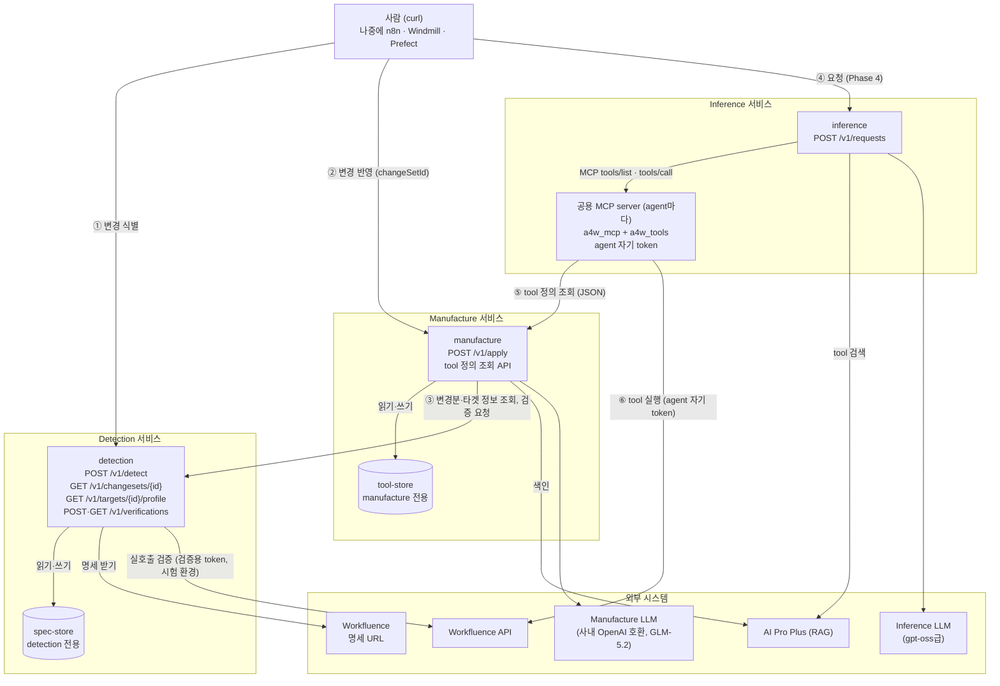
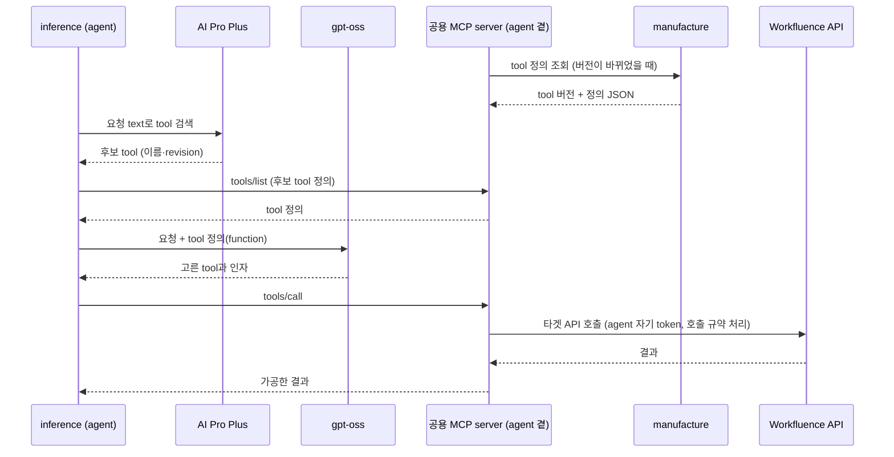
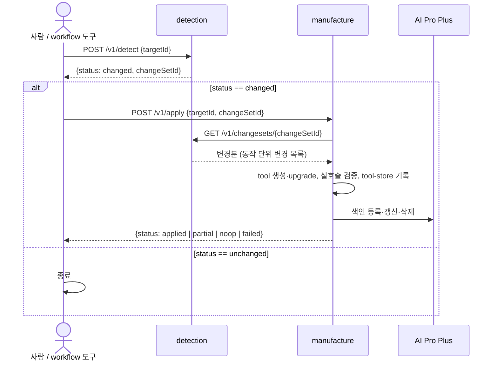
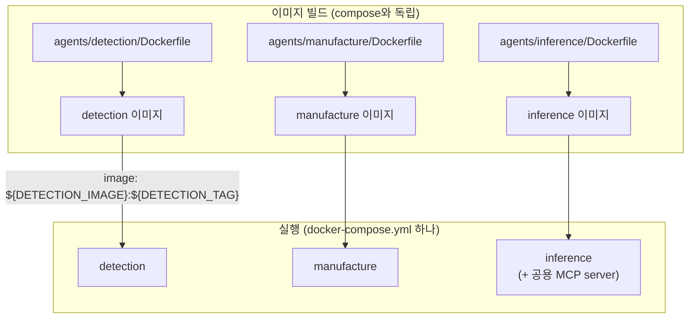

# 시스템 아키텍처 정의서

- 작성일: 2026-10-12
- 상태: 초안
- 이 문서는 phase 0 산출물이다. 과제 범위와 결정은 [`과제정의서.md`](과제정의서.md)가 정본이다.

## 1. 핵심 결정

1. **agent는 서비스 단위로 독립된 Docker container로 동작한다.** 따로 빌드하고, 따로 재시작하고, 따로 시험한다. container는 3개다.
   - Detection 서비스: `detection`
   - Manufacture 서비스: `manufacture`(tool 생성·반영, tool 정의 조회)
   - Inference 서비스: `inference`(요청 수행. agent마다 공용 MCP server를 곁에 띄운다)
   - 처음에는 Manufacture에 `manufacture-mcp`(tool 서빙·실행) container를 따로 두기로 했으나, 실행을 Inference agent가 자기 계정으로 하게 되어(아래 7) 없앴다. (사용자 확정, 2026-10-13)
2. **저장소는 소유 서비스만 접근한다.** 다른 서비스는 저장소를 직접 읽지 않고, 소유 서비스가 제공하는 API로 조회한다.
   - `spec-store`(명세 버전·변경분)는 Detection만 접근한다. Manufacture는 Detection의 조회 API로 변경분을 읽는다.
   - `tool-store`(tool 정의·버전)는 `manufacture`만 접근한다. Inference는 Manufacture의 **tool 정의 조회 API**로 tool 정의(JSON)를 받는다.
3. **실행을 연쇄로 걸지 않는다.** Detection이 Manufacture를 불러 update 하게 하지 않는다. 실행 순서는 바깥(지금은 사람, 나중에는 workflow 도구)이 정한다. 다른 서비스의 API 호출은 **조회**(변경분·타겟 정보·tool 정의)와 **검증 요청**(manufacture → Detection, 반영 작업의 한 단계)만 허용한다. 불린 서비스는 다른 서비스를 다시 부르지 않는다.
4. **각 서비스는 실행 API를 하나씩 연다.**
   - Detection: **변경 식별** API 1개 (+ 변경분 조회, 타겟 정보, 검증)
   - Manufacture: **변경 반영 실행** API 1개 (+ tool 정의 조회)
   - Inference: **요청 수행** API 1개 (Phase 4)
5. **agent는 호출되면 실행되는 구조만 갖는다.** 언제 실행할지(일정, 순서)는 바깥이 정한다. **지금은 사람이 curl로 실행한다.** 나중에 n8n, Windmill, Prefect 같은 workflow 도구의 한 단계로 그대로 끼울 수 있게 API를 만든다.
6. **Detection이 타겟 창구다.** 타겟과 맞닿는 일(명세 받기, token scope 확인, tool 실호출 검증과 시험 자료 정리)은 Detection 한 곳이 맡는다. `manufacture`는 타겟과 단절하고 타겟 token을 갖지 않는다. 타겟 연계 문제는 Detection을 보강해 푼다. (사용자 확정, 2026-10-13)
7. **tool은 JSON이고, 실행은 agent가 자기 계정으로 한다.** (사용자 확정, 2026-10-13)
   - Manufacture가 만드는 것은 tool 정의(JSON)뿐이다. tool이 더해지거나 바뀌어도 JSON만 바뀐다. code·이미지 빌드·재배포가 없다.
   - Inference의 agent는 여럿일 수 있고 저마다 자기 계정(권한이 다름)과 token을 갖는다. agent 곁의 **공용 MCP server**(code 하나, 패키지 `a4w_mcp`)가 Manufacture에서 정의를 받아 `tools/list`로 내주고, `tools/call`은 그 agent의 token으로 Workfluence를 **직접** 부른다. 호출 규약은 공용 실행기 `a4w_tools`가 지킨다. Phase 5 채팅 어댑터도 agent 자기 token으로 직접 부른다.
   - token은 agent(MCP client 쪽) 밖으로 나가지 않는다. 다른 서버로 token을 넘기는 방식(token passthrough)은 쓰지 않는다.
   - agent가 아닌 클라이언트가 공용 계정으로 tool을 실행해야 하는 경우가 생기면 Detection 경유 실행으로 더한다(지금은 interface만).

## 2. 구성도



- ① 사람이 Detection 변경 식별을 실행하면 `changeSetId`가 나온다.
- ② 사람이 그 `changeSetId`로 Manufacture 변경 반영을 실행한다.
- ③ `manufacture`는 그 `changeSetId`를 key로 Detection 조회 API를 불러 변경분을 읽는다. token scope도 Detection에서 받고, 만든 tool의 실호출 검증은 Detection 검증 API에 맡긴다. `manufacture`는 타겟을 직접 부르지 않는다.
- ④ 요청이 Inference로 들어온다(REST, Phase 5부터 채팅도).
- ⑤ agent 곁의 MCP server는 Manufacture의 tool 정의 조회 API에서 현재 tool 버전의 정의(JSON)를 받는다. 버전이 바뀌면 새 정의를 받고 agent에게 `notifications/tools/list_changed`로 알린다.
- ⑥ agent가 AI Pro Plus에서 tool을 찾고 MCP `tools/call`로 실행하면, MCP server가 그 agent의 token으로 Workfluence를 직접 부른다.

## 3. container

| container | 서비스 | 역할 | 여는 API | 저장소 | 다른 서비스 호출 | 외부 호출 |
|---|---|---|---|---|---|---|
| `detection` | Detection | 명세 수집·버전 보관·diff·변경분 산출, 타겟 창구(token scope, tool 실호출 검증·시험 환경) | 변경 식별(실행), 변경분 조회, 타겟 정보 조회, 검증 | `spec-store` 읽기·쓰기 | — | 타겟 명세 URL, 타겟 시험 환경(검증용 token) |
| `manufacture` | Manufacture | tool 생성·upgrade·검증 판정·RAG 색인, tool 정의 내주기 | 변경 반영(실행), tool 정의 조회 | `tool-store` 읽기·쓰기 | Detection 변경분·타겟 정보 조회, 검증 요청 | AI Pro Plus(쓰기), Manufacture LLM (타겟 없음) |
| `inference` | Inference | text 요청 수행, agent별 공용 MCP server로 tool 실행, 채팅 어댑터(Phase 5) | 요청 수행(실행) | (Phase 4에서 정함) | Manufacture tool 정의 조회 | AI Pro Plus(검색), Inference LLM, 타겟 API(agent 자기 token) |

- container마다 `GET /health`를 둔다. 살아 있는지 확인하는 용도다.
- **일정 실행은 agent가 하지 않는다.** "재시작 시 확인", "하루 1회 확인" 같은 일정은 외부 scheduler나 workflow 도구가 맡고, 그 일정은 그쪽의 환경변수로 설정한다. container 안에 scheduler를 두지 않고, 시작할 때 저절로 실행하지도 않는다. (MCP server가 tool 버전을 주기적으로 확인하는 것은 조회이고 실행이 아니다.)
- 공용 실행기(`a4w_tools`)는 Detection(실호출 검증)과 Inference의 MCP server(tool 실행)가 같이 쓴다. 정의 형식과 실행이 한 code라서 검증한 대로 실행된다.

## 4. 저장소

| 저장소 | 내용 | 접근 | 다른 서비스에 내주는 방법 |
|---|---|---|---|
| `spec-store` | 타겟별 명세 버전(자체 Git 이력), 변경분(changeset) | `detection` 전용 볼륨 | Detection 변경분 조회 API |
| `tool-store` | 타겟별 tool 정의와 tool 버전, 반영 기록 | `manufacture` 전용 볼륨 | Manufacture tool 정의 조회 API |

- 볼륨은 소유 서비스의 container에만 붙인다. 서비스 사이의 공유 볼륨은 없다.
- 모든 산출물은 `targetId` 아래에 둔다.
- 명세 버전은 `spec-store` 안의 자체 Git 이력으로 두고, 코드 저장소에 커밋하지 않는다.
- 저장소 내부 구조와 파일 형식은 소유 서비스의 내부 사항이다. 다른 서비스는 API 응답 모양에만 의존한다. tool 정의 조회 API의 응답 모양(`a4w.toolset/v1`, `a4w.tool/v1`)이 Manufacture와 Inference 사이의 계약이다.

### 4.1 저장 방식 (DB)

별도 DB 서버를 두지 않는다. 서비스마다 자기 볼륨 안에 파일과 SQLite를 쓴다.

| 서비스 | 데이터 | 저장 방식 |
|---|---|---|
| Detection | 명세 버전 | 파일 + 자체 Git 이력 |
| Detection | 변경분 목록·내용, 타겟별 마지막 버전, 실행 잠금, 검증 기록 | SQLite (`spec-store` 안) |
| Manufacture | tool 정의·tool 버전 | 파일. 버전별로 한 번 쓰면 바꾸지 않는 묶음 + "현재 버전" 포인터 |
| Manufacture | 반영 기록, 보류(`pendingReview`), 작업 상태, 실행 잠금, LLM 결과 재사용, 색인 상태 | SQLite (`tool-store` 안) |
| Inference | 필요하면 Phase 4에서 정한다. MCP server는 받은 tool 정의를 메모리(또는 작은 캐시)에 둔다 | — |
| tool 색인(벡터) | — | AI Pro Plus가 맡는다. 자체 벡터 DB를 두지 않는다 |

- **이유**: DB를 공유하지 않아 저장소 소유 원칙과 맞다. 쓰기량이 적고(변경 식별·반영은 하루 몇 번), 서비스마다 쓰는 container가 하나라 SQLite로 충분하다. container와 설치할 것이 늘지 않는다.
- **갱신 순서**: `manufacture`는 새 tool 버전 묶음을 다 쓴 뒤 현재 버전 포인터만 원자적으로 바꾼다. 정의 조회 API는 포인터가 가리키는 묶음만 내주므로 반쯤 쓴 tool이 나가지 않는다.
- **교체 가능성**: 저장은 repository interface 뒤에 둔다(DIP). container를 여러 개로 늘리거나, 타겟·작업량이 크게 늘거나, 운영 표준 DB가 정해지면 PostgreSQL 등으로 바꾼다.
- 테이블과 파일의 세부 구성은 Phase 1(Detection)과 Phase 2(Manufacture) 설계에 있다.

## 5. API

### 5.1 공통 규칙 (workflow 도구에 끼우기 좋게)

| 규칙 | 내용 |
|---|---|
| 형식 | HTTP + JSON. 요청·응답 본문은 JSON이다. |
| 한 단계 = 한 호출 | API 하나가 한 단계를 끝까지 수행하고 결과를 돌려준다. 숨은 연쇄 실행이 없다. |
| 다음 단계 입력 | 응답에 다음 단계가 쓸 값(예: `changeSetId`)을 담는다. workflow 도구는 이 값을 다음 단계 요청에 넘긴다. |
| 멱등 | 같은 입력으로 다시 실행해도 결과가 같다. 이미 반영한 변경분을 다시 반영하면 아무것도 하지 않고 같은 결과를 돌려준다. workflow 도구의 자동 재시도에 안전하다. |
| 상태 표시 | 응답에 `status`를 둔다. 분기는 HTTP 코드와 `status`로 한다. |
| 오류 | `{"error":{"code","message"}}` 한 가지 모양. `code`로 분기한다. |
| 명세 공개 | 각 서비스는 자기 API의 OpenAPI 명세(`/openapi.json`)를 연다. workflow 도구가 가져다 쓸 수 있다. |
| 설정 | 포트, 경로, 인증 여부는 `.env`로 둔다. |

### 5.2 Detection — 변경 식별

`POST /v1/detect`

| | 내용 |
|---|---|
| 요청 | `{"targetId": "workfluence"}` |
| 하는 일 | 타겟 명세의 변경 여부를 확인한다. 바뀌었으면 명세를 받아 새 버전으로 보관하고, 이전 버전과 diff 해서 변경분을 `spec-store`에 쓴다. |
| 응답 `status` | `changed`: 새 변경분을 만들었다. `unchanged`: 명세가 같다. |
| 응답 예 | `{"status":"changed","targetId":"workfluence","changeSetId":"…","fromVersion":"…","toVersion":"…","summary":{"added":3,"removed":0,"modified":1},"needsReview":false}` |
| 비고 | 첫 실행은 빈 버전 대비 전체를 변경분으로 만든다. 삭제·변경이 있으면(Workfluence에서는 v2 신호) `needsReview: true`. |

```bash
curl -s -X POST http://localhost:${DETECTION_PORT}/v1/detect \
  -H 'Content-Type: application/json' -d '{"targetId":"workfluence"}'
```

**변경분 조회** `GET /v1/changesets/{changeSetId}?targetId=workfluence`

| | 내용 |
|---|---|
| 하는 일 | `spec-store`의 변경분을 읽어 돌려준다. 저장소를 바꾸지 않는다. |
| 응답 | 변경분 머리(`changeSetId`, `fromVersion`, `toVersion`, `needsReview`)와 동작 단위 변경 목록(추가·삭제·변경된 동작과 각 동작의 새 명세 조각) |
| 쓰는 쪽 | Manufacture(반영할 때, `changeSetId`를 key로 조회), 사람(내용 확인할 때) |
| 비고 | 응답 모양의 세부는 Phase 1 설계에서 정한다. 이 응답 모양이 Detection과 Manufacture 사이의 계약이다. |

### 5.3 Manufacture — 변경 반영 실행 (`manufacture`)

`POST /v1/apply`

| | 내용 |
|---|---|
| 요청 | `{"targetId": "workfluence", "changeSetId": "…"}` |
| 하는 일 | `changeSetId`를 key로 Detection 변경분 조회 API를 불러 변경분을 읽고, tool을 생성·upgrade 하고, Detection 검증 API로 시험 환경 실호출 검증을 받고, AI Pro Plus 색인을 갱신하고, 결과를 `tool-store`에 쓴다. 오래 걸리므로 비동기(202 + 상태 조회)다(Phase 2 설계 4.1절). |
| 응답 `status` | `applied`: 모두 반영했다. `partial`: 일부는 사람 확인이 필요해 보류했다. `noop`: 이미 반영했거나 반영할 것이 없다. `failed`: 검증 실패 등으로 반영하지 않았다(이전 tool 버전 유지). |
| 응답 예 | 접수: `202 {"status":"running","applyId":"ap-…","targetId":"workfluence","changeSetId":"…"}`. 결과(`GET /v1/applies/{applyId}`): `{"status":"partial","applyId":"ap-…","toolVersion":"tv-…","summary":{"added":2,"updated":1,"removed":0,"pending":1,…},"index":{"upserted":3,…},"pendingReview":[{"operationId":"pages.delete","reasons":["DANGER_ADDED"]}]}` (전체 모양은 Phase 2 설계 16.2절) |
| 비고 | 사람 확인 대상(삭제·권한 변경·admin·위험 동작 추가)은 반영하지 않고 `pendingReview`로 돌려준다. 승인은 `POST /v1/reviews/{id}/decision`으로 기록하고, `changeSetId` 없이 `{"targetId"}`만 보낸 반영(정리 반영) 때 들어간다. 변경분 적용 순서 규칙은 8절 A6. |

```bash
curl -s -X POST http://localhost:${MANUFACTURE_PORT}/v1/apply \
  -H 'Content-Type: application/json' -d '{"targetId":"workfluence","changeSetId":"<위 응답의 changeSetId>"}'
```

### 5.4 Manufacture — tool 정의 조회 (`manufacture`)

| | 내용 |
|---|---|
| 하는 일 | `tool-store`의 현재 tool 버전(포인터가 가리키는 묶음)을 JSON으로 내준다. 저장소를 바꾸지 않는다. |
| 응답 | manifest(`a4w.toolset/v1`)와 tool 정의(`a4w.tool/v1`). 형식은 Phase 2 설계 6절이 정본이다 |
| 갱신 확인 | 클라이언트는 현재 tool 버전 id만 먼저 묻고, 바뀌었을 때만 정의를 받는다(조회만, 반복은 클라이언트 몫) |
| 쓰는 쪽 | Inference의 공용 MCP server, 사람(확인할 때) |
| 비고 | 경로와 모양의 세부는 Phase 3 설계에서 정한다 |

### 5.5 Inference — 공용 MCP server (agent마다)

| | 내용 |
|---|---|
| code | 공용 패키지 `a4w_mcp` 하나. tool마다 code가 없다. tool이 바뀌어도 다시 빌드·배포하지 않는다 |
| 정의 | Manufacture tool 정의 조회 API에서 받는다. 버전이 바뀌면 다시 받고 `notifications/tools/list_changed`로 알린다 |
| 제공 | `tools/list`(받은 정의 그대로), `tools/call`(정의대로 실행). tool은 `targetId`별 이름공간으로 나눈다 |
| 실행 | 그 agent의 계정 token으로 타겟 API를 **직접** 부른다. 재시도·호출 한도·충돌 처리 같은 타겟 호출 규약은 공용 실행기 `a4w_tools`가 처리한다. 고정 맥락(`homeSpace` 등)은 agent 설정에서 넣는다 |
| token | agent의 비밀로만 가진다. MCP server 밖(다른 서비스)으로 넘기지 않는다 |
| 버전 일치 | AI Pro Plus 색인의 tool `revision`(색인 `source`의 `@` 뒤)과 MCP server가 가진 tool의 `revision`이 같아야 한다. 다르면 정의를 다시 받고, 그래도 다르면 실행을 거절하고 이유를 돌려준다(Phase 2 설계 14.3절) |
| 클라이언트 | 같은 Inference 안의 agent. 표준 MCP라서 다른 MCP client도 붙을 수 있다 |

**Inference가 tool을 쓰는 흐름**



1. 요청 text로 AI Pro Plus에서 필요한 tool을 자연어 검색한다.
2. 찾은 tool들의 정의를 MCP server에서 받는다. 전체 목록을 모델에 싣지 않는다.
3. 그 tool들을 gpt-oss의 function 정의로 바꿔 넘긴다.
4. 모델이 고른 tool을 MCP `tools/call`로 실행한다.

### 5.6 Inference — 요청 수행 (Phase 4)

`POST /v1/requests` — text 요청을 받아 수행한다. 요청·응답 모양, 인증, 동기·비동기는 Phase 4 설계에서 정한다(과제정의서 미정 12번). Workfluence 채팅 어댑터(Phase 5)는 이 container 안에서 같은 수행 로직을 쓴다.

### 5.7 사람이 curl로 돌리는 흐름

```bash
# 1. 변경 식별
R=$(curl -s -X POST http://localhost:${DETECTION_PORT}/v1/detect \
      -H 'Content-Type: application/json' -d '{"targetId":"workfluence"}')
echo "$R"
# 2. 바뀌었으면 반영
CS=$(echo "$R" | jq -r 'select(.status=="changed") | .changeSetId')
[ -n "$CS" ] && curl -s -X POST http://localhost:${MANUFACTURE_PORT}/v1/apply \
      -H 'Content-Type: application/json' -d "{\"targetId\":\"workfluence\",\"changeSetId\":\"$CS\"}"
```



workflow 도구로 옮길 때는 위 두 호출을 두 단계로 두고, 1단계의 `status`로 분기하고 `changeSetId`를 2단계에 넘기면 된다.

## 6. 설정

- 공통 설정과 container별 설정은 `.env`로 받는다(포트, 저장소 경로, 로그 수준).
- 실행 일정은 agent 설정이 아니다. 외부 scheduler·workflow 도구의 환경변수로 둔다.
- 타겟 설정은 타겟별 `.env`(`config/targets/<targetId>.env`)로 받는다(spec URL, 해시 URL, 호출 한도 등). 타겟 token 같은 비밀은 `config/secrets/<targetId>.env`로 따로 두고, 필요한 container에만 붙인다. 비밀이 든 `.env`는 Git에 올리지 않고, 변수 이름만 적은 예시 파일(`.env.example`)을 올린다.
- 다른 서비스의 주소(예: `manufacture`에 Detection 주소, `inference`에 Manufacture 주소)도 설정으로 받는다.
- 외부 시스템과 비밀은 필요한 container에만 넘긴다.
  - 타겟 명세 URL, 타겟 API 주소: `detection`
  - 타겟 token: `detection`은 검증용 token(`config/secrets/targets/<targetId>.env`, token scope 확인과 실호출 검증). `inference`는 agent마다 자기 계정 token(위치·이름은 Phase 4에서 정함). `manufacture`에는 주지 않는다.
  - AI Pro Plus: `manufacture`(쓰기), `inference`(검색)
  - LLM: `manufacture`(사내 OpenAI 호환 엔드포인트, `GLM-5.2`), `inference`(gpt-oss급)
- 파일 이름과 변수 이름 규칙은 Phase 1 설계에서 정한다.

## 7. 실행 환경과 배포 단위

### 7.1 모든 작업은 container 안에서 한다

- 빌드, 테스트, 실행을 모두 container 안에서 한다. host에는 Docker(Engine·Compose)만 있으면 된다. host에 Python이나 의존 패키지를 설치하지 않는다.
- 테스트(TDD의 red·green)도 container 안에서 돌린다. 서비스마다 테스트를 돌리는 이미지(또는 Dockerfile의 test 단계)를 두고 `docker run`으로 실행한다.
- 확인한 host 환경(2026-10-12): Docker Engine 29.6.1, Docker Compose v5.3.1.

### 7.1.1 proxy

이 host는 proxy를 거쳐 인터넷에 나간다(2026-10-12 확인).

| 항목 | 값 |
|---|---|
| host 환경변수 | `HTTP_PROXY`·`HTTPS_PROXY` = `http://10.10.10.205:3128`, `NO_PROXY` = `localhost,127.0.0.1,10.10.10.0/24` |
| Docker daemon | 같은 proxy 설정이 있다(이미지 pull은 proxy로 나간다) |
| Python 패키지 | 인터넷(PyPI)에서 proxy를 거쳐 받는다. host에서 `https://pypi.org` 접속 확인(200) |
| 내부 주소 | `wf.internal` = `10.10.20.11`. 현재 `NO_PROXY` 대역(`10.10.10.0/24`) 밖이라 그대로 두면 proxy로 나간다 |

- **빌드**: `docker build`는 host의 proxy 환경변수를 자동으로 넘기지 않는다. 빌드 스크립트가 host의 `HTTP_PROXY`·`HTTPS_PROXY`·`NO_PROXY`를 `--build-arg`로 넘긴다. Dockerfile과 스크립트에 proxy 주소를 박지 않는다.
- **실행**: container의 proxy 설정은 `.env`로 넘긴다. 타겟과 내부 시스템(Workfluence `wf.internal`, AI Pro Plus 등)은 `NO_PROXY`에 넣어 proxy를 거치지 않게 하고, 인터넷 쪽(예: 외부 LLM)만 proxy를 쓴다.
- 이미지 안에 proxy 설정을 남기지 않는다(빌드 인자로만 쓰고 실행 설정은 `.env`로 받는다).

### 7.2 docker compose 하나로 구성한다

- 실행 구성은 `docker-compose.yml` 하나다. 3개 container, 각자의 볼륨, 네트워크, 환경변수 파일 연결을 여기에 둔다.
- container는 compose 안에서 따로 올리고 내릴 수 있다(`docker compose up -d detection` 등).

### 7.3 image build는 docker compose와 독립한다

- `docker-compose.yml`에는 `build:`를 두지 않는다. 미리 빌드된 이미지를 `image:`로만 참조한다.
- 이미지 이름과 태그는 하드코딩하지 않고 환경변수로 받는다. 예: `image: ${DETECTION_IMAGE}:${DETECTION_TAG}`.
- 이미지는 서비스마다 Dockerfile로 따로 빌드한다(`docker build`). 빌드 절차는 빌드 스크립트로 둔다. 나중에 CI나 사내 레지스트리로 옮겨도 compose를 고치지 않는다.



### 7.4 코드 배치

- 공통 코드(코어 interface, 타겟 어댑터 interface, 설정 읽기)는 공유 패키지로 두고 각 이미지가 포함한다.
- 저장소 배치(안):

```
agents/
  detection/      # Dockerfile, 앱, 테스트
  manufacture/    # Dockerfile, 반영·정의 조회 앱, 테스트
  inference/      # Dockerfile, 앱, 테스트
packages/
  core/           # 공통 interface·모델·설정 (타겟 무관)
  tools/          # tool 정의 형식 + 공용 실행기 (Detection·Inference가 실행)
  clients/        # LLM·RAG 클라이언트
  mcp/            # 공용 MCP server (Phase 3, Inference가 agent마다 띄움)
  targets/
    workfluence/  # Workfluence 타겟 어댑터
scripts/
  build.sh        # 이미지 빌드 (compose와 독립)
docker-compose.yml   # 실행 구성 (build: 없음)
.env.example
```

- 배치의 세부는 각 phase 설계에서 확정한다. Phase 1에서는 `detection`과 공통 패키지만 만든다.

## 8. 미정 항목

| # | 결정 사항 | 제안 | 정할 때 |
|---|---|---|---|
| A1 | 실행 API와 MCP server의 인증: 지금은 사람이 내부망에서 curl로 부른다 | 시험 환경은 인증 없이 열고, 운영은 정적 Bearer 토큰(`.env`). 둘 다 설정으로 고른다 | 확정 (사용자, 2026-10-12) |
| A2 | (해결) 변경 반영 실행이 오래 걸릴 때(tool 수 × 순차 색인). workflow 도구의 HTTP 노드는 대개 타임아웃이 있다 | 비동기: `202` + `applyId`, `GET /v1/applies/{applyId}`. Detection 검증도 같은 방식 (Phase 2 설계 4.1·11.3절) | 해결 (2026-10-13) |
| A3 | (해결, 2026-10-13 바뀜) Inference가 tool을 받는 경로 | Manufacture tool 정의 조회 API(5.4절) → agent 곁의 공용 MCP server(5.5절)가 agent 자기 token으로 실행. 처음 안(`manufacture-mcp` container)은 없앰 | 해결 (사용자, 2026-10-13) |
| A4 | API 프레임워크와 기본 이미지 | Python + FastAPI(OpenAPI 명세 자동 생성으로 workflow 도구 연동이 쉬움) | 확정 (사용자, 2026-10-12) |
| A5 | 같은 타겟에 변경 식별·반영이 동시에 두 번 실행될 때의 처리 | 타겟 단위 잠금, 진행 중이면 409로 거절 | 확정 (사용자, 2026-10-12) |
| A6 | 변경분 적용 순서: 여러 변경분 중 하나를 골라 반영할 때, 앞 변경분을 건너뛰면 tool이 어긋난다 | `manufacture`가 변경분의 `fromVersion`과 마지막 반영 버전을 비교해 다르면 409로 거절하고 먼저 반영할 변경분을 알려 준다 | 확정 (사용자, 2026-10-12) |
| A7 | 채팅 요청자별 권한: agent 계정의 권한과 채팅 요청자의 권한이 다를 때 어디까지 허용할지 | Phase 5 설계에서 정함 (과제정의서 미정 18번) | Phase 5 |
