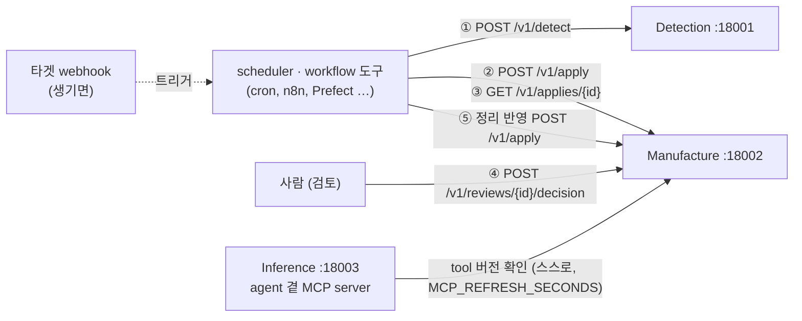
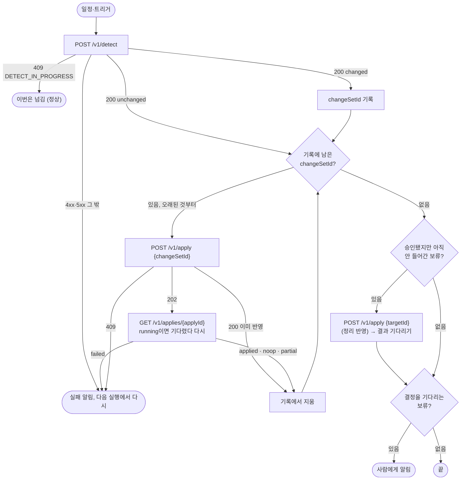

# 운영 연동 가이드 — Detection·Manufacture를 scheduler·workflow 도구로 돌리기

- 작성일: 2026-10-16
- 대상: 운영자, workflow 도구(cron, systemd timer, n8n, Windmill, Prefect 등)를 붙이는 사람
- 상위 문서: [`시스템아키텍처.md`](시스템아키텍처.md) 1·5절(실행 원칙, API 공통 규칙)

agent는 스스로 일정을 돌리지 않는다. 바깥이 Detection·Manufacture API를 불러야 타겟의 변화가 tool에 들어온다. 이 문서는 그 바깥 쪽을 붙이는 방법이다.

## 1. 누가 무엇을 부르나



- 바깥이 부르는 것은 **Detection과 Manufacture뿐**이다. Inference는 부를 필요가 없다. agent 곁 MCP server가 `MCP_REFRESH_SECONDS`(기본 60초)마다 현재 tool 버전을 확인하고, 바뀌면 재시작 없이 새 tool로 바꾼다.
- 한 번의 실행은 ① 변경 식별 → ② 반영 접수 → ③ 결과 기다리기다. 사람 검토가 필요한 변경은 ④ 사람이 승인하고 ⑤ 다음 실행에서 정리 반영으로 들어간다.
- Detection과 Manufacture는 서로를 실행시키지 않는다. 순서는 바깥이 정한다.

## 2. 쓰는 API

| API | 동기·비동기 | 성공 응답 | 쓰임 |
|---|---|---|---|
| `POST {DET}/v1/detect` `{"targetId"}` | 동기 | 200 `{"status":"changed","changeSetId","fromVersion","toVersion","summary","needsReview"}` 또는 200 `{"status":"unchanged","currentVersion"}` | ① 변경 식별 |
| `POST {MAN}/v1/apply` `{"targetId","changeSetId"}` | **비동기** | 202 `{"status":"running","applyId"}`. 이미 반영한 `changeSetId`면 200과 앞선 결과 | ② 변경 반영 |
| `POST {MAN}/v1/apply` `{"targetId"}` | 비동기 | 위와 같음 | ⑤ 정리 반영: 승인된 보류, 지난 실패 재시도, 색인 어긋남 맞추기 |
| `GET {MAN}/v1/applies/{applyId}` | — | 200 `{"status":"running"|"applied"|"partial"|"noop"|"failed","toolVersion","summary","items","pendingReview","error"}` | ③ 결과 기다리기 |
| `GET {MAN}/v1/reviews?targetId=&status=pending|approved` | — | 200 `{"reviews":[{"reviewId","tool","reasons",…}]}` | 검토할 것·승인했지만 아직 안 들어간 것 |
| `POST {MAN}/v1/reviews/{reviewId}/decision` `{"decision":"approve"|"reject","by","note"}` | — | 200 | ④ 사람 결정 |
| `GET {MAN}/v1/targets/{targetId}/state` | — | 200 `{"lastAppliedSpecVersion","lastChangeSetId","currentToolVersion",…}` | 상태 확인·복구 |
| `GET {DET}/health`, `GET {MAN}/health` | — | 200 `{"status":"ok"}`, 저장소 문제면 503 | 감시 (인증 없음) |

- 오류는 모두 `{"error":{"code","message","details"?}}` 모양이다. 분기는 HTTP 코드와 `error.code`로 한다.
- 각 서비스의 전체 명세는 `/openapi.json`에 있다. workflow 도구가 가져다 쓸 수 있다.

## 3. 한 번의 실행 흐름



## 4. 결과별 처리

### 4.1 변경 식별 (`POST /v1/detect`)

| 응답 | 뜻 | 할 일 |
|---|---|---|
| 200 `unchanged` | 명세가 지난번과 같다 | 기록에 남은 변경분이 없으면 끝 |
| 200 `changed` | 새 명세를 보관하고 변경분을 만들었다 | `changeSetId`를 **기록**하고 반영한다 |
| 409 `DETECT_IN_PROGRESS` | 같은 타겟의 변경 식별이 진행 중 | 이번은 넘긴다 |
| 502 `SPEC_FETCH_FAILED`·`SPEC_HASH_MISMATCH`·`SPEC_INVALID` | 타겟 명세를 받지 못했거나 깨졌다 | 실패로 알리고 다음 실행에서 다시 한다. 보관소는 바뀌지 않는다 |
| 404 `TARGET_NOT_FOUND`, 400 `VALIDATION_ERROR`, 401 `UNAUTHORIZED` | 설정 문제 | 사람이 고친다 |

- 명세 해시 URL(`SPEC_HASH_URL`, Workfluence는 `openapi.sha256`)을 먼저 보고 같으면 명세를 받지 않는다. 자주 불러도 가볍다.
- `needsReview: true`(동작 삭제·변경)이면 반영 결과가 보류(`partial`)가 될 것을 미리 알 수 있다.
- `changeSetId`는 `(targetId, fromVersion, toVersion)`로 정해지는 값이다. 같은 변화는 늘 같은 id다.

### 4.2 변경 반영 (`POST /v1/apply` → `GET /v1/applies/{applyId}`)

| 결과 `status` | 뜻 | 할 일 |
|---|---|---|
| `applied` | 새 tool 버전을 만들어 서빙했다(`toolVersion`) | 끝. agent는 `MCP_REFRESH_SECONDS` 안에 새 tool을 쓴다 |
| `noop` | 바꿀 것이 없었다(예: 채팅 API만 바뀜) | 끝 |
| `partial` | 일부는 들어갔고, 일부는 사람 검토를 기다린다(`pendingReview[]`) | 보류를 사람에게 알린다(5절) |
| `failed` | 아무것도 바꾸지 않았다(`error.code`) | 알리고, 다음 실행에서 같은 `changeSetId`로 다시 한다. 실패한 반영은 다시 할 수 있다 |
| `running` | 진행 중 | 기다렸다 다시 조회한다(아래 기다리기) |

| 접수 응답 | 뜻 | 할 일 |
|---|---|---|
| 202 | 새로 시작 | `applyId`로 결과를 기다린다 |
| 200 | 이 `changeSetId`는 이미 반영되었다(`applied`·`partial`·`noop`). 본문은 그때의 결과 | 기록에서 지운다. 본문의 `pendingReview`는 그때의 것이다 — 지금 보류는 `GET /v1/reviews`로 본다 |
| 409 `APPLY_IN_PROGRESS` | 같은 타겟의 반영이 진행 중(`details.applyId`) | 그 `applyId`를 기다리거나 다음 실행으로 넘긴다 |
| 409 `CHANGESET_OUT_OF_ORDER` | 마지막 반영 버전에서 시작하지 않는 변경분이다(`details.lastAppliedSpecVersion`, `changeSetFromVersion`) | 빠진 앞 변경분을 먼저 반영한다(4.3) |
| 404 `CHANGESET_NOT_FOUND` | Detection에 그 변경분이 없다 | 기록이 잘못되었다. 사람이 확인한다 |
| 502 `DETECTION_UNAVAILABLE`·`SCOPE_UNKNOWN` | Manufacture가 Detection에 닿지 못했다 | 다음 실행에서 다시 |

**기다리기**: 5초 간격으로 조회한다. 걸리는 시간은 바뀐 tool 수와 LLM 호출에 따른다. 실측(2026-10-16, 시험 스택): seed로 만든 tool 13개 6초, 33개 74초(실호출 검증 포함). 바뀐 동작에 seed가 없어 LLM이 쓰면 tool마다 수십 초가 더 걸릴 수 있다. 상한은 30분 정도로 두고, 넘으면 알린다(반영은 계속 돈다. 다음 실행은 409 `APPLY_IN_PROGRESS`로 겹치지 않는다).

### 4.3 순서와 기록

- 변경분은 **받은 순서대로, 빠짐없이** 반영해야 한다. Manufacture는 마지막 반영 버전(`lastAppliedSpecVersion`)에서 시작하는 변경분만 받는다.
- 변경 식별은 같은 명세에 대해 `changed`를 **한 번만** 돌려준다. 다음 호출은 `unchanged`다. 그래서 바깥이 `changeSetId`를 기록해 두어야 한다(반영이 실패하거나 중간에 끊겨도 잃지 않게). `scripts/a4w-sync.sh`는 `A4W_STATE_DIR/<targetId>.changesets` 파일에 적고, 반영이 끝나면 지운다.
- 기록을 잃었을 때: `GET {MAN}/v1/targets/{targetId}/state`의 `lastAppliedSpecVersion`과 `POST {DET}/v1/detect`의 `currentVersion`을 비교한다. 같으면 빠진 것이 없다. 다르면 그 사이 변경분의 id를 계산한다. `changeSetId`는 `cs-` + sha256(`"{targetId}\n{fromVersion}\n{toVersion}"`)의 앞 24자다([`phase1_detection/2_설계.md`](phase1_detection/2_설계.md) 7절). 두 버전 사이에 다른 판이 없었다면 이 id로 바로 반영하면 된다.

  ```bash
  CS="cs-$(printf '%s\n%s\n%s' workfluence "$LAST_APPLIED" "$CURRENT" | sha256sum | cut -c1-24)"
  curl -s "$DET/v1/changesets/$CS?targetId=workfluence" | jq '{changeSetId, fromVersion, toVersion}'   # 있으면 반영
  ```

  404면 그 사이에 Detection이 본 판이 더 있다는 뜻이다. Detection 로그에는 변경분 id가 남지 않으므로 workflow 실행 기록에서 찾거나 사람이 Detection 보관소를 확인한다.

## 5. 사람 검토 단계

위험한 변경은 자동으로 서빙하지 않고 보류로 둔다. 보류 이유(`reasons`):

| 이유 | 언제 |
|---|---|
| `SPEC_REVIEW` | 서빙 중인 tool의 동작 명세가 바뀌었다(Detection `needsReview`) |
| `TOOL_REMOVED` | 동작이 명세에서 사라졌다 |
| `DANGER_ADDED` | 위험 묶음(지우기 등)의 tool이 새로 들어오려 한다 |
| `SCOPE_CHANGED` | tool이 요구하는 권한 범위가 바뀌었다 |
| `UNVERIFIED` | 실호출 검증을 하지 못했다(시나리오 없음 등). 다음 반영 때 다시 검증한다 |

검토 흐름:

```bash
# 결정을 기다리는 보류
curl -s "$MAN/v1/reviews?targetId=workfluence&status=pending" | jq '.reviews[] | {reviewId, tool, reasons}'
# 항목 상세 (새 정의, 이전 정의, 검증 결과)
curl -s "$MAN/v1/reviews/<reviewId>"
# 승인 또는 거절 (결정만 기록한다)
curl -s -X POST "$MAN/v1/reviews/<reviewId>/decision" -H 'Content-Type: application/json' \
  -d '{"decision":"approve","by":"<이름>","note":"<메모>"}'
```

- 승인한 항목은 **다음 정리 반영**(`POST /v1/apply {"targetId"}`)에서 서빙된다. `scripts/a4w-sync.sh`는 실행마다 승인된 보류(`status=approved`)가 있으면 정리 반영을 한다. 그래서 사람은 승인만 하면 된다.
- 거절한 항목은 같은 명세에 대해 다시 묻지 않는다. 명세가 다시 바뀌면 새로 묻는다.
- 보류 알림은 workflow 도구의 알림(메일, 메신저)으로 보낸다. `scripts/a4w-sync.sh`는 보류가 있으면 종료 코드 2와 보류 목록을 stderr에 낸다.

## 6. 인증

- `DETECTION_AUTH_MODE`·`MANUFACTURE_AUTH_MODE`가 `bearer`면 `/v1/*` 요청에 `Authorization: Bearer <token>`을 붙인다(`DETECTION_API_TOKEN`·`MANUFACTURE_API_TOKEN`). `none`이면 붙이지 않는다. `/health`는 늘 인증이 없다.
- token은 workflow 도구의 비밀 저장소(credential)에 두고, 스크립트에는 환경변수(`A4W_DETECTION_TOKEN`·`A4W_MANUFACTURE_TOKEN`)로 넘긴다. 로그에 남기지 않는다.

## 7. 얼마나 자주 부를까

| 항목 | 권장 | 이유 |
|---|---|---|
| 변경 식별 주기 | 1~5분 | 해시 비교만 하므로 가볍다. 타겟 배포에서 agent 반영까지의 시간이 이 주기 + 반영 시간 + `MCP_REFRESH_SECONDS`(60초)다 |
| 정리 반영 | 변경 식별과 같은 실행 안에서 승인된 보류가 있을 때, 그리고 하루 한 번 | 하루 한 번은 지난 검증 실패 재시도와 색인 어긋남 맞추기용이다. 할 일이 없으면 `noop`이다 |
| 겹침 | 신경 쓰지 않아도 된다 | 겹치면 409(`DETECT_IN_PROGRESS`·`APPLY_IN_PROGRESS`)로 막힌다 |

## 8. 연동 예시

### 8.1 스크립트 `scripts/a4w-sync.sh`

3절 흐름을 그대로 구현한 bash 스크립트다(curl, jq 필요). 몇 번을 다시 불러도 안전하다.

| 환경변수 | 뜻 | 기본 |
|---|---|---|
| `A4W_TARGET` | 타겟 id | (필수) |
| `A4W_DETECTION_URL`, `A4W_MANUFACTURE_URL` | 서비스 주소 | (필수) |
| `A4W_DETECTION_TOKEN`, `A4W_MANUFACTURE_TOKEN` | bearer token (비우면 붙이지 않음) | 빈 값 |
| `A4W_POLL_SECONDS` | 반영 결과 조회 간격 | 5 |
| `A4W_APPLY_TIMEOUT_SECONDS` | 반영 결과 기다리기 상한 | 1800 |
| `A4W_STATE_DIR` | 받은 `changeSetId` 기록 위치 | `/var/lib/a4w-sync` |

종료 코드: **0** 끝남(변화 없음 포함), **2** 결정을 기다리는 보류가 있음(stderr에 목록), **1** 실패(다음 실행에서 다시 한다). 진행 기록은 stderr에 한 줄씩 남는다.

```text
2026-10-16T06:51:53Z a4w-sync target=workfluence changed changeSet=cs-… needsReview=true summary={…}
2026-10-16T06:51:59Z a4w-sync target=workfluence changeSet=cs-… apply=ap-… status=partial toolVersion=… summary={…}
2026-10-16T06:52:00Z a4w-sync target=workfluence pending reviews=13
```

### 8.2 cron

```cron
# /etc/cron.d/a4w-sync — 5분마다. flock으로 같은 스크립트 겹침도 막는다
*/5 * * * * a4w  flock -n /run/a4w-sync.lock env A4W_TARGET=workfluence A4W_DETECTION_URL=http://localhost:18001 A4W_MANUFACTURE_URL=http://localhost:18002 /opt/a4w/scripts/a4w-sync.sh >>/var/log/a4w-sync.log 2>&1
```

종료 코드 2(보류)를 알림으로 바꾸려면 감싸는 스크립트에서 `[ $? -eq 2 ] && <알림 명령>`을 붙인다.

### 8.3 systemd timer

```ini
# /etc/systemd/system/a4w-sync.service
[Unit]
Description=a4w: 타겟 변화 받아들이기 (workfluence)
[Service]
Type=oneshot
User=a4w
# A4W_* 값. token이 들어 있으면 파일 권한 600
EnvironmentFile=/etc/a4w/sync-workfluence.env
ExecStart=/opt/a4w/scripts/a4w-sync.sh
# 2(보류)는 실패가 아니다. 알림은 따로 붙인다
SuccessExitStatus=2

# /etc/systemd/system/a4w-sync.timer
[Timer]
OnBootSec=2min
OnUnitActiveSec=5min
[Install]
WantedBy=timers.target
```

`systemctl enable --now a4w-sync.timer`. 결과는 `journalctl -u a4w-sync`로 본다.

### 8.4 n8n

| 노드 | 설정 |
|---|---|
| Schedule Trigger | 5분마다 (webhook이 생기면 Webhook 노드를 같은 자리에 더한다) |
| HTTP Request "detect" | POST `{DET}/v1/detect`, Body JSON `{"targetId":"workfluence"}`, Response: Full Response(상태 코드 사용), Never Error |
| IF | `statusCode == 409` → 끝 / `statusCode != 200` → 알림 |
| Data Store(또는 DB) | `status == changed`면 `changeSetId`를 목록에 더한다 |
| Loop Over Items | 저장한 `changeSetId`를 오래된 것부터 |
| HTTP Request "apply" | POST `{MAN}/v1/apply`, Body `{"targetId":"workfluence","changeSetId":"{{$json.changeSetId}}"}` |
| IF | 202 → 기다리기 / 200 → 목록에서 지움 / 409 → 알림 |
| Wait 5s → HTTP Request "result" → IF `status == running` | 되돌아가 다시 조회 (반복 횟수 상한 360) |
| Switch `status` | `applied`·`noop`·`partial` → 목록에서 지움, `failed` → 알림 |
| HTTP Request "approved" | GET `{MAN}/v1/reviews?targetId=workfluence&status=approved` → 있으면 POST `{MAN}/v1/apply` `{"targetId":"workfluence"}` 후 결과 기다리기 |
| HTTP Request "pending" | GET `…&status=pending` → 있으면 메신저·메일 알림(`reviewId`, `tool`, `reasons`) |

bearer 모드면 HTTP Request 노드의 Authentication을 Header Auth(`Authorization: Bearer …`)로 두고 credential에 token을 넣는다.

### 8.5 Prefect (Python)

```python
import time
import httpx
from prefect import flow, task, get_run_logger

DET, MAN, TARGET = "http://localhost:18001", "http://localhost:18002", "workfluence"

@task(retries=2, retry_delay_seconds=30)
def detect() -> dict:
    r = httpx.post(f"{DET}/v1/detect", json={"targetId": TARGET}, timeout=120)
    if r.status_code == 409:
        return {"status": "busy"}
    r.raise_for_status()
    return r.json()

@task
def apply(change_set_id: str | None, timeout: int = 1800) -> dict:
    body = {"targetId": TARGET} | ({"changeSetId": change_set_id} if change_set_id else {})
    r = httpx.post(f"{MAN}/v1/apply", json=body, timeout=120)
    if r.status_code == 200:
        return r.json()                      # 이미 반영한 변경분
    r.raise_for_status()                     # 409·5xx는 실패로 (flow 재시도·알림)
    apply_id, end = r.json()["applyId"], time.time() + timeout
    while time.time() < end:
        res = httpx.get(f"{MAN}/v1/applies/{apply_id}", timeout=30).json()
        if res["status"] != "running":
            return res
        time.sleep(5)
    raise TimeoutError(apply_id)

@flow
def a4w_sync(pending_change_sets: list[str] | None = None) -> list[dict]:
    """pending_change_sets: 아직 반영하지 않은 changeSetId. 실행 사이에 잃지 않게 Prefect Variable·Block 등에 보관한다
    (이 예시는 보관 부분을 뺐다)."""
    log = get_run_logger()
    pending_change_sets = list(pending_change_sets or [])
    d = detect()
    if d["status"] == "changed":
        pending_change_sets.append(d["changeSetId"])
    results = []
    for cs in list(pending_change_sets):
        res = apply(cs)
        if res["status"] == "failed":
            raise RuntimeError(res.get("error"))
        pending_change_sets.remove(cs)
        results.append(res)
    if httpx.get(f"{MAN}/v1/reviews", params={"targetId": TARGET, "status": "approved"}).json()["reviews"]:
        results.append(apply(None))          # 승인된 보류를 서빙에 넣는다
    pending = httpx.get(f"{MAN}/v1/reviews", params={"targetId": TARGET, "status": "pending"}).json()["reviews"]
    if pending:
        log.warning("사람 검토를 기다리는 보류 %d건", len(pending))
    return results
```

배포는 `a4w_sync.serve(name="a4w-sync", interval=300)` 같은 Prefect 일정으로 한다. Windmill도 같은 모양(스크립트 한 단계 또는 detect·apply·wait 세 단계의 flow)으로 옮긴다.

### 8.6 webhook

- 지금 Workfluence는 명세 변경 webhook을 보내지 않는다. Detection·Manufacture에도 webhook을 받는 입구가 없다(과제정의서: "webhook은 나중에").
- 타겟이 webhook을 보내게 되면 **workflow 도구가 받는다.** n8n의 Webhook 노드나 Prefect·Windmill의 webhook 트리거로 같은 흐름(8.4·8.5)을 시작하면 된다. 서비스 코드는 바꾸지 않는다. webhook 본문은 믿지 않고 늘 `POST /v1/detect`로 실제 명세를 확인한다(같은 명세면 `unchanged`).
- webhook을 쓰더라도 일정 실행(예: 1시간마다)은 남겨 둔다. webhook이 빠졌을 때의 안전망이다.

## 9. 감시

| 볼 것 | 방법 |
|---|---|
| 서비스가 살아 있나 | `GET /health` (Detection·Manufacture·Inference). compose healthcheck와 `restart: unless-stopped`가 이미 있다 |
| 타겟과 agent가 같은 판인가 | `GET {MAN}/v1/targets/{id}/state`의 `lastAppliedSpecVersion` = `POST {DET}/v1/detect`의 `currentVersion` |
| agent가 새 tool을 받았나 | Inference 로그 `a4w_mcp.refresher toolset replaced: <target>=<toolVersion>`, 또는 Inference `GET /health`의 agent별 MCP 상태 |
| 결정을 기다리는 보류 | `GET {MAN}/v1/reviews?targetId=&status=pending` (스크립트 종료 코드 2) |

## 10. 확인한 것

2026-10-16, compose 스택(Detection·Manufacture)과 시험 스택 Workfluence에서 `scripts/a4w-sync.sh`를 실행했다.

| 경우 | 결과 |
|---|---|
| 명세 그대로 | detect `unchanged`, 기록 없음 → 종료 코드 0 |
| 4.3절 기록 복구 계산 (3f0a9480 → 4283c9bf) | 계산한 id `cs-72b23a1591a6f5103cee8364`가 실제 변경분과 같고 `GET /v1/changesets`로 조회됨 |
| 이미 반영한 변경분을 기록에 넣고 실행 | apply 200(앞선 결과 `partial`) → 기록에서 지움. 지금 보류는 0건이라 종료 코드 0 (앞선 결과의 오래된 보류 목록을 믿지 않는 것을 확인) |

같은 날 사람이 curl로 같은 흐름을 돌린 실측: 명세 변경 16개 동작 → detect `changed`·`needsReview` → apply 202 → 6초 뒤 `partial`(보류 13) → 승인 13건 → 정리 반영 3초 `applied` → Inference가 1분 안에 새 tool 버전으로 교체([`phase2_manufacture/3_test결과서.md`](phase2_manufacture/3_test결과서.md) 정정 절).

확인하지 못한 것: n8n·Prefect·systemd 예시는 이 환경에서 실제로 돌리지 않았다(API 호출 모양은 위 스크립트와 같다). 스크립트로 새 변경분(`changed`)을 받아 반영하는 경우는 그때 명세 변화가 없어 스크립트로는 돌리지 않았다.
